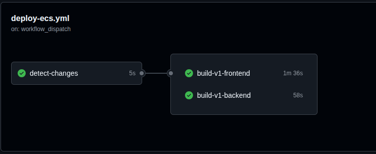

# GitHub Workflows (`.github/workflows`)

This directory houses our automated **CI/CD (Continuous Integration and Continuous Deployment)** pipelines. These workflows eliminate manual build errors by automatically packaging, testing, and shipping our applications whenever code changes.

We use two distinct pipeline strategies depending on our hosting phase: **AWS ECR (Docker Registry)** and **GitHub Container Registry (K8s/Istio GitOps)**.

---

## 1. AWS ECR Build Pipeline (`deploy-ecs.yml`)

> **Note on File Naming:** You may see this file named either `deploy-ecs.yml` or `deploy-ecs.yml.disabled`.
>
> - Changing the extension to `.disabled` tells GitHub Actions to ignore the file.
> - Keeping it as `.yml` keeps the pipeline active.

This pipeline automates building and pushing our **Version 1 (V1)** images consisting of a **Next.js frontend** and a **Flask backend** directly to **AWS ECR (Elastic Container Registry)**.

### Prerequisites & Setup

- The target ECR repositories (`rr-dev-frontend` and `rr-dev-backend`) must exist in your AWS account before this runs, or the push step will fail.
- Step-by-step instructions for provisioning ECR are located in [03-aws-ecr](https://github.com/ManunEbo/Terraform-AWS-Ritual-Roast-Part-2-Containerised/tree/main/infrastructure/03-aws-ecr).

### Pipeline Architecture

To optimize execution speed and reduce build costs, this workflow is split into three decoupled jobs:

1. **Detect Changes (`detect-changes`):** Runs first. It scans the incoming git commit. If changes are detected inside specific application directories, it flags them using boolean outputs.
2. **Build V1 Frontend (`build-v1-frontend`):** Runs _only_ if changes were detected in `apps/v1-frontend-nextjs`. It logs into AWS using secure, passwordless **OIDC IAM Roles**, builds the Docker image on a GitHub-hosted runner (Ubuntu container), and pushes it to ECR.
3. **Build V1 Backend (`build-v1-backend`):** Runs _only_ if changes are detected in `apps/v1-backend-flask`. It follows the exact same build-and-push sequence using a backend-specific IAM Role.

### Under the Hood: The Build Step

Here is a closer look at a step inside the `build-v1-frontend` job:

```yaml
- name: Build and Push Frontend
  env:
    ECR_REGISTRY: ${{ steps.login-ecr.outputs.registry }}
    ECR_REPOSITORY: rr-dev-frontend
    IMAGE_TAG: ${{ github.sha }}
  working-directory: ./apps/v1-frontend-nextjs
  run: |
    docker build -t $ECR_REGISTRY/$ECR_REPOSITORY:latest -t $ECR_REGISTRY/$ECR_REPOSITORY:$IMAGE_TAG .
    docker push $ECR_REGISTRY/$ECR_REPOSITORY --all-tags
```

#### What this does:

1. **Builds the Docker image** and applies two distinct tags:
   - `:latest` for standard deployments.
   - `:$IMAGE_TAG` (which uses `${{ github.sha }}`, the unique 40-character Git commit hash) for precise, version-controlled tracking.
2. **Pushes both tags** to our private AWS ECR registry.

### Pipeline Triggers

This pipeline is configured to fire on two distinct events:

```yaml
on:
  push:
    branches: ["main"]
    paths:
      - "apps/v1-frontend-nextjs/**"
      - "apps/v1-backend-flask/**"
  workflow_dispatch:
```

1. **Automatic Push Trigger:** Triggers a run automatically when a developer pushes changes to the `main` branch, but _only_ if those changes occur inside the specified application paths.
2. **Manual Trigger (`workflow_dispatch`):** Allows team members to manually trigger a redeployment UI button directly from the GitHub Actions tab.


<!-- [Build and push to ECR](https://github.com/ManunEbo/Terraform-AWS-Ritual-Roast-Part-2-Containerised/blob/main/.github/workflows/images/ecs-workflow.png) -->

<!--  -->

## 2. Kubernetes & Istio GitOps Pipeline (`deploy-ghcr-k8s.yml`)

This pipeline represents our production-grade upgrade. Instead of just pushing container images, this workflow manages a fully automated **GitOps deployment loop** targeting a **Kubernetes (EKS)** cluster running an **Istio Service Mesh**.

### Key Architectural Concepts

#### Concurrency Locks

When pushing updates to Git, we must prevent multiple runner environments from writing to the same files at the same time. We implement a concurrency lock at the top of the file:

```yaml
concurrency:
  group: update-manifests
  cancel-in-progress: false
```

- This ensures that only **one** runner can update our deployment manifests at a time.
- Setting `cancel-in-progress: false` guarantees that older commits are queued and completed sequentially rather than aborted mid-deployment.

#### Parallel Multi-App Builds

We build four microservices in parallel across independent runner containers:

- **V1 Stack:** Next.js Frontend & Flask Backend (Stable Track)
- **V2 Stack:** Vite Frontend & Go Backend (Canary Track)

Each build logs into **GHCR (GitHub Container Registry)** using the automatic `${{ secrets.GITHUB_TOKEN }}`, builds the image, converts the image namespace to lowercase (a GHCR requirement), and tags/pushes the build with both `:latest` and the unique commit `${{ github.sha }}`.

---

### The CD Step: Pinning Manifests with `yq`

Once the containers are safely pushed to GHCR, the pipeline updates our Kubernetes deployment files.

```yaml
- name: Install yq
  uses: mikefarah/yq@v4
```

> 💡 **What is `yq`?**
> Just like `jq` is used to parse and modify JSON files on the command line, **`yq` is a specialized command-line tool designed to parse, edit, and write YAML files**.
>
> Because Kubernetes configurations are written entirely in YAML, we use `yq` to programmatically open our manifest files, find the container image field, replace the old tag with our new Git commit SHA-1 tag, and save the file back down—all without disturbing the rest of the file's structure or comments.

```yaml
- name: Pin changed apps to the new SHA
  run: |
    set -euo pipefail
    OWNER=$(echo "${{ github.repository_owner }}" | tr '[:upper:]' '[:lower:]')
    REG="ghcr.io/${OWNER}"
    pin() {
      local file="$1" repo="$2"
      if [ -f "$file" ]; then
        yq -i ".spec.template.spec.containers[0].image = "${REG}/${repo}:${IMAGE_TAG}"" "$file"
        echo "Pinned $file -> ${REG}/${repo}:${IMAGE_TAG}"
      else
        echo "Skip (manifest absent): $file"
      fi
    }
    if [ "${{ needs.detect-changes.outputs.v1_frontend }}" = "true" ]; then
      pin "${MANIFEST_DIR}/v1-frontend-nextjs-deployment.yml" "rr-v1-frontend"
    fi
    # ... (Repeated logic for backend, v2_frontend, and v2_backend)
```

#### Why we must pin to SHA-1 (and not use `:latest`):

If we only configured our Kubernetes manifests to point to `:latest`, Kubernetes wouldn't know when a change occurred because the tag name `:latest` never changes.

Additionally, if we ever needed to **rollback** to a previous deployment, Kubernetes would look at the stable, unchanging tag `:latest` and be unable to distinguish the broken image from the working one.

By dynamically updating our YAML deployment manifest files with the unique **Git Commit SHA-1**, we guarantee:

1. **Immutability:** Each deployment points to one—and only one—exact snapshot of our code.
2. **Instant Rollbacks:** We can roll back our cluster to any historical commit instantly, as every version has a unique, permanent identifier.

### The GitOps Loop (ArgoCD)

Once the workflow updates the YAML deployment files, it commits them back to the GitHub `main` branch under the `github-actions[bot]` user.

Our Kubernetes cluster runs **ArgoCD**, which monitors our GitHub repository's manifest folders every 3 minutes. The moment ArgoCD notices that a manifest's `IMAGE_TAG` has changed on Git, it pulls the new image from GHCR and safely deploys it to the cluster.

---

## Summary of Benefits

| Feature                | AWS ECR Pipeline                         | K8s/GHCR Pipeline                             |
| :--------------------- | :--------------------------------------- | :-------------------------------------------- |
| **Primary Target**     | Docker Image Storage (AWS)               | Dynamic Kubernetes GitOps with ArgoCD         |
| **Build Optimization** | Path filtering (Only build what changed) | Path filtering (Only build what changed)      |
| **Build Speed**        | Sequential runner triggers               | Parallel runner containers                    |
| **Manifest Tracking**  | None (Registry storage only)             | Automated Git writebacks using `yq`           |
| **Rollback Safety**    | Manual ECR Image reversion               | Native K8s rolling update via exact Git SHA-1 |

---
