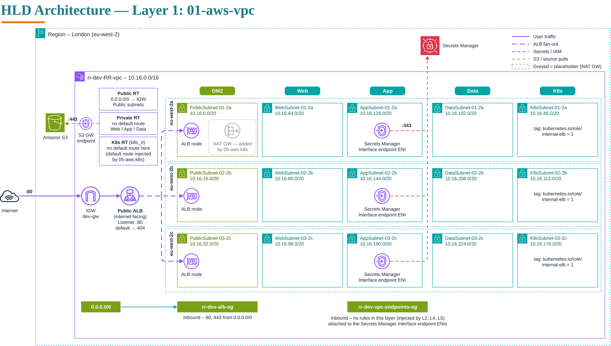

# Deploying the VPC

This is the base layer. Here we build the foundation for our infrastructure: the VPC, Subnets, the Loadbalancer, Security groups and VPC-Endpoints for Secrets Manager. Once this layer is up and running, other layers can then plugin, essentially attaching themselves to this layer, making use of the resources of this layer.

## What this layer builds

<a href="documents/hld-architecture/layer1-hld.png">
  
</a>

This layer spans three Availability Zones (AZs) across the AWS London region (`eu-west-2`).

**Key Highlights** Below are the main highlights based on the HLD above:

1. **5-Tier Subnet Isolation** - Segregates infrastructure into distinct, dedicated tiers per AZ:
   - **DMZ (Public)** - Houses the internet-facing application LoadBalancer (ALB).
   - **Web** - Private subnets reserved for frontend web services.
   - **App** - Private subnets hosting VPC interface endpoints for secure AWS service access e.g. Secrets Manager.
   - **Data** - Isolated subnets dedicated strictly to database resources.
   - **K8s** - Decicated subnets pre-tagged for internal EKS/Kubernetes LoadBalancers

2. **Secure Edge Routing** - Public internet traffic enters through an Internet Gateway (`IGW`) directly into the public ALB, keeping all downstream application and database tiers off the public web.

3. **Private AWS Service Connectivity** - Includes a VPC S3 Gateway Endpoint and Secrets Manager Interface Endpoints, allowing workloads to access AWS services privately without routing through the public internet.

4. **Default Egress Protection** - Private subnets are completely isolated from outward internet routing by default, preparing the network for downstream layers to manage NAT egress securely.

| Module                    | Creates                                                                                                                |
| ------------------------- | ---------------------------------------------------------------------------------------------------------------------- |
| `modules/vpc`             | The VPC itself, 15 subnets (five tiers across three availability zones), three route tables, and the internet gateway. |
| `modules/security_groups` | Two security group "shells" — one for the shared load balancer, one an empty base that later layers add rules into.    |
| `modules/load_balancers`  | The one public Application Load Balancer every later layer shares, with a deliberately minimal catch-all listener.     |
| `modules/endpoints`       | A private, in-VPC network path to AWS Secrets Manager, so credential lookups never have to leave the VPC.              |

# Introduction to Terraform

Before we get deep into the Terraform code, lets explain a few foundational concepts of Terraform that will prepare us for the deep dive in `infrastructure/`:

## 1. A layered approach

A layered infrastructure architecture decouples foundation, data, image registry, compute, and service mesh tiers into independent, modular building blocks. Think of a layered project structure like building a house with **modular LEGO blocks** rather than pouring a single, solid block of concrete.

**Key advantages of a Layered Architecture**

1. **Modular Stacking and Unstacking** - Downstream layers (Layer 4 & 5) consume outputs like subnet IDs or database connection strings from upstream layers (Layer 1 & 2) without modifying them. This makes swapping out major components such as replacing Layer 4 (ECS) with Layer 5 (Kubernetes) as simple as destroying or adding a single layer while leaving core network and database foundations untouched. The new layer simply attaches or plugs in.

   **The simplified explanation** - Because each layer sits neatly on top of the one beneath it, metaphorically, it gives us the flexibility to build, replace or swap an upper floor without tearing down the lower levels. For example, moving the application from AWS ECS (Layer 4) to Kubernetes (Layer 5) was straight forward because the core network (Layer 1) and the database (Layer 2) stayed right where they were.

2. **Blast radius isolation (Fire doors for mistakes)** - Infrastructure failure or accidental terraform destroys are contained within their specific layer. A misconfiguration while updating Kubernetes workloads (Layer 5) cannot corrupt our persistent MySQL database (Layer 2) or wipe out our VPC routes (Layer 1)

   **The simplified explanation** - If something goes wrong, like accidental deletion or a typo in an application update, the damage is strictly contained within that single room. A mistake on the top floor cannot accidentaly burn down the house, wipe out our database, or knock out our core network setup.

3. **Decoupled deployment lifecycles (Changing lightbulbs vs. rewiring the house)** - Low-level infrastructure (VPCs, subnets, database clusters) changes infrequently, whereas application compute layers deploy daily. Separating state files ensures we never risk modifying core network primitives during routine application updates.

   **The simplified explanation** - Core networks and databases rarely change once built but application code changes every single day. Keeping them separate means developers can make daily tweaks to the app without touching or risking the heavy plumbing underneath.

4. **Tailored security keys** - We operate under the **Principle of Least Privileges**: Entities within each layer only get the specific credentials necessary to complete their tasks e.g. GitHub Actions workflows only get credentials to drop off container images in the ECR registry (Layer 3), but it never gets credentials to retrieve secrets from Secrets Manager containing our database passwords (Layer 2).

5. **Working with 5 small sub-directories instead of 1 giant master directory** - Instead of opening a massive, messy directory every time we want to make a tiny change, each layer is structured for specific intent. This keeps updates fast, eliminates guesswork, and makes fixing bugs vastly simpler.

## 2. Moduler setup

A Terraform deployment consists of many groups of resources interconnecting to construct the deployment. It is best practice to organise these resources in a structure that isolates one specific group from another i.e. we don't want to mix up the creation of networking resources such as VPC, subnets and route tables with the creation of the database, lambda functions, security groups etc, these are best kept separate. This simplifies finding resources and making the codebase easy for others to pick up.

We define such a separation of concern as a module. A module should have the following essential files:

1. **variables.tf** - This file defines the variables and their formats that will be used in this module. The variables can also take inputs passed in from other modules via the root module. This is how modules share variables.
2. **outputs.tf** - This file defines the variables that this modules is sharing with the other modules. The root module can pull this and pass it on.

Other than these essentials, the module will have files that uniquely define specific resources that will be referenced in the outputs.tf i.e. shared with other modules. **Such files are the whole point of having modules**. There maybe several modules in a project, each one focusing on a specific required task.

## 3. Configuring the environment (The management module)

In a layered infrastructure setup a directory like `01-aws-vpc/environments/dev` acts as the **Control center for our development environment**. Metaphorically, if our Terraform modules are the generic templates for building a house, then the `dev` folder is the specific work order detailing exactly how to build the **"testing"** version of that house. The following is a list of responsibilities for the environment directory:

1. **Setting environment specific variables (The dials)** - The underlying modules like the Layer 1 `vpc` module are written to be reusable i.e. environment agnostic; they don't know if they are being built for production or testing. The `dev` folder contains the specific configuration files such as `variables.tf` that define the variables and their formats that will be used in this specific environment e.g. instance size, network CIDR range etc. When we run `terraform apply` on the `dev` environment, Terraform will pass the values from `dev` environment to the modules and deploy the architecture. In cases where there is identical `prod` or `staging` sub directories next to the `dev`, we can easily pass different values to corresponding variables in such environments and deploy all three environments simultaneously.

2. **Terraform lock file `.terraform.lock.hcl`** - This is the **Provider Dependency Lock file**. When we write Terraform code, we rely on external plugins called "providers", like the AWS provider to talk to AWS. These plugins are version controlled. When we run `terraform init` for the first time, Terraform downloads those providers. It then creates the `.terraform.lock.hcl` file, recording the **exact version numbers** and **cryptographic hashes**, unique digital fingerprints, of the downloaded plugins. On any future runs, Terraform reads this lock file and forces our system to use those exact versions, even if AWS or HashiCorp released a newer version overnight. **Note, this lock file contains no sensitive data thus it can be stored in our Git repository.**

   **What are we using it for?**
   - **Guaranteed consistency** - It solves the _"it works on my machine"_ problem. By committing it to Git, we guarantee that our local laptop, our co-worker's laptop and our automated GitHub Actions CI/CD pipeline are all using the exact same version of the AWS provider.

   - **Preventing unexpected breakages** - If the AWS provider releases a major update with breaking changes, our infrastructure won't suddenly fail to deploy, because the lock file pins us to the older, **known-working**, version until we explicitly run `terraform init -upgrade`.

   - **Security** - Because it stores cryptographic hashes, Terraform will block the deployment if it detects that the provider code was tampered with maliciously.

3. **Terraform state lock file `terraform.state.lock`** - This is a temporary safety mechanism that prevents any two entities (people and or processes) from modifying the same infrastructure state file at the exact same time.

   **How does it work**
   - **Lock acquisition** - Whenever we execute a command that reads or modifies state such as `terraform plan`, `terraform apply`, or `terraform destroy`, Terraform automatically attempts to create a lock before making any changes.

   - **Recording lock info** - It creates a temporary record containing details about the current operation: A unique **Lock ID**; the user or system running the command e.g. our local username or GitHub Actions runner; the timestamp when the operation started; the operation type e.g. `OperationTypeApply`.

   - **Blocking concurrent runs** - If another engineer or CI/CD pipeline tries to run `terraform apply` on that same layer while the lock is active, Terraform reads the lock, stops immediately, and displays an error showing who is currently holding the lock.

   - **Lock release** - Once the command completes successfully or fails safely, Terraform deletes the lock record, allowing the next queued operation to run.

   **How are we using it**
   - **Preventing state file corruption** - If two entities such as a developer and GitHub Actions ran `terraform apply` on Layer 1 at the same time, both would try to write to the same AWS S3 state file simultaneously, resulting in a corrupted, unusable state file.

   - **Enforcing order in CI/CD** - This file ensures automated pipelines and team members wait their turn, preserving a single, consistent sequence of changes.

   - **Auditability and debugging** - If a deployment is stuck or blocked, the state lock error provides immediate visibility into who holds the lock, on what machine, and when the operation started, making it easy to identify stale or hanging deployments.

4. **State file isolation** - Terraform tracks everything it builds in a state file. **It's Terraform's single source of truth**, a JSON file that maps our declarative code to real-world cloud resources.

   **How does it work?**
   - **Resource mapping** - When we declare `resource "aws_vpc" "main"`, Terraform provisions it in AWS, gets back an ID like `vpc-0a1b2c3d4e` and records that mapping in the state file.
   - **Metadata & attribute tracking** - It stores the exact live attributes of our managed infrastructure; IP addresses, Amazon resource names (ARNs), route tables, and secrets.
   - **Drift detection** - Whenever we run `terraform plan` or `terraform apply`, Terraform performs a three-way comparison between:
     - our local `.tf` code, what we want.

     - The `.tfstate` file, what Terraform thinks exists.

     - The real cloud environment, what actually exists in AWS.

   - **Storing the state file** - There are several options when it comes to storing the `terraform.tfstate` file:
     - **Local storage** - Here we save the file directly in our project folder. This is problematic for team environments as it risks file loss, concurrent overwritten changes, and exposes secrets in plain text on our laptop.

     - **Remote backends (Recommended)** - There are a few options here:
       - **AWS S3 bucket** a central encrypted object storage, standard for AWS architectures, this is what we're using
       - **Terraform Cloud / HashiCorp Cloud Platform (HCP)**, managed state handling, access controls, and policy enforcement
       - **Azure blob Storage / Google Cloud Storage (GCS)**, these are object storage equivalents for Azure and GCP environments respectively
       - **HTTP / GitLab / GitHub State Storage**, API-based remote state management from GitHub

   - **Comparing the files** - These three files manage completely different aspects of Terraform stability and safety:
     - **`terraform.lock.hcl`** - ensures everyone uses the exact same plugin binaries to build the code
     - **`terraform.state.lock`** - blocks multiple engineers or CI/CD pipelines from modifying the state file simultaneously.
     - **`terraform.tfstate`** - records the final result of those builds once the lock releases.
   - **How are we using the state file**
     - **Decoupled layer states** - In this multi-layered architecture, Layer 1 - Layer 5, every layer maintains its own isolated state file in AWS S3 e.g. `dev/layer1-vpc/terraform.tfstate`. This isolates blast radius so an apply in Layer 5 never risks corrupting Layer 1.

     - **Secure remote storage & team collaboration** - Storing state files in an encrypted AWS S3 bucket keeps sensitive infrastructure data off local machines while allowing developers and GitHub Actions to share a single ground truth.

5. **The execution point** - This is the directory where we actually run our commands (`terraform init`, `terraform plan`, `terraform apply`). The code inside this folder pulls in the generic layers we built (Layer 1, Layer 2 etc), injects the `dev` variables into them, reads the `dev` remote state, and orchestrates the actual deployment to AWS.

Note, these multiple environments; `dev`, `staging`, `prod`; exist as separate directories, their configuration are applied directly to the modules within that layer. **That makes the code base flexible such that we can deploy the same code in all environments simultaneously**, the difference being the values we pass to them, which could dramatically change the outcome.

## The root module

Since we're using a layered approach, each layer consists of a root module, which is under the corresponding `environments/dev/` subdirectory, this is essentially the management module for the environment. The root module will also have the same essential files above in additions to **main.tf**. This file defines all corresponding modules in the layer and passes values as input parameters to the module being defined.

## Variable precedence in Terraform

Terraform evaluates variables in a strict hierarchy where sources loaded **later** override values set by **earlier** sources i.e. **Terraform's internal loading pipeline** during execution loads values in the order of precedence, replacing values previously set by lower priority sources with the higher priority sourced values.

**Variable precedence hierarchy, Lowest to Highest**

1. **Variable block defaults (Lowest priority)** - The default value declared directly within the `variable "x" {default = "value"}` block in `.tf` files. This acts as a safe fallback if no other value source is provided.
2. **Environment variables `TF_VAR_name`** - These values are passed in via the command line prefixed with `TF_VAR`, Terraform looks for such values. They are useful for injecting non-committed settings or sensitive credentials into local shell sessions or build agents without modifying disk files.
3. **`terraform.tfvars` / `terraform.tfvars.json`** - These are standard key value pairs assignment files automatically recognized and loaded by Terraform when present in the root module directory. It serves as the primary configuration file for environment-specific variables.
4. **`*.auto.tfvars` / `*.auto.tfvars.json`** - Automatically loaded variable files processed in alphabetical order by filename e.g. `a.auto.tfvars` is processed before `b.auto.tfvars`. This is useful when splitting large variable lists into logical, self-contained files e.g. `01-network.auto.tfvars`, `02-database.auto.tfvars` while overriding base `terraform.tfvars` values.
5. **`-var` and `-var-file` command-line flags (Highest priority)** - These are values passed into Terraform directly from the CLI at runtime e.g. `terraform plan -var="environment=dev"` or `-var-file="override.tfvars"`. If multiple `-var` or `-var-file` flags are supplied, Terraform processes them in the exact order they appear on the command line. This is used for immediate, high priority overrides, ad-hoc testing, or dynamic parameter injection in automated CI/CD pipelines.

**Why the precedence is structured in this order**

The precedence order is built around the principle of explicit intent and locality:

1. **From static defaults to dynamic overrides** - Baseline defaults hardcoded in module definitions `default =...` represent broad assumptions. As we move up the hierarchy towards runtime command line flags `-var`, the input source becomes more localized and explicitly intended for that specific deployment execution.

2. **Separation of code and configuration** - By placing file based configuration `.tfvars` above environment settings `TF_VAR_...`, Terraform ensures project specific, committed configuration files take precedence over lingering shell environment variables.

3. **Granular automation control** - Giving command line options `-var`/`-var-file` ultimate priority allows human operators and CI/CD pipelines to temporarily force specific behaviour without dirtying committed project files or modifying persistent environment variables.

## Data sources

A data source in Terraform is a read-only query that fetches real time information directly from an external source or cloud provider without creating, modifying, or managing that resource.

**How data sources work**

1.  **Declaration** - We declare a `data` block to tell Terraform what to look for, **resource type** and how to find it, using **`filters` like `tag: Name`, or `ID`**

    Here's an example:

    ```hcl
    data "aws_vpc" "main" {
    filter {
       name   = "tag:Name"
       values = ["rr-dev-RR-vpc"]
    }
    }
    ```

    Here we're looking for a `aws_vpc` resource type filtering by tags and the matching value is `"rr-dev-RR-vpc"`. This will return all matching values. `"main"` is the name we're attaching to this data source for referencing the returned resource.

2.  **API query** - When Terraform runs, it makes a direct API call to AWS using those filters.
3.  **Attribute exposure** - AWS responds with the live resource's details and Terraform makes those attributes available to the rest of our configuration using the syntax `data.<TYPE>.<NAME>.<ATTRIBUTE>` e.g. `data.aws_vpc.main.id` or `data.aws_vpc.main.cidr_block`.

**Advantages over other methods**

Compared to hardcoding values or using **state-coupling mechanisms** like `terraform_remote_state` which requires knowing the exact S3 bucket path and exact output variable names:

1. **Complete layer decoupling (vs `terraform_remote_state`)** - Downstream layers don't need access to upstream layer S3 state files, nor do they care how upstream layers named their output variables. They only care about what actually exists in AWS.
2. **Eliminates hardcoding (vs. manual input variables)** - We never have to manually copy and paste dynamic AWS IDs, like `vpc-0a1b2c3d` or subnet IDs, into our `terraform.tfvars` file across environments.
3. **Live ground truth** - Data sources evaluate the live AWS environment at runtime, ensuring our configurations operate against current infrastructure state rather than stale state files.
4. **Refactoring resilience** - We can completely restructure or rewrite Layer 1's code from scratch, as long as the deployed VPC retains its expected tag in AWS, Layer 2 will continue to discover it without breaking.
5. **Granular security** - Downstream environments only require standard AWS read permissions `ec2:DescribeVpcs` rather than elevated read access to S3 backend buckets containing sensitive state data.

**How are we using data sources**

In the Ritual Roast architecture, data sources serve as the **glue between isolated layers**. they enable us to make use of resources created in upstream layers in flexible dynamic ways. Below are some example use cases:

1. **Network discovery** - Layer 2 (RDS), Layer 4 (ECS) and Layer 5 (K3s) use `data "aws_vpc"` and `data "aws_subnets"` to discover Layer 1's VPC ID and private subnet tiers dynamically based on environment tags.
2. **Container image lookups** - Layer 4 and use `data "aws_ecr_repository"` to retrieve registry URLs created in Layer 3 (ECR) for container deployment with ECS.
3. **Secret & config management** - Downstream layers use `data "aws_secretsmanager_secret_version"` to read runtime/latest database credentials generated in upstream layers without passing sensitive plain-text strings through code.

# Environment configuration files

Since the `01-aws-vpc/environments/dev` is the subdirectory that holds all the configuration for this layer lets look at some of the important settings and the role they play in this layer.

## a. [providers.tf](https://github.com/ManunEbo/Terraform-AWS-Ritual-Roast-Part-2-Containerised/blob/main/infrastructure/01-aws-vpc/environments/dev/providers.tf):

**`required_version = "1.14.3"`** - This defines which terraform version we're using with ensuring reproducability i.e. when you clone this repo you will need this version of Terraform or upgrade/downgrade to it to ensure everything works as expected.

**S3 Backend**:

```hcl
backend "s3" {
  bucket       = "rr-capstone-5b160b287a99a6d9"
  key          = "dev/vpc/state/terraform.tfstate"
  region       = "eu-west-2"
  encrypt      = true
  use_lockfile = true
  }
```

Yet another crucially important component. This specifies the name of the bucket that's storing our state and lock file, **`rr-capstone-5b160b287a99a6d9`** and the specific file path within **`key = "dev/vpc/state/terraform.tfstate"`**. Note every layer key (file path) starts with `"dev/../state/terraform.tfstate`, so the value we substitute in for `..` differentiates the different layers backend i.e. all layers store their backend in S3 under `"dev/..."`.

**`required_providers {...}`**

```hcl
aws = {
  source  = "hashicorp/aws"
  version = "~> 6.38.0"
}
```

Here we specify the provider plugins that we need, pinned to the required version, essentially loading the Terraform AWS module. This is how Terraform understands AWS resources and how to call them.
The source is the publisher of this plugin. Other plugins in this file include `"hashicorp/random"` and `"hashicorp/time"`.

**Configure AWS provider**

```hcl
provider "aws" {
  region = "eu-west-2"
}
```

Here we configure the AWS provider plugin and set the region that our deployment will be operating in. This is important as some resources might be region specific e.g. in `us-east` there are 6 AZs instead of the usual 3, code that doesn't account for this might deploy insufficient resources or break, in the case of loops and counts.

## b. [main.tf](https://github.com/ManunEbo/Terraform-AWS-Ritual-Roast-Part-2-Containerised/blob/main/infrastructure/01-aws-vpc/environments/dev/main.tf):

Since this layer is the base, there's no data sources used to import resource by their IDs from another layer. All parameters and their values are pulled in from variables.tf linked to terraform.tfvars and or directly from shared_locals.tf

```hcl
module "vpc" {
  source      = "../../modules/vpc"
  common_tags = local.common_tags

  vpc_name    = var.vpc_name
  environment = var.environment
  aws_region  = var.aws_region
  vpc_cidr    = var.vpc_cidr

  public_subnet_list   = var.public_subnet_list
  web_subnet_list      = var.web_subnet_list
  app_subnet_list      = var.app_subnet_list
  database_subnet_list = var.database_subnet_list
  k8s_subnet_list      = var.k8s_subnet_list
}

```

The example above shows how we pass parameter values as inputs to the `vpc module`. In the `vpc module` these variables and the values will be mapped to a variable defined in the corresponding `variables.tf` of the `vpc module`. Then that specific variable can be used throughout the module as if it originated locally.

Any values starting with `local.` is coming from `shared_locals.tf` . Any values starting with `var.` is coming from `variables.tf`, however, due to the variable precedence that value might be coming from an environment variable or from `terraform.tfvars`, for example all the subnets data is coming from `terraform.tfvars` file.

`source = "../../modules/vpc"` specifies the module path for the vpc module. Note the `../../` means change directory back 2 parent directories.

### Dependency graph:

Terraform likes to do things in parallel, however, it's clever enough to know that when deploying project resources there can be relationships/dependencies between the resources. Instead of following a top-to-bottom execution process during a `tf plan` or `tf apply`, Terraform checks every file and maps out all the relationships (builds the dependency graph, [graph.svg](https://github.com/ManunEbo/Terraform-AWS-Ritual-Roast-Part-2-Containerised/blob/main/infrastructure/01-aws-vpc/environments/dev/graph.svg) ). Then it sorts this into a topological execution order. If it finds any circular dependency, (A references B, B references A) then it throws an error. Thus dependencies are automatically detected when a module requires a resource that is created from another module. In such cases the dependency must exist, there fore created, first.

```hcl
module "endpoints" {
  source = "../../modules/endpoints"

  vpc_id          = module.vpc.vpc_id
  environment     = var.environment
  common_tags     = local.common_tags
  aws_region      = var.aws_region
  app_subnet_ids  = module.vpc.app_subnet_ids

  # THE CRITICAL LINK: This forces Terraform to build the SG before the Endpoint
  endpoints_sg_id = module.security_groups.endpoints_sg_id
}

```

Above the endpoints module needs the endpoints security group `endpoints_sg_id = module.security_groups.endpoints_sg_id` there fore that security group needs to be create before the endpoints module resources. When the dependency relationships are not so clear, we can specify the dependency with `depends_on` argument; In layer 5 main.tf, we have such an example where the **compute_k8s** module depends on the **network_k8s** module `depends_on = [ module.network_k8s ]`.

## c. [share_locals.tf](https://github.com/ManunEbo/Terraform-AWS-Ritual-Roast-Part-2-Containerised/blob/main/infrastructure/01-aws-vpc/environments/dev/shared_locals.tf):

locals is another flexible way to create variables and assign values to them. Locals are module scoped object (immutable and static, at the point of call) variables that can take the form of lists, maps and single variable. Their values can't be set by .tfvars nor values from the cli. They can only be set by module specific internal, computed/derived values; any externally derived values must be passed through a variable and the variable can then be assigned to the locals. Locals are referenced using `local.<name>` i.e. we drop the s in local(s).

```hcl
locals {
  Project        = "ritual-roast-ECS"
  Project_owner  = "Elvy ManunEbo"
  Terraform      = "true"
  Environment    = var.environment
  Region         = var.aws_region
  aws_account_id = data.aws_caller_identity.current.account_id
  s3_bucket      = "rr-capstone-5b160b287a99a6d9"
}

locals {
  common_tags = {
    Project       = local.Project
    Project_owner = local.Project_owner
    Terraform     = local.Terraform
    Environment   = local.Environment
    Region        = local.Region
  }
}
```

Above, the first locals comprises 7 individual key value pairs, locals. The second locals selectively pulls five individual locals from the prior and forms a locals object called `common_tags`, a map which will be applied as labels to all if not most resources of this project, see example below:

```hcl
resource "aws_lb" "rr_public" {
  name               = "rr-${var.environment}-public-alb"
  internal           = false
  load_balancer_type = "application"
  security_groups    = [var.public_alb_sg_id]
  subnets            = var.public_subnet_ids

  tags = merge(var.common_tags, {
    Name = "rr-${var.vpc_name}-public-alb"
  })
}

```

This is how we defined our ALB: the tags section, labels, is a merge between the `Name` and the `common_tags` defined above in `shared_locals.tf` but since this is in the **alb module** where it's passed in as a variable, it's referenced as `var.common_tags`. This is how we make use of locals. As can be seen, we can reference the locals values individually, hence they can be passed into variables in `variables.tf` so long as the actual file holding the locals (`shared_locals.tf` in our case) is within the same module.

## d. [terraform.tfvars](https://github.com/ManunEbo/Terraform-AWS-Ritual-Roast-Part-2-Containerised/blob/main/infrastructure/01-aws-vpc/environments/dev/terraform.tfvars):

To better understand the use of `.tfvars` it's useful to understand the variable precedence in Terraform: Terraform resolves variable values from multiple possible sources, and when the same variable is set in more than one place, the highest priority source wins. The precedence from lowest to highest:

1. Default value in the variable block (lowest priority)

```hcl
variable "environment" {
  default = "dev"
}
```

2. Environment variables ( "TF_VAR\_<variable-name>" )

```hcl
export TF_VAR_environmenstaging
```

3. terraform.tfvars file (if present in the working directory)

4. terraform.tfvars.json file (if present — same precedence tier as #3, but .json is processed after .tfvars if both somehow exist)

5. _.auto.tfvars / _.auto.tfvars.json files, loaded in alphabetical order by filename (so a.auto.tfvars is overridden by z.auto.tfvars if both set the same variable)

6. -var and -var-file flags on the CLI, in the order they appear on the command line — and critically, later flags on the same command override earlier ones, including overriding an earlier -var-file with a later -var

```hcl
terraform apply -var-file="prod.tfvars" -var="environment=hotfix"
```

7. (Highest) Explicit input in a parent module's module block, when a variable is being passed into a child module

```hcl
module "layer4" {
  source = "../layer4"
  environment = "prod"    # This always wins inside layer4's scope
}
```

Now that we know the variable precedence lets look at our terraform.tfvars file. This file contains lists of map objects of all subnets, consisting of `subnete_name`, `cidr`, and `az`. The example below shows the public subnets:

```hcl
public_subnet_list = [
  {
    subnet_name = "PublicSubnet-01-2a"
    cidr        = "10.16.0.0/20"
    az          = "eu-west-2a"
  },
  {
    subnet_name = "PublicSubnet-02-2b"
    cidr        = "10.16.16.0/20"
    az          = "eu-west-2b"
  },
  {
    subnet_name = "PublicSubnet-03-2c"
    cidr        = "10.16.32.0/20"
    az          = "eu-west-2c"
  }
]
```

The all objects in terraform.tfvars must have a matching name in variables.tf for their values to be passed onto the variable. If there's no match the `.tfvars` value is ignored.

## e. [variables.tf](https://github.com/ManunEbo/Terraform-AWS-Ritual-Roast-Part-2-Containerised/blob/main/infrastructure/01-aws-vpc/environments/dev/variables.tfvars):

This file contains all the variable definitions for the respective scope, in this case the layer root module. Since the corresponding `terraform.tfvars` file has created lists of maps (key value pairs) the corresponding objects in `variables.tf` must also match the type else terraform will throw an error, see example below:

```hcl
variable "public_subnet_list" {
  type = list(object({
    subnet_name = string
    cidr        = string
    az          = string
  }))
}
```

As can be seen above we have the variable definition for `public_subnet_list` this determins what we should expect as input values for the variable. Notice the object type is list(object({})), the `{}` references a map object and its inner most member objects are strings with the same key names as in the `terraform.tfvars` file.

We could also have just a string variable and pass a default value to it.

```hcl
variable "vpc_name" {
  type    = string
  default = "RR-vpc"
}
```

Above this is how the VPC name is defined, with a default value of `RR-vpc`, if no value is set using higher priority source then the default value will be used.

## f. [outputs.tf](https://github.com/ManunEbo/Terraform-AWS-Ritual-Roast-Part-2-Containerised/blob/main/infrastructure/01-aws-vpc/environments/dev/outputs.tf):

For resources created in one module to be consumed by other modules those resources need to be shared with other modules. A module shares its resources by outputing the resource name/ID. This is how the root module main.tf is able to pass resource IDs from one child module into another child module:

**How root module main.tf shares resource ids from one child module to another**

```hcl
module "alb" {
  source = "../../modules/load_balancers"

  vpc_id = module.vpc.vpc_id
  vpc_name = var.vpc_name
  common_tags = local.common_tags
  environment = var.environment
  public_subnet_ids = module.vpc.public_subnet_ids
  public_alb_sg_id = module.security_groups.alb_sg_id
}
```

The example above is from the `01-aws-vpc/environments/dev/main.tf`, it illustrates how the `alb module` retrieves all the public subnets ids:
`public_subnet_ids = module.vpc.public_subnet_ids`
They are created in the vpc module. It also retrieves its own security group id:
` public_alb_sg_id = module.security_groups.alb_sg_id`
which is created in the security_groups module. Thus for these values to be available both the `vpc` module and the `security_group` have to share them via their respective outputs:

**Extracted from vpc module outputs.tf**

```hcl
output "public_subnet_ids" {
  description = "IDs of the public edge subnets"
  value       = aws_subnet.public[*].id
}
```

**Extracted from security_groups module outputs.tf**

```hcl
output "alb_sg_id" {
  description = "The Public edge load balancer security identifier"
  value       = aws_security_group.rr_alb.id
}
```

then the root module picks it up and passes it into the child module as a variable, this is what we've seen above.

To make resources created inside this base layer available in other layers, one method is to do the exact same thing but at root module level. The root module has its own `outputs.tf` file that exports the contents as the root modules own top level outputs. The contents of this file is read by the `terraform_remote_state`, it essentially prints this information in the state file. Other layers can then query this information. Note, `terraform_remote_state` only makes visible the root module outputs, there's no visibility on the child modules such as vpc. Thus every value another layer needs to consume via remote state has to be explicitly outputed by both the child module and the root module, for it to appear in the state file. Note, this is not the cleanest method; the state file prints these values i.e. they are visible in the log. An alternative is to use **data source** directly. This is cleaner; leaves no log trail and only needs the tags to match the resource. In this project data sources is how cross-layer resource sharing is applied. This will be demonstrated later.

# 1. Virtual Private Cloud (VPC)

Consider is a private intranet closed off from the outside world i.e. the IP addresses of resources within the VPC are not routable on the internet; they cannot be found online and they cannot speak to the internet, by default. To enable internet access we use an Internet Gateway (`igw`) or a Network Address Translation (NAT) Gateway placed in tha subnet with access to the `igw`. Then we create a route table with a rule that sends all outgoing/egress traffic to the `igw` on a specific port. Equally, we can create an incoming/ingress rule that allows traffic on a specific port.

An important component of the VPC is the VPC CIDR block, this is the broad IP range of the entire VPC e.g. **10.16.0.0/16** results in 65,536 distinct IP addresses.
It is common practice to break this large network into smaller isolated chuncks.

## a. Subnets

Those smaller isolated chuncks are called subnets. Essentially they re-arrange the number of bits allocated to the network and the host portions of the CIDR block through an exchange called borrowing network bits. The more network bits borrowed the higher the number of networks and the lower the number host IP addresses. For a comprehensive derivation of the subnets used in this project please see the first project, [Terraform-AWS-Ritual-Roast-Part-1](https://github.com/ManunEbo/Terraform-AWS-Ritual-Roast-Part-1) section 6. 🚀 Technical Highlights, VPC and Subnetting. In this project we use 15 subnet groups, to isolate the various resources deployed, see network layouts below.

### The network layout

The VPC is carved into five tiers, each spread across three Availability Zones (`eu-west-2a` / `eu-west-2b` / `eu-west-2c`) for resilience against a single AZ failing:

| Tier         | AZ 2a            | AZ 2b            | AZ 2c            | What lives here                           |
| ------------ | ---------------- | ---------------- | ---------------- | ----------------------------------------- |
| **Public**   | `10.16.0.0/20`   | `10.16.16.0/20`  | `10.16.32.0/20`  | The shared ALB only                       |
| **Web**      | `10.16.64.0/20`  | `10.16.80.0/20`  | `10.16.96.0/20`  | Frontend containers (layer 4, ECS)        |
| **App**      | `10.16.128.0/20` | `10.16.144.0/20` | `10.16.160.0/20` | Backend containers + Lambda (layers 2, 4) |
| **Database** | `10.16.192.0/20` | `10.16.208.0/20` | `10.16.224.0/20` | RDS (layer 2)                             |
| **K8s**      | `10.16.48.0/20`  | `10.16.112.0/20` | `10.16.176.0/20` | K3s EC2 nodes (layer 5)                   |

Each `/20` gives 4,096 addresses per subnet, generous headroom for a project this size, carved out of the `/16` as contiguous, non-overlapping blocks so there's room to grow without re-plumbing anything later. Also AWS reserves 5 ip addresses. So in our first subnet (`10.16.0.0/20`), for example the following ip addresses are reserved:

| IP            | Reserved for                                                                                                          |
| ------------- | --------------------------------------------------------------------------------------------------------------------- |
| `10.16.0.0`   | Network address (standard, not usable)                                                                                |
| `10.16.0.1`   | Reserved by AWS for the VPC router                                                                                    |
| `10.16.0.2`   | Reserved by AWS for DNS (maps to the Amazon-provided DNS server, base of VPC CIDR + 2)                                |
| `10.16.0.3`   | Reserved by AWS for future use                                                                                        |
| `10.16.0.255` | Network broadcast address (standard, not usable — though AWS doesn't actually support broadcast, it's still reserved) |

The above applies to all other subnets.

Note, the **K8s** subnets consists of left over subnets from the original calculations; that's why they don't follow the additive property of +16 on the third number ("octate").

The K8s tier is tagged `kubernetes.io/role/internal-elb=1`, a label AWS's own Kubernetes cloud-controller looks for so it can automatically discover the right subnets if an internal Kubernetes-managed load balancer is ever created — a small detail, but one that has to be right before Kubernetes exists, since it's a property of the subnet, not something Kubernetes can add after the fact.

## b.Routing

In this section we create three route tables in [routing.tf](https://github.com/ManunEbo/Terraform-AWS-Ritual-Roast-Part-2-Containerised/blob/main/infrastructure/01-aws-vpc/modules/vpc/routing.tf):

1. **Public route table**

   ```hcl

   resource "aws_route_table" "public" { ... }
   resource "aws_route" "public_internet_access" {
     route_table_id         = aws_route_table.public.id
     destination_cidr_block = "0.0.0.0/0"
     gateway_id              = aws_internet_gateway.main.id
   }

   ```

   A route to the public internet is then added to this route table by adding `route_table_id  = aws_route_table.public.id` to the route:

   ```hcl

   resource "aws_route" "public_internet_access" {
     route_table_id         = aws_route_table.public.id
     destination_cidr_block = "0.0.0.0/0"
     gateway_id             = aws_internet_gateway.main.id
   }

   ```

   As can be seen above, we've specified `destination_cidr_block = "0.0.0.0/0"` which means any non-internal destination should be routed to our IGW, `gateway_id = aws_internet_gateway.main.id`. We then associate all public subnets to this route table, giving any resource placed in those subnets access to the internet. Note such resources are also exposed i.e. they will be reachable from the internet

   ```hcl

   resource "aws_route_table_association" "public_assoc" {
     count          = length(aws_subnet.public)
     subnet_id      = aws_subnet.public[count.index].id
     route_table_id = aws_route_table.public.id
   }

   ```

   Later on we can place a NAT gateway in any of these public subnet to enable egress internet access for our resources in private subnets.

2. **Private route table**
   There is a default route table that all subnets within a VPC are associated to, initially. Instead of using that table which would include the public subnets, we create a private route table and associate all the non-public subnets, with the exception of k8s subnets, to it. The process is exactly as above so no illustrations needed. Since there is no route to the internet, resources in these subnets will not have internet access. All our ECS resources will be deployed in these private subnets. Every AWS service they need (Secrets Manager, ECR, CloudWatch Logs, S3) is reachable through a private VPC endpoint instead which is both cheaper than a NAT gateway (no per-GB processing charge, no hourly charge) and more secure (traffic never transits the public internet at all, even privately).

3. **K8s route table**

   The Kubernetes cluster requires access to the internet because we are deploying Kubernetes on EC2 and we need internet access to perform several tasks:
   - Updates & Upgrades - Our EC2 instances will need to pull updates and upgrades from the internet.
   - Gitops with ArgoCD - When the cluster is up, it will need to pull images from ghcr.io and send metrics to grafana.

   If we placed the Kubernetes subnets on the private route table above, we'd have to add a NATGW to that private route table. That would violate the least privileges principle, giving internet access to resources that don't need it. Hence, increasing the attack surface by enabling any breached resource in any of the private subnets the means to communicate with external neferious website, sending them data. The more secure approach is to isolate the Kubernetes cluster with it's own route table that we can route to a NAT gateway, allowing egress only internet access.

## c. Security Groups

To achieve the network isolation we use security groups. While security groups attach to Elastic Network Interfaces (ENIs) they are used as access pass i.e. we can create a rule that says permit any resource that has the following security group id attached to perform tasks against resources that have this other security group id. Thus any resource that does not have the necessary security group would not be permitted to perform any actions against a target resource such as a database.Thus by assigning a specific security group to resources in a specific subnet, we can isolate ingress and egress communication with respect to that subnet. We can attach a security group at the front door of our VPC restricting and or permitting traffic from the internet to specific internal resources.

**Security groups: two shells, populated by later layers**

This layer creates exactly two security groups:

1. [sg-endpoints.tf](https://github.com/ManunEbo/Terraform-AWS-Ritual-Roast-Part-2-Containerised/blob/main/infrastructure/01-aws-vpc/modules/security_groups/sg-endpoints.tf)
   - **`rr_endpoints_sg`** — created with no rules, it exists purely as a stable, named target other layers can attach ingress rules to later, without this layer needing to know in advance what will need to reach it. This makes the security group flexible for future use.
   - The `create_before_destroy = true` lifecycle rule ensures that we create the replacement first then destroy the old one; that way replacing it doesn't leave a dependent VPC endpoint briefly orphaned.

2. [sg-loadbalancer.tf](https://github.com/ManunEbo/Terraform-AWS-Ritual-Roast-Part-2-Containerised/blob/main/infrastructure/01-aws-vpc/modules/security_groups/sg-loadbalancer.tf)
   - **`rr_alb`** — this is the load balancer's SG (frontdoor's security group), with ingress (inbound) rules for HTTP (port 80) and HTTPS (port 443). There's no egress rules specified here hence the AWS's default allow-all-outbound applies. Although this means the front door is open and any accepted traffic can go anywhere it isn't a security issue: In Layer 4 & 5, we have security groups that only accept ingress from this security group on specific ports. This channels that broad spectrum into a narrow stream, with intent.

## d. LoadBalancer

LoadBalancers perform a number of tasks: they can act as the front door and the traffic conductor, redirecting traffic to specific resources or they can distribute traffic to a group of resources based on some algorithm. That's just a few of its attributes. By placing the LoadBalancer in a public subnet, we can attach a security group that permits the LoadBalancer to communicate with specific resources in private subnets enabling website traffic from the internet to traverse our frontend, backend servers and the database. Note, however, there are costs involved with internet traffic on AWS in particular NAT gateways.

The public ALB: a deliberately empty front door, [alb-public.tf](https://github.com/ManunEbo/Terraform-AWS-Ritual-Roast-Part-2-Containerised/blob/main/infrastructure/01-aws-vpc/modules/load_balancers/alb-public.tf).

```hcl
resource "aws_lb" "rr_public" {
  name               = "rr-${var.environment}-public-alb"
  internal           = false
  load_balancer_type = "application"
  security_groups    = [var.public_alb_sg_id]
  subnets            = var.public_subnet_ids
}

resource "aws_lb_listener" "rr_public_http" {
  load_balancer_arn = aws_lb.rr_public.arn
  port     = "80"
  protocol = "HTTP"

  default_action {
    type = "fixed-response"
    fixed_response {
      content_type = "text/plain"
      message_body = "404: Service Not Found. Welcome to the Ritual Roast Gateway."
      status_code  = "404"
    }
  }
}
```

This is the single most important design decision in this layer: the ALB has **no target group and no routing rules of its own.** Its only listener is a port-80 HTTP listener whose default action is a hard-coded 404. Given the current setup, the ALB doesn't forward anything; it's a front door with no rooms behind it yet.
That's deliberate: rather than one layer owning the ALB and every other layer having to work around that ownership, this layer provides a neutral front door, and each layer that actually runs something (layer 4's ECS services, layer 5's K3s frontend nodes) creates its own target group and attaches its own listener rule directly onto this shared listener, at a distinct priority.

Because layer 4 (ECS) and layer 5 (Kubernetes) are never deployed at the same time in this project, their rules never actually compete. In additions, the wiring of the respective ALB listener in layers 4 & 5 sets a priority: 100 in Layer 4 and 10 in Layer 5. Should both layers be live at the same time, these priority levels means that Layer 5 listener will win. Thus the ALB will forward traffic to Layer 5 ensuring no competition between Layer 4 & 5.

The 404 default action means that if neither is deployed (say, mid-migration between them), a request to the ALB gets an honest "PAGE NOT FOUND" instead of hanging or erroring in a way that's hard to diagnose.

Note, in production HTTPS, port 443, is used for all communication, and the TLS certificate usually terminates here at the LoadBalancer i.e. encrypted traffic from the internet is decrypted at the LoadBalancer and continues forth into the VPC unencrypted. The load balancer's own security group already permits inbound HTTPS on 443, even though currently its only listener is plain HTTP(unencrypted) on 80:

```hcl
resource "aws_security_group_rule" "alb_allow_443_inbound" {
  type = "ingress"; from_port = 443; to_port = 443; protocol = "tcp"
  cidr_blocks = ["0.0.0.0/0"]
  security_group_id = aws_security_group.rr_alb.id
}
```

It is addressed/annotated that a HTTPS, port 443, is a must have for production. It also a placeholder for adding a TLS listener and an **AWS Certificate Manager (ACM)** certificate later, without needing a second change to the security group when that happens.

## e. VPC Endpoints

There are two types of VPC Endpoints used in this project:
**Gateway** This works by injecting a route into a route table; this is a routing trick instead of a real network presence. It's only available for S3 and DynamoDB.
Since route tables don't consume any Elastic Network Interfaces nor any per Availability zone (AZ) infrastructure, it's free (cheap) and ideal.
**Interface** This endpoint type is provided by Private Link: All AWS services that supports interface endpoints sit behind an AWS managed (private) NLB. This NLB facilitates exposure of the AWS services in the AWS internal backend VPC. Each of these services has a public dns endpoint that resolves to a public IP address. Without Private Link, reaching these services is a round trip, from our private subnets:

**NATGW → IGW → AWS Service public IP/DNS endpoint → Back**

That's the long way home. Private Link brings these services a lot closer; it enables us to consume these services as if they were within our VPC. When we provision an interface endpoint, Private Link does the following:

1. Places an ENI with a private IP in each specified subnet; this is the portal door to the service, living in our VPC
2. Sets up the plumbing behind the scene that connects the ENI to the actual service behind the AWS internal VPC NLB
3. Optionally, wires up private DNS (`private_dns_enabled = true`) such that the service public DNS name resolves to the ENI IP addresses instead i.e. localising a relatively remote service.

Thus a round trip involving the public internet becomes an internal dash across the AWS backend.

**Interface Endpoint for Secrets Manager**
In this Layer we only deploy an interface VPC Endpoint for Secrets Manager because that is the only endpoint resource that both Layer 4 and Layer 5 will use.

```hcl

resource "aws_vpc_endpoint" "rr_secretsmanager" {
  vpc_id              = var.vpc_id
  service_name        = "com.amazonaws.${var.aws_region}.secretsmanager"
  vpc_endpoint_type   = "Interface"
  security_group_ids  = [var.endpoints_sg_id]
  subnet_ids          = var.app_subnet_ids
  private_dns_enabled = true

  tags = merge(var.common_tags, {
    Name = "rr-${var.environment}-secrets-endpoint"
  })
}

```

Above it can be seen that the ENIs will be injected inside the App subnets, `subnet_ids = var.app_subnet_ids` . `private_dns_enabled = true` makes AWS's standard DNS name for Secrets Manager (`secretsmanager.eu-west-2.amazonaws.com`) resolve inside the VPC to this private endpoint, ENI's private IP, instead of a public IP. So the boto3 / AWS SDK calls in `apps/v1-backend-flask` and `apps/v2-backend-go` that fetch database credentials need zero code changes to use it; they just call the standard AWS API and the network quietly keeps the traffic private, resolving to the ENIs private IP address.
Note, this endpoint incurs hourly and per gigabyte costs in additions to the ENIs that need to be injected into the three app subnets.

# 2. Where this fits in the bigger picture

Every later layer depends on this layer and none of them can be usefully applied without it. The sequential deploy order that runs through this whole project — VPC, then RDS, then ECR, then ECS, then (after destroying ECR/ECS) Kubernetes — exists specifically because layers 2 onward all read this layer's subnet IDs, VPC ID, and security groups as inputs. See the root project documentation for the full five-layer sequence, and `infrastructure/04-aws-ecs/README.md` /
`infrastructure/05-aws-k8s/README.md` for how each of them attaches its own listener rule onto the one ALB this layer creates.

# 3. Instructions

Perform the following tasks to deploy Layer 1:

1. Create an S3 bucket in AWS that will house the state file, do this either on the AWS consol or on the cli.
2. Open `01-aws-vpc/environments/dev/providers.tf` and change the bucket name from `"rr-capstone-5b160b287a99a6d9"` to your new bucket name
3. If you're using a different region, change the provider region from `"eu-west-2"` to your desired region
4. Open `01-aws-vpc/environments/dev/shared_locals.tf` and change `Project_owner` , `s3_bucket` and add/modify/remove any other desired labels
5. Rename `terraform.tfvars.txt` to `terraform.tfvars`. If your desired region is not `eu-west-2` then open the file and change the respective `az`s values, else **Do NOT** change anything.
6. Open `01-aws-vpc/environments/dev/variables.tf` and if your desired region is different, update the default value for aws_region variable `default = "eu-west-2"` . If you want to change the VPC name, update the default value for vpc_name, `default = "RR-vpc"` to your desired value.
7. If on Linux change directory to the layer 1 dev directory `cd infrastructure/01-aws-vpc/environments/dev`
8. Create an alias for terraform `alias tf=terraform`, this is easier than writing out the long word
9. Initialize terraform: `tf init`
10. Run terraform plan: `tf plan` review the outputs and if you're happy proceed to the next command
11. Run terraform apply, with caution `tf apply`, or if you trusted the plan `tf apply -auto-approve`
12. Congrats, you've deployed your VPC.
