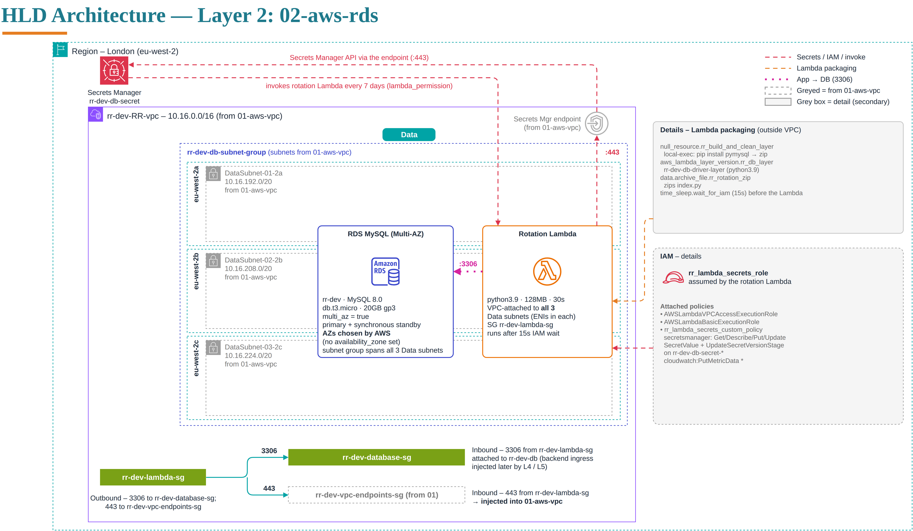

# Deploying RDS with Lambda Secret Rotation

In this layer we deploy the Relational Database Service (RDS) MySQL database along with the necessary setup to rotate the database secret with a Lambda function,
the IAM role that enables the Lambda function to carry out its tasks, and both the database and Lambda security groups to ensure restricted access.

<a href="documents/hld-architecture/layer2-hld.png">
  
</a>

Here we're provisioning the centralized, highly available database tier (**Amazon RDS MySQL**) within the isolated private data subnets, created back in Layer 1, integrated with automated zero downtime credential management.

**Key Highlights** - Below are the main highlights based on the HLD above:

1. **High-Availability Database Tier** - Deploys a Multi-AZ Amazon RDS MySQL instance across three private data subnets, providing synchronous replication and automatic failover.

2. **Automated Credential Rotation** - Integrates AWS Secrets Manager with an automated Python Lambda function to securely rotate database credentials every 7 days.

3. **Strict Private Network Isolation** - Database access (port 3306) is strictly confined within the VPC. Security groups isolate the database so it only accepts connections from authorized sources (the rotation Lambda and upcoming application backends).

4. **Secure In-VPC Secret Management** - The rotation Lambda communicates with AWS Secrets Manager entirely over private VPC Endpoints (`port 443`), preventing sensitive credential traffic from ever crossing the public internet.

Below are the highlights of each section.

## 1. Environment configuration

This is a modular setup identical to Layer 1: We have the environment that sets up the deployment configuration `02-aws-rds/environment/dev`. In [main.tf](https://github.com/ManunEbo/Terraform-AWS-Ritual-Roast-Part-2-Containerised/blob/main/infrastructure/02-aws-rds/environments/dev/main.tf) we have four child modules:

1. Security groups - Here we create the security groups for locking down the database and for the Lambda function
1. iam - Here we create the IAM role with the necessary policy attachments (permissions) for Lambda to perform all of its tasks
1. lambda - Here we create the Lambda function to rotate the secrets using the Lambda role
1. rds - Finally we create the database

### Dependency graph

The Security group module and the IAM module do not have any dependency thus they would most likely run in parallel. While the Lambda module needs the IAM role and the Lambda security group to exist beforehand, those are dependency requirements that must be met beforehand. The rds module needs the database security group and the Lambda function ARN to exist beforehand, that's the database dependency requirements; it must be met beforehand.

### Data sources

Data sources housed in [data.tf](https://github.com/ManunEbo/Terraform-AWS-Ritual-Roast-Part-2-Containerised/blob/main/infrastructure/02-aws-rds/environments/dev/data.tf) are used to pull resources created in Layer 1; VPC, and database subnets:

```hcl
data "aws_vpc" "rr_vpc" {
  tags = local.common_tags_vpc
  filter {
    name   = "tag:Name"
    values = ["rr-${var.environment}-*"]
  }
}

data "aws_subnets" "rr_db_subnets" {
  tags = local.common_tags_vpc
  filter {
    name   = "tag:Name"
    values = ["DataSubnet-*"]
  }
}
```

These data sources query the respective AWS resource, aws_vpc and aws_subnets, for all resource instances that match the filter criteria i.e. any "Name" tag that matches the `values` pattern is returned. Thus this returns an object which could be a map, a list or string or a combination of them all. Above `rr_vpc` resource will return a single object which has several attributes id, name, cidr etc. The `rr_db_subnets` resource will return a list object containing maps of database subnets with all of its attributes; subnet_name, cidr, az. From these resources, we can extract the specific desired resource attribute such as vpc.id and subnet.az .

The other two data sources are used to retrieve the account id of the current user and the region set by the current user. Note these are AWS parameters.

### providers.tf

The only change in providers is the backend key `key = "dev/rds/state/terraform.tfstate"` it now points to a different path, `"dev/rds"` instead of `"dev/vpc"`.

### variables.tf

The only notable elements of [variables.tf](https://github.com/ManunEbo/Terraform-AWS-Ritual-Roast-Part-2-Containerised/blob/main/infrastructure/02-aws-rds/environments/dev/variables.tf) is the two database credentials:

```hcl
variable "db_username" {
  type      = string
  sensitive = true
}

variable "db_password" {
  type      = string
  sensitive = true
}
```

These values will be exported in the terminal into Terraform environment variables via the terminal, **see instructions below**. Notice they've been marked as **sensitive**, `sensitive = true` this prevents Terraform from printing them in the log i.e. if we output these values, they will be hidden in the terminal however they will still be seen in Terraform state.

### Outputs and shared_locals

Note, the outputs in Layer 1 were just for show, we have no outputs from here on in as we will be retrieving resources via data sources.
In `shared_locals` we have a new set of common tags, `common_tags_vpc`, these were intended to be used in data source filters that look back to Layer 1 but they are not used, they can be removed.

**Next, let's look at the modules and highlight some interesting components.**

## 2. IAM module

Here we create the IAM role and role policies and attach them to the role to enable the Lambda function to rotate secrets, communicate with the database and write logs.

### data source

Notice that the module has its own data.tf which it uses to retrieve the current user data source and the AWS region; why when the root module already does this? The answer is simply a matter of preference and we did not pass those data sources as variables into this module in `environment/dev/main.tf`. Having data.tf here means these data sources can be referenced directly within the module, in any file without having to define a variable in variables.tf.

```hcl
data "aws_caller_identity" "current" {}
data "aws_region" "current" {}
```

From the first data source we can retrieve the account id. From the second, we can retrieve the current AWS region, set by the user.

### IAM Lambda role

In [iam-lambda.tf](https://github.com/ManunEbo/Terraform-AWS-Ritual-Roast-Part-2-Containerised/blob/main/infrastructure/02-aws-rds/modules/iam/iam-lambda.tf)
file we create the magic that permits the Lambda function to do what it needs to do. Firstly, we create the role:

```hcl
resource "aws_iam_role" "rr_lambda_secrets_role" {
  name = "rr-${var.environment}-lambda-secrets-role"

  assume_role_policy = jsonencode({
    Version = "2012-10-17"
    Statement = [{
      Action = "sts:AssumeRole"
      Principal = {
        Service = "lambda.amazonaws.com"
      }
      Effect = "Allow"
      Sid    = ""
    }]
  })

  tags = merge(var.common_tags, {
    Name = "rr-${var.environment}-lambda-secrets-role"
  })
}
```

### Role Policy Attachment

Now that the role is created we can load it with permissions. First we attach some AWS defined policies, these are policies created and managed by AWS. They allow an entity to perform numerous actions against specific resources.

```hcl

resource "aws_iam_role_policy_attachment" "rr_lambda_vpc_access" {
  role       = aws_iam_role.rr_lambda_secrets_role.name
  policy_arn = "arn:aws:iam::aws:policy/service-role/AWSLambdaVPCAccessExecutionRole"
}

resource "aws_iam_role_policy_attachment" "rr_lambda_basic_execution" {
  role       = aws_iam_role.rr_lambda_secrets_role.name
  policy_arn = "arn:aws:iam::aws:policy/service-role/AWSLambdaBasicExecutionRole"
}

```

The first policy attachment gives the Lambda function access to our VPC: the Lambda function does not reside within our VPC, this attachment will permit it to communicate with our RDS instance in our database subnet as if the Lambda function lives within our VPC.

The second policy attachment gives the Lambda function the capability to write logs to CloudWatch logs. This is very important as we have no eyes on the Lambda function i.e. it runs blind in a container managed by AWS and we don't see this. Thus it is prone to failing silently, no logs. We need logs to be able to find faults and fix them, so allowing Lambda to write to CloudWatch gives us eyes into the job that ran and to see whether it was a success or failure.

### Custom policy

This is the crux of the Lambda role, the permissions for rotating the secrets in Secrets Manager

```hcl

resource "aws_iam_policy" "rr_lambda_secrets_custom_policy" {
  name = "rr-${var.environment}-lambda-secrets-manager-policy"
  policy = jsonencode({
    Version = "2012-10-17"
    Statement = [{
      Effect = "Allow"
      Action = [
        "secretsmanager:GetSecretValue",
        "secretsmanager:DescribeSecret",
        "secretsmanager:UpdateSecret",
        "secretsmanager:PutSecretValue",
        "secretsmanager:UpdateSecretVersionStage" #  Permits shifting the "AWSCURRENT" label
      ]
      Resource = "arn:aws:secretsmanager:${data.aws_region.current.id}:${data.aws_caller_identity.current.account_id}:secret:rr-${var.environment}-db-secret-*"
      },
      {
        # Allow Lambda to write metrics to CloudWatch Metrics
        Effect = "Allow"
        Action = [
          "cloudwatch:PutMetricData"
        ]
        Resource = "*"
      }
    ]
  })
}

```

The statement section of the policy has two elements; there are a few important factors here to dissect and what they facilitate, so let's break them down:

```hcl
Action = [
  "secretsmanager:GetSecretValue",
  "secretsmanager:DescribeSecret",
  "secretsmanager:UpdateSecret",
  "secretsmanager:PutSecretValue",
  "secretsmanager:UpdateSecretVersionStage" #  Permits shifting the "AWSCURRENT" label
]

```

These are essentially the permissions for the different tasks that the Lambda function can perform against the specified resource(s) in Secrets Manager. **They are directly aligned with the Python functions for rotating the secret**. We will see this later. They are mostly self explanatory:

1. `"secretsmanager:GetSecretValue"` - Permission to read the actual secret value. The Lambda needs this to retrieve the current credentials so it can connect to the database and verify/rotate them.
1. `"secretsmanager:DescribeSecret"` - Permission to read metadata about the secret, not the value itself: which version is currently staged as AWSCURRENT/AWSPENDING/AWSPREVIOUS etc. The rotation Lambda uses this to figure out which step of the rotation cycle it's currently in.
1. `"secretsmanager:UpdateSecret"` - Permission to modify the secret's configuration, not primarily its value — things like the KMS encryption key or description.
1. `"secretsmanager:PutSecretValue"` - Permission to create a new version of the secret with new credential values, normally staged as AWSPENDING.
1. `"secretsmanager:UpdateSecretVersionStage"` - Permission to move the staging labels between versions: promotes AWSPENDING to AWSCURRENT (and bumps the old AWSCURRENT down to AWSPREVIOUS). This is the last step in secrets rotation.

Note, the above permissions apply to specific resources:

`Resource = "arn:aws:secretsmanager:${data.aws_region.current.id}:${data.aws_caller_identity.current.account_id}:secret:rr-${var.environment}-db-secret-*"}`

This specifically restricts the above actions to secrets with the name **`rr-${var.environment}-db-secret-*`**. Thus the Lambda function will not be able to do anything with any other secrets in Secrets Manager. Notice also how the data source is used directly in this code to retrieve the AWS region and the current account_id.

On the second statement we have:

```hcl
Action = [
  "cloudwatch:PutMetricData"
]
```

1. `"cloudwatch:PutMetricData"` - Permission to write custom metric data points into CloudWatch. Note this doesn't include read permissions (GetMetricData/ListMetrics would be the read-side equivalents).

Then we finally attach the custom policy to the Lambda role using an `aws_iam_role_policy_attachment`:

```hcl
resource "aws_iam_role_policy_attachment" "rr_custom_policy_attach" {
  role       = aws_iam_role.rr_lambda_secrets_role.name
  policy_arn = aws_iam_policy.rr_lambda_secrets_custom_policy.arn
}
```

The Lambda function will assume this role when it is invoked so that it can rotate the secrets in **Secrets Manager**, write logs to CloudWatch and change passwords in the database.

### Outputting the Lambda role ARN

This Lambda role's ARN is required in the Lambda module. So we output it, making it available to the root module.

```hcl
output "lambda_role_arn" {
  description = "The Lambda role ARN"
  value       = aws_iam_role.rr_lambda_secrets_role.arn
}
```

## 3. Security groups module

Here we create the security groups to lock down the database and the Lambda function respectively. We use a data source to pull the endpoints security group to enable access to Secrets Manager endpoints for the Lambda function.

```hcl
data "aws_security_group" "rr_endpoints_sg" {
  filter {
    name   = "tag:Name"
    values = ["rr-${var.environment}-vpc-endpoints-sg"]
  }
}
```

### Lambda security group

[sg-lambda.tf](https://github.com/ManunEbo/Terraform-AWS-Ritual-Roast-Part-2-Containerised/blob/main/infrastructure/02-aws-rds/modules/security_groups/sg-lambda.tf) houses the Lambda security group. Below we outline the highlights of this security group:

```hcl
resource "aws_security_group" "rr_lambda" {
  name        = "rr-${var.environment}-lambda-sg"
  description = "RR: Allow Lambda to reach RDS and Secrets Manager VPC Endpoints"
  vpc_id      = var.vpc_id

  tags = merge(var.common_tags, {
    Name = "rr-${var.environment}-lambda-sg"
  })
}

```

This defines **rr_lambda** security group. The `vpc_id = var.vpc_id` ensures that this security group is created inside our VPC. As usual the tags merge all the common tags and the **Name** tag.

Next we add egress security groups rules to enable outwards communication from the Lambda security group to the database security group and the VPC endpoints security group for Secrets Manager.

```hcl
resource "aws_security_group_rule" "rr_lambda_egress_to_db" {
  type                     = "egress"
  description              = "RR: Allow Lambda to rotate DB credentials"
  from_port                = 3306
  to_port                  = 3306
  protocol                 = "tcp"
  security_group_id        = aws_security_group.rr_lambda.id
  source_security_group_id = aws_security_group.rr_database.id
}
```

A few things to note above: Since this is an egress rule the `security_group_id` is the originating security group and the `source_security_group_id` is the destination security group. Essentially this is the outbound passport that allows anything with **rr_lambda** security group attached to communicate with anything with the database security group, **rr_database**, on port 3306 using `tcp` protocol. The same applies to the second security group rule, `rr_lambda_egress_to_endpoints` the difference being the use of port 443, HTTPS, and the corresponding source security id for VPC endpoints, `data.aws_security_group.rr_endpoints_sg.id`.

Since security groups are stateful, we don't need to specify a rule for the return traffic for anything initiated within the security group i.e. the security group will match/allow the return traffic with it's origin. However, expected inbound communication initiated from a given security group needs an ingress rule to enable that communication. Since the database **does not initiate any outbound communication anywhere**, we don't need an ingress communication from the database security group. But we do expect inbound communication from the endpoints security group to the Lambda security group, so we create an ingress rule for that:

```hcl
resource "aws_security_group_rule" "endpoints_ingress_from_lambda" {
  type                     = "ingress"
  description              = "RR: Injected by Layer 2 - Allow Lambda into Endpoints SG"
  from_port                = 443
  to_port                  = 443
  protocol                 = "tcp"
  security_group_id        = data.aws_security_group.rr_endpoints_sg.id
  source_security_group_id = aws_security_group.rr_lambda.id
}
```

As can be seen, above we have an ingress type security group enabling inbound communication from the endpoints security group. Notice how the `security_group_id` and the `source_security_group_id` values have reversed in comparison to the corresponding egress rule above it, see this in `sg-lambda.tf`. That just indicates the direction of communication from where it was initiated.

### Database security group

[sg-database.tf](https://github.com/ManunEbo/Terraform-AWS-Ritual-Roast-Part-2-Containerised/blob/main/infrastructure/02-aws-rds/modules/security_groups/sg-database.tf) houses the database security group.

```hcl
resource "aws_security_group" "rr_database" {
  name_prefix = "rr-${var.environment}-database-sg-"
  description = "RR: Foundational security identity boundary for database assets"
  vpc_id      = var.vpc_id

  lifecycle {
    create_before_destroy = true
  }

  tags = merge(var.common_tags, {
    Name = "rr-${var.environment}-database-sg"
  })
}

```

There are two interesting components worth noting here: `lifecycle` rule and `name_prefix` label: The `create_before_destroy = true` lifecycle rule ensures that we create the replacement first then destroy the old one; that way replacing it doesn't leave a dependent database briefly without a security group. When this new security group is created it will have the same name as the old one. This will cause a conflict and Terraform will reject this. To bypass this error we use the `name_prefix` convention with `"rr-${var.environment}-database-sg-"`, this allows Terraform to add some hex characters after the `"-"` at the end, ensuring that the new security group has a slightly different name to the old one. Then it proceeds to destroying the old security group.

In this layer there is a single service that communicates with the database, that is the Lambda function. As we move to layer 4 and layer 5, they will add their own corresponding security group rules to the database security group. Below is the ingress security group rule that enables inbound communication from the Lambda security group to the database security group.

```hcl
resource "aws_security_group_rule" "rr_db_ingress_from_lambda" {
  type                     = "ingress"
  description              = "RR: Lambda rotation access to MySQL"
  from_port                = 3306
  to_port                  = 3306
  protocol                 = "tcp"
  security_group_id        = aws_security_group.rr_database.id
  source_security_group_id = aws_security_group.rr_lambda.id
}
```

This rule will allow the Lambda function access to the database so that it can update the password after completing the password rotation in Secrets Manager. There's nothing particularly new here that we haven't seen before.

## 4. Lambda module

In this module we build and package the Lambda function with its dependencies ready for shipping. The module itself has two dependencies: Lambda security group from the security_groups module and Lambda IAM role from the iam module. Thus both those resources must be created before the Lambda module can start running.

We have the usual setup; `variables.tf`, `outputs.tf` but no `data.tf`. The only data source required in this module is `database_subnet_ids` passed in via the root module. Nothing else of real interest in those files.

The main events of this module occur in 3 files:

1. `index.py` - This has a function for each step of the rotation from creating the new random password to switching the pointer, `AWSCURRENT`, to the new value.
1. `layers.tf` - This creates a Lambda layer, packaging index.py and its dependency ready for shipping
1. `rotation.tf` - This creates the Lambda function and gives the execution permission to Secrets Manager to invoke the Lambda function

Let's look into these files in detail:

### [index.py](https://github.com/ManunEbo/Terraform-AWS-Ritual-Roast-Part-2-Containerised/blob/main/infrastructure/02-aws-rds/modules/lambda/index.py)

This is the source code for the Lambda function. It assumes that the pymysql dependency is installed. It starts off importing the necessary Python modules then it sets the logging level to **INFO**. The majority of the functions below write logs.

**Generating a random password**

```python
def generate_random_password(length=16):
    characters = string.ascii_letters + string.digits + "!@#$%^&*"
    return ''.join(random.choices(characters, k=length))
```

The function above then generates a sixteen character random password using letters, numbers and special characters. Note, this makes a very strong password.

**Lambda handler function: the co-ordinator function**

```python
def lambda_handler(event, context):
    arn = event['SecretId']
    token = event['ClientRequestToken']
    step = event['Step']

    client = boto3.client('secretsmanager')

    metadata = client.describe_secret(SecretId=arn)
    if not metadata['RotationEnabled']:
        logger.error(f"Secret {arn} is not enabled for rotation")
        raise ValueError(f"Secret {arn} is not enabled for rotation")

    if step == "createSecret":
        create_secret(client, arn, token)
    elif step == "setSecret":
        set_secret(client, arn, token)
    elif step == "testSecret":
        test_secret(client, arn, token)
    elif step == "finishSecret":
        finish_secret(client, arn, token)
    else:
        msg = f"Invalid step parameter: {step}"
        logger.error(msg)
        raise ValueError(msg)
```

This function is passed two values:

1. `event` - A dictionary containing three key value pairs: `SecretId` this is the secret ARN, used to isolate the secret at hand so that we know which secret we're working with; `ClientRequestToken` this is Secrets Manager's unique version-tracking key for this specific rotation attempt, it's also the `Versionid` attached to the new secret version created during `createSecret`. Note, the same token is re-used across all four steps of the same rotation attempt; execution `Step`, this is how we know our whereabouts along the execution sequence, valid values are what's tested in the `if... elif ...else` of the function.
2. `context` - this is the Lambda runtime context object, automatically supplied by the Lambda service itself on every invocation. It carries metadata about the invocation and execution environment.

The `client` specifies which AWS resource we're working with, as the parameters retrieved above it are specific to the `secretsmanager` client. We invoke the client to retrieve the secrets metadata with `client.describe_secret(SecretId=arn)`. Then an initial verification of whether the secret rotation is enabled is carried out. If this fails an error is logged **before** a `ValueError()` is raised, **exiting** the function.

If all is well then we proceed through the steps passing to the corresponding functions `client`,`arn`, and `token` parameters. If an invalid value is passed in for `step` then once again an error is logged before a value error is raised exiting the function.

**get_secret_dict**

```python
def get_secret_dict(client, arn, stage, token=None):
    if token:
        response = client.get_secret_value(SecretId=arn, VersionId=token, VersionStage=stage)
    else:
        response = client.get_secret_value(SecretId=arn, VersionStage=stage)
    return json.loads(response['SecretString'])

```

This function retrieves the secret value whether the token is set or not. We pass a value for stage, either **AWSCURRENT** or **AWSPENDING** — each holds a different password until the final rotation step, when **AWSPENDING's** password becomes the new **AWSCURRENT**.

**create_secret**

```python
def create_secret(client, arn, token):
    current_dict = get_secret_dict(client, arn, "AWSCURRENT")
    current_dict['password'] = generate_random_password()

    try:
        client.put_secret_value(
            SecretId=arn,
            ClientRequestToken=token,
            SecretString=json.dumps(current_dict),
            VersionStages=['AWSPENDING']
        )
    except client.exceptions.ResourceExistsException:
        pass
```

This function performs a number of tasks:

1. retrieves a dictionary of the **AWSCURRENT** password and passes it into a variable: `current_dict = get_secret_dict(client, arn, "AWSCURRENT")`
2. calls `generate_random_password()` function and updates the **password** field of the dictionary with the output: `current_dict['password'] = generate_random_password()`
3. Writes that new dictionary into **AWSPENDING** with a try block. Thus, this will write the new value into **AWSPENDING** if there is no current value with the same ClientRequestToken. If one already exists then the exception will catch this and skip, this happens when we're recovering from a network blackout or timeout failure.

**Set secret**

```python
def set_secret(client, arn, token):
    current_dict = get_secret_dict(client, arn, "AWSCURRENT")
    pending_dict = get_secret_dict(client, arn, "AWSPENDING", token)

    host = current_dict['host']
    db_name = current_dict['dbname']
    username = current_dict['username']
    new_password = pending_dict['password']

    try:
        conn = pymysql.connect(
            host=host,
            user=username,
            password=current_dict['password'], # Log in with old password
            database=db_name,
            connect_timeout=5,
            ssl={"ca": RDS_CA}
        )
        with conn.cursor() as cursor:
            # Change password directly
            cursor.execute(f"ALTER USER '{username}'@'%' IDENTIFIED BY '{new_password}';")
        conn.commit()
        conn.close()
    except Exception as e:
        logger.error(f"Failed to update database password: {e}")
        raise
```

**TLS note:** MySQL 8.4 creates users (including the master user) with `caching_sha2_password`, which only authenticates over TLS (or via RSA key exchange, which needs the Python `cryptography` package). Both `pymysql.connect()` calls therefore pass `ssl={"ca": RDS_CA}`, where `RDS_CA = "/var/task/global-bundle.pem"` is the RDS CA bundle packaged into the Lambda zip. With TLS, the layer needs only `pymysql`.

This function performs the following tasks:

1. Retrieves the **AWSCURRENT** and **AWSPENDING** secret's dictionary containing the corresponding password and other credentials
2. Extracts several components for DB credentials into variables
3. Attempts to connect to the database with the current credentials
4. If connection is successful it proceeds to alter the database user's password i.e. change the password setting it to the new password from `AWSPENDING`: `cursor.execute(f"ALTER USER '{username}'@'%' IDENTIFIED BY '{new_password}';")` commits the change, making it permanent, and closes the connection.
5. If it fails to update the password, the exception catches this and logs the error before triggering a bare raise which **"re-raises"** the exception currently being handled, with the same message, and sends this back to Secrets Manager's rotation logic for debugging, and the most crucial part, causing this Lambda invocation to fail. As a result Secrets Manager knows that the database secret remains unchanged.

**test_secret**

```python
def test_secret(client, arn, token):
    pending_dict = get_secret_dict(client, arn, "AWSPENDING", token)

    try:
        conn = pymysql.connect(
            host=pending_dict['host'],
            user=pending_dict['username'],
            password=pending_dict['password'],
            database=pending_dict['dbname'],
            connect_timeout=5,
            ssl={"ca": RDS_CA}
        )
        conn.close()
    except Exception as e:
        logger.error(f"Failed to connect with new password: {e}")
        raise
```

Now that the password has been changed successfully, this function attempts to log in with the new password to ensure that the password was updated successfully. It starts off by retrieving the pending password: `pending_dict = get_secret_dict(client, arn, "AWSPENDING", token)`. Then the try block extracts the DB credentials from the pending dictionary and establishes a connection then immediately closes it. If it fails, the exception catches and logs the error before a bare raise which would **re-raise** the error and send it back to the Secrets Manager rotation logic, essentially terminating the rotation.

**finish_secret**

```python

def finish_secret(client, arn, token):
    metadata = client.describe_secret(SecretId=arn)
    current_version = None
    for version in metadata.get("VersionIdsToStages", {}):
        if "AWSCURRENT" in metadata["VersionIdsToStages"][version]:
            if version == token:
                return # Already the active version
            current_version = version
            break

    client.update_secret_version_stage(
        SecretId=arn,
        VersionStage="AWSCURRENT",
        MoveToVersionId=token,
        RemoveFromVersionId=current_version
    )

```

Now that the new database credentials have been tested successfully, it is time to complete the rotation: This function performs the following tasks:

1. Retrieves the secrets metadata `metadata = client.describe_secret(SecretId=arn)` this returns a dictionary with all existing versions. Note the version here refers to the token.
2. The function then loops through all the current versions mapped to the stages; the stages are either `AWSCURRENT` or `AWSPENDING`. It checks if the version attached to the `AWSCURRENT` matches the token. If so then we're already using the latest, no further action is taken and the function exits. Else it assigns that version to a variable called `current_version`.
3. Invokes the boto3 client for `secretsmanager`, we saw this earlier, to move the `AWSCURRENT` label from **current_version** to the token. Now `AWSCURRENT` and `AWSPENDING` point to the same version and in the background what was the previous `AWSCURRENT` is demoted to `AWSPREVIOUS`.

Now the rotation is complete.

### [layers.tf](https://github.com/ManunEbo/Terraform-AWS-Ritual-Roast-Part-2-Containerised/blob/main/infrastructure/02-aws-rds/modules/lambda/layers.tf)

In this file we install the pymysql dependency, zip it and cleanly remove the installation directory

**What are Lambda layers?**

Lambda functions run inside an AWS managed environment. That environment is a runtime container that installs and executes the Lambda function. It is best practice to make these Lambda functions as lean and light as possible, that's a factor in how quickly the function boots up. This means stripping away all non essential code such as dependency libraries from the function source code. But we need these dependencies available to the function at runtime. So we bundle up the dependencies into a zipped file that gets uploaded with the function. AWS will unzip/extract this into **/opt** inside the runtime container. Since we're using Python, the dependencies can be stored in **/opt/python** while the function itself gets stored under **/var/task**. Note a function can attach up to five layers, and the combined unzipped size of function code + all layers is capped at 250 MB, very light. One of the main flexibilities of Lambda layers is that a single Lambda layer can be used and reused by multiple Lambda functions, eliminating unnecessary duplications.

**Packaging the dependency**

```hcl
resource "null_resource" "rr_build_and_clean_layer" {
  triggers = {
    # Increment this version string to force a manual rebuild of the layer
    dependency_version = "pymysql-v1.1"
  }

  provisioner "local-exec" {
    command = <<EOT
        set -e
        # 1. Clean up any previous builds
        rm -rf ${path.module}/layers/python
        rm -f ${path.module}/layers/db_driver.zip

        mkdir -p ${path.module}/layers/python

        # 2. Install purely from source, ignore caches
        pip install pymysql -t ${path.module}/layers/python/ --no-cache-dir --upgrade

        # 3. Zip while STRICTLY preserving permissions (-r = recursive, -q = quiet, -y = preserve symlinks)
        cd ${path.module}/layers
        zip -rqy db_driver.zip python/

        # 4. Clean up the unzipped folder
        rm -rf python/
    EOT
  }
}
```

The first step above in packaging pymysql is to specify the dependency version, this facilitates a smooth transition between upgrades i.e. if we were to upload a newer version of pymysql we increment the dependency_version to `pymysql-v1.2`. If we face compatibility issues after this upgrade, we can always downgrade to the previous version `pymysql-v1.1`".

Next we have the provisioner block, this is a meta-block that runs arbitrary local or remote commands as a side effect of creating (or destroying) a resource i.e. this is Terraform's unconventional(not managed by state file) way of executing code in your local machine or in a remote machine. Lets take a closer look at the block:

1. `set -e` - This ensures that if any command in this script exits with a non-zero status the **bash shell** should stop immediately and abort the rest of the scripts. Without this bash would continue on to the next line and so on. Eventually packaging an incomplete `.zip` dependency file which would lead to the Lambda function crashing because of missing dependencies. Thus `set -e` converts a silent partial failure into a loud, immediate fail; the provisioner fails, `terraform apply` fails and we're notified before the zip gets uploaded as a Lambda layer.
2. `rm -rf ${...}/...` - These remove previous builds so that we start fresh below.
3. `${path.module}` - This is Terraform's path reference expression; it resolves to the filesystem directory containing the `.tf` file. Since this file sits in `modules/lambda/layers.tf`, then `${path.module}` resolves to absolute path of `modules/lambda/` on the machine running `terraform apply`.
4. `mkdir -p ${path.module}/layers/python` - This recreates the directory that will house the dependency local installation, isolating it from the operating system
5. `pip install pymysql -t ${path.module}/layers/python/ --no-cache-dir --upgrade` - This installs pymysql with the `-t`, targeted install, into the specified directory, it also bypasses local cache (`--no-cache-dir`) and forces the latest version, `--upgrade` rather than relying on what's cached locally.
6. `cd ${path.module}/layers` - To zip the `python/` sub-directory we must be in its parent directory, so we cd into it.
7. `zip -rqy db_driver.zip python/` - This zips the `python/` sub directory recursively `-r` into **db_driver.zip**. The `-q`, quiet mode, suppresses zip's normal file by file output. The `-y` preserves symbolic links as symbolic links instead of resolving them to the real path.
8. `rm -rf python/` - This deletes the unzipped staging directory to free up the memory space (keeping things clean).

One thing to note, the installation above is not fixated on a version of pymysql. This creates a reproducibility gap:
`pip install pymysql` with no version specified means pip resolves to the `latest` version at the time the command runs. While the `--upgrade` flag explicitly tells pip to replace the cached/existing version with the newest available version. In this development environment, we'll maintain this flexible approach, however in production it would be best to fix the pymysql version to for example pymysql==1.1.1; that would change the command to:

`pip install pymysql==1.1.1 -t ${path.module}/layers/python/ --no-cache-dir`

The above command can be substituted even in this development environment as you wish as it matches the dependency versioning `dependency_version = "pymysql-v1.1"`.

**Lambda layer versioning**

This is how the dependency above is registered/published with AWS Lambda as a reusable artifact that functions can attach to. In AWS this lands on the `PublishLayerVersion` API, this then labels the layer with an immutable layer version. Now each time the zip file contents change and we run `terraform apply`, AWS publishes a new version number and keeps the old versions, facilitating roll backs, until we delete them.

```hcl
resource "aws_lambda_layer_version" "rr_db_layer" {
  depends_on = [null_resource.rr_build_and_clean_layer]

  filename            = "${path.module}/layers/db_driver.zip"
  layer_name          = "rr-${var.environment}-db-driver-layer"
  compatible_runtimes = ["python3.12", "python3.13"]
  description         = "RR: Database driver dependencies for secret rotation"

  source_code_hash = base64sha256(null_resource.rr_build_and_clean_layer.id)
}
```

Let's look at the above resource block in more details:

1. `depends_on = [null_resource.rr_build_and_clean_layer]` - Since Terraform likes to do things in parallel, this just means that the **null_resource** above it has to run beforehand.
2. `filename` - This is the path to the layer zip file that Terraform uploads
3. `layer_name` - This is the human readable name for this layer that will show in the Lambda console or on the CLI.
4. `compatible_runtimes` - This is a list, that determines which Lambda runtime environments this layer is safe to attach to.
5. `description` - Self explanatory
6. `source_code_hash` - This determines whether AWS should create a new layer version or not. AWS checks this hash against the value in the state, if it has changed then this means the underlying contents has changed, thus there is a valid reason for publishing a new layer version, else it skips publishing a new layer version. Thus locally, we can rebuild the layer as many times as we like, unless the contents of the built package changes, AWS will do nothing with what's pushed up.

### [rotation.tf](https://github.com/ManunEbo/Terraform-AWS-Ritual-Roast-Part-2-Containerised/blob/main/infrastructure/02-aws-rds/modules/lambda/rotation.tf)

In this section we deploy the Lambda function; we package `index.py` and send it to AWS Lambda. Everything is contained in one file rotation.tf. The process is split into four components, each accomplishing a different task.

**Archiving index.py and the RDS CA bundle**

Lambda's deployment API only accepts a zip archive or an S3 pointer to one; it doesn't accept raw source files. So we zip `index.py` together with `global-bundle.pem` (the RDS CA bundle used for TLS). Each file gets its own `source` block so both sit at the zip root, and the bundle lands at `/var/task/global-bundle.pem` in the Lambda:

```hcl
data "archive_file" "rr_rotation_zip" {
  type = "zip"
  source {
    content  = file("${path.module}/index.py")
    filename = "index.py"
  }
  source {
    content  = file("${path.module}/global-bundle.pem")
    filename = "global-bundle.pem"
  }
  output_path = "${path.module}/rotation.zip"
}
```

The bundle is public CA certificates, downloaded from `https://truststore.pki.rds.amazonaws.com/global/global-bundle.pem` (the same source the backend Dockerfiles use).

This is Terraform's built-in archiving mechanism. The three internal parameters are self explanatory: It reads in index.py and outputs rotation.zip, to the same directory.

**IAM eventual-consistency problem**

When an IAM role is created via Terraform, AWS's API returns success, the role technically exists. But, IAM is a globally-distributed service and the role's data doesn't have instant reach to every AWS resource that might require it, it has eventual reach. Thus if a service or resource tries to assume and or validate that role shortly after it has been created, it can get an `AccessDenied` or `InvalidParameterValueException` even though the role exist and is correctly configured. Such errors are due to the delay in the AWS backend. There are several ways to tackle this delay and we've already seen one, `depends_on`. Below is another alternative method:

```hcl
resource "time_sleep" "wait_for_iam" {
  create_duration = "15s"
  triggers = {
    role_arn = var.lambda_role_arn
  }
}
```

This resource pauses for 15 seconds, buying enough time for the role ARN to reach the Lambda function. The `triggers = {}` is where the magic happens: it ties the pause to the actual Lambda role ARN i.e. this trigger ensures whenever that role is being created/re-created then the 15 seconds delay is applied.

**AWS Lambda function**
This resource actually deploys the Lambda function ensuring that all the requirements are met for a successful deployment:

```hcl
resource "aws_lambda_function" "rr_secret_rotation_function" {
  function_name = "rr-${var.environment}-secret-rotation-function"
  handler       = "index.lambda_handler"
  runtime       = "python3.13"

  filename         = data.archive_file.rr_rotation_zip.output_path
  source_code_hash = data.archive_file.rr_rotation_zip.output_base64sha256

  role = var.lambda_role_arn

  layers = [aws_lambda_layer_version.rr_db_layer.arn]

  vpc_config {
    subnet_ids         = var.database_subnet_ids
    security_group_ids = [var.lambda_sg_id]
  }

  memory_size = 128

  timeout = 30

  depends_on = [time_sleep.wait_for_iam]
}

```

Let's look at this resource in details:

1. `function_name` - this is self explanatory, the name of the function. Notice that it references the environment variable, in our case this will equate **dev**.
2. `handler = "index.lambda_handler"` - This tells the Lambda runtime which function to invoke, the entry point, on each execution. Note, this is the lambda_handler function within index.py i.e. the above syntax is in the form `module.function`.
3. `runtime = "python3.13"` - This specifies the Lambda execution environment.
4. `filename = data.archive_file.rr_rotation_zip.output_path` - This references the output file from the data source above
5. `source_code_hash = data.archive_file.rr_rotation_zip.output_base64sha256` - This hash is what detects changes in index.py or the CA bundle so that Terraform can push a new deployment of the Lambda function. If no change detected, then Terraform will do nothing whenever we run `tf apply`.
6. `role = var.lambda_role_arn` - This is the ARN for IAM role the Lambda function assumes at runtime; the same role whose propagation the `time_sleep` resource is tackling.
7. `layers = [aws_lambda_layer_version.rr_db_layer.arn]` - This attaches the PyMySQL layer dependency for this Lambda function. Now `import pymysql` will work.
8. `vpc_config {}` - This places the Lambda's execution environment inside our VPC, in the database subnets. This enables a direct private network path for the function to reach the MySQL database. It also attaches the necessary security group for the Lambda function which allows the Lambda ENIs to talk to the database
9. `memory_size = 128` - This is the minimum allowed value for memory. Since this is a basic function the allocated memory and corresponding CPU is adequate.
10. `timeout = 30` - This sets the maximum time before Lambda forcibly kills the invocation. This is plenty of time for the Lambda function to complete the rotation of the secret.
11. `depends_on = [time_sleep.wait_for_iam]` - This references the `time_sleep` resource above, forcing Terraform to wait for the 15 seconds pause to finish IAM role propagation before attempting to create this function.

## 5. RDS module

In this module we create the secret in Secrets Manager and instantiate the database. The module structure follows the standard we've used all through out this project. Thus only **secrets.tf** and **rds.tf** are new and of real interest. Lets take a closer look inside:

### [secrets.tf](https://github.com/ManunEbo/Terraform-AWS-Ritual-Roast-Part-2-Containerised/blob/main/infrastructure/02-aws-rds/modules/rds/secrets.tf)

**secrets.tf** is where we tackle the logical issue for creating the secret. There's a chicken and egg problem here: **the database needs the secret to start but the secret needs the database's host address to be complete**; the database host is not known until the database is live, a placeholder is used to bypass this so that the secret can be created; the host is needed because the Lambda function needs to know which host to connect to, to update db credentials; for the database to boot it needs to retrieve the database credentials from the secret and this can only happen if the secret exists prior to the database. To resolve this, a multi-stage versioning approach is adopted for creating the secret.

**Creating the secret shell**

The first step is to create the secret shell, it's not loaded with anything.

```hcl
resource "aws_secretsmanager_secret" "rr_db_secret" {
  name                    = "rr-${var.environment}-db-secret"
  description             = "Database credentials for Ritual Roast (${var.environment})"
  recovery_window_in_days = 0

  tags = merge(var.common_tags, {
    Name = "rr-${var.environment}-db-secret"
  })
}
```

Above the secret is defined with the following attributes:

1. `name = "rr-${var.environment}-db-secret"` - this is the name of the secret, notice how it injects the environment so that we can distinguish **dev** from **staging**, **prod** etc.
2. `description` - This describes what the secret is for.
3. `recovery_window_in_days` - When we delete the secret, AWS maintains the secret in the background for up to 30 days. In that time period another secret with the same name cannot be created. By setting this to 0 means that when we delete the secret, the secret is gone, nothing is maintained in the background, costing money.
4. `tags = {}` - We've seen this before, it merges project labels with the name of this resource.

**Step 1: Skeleton version**

Now that the secret's shell is created, we need to create a skeleton secret version, with the database credentials, that we can pass to the database so that it can boot.

```hcl
resource "aws_secretsmanager_secret_version" "rr_db_skeleton" {
  secret_id = aws_secretsmanager_secret.rr_db_secret.id
  secret_string = jsonencode({
    username = var.db_username
    password = var.db_password
    host     = "placeholder"
    port     = 3306
    dbname   = "ritual_roast"
  })

  lifecycle {
    ignore_changes = [secret_string]
  }
}
```

Above, this is the first secret version, named `rr_db_skeleton`, below we explain its attributes:

1. `secret_id = aws_secretsmanager_secret.rr_db_secret.id` - this links the secret shell to this secret version, essentially loading the db credentials onto it.
2. `secret_string = jsonencode({})` - this is the format of the secret i.e. all the values it will have. The **username & password** values will be passed through the cli into environment variables, see instructions below. Note the host has **"placeholder"** for value, this is the reason we're using `aws_secretsmanager_secret_version`; when the database has booted, the host value will be extracted into the next version.
3. `lifecycle {}` - Terraform ensures that the deployment is a reflection of the state file, expected deployment; thus when deployed resources deviate from the state file, Terraform will destroy or recreate resources to match the state file. `ignore_changes = [secret_string]` tells Terraform to relinquish control of this resource so that the Lambda function can take control of rotating these values, else Terraform will reset the changed values to the infile values every time we run `terraform apply`, which would lead to the secret being out of sync with the database, breaking the application in the process.

Now the database can boot up and publish a host.

**Dynamic pointer to secrets credentials**

To ensure that resources such as RDS, ECS and K8s don't pull stale credentials from the secret, at runtime, we need a way to track the latest live credentials:
This data source tracks the `AWSCURRENT` label which holds the most up-to-date credentials, after the completion of the rotation, see Lambda function section above.

```hcl
# Tracks the "AWSCURRENT" label so ECS, k8s and RDS always have the latest.
data "aws_secretsmanager_secret_version" "rr_latest_creds" {
  secret_id = aws_secretsmanager_secret.rr_db_secret.id
  depends_on = [aws_secretsmanager_secret_version.rr_db_skeleton]
}
```

Let's look at the attributes:

1. `secret_id = aws_secretsmanager_secret.rr_db_secret.id` - This specifies which secret to track
2. `depends_on = [aws_secretsmanager_secret_version.rr_db_skeleton]` - This ensures that the skeleton secret version exist before this data source is created, that way it doesn't throw an error when we run `terraform apply`.

Now we can point the rds database instance, ECS and K8s to this data source and it will always retrieve the latest live credentials.

**Step 2: Update host after instantiating the database**

Once the database is up, the host address can be retrieved and injected into the final secret version, `rr_db_host_update`. This is what the resource below achieves

```hcl
resource "aws_secretsmanager_secret_version" "rr_db_host_update" {
  secret_id = aws_secretsmanager_secret.rr_db_secret.id
  secret_string = jsonencode({
    username = var.db_username
    password = var.db_password
    dbname   = "ritual_roast"
    port     = 3306
    host     = aws_db_instance.rr_database.address
  })

  depends_on = [aws_db_instance.rr_database]

  lifecycle {
    ignore_changes = [secret_string]
  }
}
```

Lets have a look at the attributes:

1. `secret_id` - The secret ID of our secret, no change here
2. `secret_string` - The secret's credentials and format
3. `host = aws_db_instance.rr_database.address` - Here we're retrieving the value for host from the database and injecting it into the secret.
4. `depends_on = [aws_db_instance.rr_database]` - This ensures that the database is created before this specific secret version, that way the host address exists.
5. `lifecycle { ignore_changes = [secret_string] }` - This tells Terraform to relinquish control of this resource settings to allow the Lambda function to update the values without Terraform reverting to initial infile values.

**Invoking rotation**

Now that the final secret version is created and the host address is updated, the Lambda function can be invoked to rotate the credentials. That is exactly what the resource below, `aws_secretsmanager_secret_rotation` does:

```hcl
resource "aws_secretsmanager_secret_rotation" "rr_db_rotation" {
  secret_id           = aws_secretsmanager_secret.rr_db_secret.id
  rotation_lambda_arn = var.rotation_lambda_arn

  rotation_rules {
    automatically_after_days = 7 # the standard rotation window is 30 days
  }

  # Only begin rotation once the full host information is in the secret
  depends_on = [aws_secretsmanager_secret_version.rr_db_host_update]
}
```

Lets have a look at the attributes:

1. `secret_id` - This specifies the ID of our secret, locking down the rotation to `rr_db_secret` secret.
2. `rotation_lambda_arn = var.rotation_lambda_arn` - This specifies our Lambda function's ARN, now we know which function to call. Note, this value is passed in through the root module variable, from the Lambda module.
3. `rotation_rules {}` - This specifies the cycle period for rotating the secret, here it's set to 7 days, `automatically_after_days = 7`, which narrows down the attack window should there be a breach in one of the containers. Note, the standard rotation window is 30 days.
4. `depends_on = [aws_secretsmanager_secret_version.rr_db_host_update]` - This ensures that the rotation function is only invoked after the **rr_db_host_update** secret version has been created i.e. when the host name has been updated.

**Lambda permissions for Secrets Manager**

The IAM role controls what the Lambda function is allowed to do but it doesn't control who's allowed to invoke the Lambda function. As things are, if Secrets Manager attempts to invoke the rotation Lambda function, it would get an **AccessDenied** error. That's because Secrets Manager itself needs explicit permissions to call the Lambda function. `aws_lambda_permission` resource is a resource based policy attached directly to the Lambda function itself. Note, this is different from an identity-based policy attached to a role/user. This is the mechanism AWS uses specifically for cross-service invocation grants.

```hcl
resource "aws_lambda_permission" "allow_secretsmanager_to_call_lambda" {
  statement_id  = "AllowExecutionFromSecretsManager"
  action        = "lambda:InvokeFunction"
  function_name = var.rotation_lambda_arn
  principal     = "secretsmanager.amazonaws.com"
  source_arn    = aws_secretsmanager_secret.rr_db_secret.arn
}
```

Lets take a closer look at this resource:

1. `statement_id  = "AllowExecutionFromSecretsManager"` - This is the unique identifier, label, for this specific permission statement, within the Lambda's resource policy. This is required by AWS; it's useful if you ever need to reference/remove a specific statement for example:
   `aws lambda remove-permission --statement-id AllowExecutionFromSecretsManager`
2. `action = "lambda:InvokeFunction"` - This is the specific permission being granted: The right to invoke this function. Note, this is the only action Secrets Manager needs. It doesn't need to read the function's code, update its configuration, or anything else.
3. `function_name = var.rotation_lambda_arn` - This specifies the Lambda function that the permission applies to. Note that referencing our Lambda function here creates an implicit dependency reference i.e. the Lambda function must be created first before this policy permission can be created.
4. `principal = "secretsmanager.amazonaws.com"` - This names the entity being granted the invocation permission. Note, this is very open: it allows any Secrets Manager rotation schedule in the entire account, not just from a specific role, to trigger this Lambda function when a rotation is due.
5. `source_arn = aws_secretsmanager_secret.rr_db_secret.arn` - This restricts the invocation of our Lambda function to this secret ARN i.e. only secrets rotation events from this secret, `rr_db_secret`, can invoke the function.

### [rds.tf](https://github.com/ManunEbo/Terraform-AWS-Ritual-Roast-Part-2-Containerised/blob/main/infrastructure/02-aws-rds/modules/rds/rds.tf)

**rds.tf** contains everything we need to properly setup the database: from the subnet groups to the database parameters. Lets take a closer look inside:

**Database subnet group**

Relational database service (RDS) is an AWS managed service. We have no access to the container environment that it runs in i.e. it does not run in our VPC nor account. However, by specifying a subnet group, the service places real Elastic Network Interfaces (ENIs) directly in our specified subnets to give the database a genuine network presence inside our VPC, even though the underlying compute is managed by AWS outside our account.

Note, a multi-AZ setup places two ENIs in the subnet group: one for the primary instance and one for the standby failover target. RDS ensures that they are placed in different AZ. Below is the subnet group definition:

```hcl
resource "aws_db_subnet_group" "rr_db_subnet_group" {
  name       = "rr-${var.environment}-db-subnet-group"
  subnet_ids = var.database_subnet_ids

  tags = merge(var.common_tags, {
    Name = "rr-${var.environment}-db-subnet-group"
  })
}
```

Lets take a closer look at the attributes:

1. `name = "rr-${var.environment}-db-subnet-group"` - This is the name of our subnet group
2. `subnet_ids = var.database_subnet_ids` - This specifies the selected subnet IDs that will be made available for RDS to place the ENIs. Since the database subnets were created in Layer 1, they were retrieved using data source in the root module then passed to the rds module via variables.
3. `tags` - These merge the project labels with the name of the subnet group.

**Database instance**

Here we define all the parameter requirement for creating/instantiating our database:

```hcl
resource "aws_db_instance" "rr_database" {
  identifier = "rr-${var.environment}-db"
  db_name    = "ritual_roast"

  engine         = "mysql"
  engine_version = "8.4"

  engine_lifecycle_support = "open-source-rds-extended-support-disabled"

  instance_class    = "db.t3.micro"
  allocated_storage = 20
  storage_type      = "gp3"

  multi_az               = true
  db_subnet_group_name   = aws_db_subnet_group.rr_db_subnet_group.name
  vpc_security_group_ids = [var.database_sg_id]

  username = jsondecode(data.aws_secretsmanager_secret_version.rr_latest_creds.secret_string)["username"]
  password = jsondecode(data.aws_secretsmanager_secret_version.rr_latest_creds.secret_string)["password"]

  skip_final_snapshot = true

  depends_on = [aws_secretsmanager_secret_version.rr_db_skeleton]

  lifecycle {
    ignore_changes = [password]
  }

  tags = merge(var.common_tags, {
    Name = "rr-${var.environment}-db"
  })
}
```

Let's look into this a little deeper:

1. `identifier = "rr-${var.environment}-db"` - This is the instance's name as it appears in the RDS console/API. Note, this is AWS's internal identifier, not the database schema name.
2. `db_name = "ritual_roast"` - This is the actual database(schema) name, created inside the MySQL engine on first boot i.e. this is what our apps connect to, the dbname in our secret JSON.
3. `engine = "mysql"` - This is the selected database engine: The core data management software.
4. `engine_version = "8.4"` - This is the major version, it determines the actual MySQL binary AWS provisions and manages. We use 8.4 because RDS for MySQL 8.0 left standard support on 31 Jul 2026 and new 8.0 instances are billed for Extended Support. On 8.4, users authenticate with `caching_sha2_password`, which requires TLS; see the TLS note in the Lambda module.
   - `engine_lifecycle_support = "open-source-rds-extended-support-disabled"` - If this major version ever passes end of standard support, creating the instance fails instead of silently enrolling it in paid Extended Support.
5. `instance_class = "db.t3.micro"` - This is the compute/memory tier, although t3.micro is small it has burstable-CPU which means it can handle small spikes in traffic, to an extent. It's not ideal for production but for dev/or low traffic, it's adequate.
6. `allocated_storage = 20` - This is the disk size in GB for the underlying storage volume i.e. the allocated storage size.
7. `storage_type = "gp3"` - This is the Elastic Block Service (EBS) volume storage. Note **GP3** is the current-generation general-purpose SSD. It offers better baseline IOPS/throughput control than the older **GP2**. Consider this the physical disk the allocated 20GB actually lives on.
8. ` multi_az = true` - This provisions a standby instance in another AZ for our primary instance to failover to i.e. if the primary instance goes down we switch to the standby. The replica, standby instance, is a copy of the primary so it has the same data copied synchronously.
9. `db_subnet_group_name = aws_db_subnet_group.rr_db_subnet_group.name` - This references the name of the subnet group we defined above. Note, the actual subnets span 3 AZs.
10. `vpc_security_group_ids = [var.database_sg_id]` - This is the database security group we defined in the security group module. It controls who can reach the database on it's port.
11. `username = jsondecode(data.aws_secretsmanager_secret_version.rr_latest_creds.secret_string)["username"]` - This is how the username is retrieved from the data source that points to the latest, most upto date credentials. At this point in the apply sequence, that will be the skeleton secret version since the host-update version (below) is created later and depends on the database already existing.
12. `password = jsondecode(data.aws_secretsmanager_secret_version.rr_latest_creds.secret_string)["password"]` - This is the password, retrieved the same way as the username above. `jsondecode` parses the JSON secret string into a map, then indexes into the specific keys.
13. `skip_final_snapshot = true` - This tells AWS not to take a final backup snapshot when this instance is destroyed. This is convenient for the dev environment but not for production where we would want to keep the data.
14. `depends_on = [aws_secretsmanager_secret_version.rr_db_skeleton]` - This explicit dependency specifies that the skeleton secret version must be created before the database. Note the data source which pulls the credentials also has an explicit dependency on the skeleton secret version.
15. `lifecycle` - As usual, this tells Terraform to stop tracking drift on the password after initial creation. Without this, every `tf apply` after rotating password changes will result in a mismatch and Terraform will try to reset the password.
16. `tags` - Same as usual: merges project specific labels with the instance name.

## 6. Instructions

Here is the step by step guide to deploy Layer 2 successfully:

1. Copy the name of the S3 bucket used in Layer 1
2. Open `02-aws-rds/environments/dev/providers.tf` and replace the bucket name from `"rr-capstone-5b160b287a99a6d9"` with the value.
3. If you're using a different region, change the provider region from `"eu-west-2"` to your desired region.
4. Open `02-aws-rds/environments/dev/shared_locals.tf` and change `Project_owner` , `s3_bucket` and add/modify/remove any other desired labels
5. If on Linux change directory to the Layer 2 dev directory `cd infrastructure/02-aws-rds/environments/dev`
6. Create an alias for terraform `alias tf=terraform`, this is easier than writing out the long word
7. Export the db credentials: `export TF_VAR_db_username="elvy"` and `export TF_VAR_db_password="Password3!"`
8. Initialize terraform: `tf init`
9. Run terraform plan: `tf plan` review the outputs and if you're happy proceed to the next command
10. Run terraform apply, with caution `tf apply`, or if you trusted the plan `tf apply -auto-approve`
11. Congrats, you've deployed your RDS. Note, this will take 12 to 15 minutes

**Cost note:** RDS Multi-AZ is billed per hour while the instance exists, so run `tf destroy` after each session and set an AWS Budget alert. `engine_lifecycle_support = "open-source-rds-extended-support-disabled"` stops the instance being enrolled in paid Extended Support when its engine version leaves standard support.
