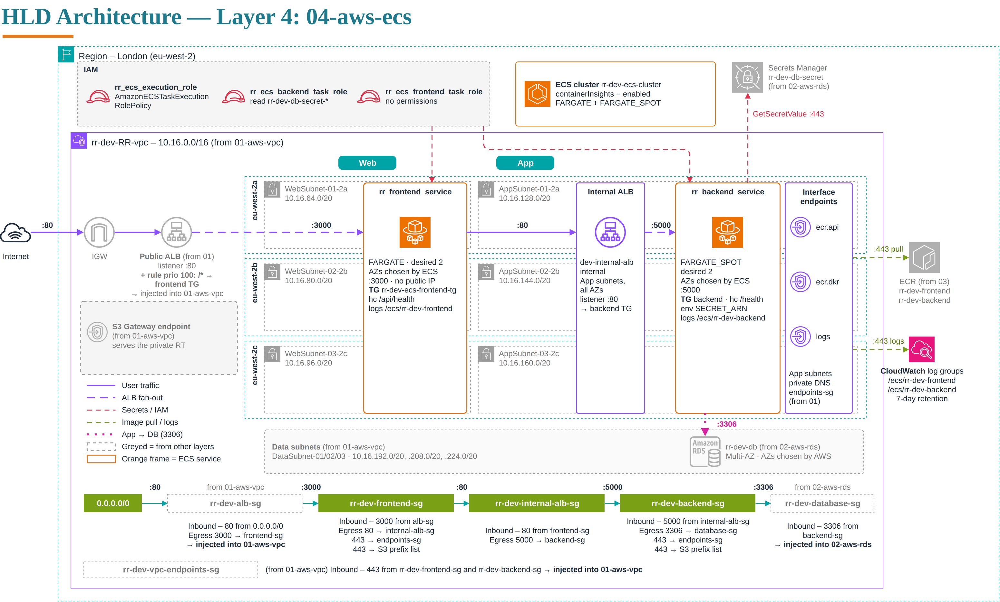

# Layer 4 - Serverless Elastic Container Service (ECS) with Fargate

In this Layer we deploy the website using severless ECS with Fargate: We pull resources from the previous three Layers and add extra resources to ensure our network traffic is secure and cost effective.

<a href="documents/hld-architecture/layer4-hld.png">
  
</a>

**Key Highlights** Below are the main highlights based on the HLD above:

1. **Serverless Compute Platform** - Runs frontend and backend container workloads across multiple AZs using AWS Fargate and cost-effective Fargate Spot, eliminating server management overhead.

2. **Two-Tier LoadBalancing** - Directs public user traffic to the frontend through a public LoadBalancer, while isolating backend communication behind a dedicated internal LoadBalancer (`dev-internal-alb`).

3. **Chained Defense & Least Privilege** - Uses strict, multi-stage Security Groups so that the frontend can only communicate with the internal LoadBalancer, and only the backend is permitted to access the database.

4. **Private AWS Service Integration** - Container tasks pull images from Amazon ECR and retrieve database credentials from Secrets Manager strictly over private VPC Endpoints, streaming container logs directly to Amazon CloudWatch.

# Dev environment

We have the usual structure but this time it is more populated, simply because we're pulling in resources from all three previous Layers using data sources.

## data.tf

Lets have a look at some of these resources in [data.tf](https://github.com/ManunEbo/Terraform-AWS-Ritual-Roast-Part-2-Containerised/blob/main/infrastructure/04-aws-ecs/environment/dev/data.tf).

```hcl
data "aws_vpc" "rr_vpc" {
  tags = local.common_tags_vpc
  filter {
    name = "tag:Name"
    values = ["rr-${var.environment}-*"]
  }
}
```

Here we're retrieving the VPC. Lets have a look at the components:

1. `tags = local.common_tags_vpc` - This injects the common tags that were used in Layer 1, they have been recreated at the top of data.tf for this exact use. This allows us to find a VPC that has all of these tags
2. `filter { }` This gives us a more granular search tool to narrow down our search results. Lets look at its components:
   a. `name = "tag:Name"` - This specifies what we're filtering by: we're filtering by `tag` and the tag is called `Name`
   b. `values = ["rr-${var.environment}-*"]` - This specifies the value of the tag. It will return all VPCs names with `rr-` prefix followed by the environment `dev-`. The wild card operator `*` means any number of characters to follow.
   The filter alone is good enough to retrieve our VPC.

Here's another example, this time we're retrieving the App subnets:

```hcl
ata "aws_subnets" "AppSubnets" {
    tags = local.common_tags_vpc

    filter {
      name = "tag:Name"
      values = ["AppSubnet-*"]
    }
}
```

Here's an example where we're not using filter, just simply the `name` of the security group:

```hcl
data "aws_security_group" "public_alb_sg" {
  name = "rr-${var.environment}-alb-sg"
}
```

Have a look through the full file to view all the resources.

## main.tf & providers.tf

**providers.tf** is identical to all the other Layers equivalent file. So there's nothing we haven't seen before.

**main.tf** is structurally the same as all the other Layers' main.tf however its more congested. The file is ordered such that modules that don't rely on other modules outputs are placed at the top: **security_groups** and **iam** modules both have no local sub modules dependencies; they do require that the data sourced resources from previous Layers do exist before hand, an implicit dependency.

The rest of the modules have visible implicit dependencies on other local modules. They have been organised by the number of implicit dependencies. Note, this order is not important as Terraform does not read a file top to bottom, it builts a map instead.

## outputs.tf

Here we output the public URL, DNS endpoint, for our ritual roast website

```hcl
output "ritual_roast_public_url" {
  description = "The public URL to access the Ritual Roast Application"
  value = "http://${data.aws_lb.gateway_alb.dns_name}"
}

```

Lets have a look at the components:

1. `description = ...` - This describes what this resource returns 2.`value = "http://${data.aws_lb.gateway_alb.dns_name}"` - This returns the public LoadBalancer DNS name and wrapps it into a HTTP URL

This output will be printed to the consol, copying and pasting it on the browser will load the website.

# Modules

This Layer has 5 child modules besides the root module:

1. **security_groups** - In this module we create the security groups that will restrict communication between resources that have ENIs attached.
2. **iam** - In this module we create the ECS roles that will enable the ECS containers to communicate with various resources
3. **load-balancers** - In this module we'll rewire the public ALB from Layer 1 for ECS and create an internal, private, ALB to decouple the frontend from the backend
4. **endpoint** - In this module we rewire the network traffic rerouting it through the AWS backbone between supported resources, end to end, to cut AWS costs and enhance security.
5. **ecs** - In this module we create the ECS cluster and the supporting resources to bring up the website

Lets take a look at each module in detail.

## security_groups (SG)

Although resources are injected into this module via root module data sources passed into variables, this module has it's own [data.tf](https://github.com/ManunEbo/Terraform-AWS-Ritual-Roast-Part-2-Containerised/blob/main/infrastructure/04-aws-ecs/modules/security_groups/data.tf). It uses data source to retrieve other resources needed in this module. Note, this is just a preference, it's not mandatory i.e. we could have retrieved all the resources in the root module data.tf and passed them onwards.

### aws_prefix_list for S3

There is one particular peculiarity at the top of this file worthy of an explanation, as we haven't seen it before:

```hcl
data "aws_prefix_list" "s3" {
  name = "com.amazonaws.${var.aws_region}.s3"
}
```

The `data "aws_prefix_list" "s3"` block acts as a dynamic search query to AWS: AWS manages a massive constantly changing pool of IP addresses for S3, in every region. Instead of forcing us to track and hardcode hundreds of IP ranges, CIDR blocks, in our firewall rules, AWS bundles them into a **single managed Prefix List** which is always named in the format **com.amazonaws.<region>.s3**

This data block tells Terraform: "Go ask AWS for the underlying ID of the S3 prefix list in my current region so I can use it securely in my rules."

**Why does S3 need these public IP addresses?**
S3 was built as a public, internet facing distributed storage system. It lives in the **"Public AWS zone"** i.e. it is designed to be accessed by anything, anywhere: mobile apps, on-premise corporate networks, IoT devices etc. As a result, to be globally reachable from the open internet requires public IP addresses. Thus all traffic to S3, including endpoints, ultimately route traffic to S3's public IPs. AWS just keeps that traffic on their private backbone network.

**Why are the IPs constantly changing**
S3 is not a single giant server; it is a continuously shifting fleet of millions of servers spread across multiple data centers. Thus the pool changes because of **scale, high availability, and load balancing**. Below are the factors that lead to the IP cycles:

1. **Elasticity & Hardware Lifecycle** - AWS is constantly racking new servers to increase capacity and decommissioning old or broken servers. Everytime hardware cycles/replaced, IPs are reallocated.
2. **Traffic Rebalancing** - If a specific S3 node or AZ is getting hammered with traffic, AWS dynamically shifts traffic to other nodes, which introduces new IP ranges into the active pool.
3. **DDoS Protection** - By rapidly shifting the IP ranges that handle traffic, AWS can mitigate massive Distributed Denial of Service (DDoS) attacks.

Because of the above, AWS cannot promise a static IP for S3. Thus they publish large blocks of IPs (CIDR ranges) that cover their current fleet, and they update that list as the fleet evolves.

**Why is this important to our project?**
When configuring `aws_security_group_rule` in Terraform, we specify where the traffic is allowed to go. Terraform provides three options for destination:

1. `source_security_group_id` - We've been working with this, Security Group Chaining i.e. pointing to another internal AWS resource's firewall.
2. `cidr_blocks` - For hardcoded, static IP ranges (like `0.0.0.0/0` or `10.0.1.0/24`)
3. `prefix_list_ids` - For lists of IP addresses managed centrally by AWS or ourselves.

We will use `prefix_list_ids` in the security group rule(s) that enables our resources to reach S3 via the Gateway endpoints, see endpoints module below.

### Visualizing traffic flow

Before getting into the actions lets visualize the traffic flow from the internet through our VPC to aid our understanding of building a security fortress:

```
1. Internet
   │
   ▼
2. Public ALB  (layer 1's shared ALB, port 80)
   │  this layer's own rule — priority 100, path "/*"
   ▼
3. Frontend target group :3000   (health check: GET /api/health)
   │
   ▼
4. Frontend Fargate task  (Next.js — 512 CPU / 1024 MB, 2 tasks, on-demand)
   │  BACKEND_URL = http://<internal ALB DNS name>
   ▼
5. Internal ALB  (private — no public IP, no internet route)
   │
   ▼
6. Backend target group :5000   (health check: GET /health)
   │
   ▼
7. Backend Fargate task  (Flask — 256 CPU / 512 MB, 2 tasks, Spot)
   │
   ▼
8. RDS MySQL  (layer 2)

```

Lets elaborate on the above:

1. **Internet request to public ALB** - A user sends HTTP request from the internet to Layer 1's shared public ALB on port 80
2. **Public ALB path evaluation & target forwarding** - The public ALB evaluates its listener rules. Rule priority 100 matches the path `/*` and forwards the traffic to the Frontend target group on port 3000
3. **Frontend task execution (Next.js)** - One of the two On-demand Next.js Fargate tasks receives the request on port 3000. When the client needs backend data, the Next.js application initiates an internal HTTP API request to the environment variable `BACKEND_URL`, which points to the private DNS name of the **Internal ALB**
4. **Internal ALB Forwarding** - The internal ALB, which lives in private subnets with no public IP, receives the request from the Next.js task and routes it to the **Backend target group** on port 5000.
5. **Backend task execution (Flask)** - One of the two **Fargate Spot Flask tasks** receives the API request on port 5000 and executes the business logic.
6. **Database Persistence (RDS MySQL)** - To read or write data, the Flask task opens a MySQL connection to the **RDS instance**, from Layer 2, on port 3306

### Where Security Groups fit in (Security Group Chaining)

Instead of restricting network traffic using hardcoded CIDR IP blocks, AWS security best practice uses Security Group Chaining, where a destination Security Group explicitly allows traffic from a source Security Group ID.

This approach is essential for dynamic container environments like ECS Fargate. When container tasks scale out or replace unhealthy instances, they are assigned new, temporary private IP addresses. If firewall rules were bound to static IP addresses, network access would break whenever a container died, or you would be forced to open up broad, insecure subnet CIDR blocks.

With Security Group Chaining, network security is completely decoupled from IP addresses. Any new container task launched with the approved source Security Group automatically gains network access to the destination, regardless of its IP. This enforces the Principle of Least Privilege without requiring manual firewall updates as infrastructure scales.

In this module we setup security groups for several resources to facilitate communication to and fro. The security groups are separated into files, one per security group. Lets look at each of these in detail.

### [sg-web-tier.tf](https://github.com/ManunEbo/Terraform-AWS-Ritual-Roast-Part-2-Containerised/blob/main/infrastructure/04-aws-ecs/modules/security_groups/sg-web-tier.tf)

This file houses the Frontend security group and its security group rules. The frontend security group will apply to the **Web subnets**. In here we'll place any resource specific to the Frontend e.g. Frontend ECS containers.

```hcl
resource "aws_security_group" "rr_frontend" {
  name        = "rr-${var.environment}-frontend-sg"
  description = "Frontend containers (Web Tier) security group"
  vpc_id      = var.vpc_id

  tags = merge(var.common_tags, {
    Name = "rr-${var.environment}-frontend-sg"
  })
}
```

Above, this is how we create a security group in this case Frontend security group, `rr_frontend`. This is just the shell of the security group: There are no rules attached. Lets look at the components:

1. `name = "rr-${var.environment}-frontend-sg"` - This is the name of our security group
2. `description = "Frontend containers (Web Tier)"` - This tells us what the security group is for
3. `vpc_id = var.vpc_id` - This creates the security group in our VPC
4. `tags = ...` - This merges the common tags with the `Name` tag

Now that the empty shell of our security group is created lets see how we attach security group rules, chaining `rr_frontend` to other security groups. But first, lets clear up a source of confusion. In Terraform's `aws_security_group_rule` resource:

1. `security_group_id` - This alwasys means **"The security group I am attaching this specific rule to."**
2. `source_security_group_id` - This means **"The OTHER security group this rule interacts with."**

Therefore:

1. In an `ingress` (inbound) rule, `source_security_group_id` **acts as the Origin i.e. Allow traffic from this SG**
2. In an `egress` (outbound) rule, `source_security_group_id` **acts as the Destination i.e. Allow traffic to this SG**

Now that we've cleared up the confusion, lets look at these two types of rules:

1. **Ingress rule**
   An ingress rule accepts incoming traffic from a specified source.

```hcl
resource "aws_security_group_rule" "rr_frontend_from_public_alb" {
  type                     = "ingress"
  from_port                = 3000
  to_port                  = 3000
  protocol                 = "tcp"
  security_group_id        = aws_security_group.rr_frontend.id
  source_security_group_id = data.aws_security_group.public_alb_sg.id
}
```

Above we have an ingress rule that accepts traffic from `public_alb_sg` into `rr_frontend` on port 3000. Note this is HTTP traffic. Lets look at the components:

1. `type = "ingress"` - This specifies the direction of the traffic, in this case incoming traffic.
2. `from_port = 3000` - This specifies the source port i.e. the port the packets where sent through
3. `to_port = 3000` - This specifies the target port i.e. the receiving port.
4. `protocol = "tcp"` - This specifies the rule as to how data will be transmitted. **Transmission Control Protocol (TCP)** requires a three way handshake which ensures a connection is established first, end to end, before data transfer.
5. `security_group_id = aws_security_group.rr_frontend.id` - In an ingress rule, this specifies the target security group i.e. the one receiving traffic.
6. `source_security_group_id = data.aws_security_group.public_alb_sg.id` - In an ingress rule, this specifies the originator/source security group i.e. the one sending traffic.

**Why is this important**
The public ALB is the frontdoor of our application, it's the bridge between customers on the internet and our applications in private subnets inside our VPC.
Thus the ALB receives traffic from the internet on port 80, it forwards that traffic to the Frontend application on port 3000. `rr_frontend` security group verifies the source of the traffic and sees that its the public loadbalancer and allows it to pass.

**Why port 3000**
We are using port 3000 because our next.js server listens on port 3000.

2. **Egress rule**

```hcl
resource "aws_security_group_rule" "rr_frontend_to_internal_alb" {
  type                     = "egress"
  from_port                = 80
  to_port                  = 80
  protocol                 = "tcp"
  security_group_id        = aws_security_group.rr_frontend.id
  source_security_group_id = aws_security_group.rr_internal_alb.id
}

```

Above we have an egress rule that sends outbound traffic from `rr_frontend` SG to `rr_internal_alb` on port 80. Lets look at the components, we'll skip what hasn't changed from the ingress rule

1. `type = "egress"` - This specifies the direction of the traffic, in this case outbound traffic
2. `from_port` and `to_port` - These are now port 80
3. `security_group_id = aws_security_group.rr_frontend.id` - This now specifies the source/originator security group i.e. allow outbound traffic from `rr_frontend` to the other security group
4. `source_security_group_id = aws_security_group.rr_internal_alb.id` - This now specifies the target/destination security group. Npte for this traffic to be accepted we need an ingress rule for `rr_internal_alb`.

**Why is this important**
Between the frontend and the backend there is an internal ALB that ensures that the frontend doesn't communicate directly to the backend. This adds an extra layer of security i.e. the backend containers service and or IP address is not known by the frontend containers. Thus for the frontend to communicate with the backend it sends traffic to the internal ALB.

**Why port 80 instead of 5000**

An ALB acts as a standard web proxy. Best practice dictates that infrastructure components, like the ALB, offer standard HTTP(80) or HTTPS (443) interfaces to their clients. The frontend shouldn't need to care what obscure port the backend application use. It just calls `http://internal-alb:80`. The ALB handles the translation, taking the request on port 80 and routing it to the Flask app on port 5000.

### The remaining rules

The remaining rules are variations of the two above, to save space we'll focus more on what changes:

1. **Why we need this rule**
2. **Why use that port**

Covering these will give us the broader picture of our security posture.

1. **Egress:Frontend -> Interface Endpoints `rr_frontend_egress_to_endpoints`**
   **Why is this important**
   Fargate containers run in private subnets with no internet access. When a frontend container boots up, it needs to talk to the AWS API to download its Docker imagefrom ECR and stream its logs to CloudWatch. VPC Endpoints allow this private communication. Thos rule lets the container reach those Endpoints.
   **Why port 443**
   All communication with AWS APIs, like ECR and CloudWatch, happens over standard, encrypted HTTPS, which stricly uses port 443

2. **Egress: Frontend -> S3 Gateway `rr_frontend_egress_to_s3`**
   **Why is this important**
   ECR stores the actual filesystem layers of our Docker images in AWS S3. Since there's no NAT Gateway in this layer to reach S3 we need an alternative route. To sucessfully pull an image, Fargate must reach S3. The S3 Gateway Endpoint relies on **AWS Prefix Lists rather than Security groups**. This rule allows outbound traffic to the massive list of S3 IP addresses in our specified region.
   **Why port 443**
   Pulling data from AWS S3 is an API call that occurs over encrypted HTTPS (port 443).

3. **Injected Egress: Public ALB > Frontend `alb_allow_outbound_to_frontend`**
   **Why is this important**
   Although Security Groups are stateful intelligent devices i.e. any allowed inbound traffic does not require an outbound rule for the response, the return is automatic because the Security Group catches this as the response to the inbound traffic. However, if a separate outbound traffic heading for the same external source is initiated, it would be unassociated with the current inbound traffic and will be blocked. Thus to allow this we need an egress rule: Just because the Frontend has an `inbound` rule allowing traffic from the ALB doesn't mean the ALB has an outbound rule allowing it to initiate traffic headed for the Frontend. This rule modifies the Public ALB's Security Group from Layer 1, giving it the outbound permission to physically rach the Frontend containers.
   **Why Port 3000**
   The ALB is sending traffic to the Next.js container which is listeningon port 3000

### [sg-internal-alb.tf](https://github.com/ManunEbo/Terraform-AWS-Ritual-Roast-Part-2-Containerised/blob/main/infrastructure/04-aws-ecs/modules/security_groups/sg-internal-alb.tf)

This Security Group shields the Backend from the Frontend. It allows the Frontend containers to forward path based requests to be handled by the backend.

```hcl
resource "aws_security_group" "rr_internal_alb" {
  name   = "rr-${var.environment}-internal-alb-sg"
  vpc_id = var.vpc_id

  tags = merge(var.common_tags, {
    Name = "rr-${var.environment}-internal-alb-sg"
  })
}
```

Above is the SG skeleton, lets look at the SG rules:

1. **Ingress: Frontend -> Internal ALB `rr_int_alb_from_frontend`**
   **Why is this important**
   Earlier we saw an egress to internal ALB rule in sg-web-tier, `rr_frontend_to_internal_alb`, which allows outbound Frontend traffic to the ALB. When that traffic reaches the internal ALB it requires an ingress rule to accept that traffic. Thus, this rule is the counter party to the egress rule that completes path so that traffic can flow into the internal ALB.
   **Why port 80**
   Notice that this is HTTP not HTTPS traffic. Setting up Transport Layer Security (TLS) certificates is a complicated matter, it is common practice for TLS certificates to terminate at an ALB i.e. HTTPS from the internet would terminate at a Loadbalancer and continue as HTTP. However, for maximum security especially in prod environments end to end TLS might be required which would mean configuring SECURE SOCKET Layer(SSL) on the backend application i.e. ensuring that the public encryption certificate/key is baked into the container images, at runtime. But for this dev environment HTTP is addequate, we can avoid various costs: purchasing a domain and an ACM certificate from AWS Certificate Manager.
2. **Egress: internal ALB -> Backend `int_alb_to_backend`**
   **Why is this important**
   Now that the communication between the Frontend and the internal ALB is configured, the ALB needs to forward that traffic onto the Backend. This rule enables the ALB to forward the Frontend traffic to the Backend containers. Note, there will also have to be an ingress rule on the Backend SG to accept this traffic.
   **Why port 5000**
   The Backend Flask containers listen on port 5000 for incoming traffic i.e. this is the open door on the container that is expecting traffic for the application.

### [sg-app-tier.tf](https://github.com/ManunEbo/Terraform-AWS-Ritual-Roast-Part-2-Containerised/blob/main/infrastructure/04-aws-ecs/modules/security_groups/sg-app-tier.tf)

Now that the Frontend security group is completed, lets turn our attention to the backend, `App-tier`.

```hcl
resource "aws_security_group" "rr_backend" {
  name        = "rr-${var.environment}-backend-sg"
  description = "Backend containers (App Tier)"
  vpc_id      = var.vpc_id

  tags = merge(var.common_tags, {
    Name = "rr-${var.environment}-backend-sg"
  })
}

```

Above is the skeleton Backend security group, `rr_backend`. Lets look at the associated Security Group Rules:

1. **Ingress: Internal ALB -> Backend `backend_from_internal_alb`**
   **Why is this important**
   The Frontend Next.js does not know the Backend. It retrieves the internal ALB DNS address at runtime. The internal ALB acts as the middleman between the Next.js Frontend and the Flask Backend: When the frontend needs data, it sends an HTTP request to the internal ALB. The ALB then forwards that request to the Backend containers. This rule acts as the internal ALB traffic's security clearance for the Flask app, allowing the internal ALB's traffic to enter.
   **Why port 5000**
   Port 5000 is the standard default port for Flask applications. Because the Backend container is listening for traffic on port 5000, the firewall must be open on exactly that port.

2. **Egress: Backend -> Database `backend_to_db`**
   **Why is this important**
   To authenticate users, fetch records, or save data, the Flask application needs to communicate with the RDS database. This rule gives the Backend containers the network permissions to send outbound traffic to the database.
   **Why port 3306**
   Port 3306 is the universally recognized default port for MySQL database
3. **Injected Ingress: Backend -> Database `db_ingress_from_backend`**
   **Why is this important**
   The database Security Group was created in Layer 2, it has no knowledge of our Backend. There's no database Security Group rules that accepts incoming traffic from the Backend. Security Groups require a two-way handshake of permissions: Just because the backend is allowed to send traffic, rule 2 above, doesn't mean the database is allowed to accept it. This rule bridges the gap by injecting an inbound rule into the database's Security Group, `database_sg`, to accept incoming traffic from the Backend.
   **Why port 3306**
   The backend is trying to reach MySQL which listens on port 3306
4. **Egress: Backend -> Interface Endpoints `rr_backend_egress_to_endpoints`**
   **Why is this important**
   Like the Frontend, the Backend Fargate containers run in private subnets with no internet access. When they boot up, they need to communicate with AWS services to pull their Docker Images from ECR, stream logs from CloudWatch, and crucially fetch the RDS credentials from AWS Secrets Manager. All of the interface endpoints are using the same Security group, `endpoints_sg_id`. This rule allows outbound Backend traffic passage to reach any of the endpoints be it ECR or Secrets Manager etc.
   **Why port 443**
   All communication with AWS APIs happens over secure encrypted end to end HTTPS, which operates strictly on port 443. This extra layer of security is useful in cases where there is a breach i.e. HTTP sends the traffic in plain text, any one can read it but HTTPS being encrypted, means if a bad actor was to get in our system, they can capture the traffic but can't read it because it is encrypted.

5. **Egress: Backend -> S3 Gateway `rr_backend_egress_to_s3`**
   **Why is this important**
   ECR stores the physical files, image layers, of our Docker containers in Amazon S3. To successfully download the Flask image, the Fargate task must reach S3 through a VPC Gateway Endpoint. This rule explicitly allows outbound traffic to the dynamic, AWS-managed list of S3 IP addresses, the `prefix_list_ids` we reviewed earlier.
   **Why port 443**
   Downloading image layers from S3 is an API operation that requires an encrypted HTTPS connection, which runs on port 443. Note, AWS manages the TLS certificates for this.

### [sg-endpoints.tf](https://github.com/ManunEbo/Terraform-AWS-Ritual-Roast-Part-2-Containerised/blob/main/infrastructure/04-aws-ecs/modules/security_groups/sg-endpoints.tf)

All the interface type endpoints are using this single Security Group, `rr_endpoints_sg`. Thus whether we're connecting to ECR, Secrets Manager, CloudWatch logs, the gate keeper is the same. Note, this Security Group resides in Layer 1, making it accessible in all other Layers.

```hcl
resource "aws_security_group" "rr_endpoints_sg" {
  name_prefix = "rr-${var.environment}-vpc-endpoints-sg-"
  description = "RR: Base shell for VPC Interface Endpoints. Rules injected by upper layers."
  vpc_id      = var.vpc_id

  lifecycle {
    create_before_destroy = true
  }

  tags = merge(var.common_tags, {
    Name = "rr-${var.environment}-vpc-endpoints-sg"
  })
}
```

Lets have a look at the rules we're attaching for this Layer.

1. **Ingress: Frontend -> Interface Endpoints `rr_endpoints_ingress_from_frontend`**
   **Why is this important**
   The frontend needs to reach ECR to pull images and CloudWatch logs to write logs. We have a Frontend egress rule that allows that. This is it's complementary ingress rule that accepts traffic at the endpoints.
   **Why port 443**
   It is standard practice that all traffic on the AWS backbone is encrypted hence HTTPS managed by AWS.
2. **Ingress: Backend -> Interface Endpoints `rr_endpoints_ingress_from_frontend`**
   **Why is this important**
   The Backend needs to communicate with ECR, CloudWatch logs, and Secrets Manager. The egress outbound rule already exists, above in sg-app-tier section. This is the receiving end of that, inbound ingress, at the endpoints door step.
   **Why port 443**
   The AWS backbone standard uses HTTPS. It's the fastest and relatively cheaper way to go from our VPC to AWS managed resources, without leaving the AWS system.

### [outputs.tf](https://github.com/ManunEbo/Terraform-AWS-Ritual-Roast-Part-2-Containerised/blob/main/infrastructure/04-aws-ecs/modules/security_groups/outputs.tf)

Three security groups are created in this sub module and we output them making them available to other modules via the root module.

## iam

While the Security Groups guard the gate and only allow traffic with the right credentials to pass through, the IAM role gives an entitity the permissions to perform specified tasks against AWS resources i.e. after authentication what privileges are granted to the entity to accomplish the necessary tasks. The focus in this module is to create the ECS roles and attach to them the required privileges.

The main file in this module is [ecs-roles.tf](https://github.com/ManunEbo/Terraform-AWS-Ritual-Roast-Part-2-Containerised/blob/main/infrastructure/04-aws-ecs/modules/iam/ecs-roles.tf), it houses all the roles.

Lets look at the roles:

### 1. Ritual Roast - ECS Execution Role `rr_ecs_execution_role`

**Who is it for**
The AWS ECS/Fargate infrastructure itself, the underlying agent running the ECS tasks.
**Why is this important**
Before the application code can run, AWS needs to download the Docker images from ECR and set up a pipeline to stream standard output (stdout) to CloudWatch Logs. Because our infrastructure lives in a private subnet, the ECS agent needs an AWS identity, permissions, to securely reach out to ECR and CloudWatch to perform these tasks.

```hcl
resource "aws_iam_role" "rr_ecs_execution_role" {
  name = "rr-${var.environment}-ecs-execution-role"

  assume_role_policy = jsonencode({
    Version = "2012-10-17"
    Statement = [{
      Action = "sts:AssumeRole"
      Effect = "Allow"
      Principal = { Service = "ecs-tasks.amazonaws.com" }
    }]
  })

  tags = merge(var.common_tags, {
    Name = "rr-${var.environment}-ecs-execution-role"
  })
}
```

We've seen IAM roles before, the only interesting thing here is `Principal = { Service = "ecs-tasks.amazonaws.com" }` which defines who can assume this role. Currently, there is no policy attached to this role. That's the next step.

**Attaching the AWS Managed Policy `AmazonECSTaskExecutionRolePolicy`**

```hcl
resource "aws_iam_role_policy_attachment" "rr_ecs_execution_standard" {
  role       = aws_iam_role.rr_ecs_execution_role.name
  policy_arn = "arn:aws:iam::aws:policy/service-role/AmazonECSTaskExecutionRolePolicy"
}
```

**What does this allow**
Behind the scenes, this managed policy grants actions such as: `ecr:GetAuthorizationToken`, `ecr:BatchGetImage`, `logs:CreateLogStream` and `logs:PutLogEvents`. It applies to all ECR and CloudWatch resources.
**Maintaining least privileges principle**
By using this specific managed policy, we ensure the Fargate agent only has exactly the permissions required to bootstrap a container: pull an image and write logs. It explicitly cannot read our database secrets, nor modify any resource in our VPC.

### 2. Ritual Roast - Backend Task Role `rr_ecs_backend_task_role`

**Who is it for?**
This is for the running Flask application
**Why is it important?**
Once the container is running, the Python/Flask code inside needs to fetch the database credentials to connect to MySQL. Thus this role provides the AWS credentials directly to our application's AWS SDK, **the Boto3 client**.

```hcl
resource "aws_iam_role" "rr_ecs_backend_task_role" {
  name = "rr-${var.environment}-ecs-backend-task-role"

  assume_role_policy = jsonencode({
    Version = "2012-10-17"
    Statement = [{
      Action    = "sts:AssumeRole"
      Effect    = "Allow"
      Principal = { Service = "ecs-tasks.amazonaws.com" }
    }]
  })
}
```

As usual, nothing new to see here, the `assume_role_policy` object specifies the action `"sts:AssumeRole"` and the entity that can assume it, `Principal = { Service = "ecs-tasks.amazonaws.com" }`.

Lets look at the policy that will be attached to it.
**User defined policy for Secrets Manager `rr_backend_task_policy`**

```hcl
resource "aws_iam_policy" "rr_backend_task_policy" {
  name        = "rr-${var.environment}-backend-task-policy"
  description = "Permissions for the Ritual Roast backend to access DB Secrets and S3"
  policy = jsonencode({
    Version = "2012-10-17"
    Statement = [
      {
        # Allow the backend to get secrets
        Effect = "Allow"
        Action = [
          "secretsmanager:GetSecretValue",
          "secretsmanager:DescribeSecret"
        ]
        Resource = ["arn:aws:secretsmanager:${var.aws_region}:${var.aws_account_id}:secret:rr-${var.environment}-db-secret-*"]
      }
    ]
  })
}
```

Lets have a look at the actions:

1. `"secretsmanager:GetSecretValue"` - Permission read the actual password i.e. retrieve the password value.
2. `"secretsmanager:DescribeSecret"` - Permission to reads metadata about the secret, not the value itself: which version is currently staged as AWSCURRENT/AWSPENDING/AWSPREVIOUS etc.

As they are, the permissions will read secrets value and retrieve the secret's metadata on all secrets. To ensure least privileges, we need to lock this down to this database secret(s). This is achieved by resource section: 3. `Resource = ["arn:aws:secretsmanager:${var.aws_region}:${var.aws_account_id}:secret:rr-${var.environment}-db-secret-*"]` - This specifies the exact resource that the above privileges applies to: any secret that has the following prefix `rr-${var.environment}-db-secret-*`. Note the use of the wildcard operator `*` here means any number of characters. Thus as long as the secret name matches upto the prefix, this policy will allow our Backend ECS Task to read it. Now our policy is locked down, ready to be attached.

**Attaching the policy to the role `rr_backend_task_role_attachment`**

```hcl
resource "aws_iam_role_policy_attachment" "rr_backend_task_role_attachment" {
  role       = aws_iam_role.rr_ecs_backend_task_role.name
  policy_arn = aws_iam_policy.rr_backend_task_policy.arn
}
```

The resource above attaches the policy to the role. As can be seen, the body specifies the `role` and `policy_arn`. Thus our role now has permissions to read the secret.

### 3. Ritual Roast - Frontend Task Role `rr_ecs_frontend_task_role`

**Who is it for**
The frontend Next.js application code
**Why is it important**
It gives the frontend container(s) a dedicated AWS Identity, even if it doesn't currently need to call any AWS APIs.

```hcl
resource "aws_iam_role" "rr_ecs_frontend_task_role" {
  name = "rr-${var.environment}-ecs-frontend-task-role"

  assume_role_policy = jsonencode({
    Version = "2012-10-17"
    Statement = [{
      Action    = "sts:AssumeRole"
      Effect    = "Allow"
      Principal = { Service = "ecs-tasks.amazonaws.com" }
    }]
  })
}
```

**Why is there no policy for this role**
This is just an empty skeleton. It is an example of excellent security architecture:

1. **No AWS API Calls needed** - The Next.js Frontend is designed to handle web traffic and make standard HTTP API calls to the Internal ALB, which routes to our Flask Backend. **Frontend has no requirement to talk to AWS Secrets Manager nor our database. Thus, it needs no AWS permissions.**
2. **The Ultimate Least Privilege** - The best way to enforce least privilege is to grant nothing at all.
3. **Future-Proofing (Why we create the skeleton anyway)** - If we decide later that the Frontend needs to upload files directly to S3 or to enabe AWS X-Ray tracing for performance monitoring, we simply attach a policy to this existing role. At that point, if we didn't have this skeleton role attached to this ECS Task definition, adding permissions later would require modifying the Task definition and Terraform would tear down the running containers and redeploy with the updates. Thus by providing the skeleton now, we decouple the infrastructure deployment from future IAM policy updates.

### outputs.tf

The roles previewed above are needed in the `ecs` module, so we output all three roles, making them available to the root module to pass to the `ecs` module.

## load-balancers

In this module we wire up the Public ALB to forward traffic to our ECS tasks/containers and setup the internal ALB.

### Wiring the Public ALB for ECS

The Public ALB, the front door was created in Layer 1. We now want to redirect traffic that lands there to our ECS Frontend containers. We need two components to wire up the Public ALB from Layer 1 for ECS: **a target group** and **a Listener**. The wiring of the Public ALB is done in [alb-wiring.tf](https://github.com/ManunEbo/Terraform-AWS-Ritual-Roast-Part-2-Containerised/blob/main/infrastructure/04-aws-ecs/modules/load-balancers/alb-wiring.tf).

#### Target Group `aws_lb_target_group`

A Target Group tells the LoadBalancer where to send incoming traffic, how to communicate with the destination resources, and how to verify that those resources are healthy before sending them traffic. Below is our Layer 4 target group

```hcl
resource "aws_lb_target_group" "rr_frontend" {
    name        = "rr-${var.environment}-ecs-frontend-tg"
    port        = 3000
    protocol    = "HTTP"
    vpc_id      = var.vpc_id
    target_type = "ip"

    health_check {
      enabled             = true
      path                = "/api/health"
      port                = "3000"
      interval            = 30
      timeout             = 5
      healthy_threshold   = 2
      unhealthy_threshold = 2
      matcher             = "200"
    }
}
```

Lets understand the components one by one:

1. `name = "rr-${var.environment}-ecs-frontend-tg"` - This is the unique name given to this target group inside AWS
2. `port = 3000` - This is the network port on which the Next.js application container is listening on
3. `protocol = "HTTP"` - The protocol used by the ALB to talk to Next.js containers.
4. `vpc_id = var.vpc_id` - This specifies the VPC where these targets live, our Ritual Roast VPC
5. `target_type = "ip"` - This is crucial for ECS Fargate using `awsvpc` networking mode: Instead of routing traffic to an EC2 instance ID, `ip` allows the ALB to route traffic directly to the private ENI IP address assigned to each individual Fargate task container.

#### Health Checks

A health check is an automated mechanism where the ALB periodically sends a background HTTP request to every registered target container to test if it is functioning properly.
**Why is this important**
ECS Fargate containers are dynamic and ephemeral, they spin up, scale out, or get replaced when unhealthy. The ALB must constantly verify that a container is actually booted up and ready to serve requests before sending real user traffic to it. If a container crashes, the health check fails, and the ALB immediately stops routing traffic to that broken task while ECS spins up a replacement.
**Shallow checks vs Deep checks**
**Shallow health checks** only checks if the immediate web process, our Next.js app server, is alive and responding. It does not test downstream dependencies like connections or secondary APIs.
**Deep health checks** tests the entire stack, checking if the web server is alive, plus verifying that the backend database and third-party APIs are all reachable
**Why shallow checks are used here instead of deep checks**
To avoid ALB container assasination, cascading failures: If our frontend health check were "deep" and checked if the backend API or RDS MySQL database was reachable, the following would happen:

1. A temporary database blip would cause the Frontend health check `/api/health` to fail, despite there being nothing wrong with the Frontend containers.
2. The ALB would assume the Frontend containers were broken and terminate all of them.
3. Tearing down healthy web containers because a downstream database was briefly lagging makes the outage significantly worse and prevents user-facing error pages from rendering. A shallow check ensures Fargate only kills Frontend containers if Next.js itself dies.

**Component by component of `health_check {}`**

1. `enabled = true` - Explicitly enables the health check mechanism for this target group.
2. `path = "/api/health"` - This is the specific URL endpoint inside the Next.js app that the ALB pings to check status
3. `port = "3000"` - This is the port the ALB ping for health checks, it has to match the app's listening port
4. `interval = 30` - This is the frequency, how often, the ALB sends a health check request, in seconds
5. `timeout = 5` - This is the maximum time, in seconds, the ALB will wait for a response before counting that ping as a failure.
6. `healthy_threshold = 2` - This is the number of consecutive successful pings required before a newly created or recovered container is marked **"Healthy"** and allowed to receive live traffic.
7. `unhealthy_threshold = 2` - This is the number of consecutive failed pings required before declaring a task **"Unhealthy"** and thus dropping it.
8. `matcher = "200"` - This is the exact HTTP response code, **"Success/OK"**, the endpoint must return to count as a successful check. It enforces absolute certainty thus the following register as unhealthy: redirects `301`,`302`, client errors `4xx`, server errors `5xx`, all mean something unexpected is happening with the application path. Accepting only `200 OK` guarantees that the Next.js framework is fully booted, routed properly, and responding as intended.

#### ALB Listener

```hcl
resource "aws_lb_listener_rule" "rr_ecs_frontend_rule" {
    listener_arn = var.gateway_listener_arn
    priority = 100

    action {
      type = "forward"
      target_group_arn = aws_lb_target_group.rr_frontend.arn
    }

    condition {
      path_pattern {
        values = ["/*"]
      }
    }
}
```

**What is a listener**
A process running on the ALB that actively listens for incoming client connection requests on a specific port and protocol e.g. HTTP on port 80 in our Public ALB built in Layer 1.
**Why is this important**
The Public ALB was created in Layer 1, but Layer 4 is where our ECS applications are deployed. Instead of recreating the ALB in Layer 4, a **Listener rule** allows Layer 4 to attach routing logic to Layer 1's existing Listener; that's what we have in the code directly above.

Lets look at the components one by one:

1. `listener_arn = var.gateway_listener_arn` - This associates this listener rule to the Layer 1's Public ALB port 80 Listener, via its ARN. Essentially this instructs it to evaluate this rule for incoming web traffic.
2. `priority = 100` - This is the evaluation order of the rule: Listeners evaluate rules in numerical order, the lower the number, the higher the priority. Thus Priority 100 ensures this rule is checked early in the chain, provided no other rules exist with priority less than 100.
3. `action { type = "forward", target_group_arn = aws_lb_target_group.rr_frontend.arn}` - This tells the ALB what to do when a request matches the condition: **forward the raw HTTP traffic directly to the `rr_frontend` target group**.
4. `condition { path_pattern { values = ["/*"] } }` - This is the rule condition: Any incoming URL path matching `/*`, which catches all web requests, will trigger this forward action to the Next.js containers.

### Internal ALB setup

This setup is no different to the Public ALB in Layer 1. This just resides in a private, internal, subnet. It consists of all the components the Public ALB has. Since we've discussed most of the important components above in wiring up the Public ALB for ECS, we'll just mention a few things. For the full code refer to [alb-internal.tf](https://github.com/ManunEbo/Terraform-AWS-Ritual-Roast-Part-2-Containerised/blob/main/infrastructure/04-aws-ecs/modules/load-balancers/alb-internal.tf).

```hcl
resource "aws_lb" "internal" {
  name               = "${var.environment}-internal-alb"
  internal           = true
  load_balancer_type = "application"
  security_groups    = [var.internal_alb_sg_id]
  subnets            = var.app_subnet_ids # Private App Subnets

  tags = merge(var.common_tags, {
    Name = "${var.vpc_name}-internal-alb"
  })
}
```

This is an AWS ALB operating at Layer 7 (HTTP/HTTPS). It acts as the bridge, a private traffic distributor between the Frontend and the Backend, housed in our app subnets: It receives API requests from the Next.js frontend and spreads them evenly across the active Flask backend containers.
**Why we need it**
Fargate containers are ephemeral, their IP addresses change every time they scale up, scale down, or deploy. The Next.js frontend cannot hardcode a destination IP as it will become invalid should the specific container be destroyed. The internal ALB provides **a single, static DNS name, point of contact**, that the frontend can rely on, while the ALB handles the complex job of tracking the ever-changing backend container IPs. Note, this approach also ensures that the frontend does not know anything about the backend, reducing the attack surface, should any frontend containers be breached.

#### Outputs.tf

This module outputs three things in [outputs.tf](https://github.com/ManunEbo/Terraform-AWS-Ritual-Roast-Part-2-Containerised/blob/main/infrastructure/04-aws-ecs/modules/load-balancers/outputs.tf):

1. `internal_alb_dns_name` - The internal ALB DNS name
2. `frontend_tg_arn` - The Frontend target group ARN
3. `backend_tg_arn` - The Backend target group ARN
   This makes them available to the root module which in turns passes them into the `ecs` module.

## endpoints

VPC endpoints are fundamentally about keeping AWS traffic on the private AWS network backbone, rather than traversing the public internet. This improves security, reduces latency, and often lowers data transfer costs.

### The two types of Endpoints

AWS provides two distinct types of VPC Endpoints: **Interface Endpoints** and **Gateway Endpoints**. Both are provided and managed by AWS, but they operate at different layers of your network. Gateway Endpoints were introduced first, specifically for S3 and DynamoDB, as a free routing feature. However, modifying route tables doesn't easily extend to thousands of different AWS and third-party services, nor does it allow on-premises resources, via **VPN/Direct Connect** to use them.

To solve this AWS introduced AWS PrivateLink and Interface Endpoints. These act like physical network cards plugged directly into our subnets, making them accessible to any resource in our VPC or on-premises networks.

#### How they work

1. **Interface Endpoints, Powered by AWS PrivareLink**
1. AWS injects an Elastic Network Interface (ENI) with a private IP address directly into our specified subnets
1. When the application makes a DNS request for an AWS service, e.g. `ecr.eu-west-2.amazonaws.com`, AWS intercepts it and resolves it to the local private IP of that ENI. The traffic never leaves the VPC, it goes straight to the ENI, which acts as a portal to the AWS service.
1. Because it uses an ENI, we can secure access using a firewall, Security Groups.

1. **Gateway Endpoints**
1. AWS adds a specific route to our VPC's route tables. There are no ENIs or private IP addresses created.
1. When your application trie to reach S3's public IP addresses, the route table intercepts that traffic based on a prefix list, e.g. `pl-123456`, and funnels it securely through the Gateway Endpoint over the AWS backbone.
1. Because there is no ENI, we cannot use Security Groups. Instead, we make use of VPC Endpoint policies, **IAM JSON documents**, attached directly to the endpoint.

Now lets look at individual Endpoints, one by one:

### ECR API `ecr_api`

This is the control plane for ECR: Before ECS can run our containers, it must talk to the ECR API to authenticate, check permissions, and ask for the metadata of the Docker images we want to run.

```hcl
resource "aws_vpc_endpoint" "ecr_api" {
  vpc_id              = var.vpc_id
  service_name        = "com.amazonaws.${var.aws_region}.ecr.api"
  vpc_endpoint_type   = "Interface"
  security_group_ids  = [var.endpoints_sg_id]
  subnet_ids          = var.app_subnet_ids    # This has 3 subnets so we are using 3 ENIs, one in each subnet
  private_dns_enabled = true

  tags = merge(var.common_tags, {
    Name = "${var.environment}-ecr-api-endpoint"
  })
}
```

Lets look at the components:

1. `vpc_id = var.vpc_id` - This specifies the VPC that the Endpoints will be placed in, our VPC
2. `service_name = "com.amazonaws.${var.aws_region}.ecr.api"` - This is the exact AWS service we're creating a bridge for.
3. `vpc_endpoint_type = "Interface"` - This specifies the Endpoint type, we're using AWS PrivateLink (Interface)
4. `security_group_ids = [var.endpoints_sg_id]` - This attaches a firewall to the endpoint ENI, usually allowing inbound HTTP/HTTPS traffic from our containers
5. `subnet_ids = var.app_subnet_ids` - This specifies the subnets that the ENIs will be placed in. Note `var.app_subnet_ids` consists of three subnet IDs i.e. it will drop one ENI in each of our three private App subnets so that **if one AZ goes down, the other two can still talk to ECR**.
6. `private_dns_enabled = true` - This turns on the private IP resolution such that the DNS converts/replaces the public IP address value with the local private IP address of the ENI sitting in our subnets when we query the DNS server for ECR API.

The remaining Endpoints are exact copies of the one above, so we'll briefly mention what they are for. To view the full file see [endpoints.tf](https://github.com/ManunEbo/Terraform-AWS-Ritual-Roast-Part-2-Containerised/blob/main/infrastructure/04-aws-ecs/modules/endpoints/endpoints.tf).

### ECR Docker `ecr_dkr`

While the API Endpoint gets the metadata, the `dkr` Endpoint does the heavy lifting: This Endpoint handles the actual downloading, pulling, of the Docker image layers from ECR into our Fargate tasks, invoked by the Docker daemon running inside our Fargate ECS host.

### CloudWatch Logs `logs`

Fargate containers don't have permanent hard drives. If they crash, all local logs are destroyed. Fargate uses the `awslogs` driver to instantly stream console output, Next.js and Flask logs, to CloudWatch. Without this endpoint, Fargate cannot reach CloudWatch, and if the task cannot send its logs, Fargate will refuse to start the container at all.

### Gateway Endpoint `s3`

Here there is some differences from the `Interface` Endpoints above. Even though we have ECR Endpoints, AWS stores the actual, physical Docker image layers in hidden S3 buckets behind the scenes. Fargate must reach S3 to download the final image payloads. Thus, without an S3 endpoint Fargate image pulls will hang and fail.

```hcl
resource "aws_vpc_endpoint" "s3" {
  vpc_id            = var.vpc_id
  service_name      = "com.amazonaws.${var.aws_region}.s3"
  vpc_endpoint_type = "Gateway"
  route_table_ids   = var.route_table_ids

  # Attach the Zero-Trust Policy
  policy = data.aws_iam_policy_document.s3_gateway.json

  tags = merge(var.common_tags, {
    Name = "rr-${var.environment}-s3-gateway"
  })
}
```

Lets have a look at the components that are different:

1. `vpc_endpoint_type = "Gateway"` - This specifies that this is a routing-based endpoint, meaning no ENIs and no hourly charges.
2. `route_table_ids = var.route_table_ids` - Instead of providing `subnet_ids` like an interface endpoint, we specify route tables. AWS will automatically inject a custome route into these tables, e.g. `"Destination:S3 -> Target:vpce-xxx"`, for our private subnets.
3. `policy = data.aws_iam_policy_document.s3_gateway.json` - Here we specify an IAM policy document to enforce a Zero-Trust security posture, ensuring this tunnel only permits the ECS execution role to pull image layers, blocking any accidental or malicious S3 access by attaching an IAM policy directly to the network tunnel.

### outputs.tf

Here we bundled up all of the endpoints ID into a dictionary object and output them, making them available for the root module. It's not referenced by any module at all so it's just for exercise.

```hcl
output "endpoint_ids" {
  description = "The IDs of the created VPC Endpoints"
  value = {
    # secrets = aws_vpc_endpoint.secretsmanager.id
    ecr_api = aws_vpc_endpoint.ecr_api.id
    ecr_dkr = aws_vpc_endpoint.ecr_dkr.id
    logs    = aws_vpc_endpoint.logs.id
    s3      = aws_vpc_endpoint.s3.id
  }
}
```

## ecs

Elastic Container Services (ECS) consists of three broad components: Cluster, Tasks and Services. Lets build an analogy to aid our understanding of ECS. We can think of ECS as a company with the following departments:

1. `Cluster` - This is the office building that houses the work to be done
2. `Tasks` - This is the employee actually doing the work
3. `Service` - This is the department manager ensuring the right number of employees are always on shift.

### ECS [cluster](https://github.com/ManunEbo/Terraform-AWS-Ritual-Roast-Part-2-Containerised/blob/main/infrastructure/04-aws-ecs/modules/ecs/cluster.tf)

An ECS cluster is a logical grouping, a perimeter, of our ECS resources. We can consider it a namespacce for our applications.
**What it does**
The cluster acts as the overaching environment that holds our underlying infrastruture, either Fargate capacity or EC2 instances, and the applications running on them. It doesn't actually run any code. It provides isolation such as `production-cluster` and `dev-cluster` to ensure workloads in either space never mix.
**How it does it in the ECS family**

1. `Infrastructure management` - When we instruct ECS to run a container, we must also specify which cluster to use. When using EC2 instances, the cluster tracks the total available CPU and memory and allocates the containers to available resources.
2. `State tracking` - The cluster acts as the central brain for state. It constantly monitors how many resoures are available, which instanes are connected, and which applications are running where.

### ECS Tasks

Tasks are the smallest deployable units of compute in ECS. It is a running instance of a **Task Definition** which is just a JSON file that specifies the configurations such as the Docker image, memory in GB RAM, port etc.
**What it does**
Tasks do the actual work: A task is simply one or more Docker containers running together on the same host. Thus if our application requires a web server container and a background logging container to run side-by-side and share local storage, we group them into a single task, like sidecars in Kubernetes.
**How they do it in the ECS family**

1. `Execution` - When a Task is launched, ECS pulls the required Docker image from our registry.
2. `Resource consumption` - The task is allocated the exact amount of CPU and memory defined in its configuration file.
3. `Networking` - In modern ECS setups, using `awsvpc` network mode, every single Task gets its own ENI thus its own private IP, just like a mini EC2 instance.
4. `Lifecycle` - Tasks are ephemeral. If the container crashes, the Task dies. It does not automatically restart itself.

### ECS Services

An ECS Service is a long-running manager and scheduler for Tasks.
**What they do**
Because Tasks die when they crash and don't auto restart, we don't run tasks manually. Instead we create a Service. The Service's job is to ensure that a specified number of Tasks, **Desired count**, are constantly running and healthy.
**How they do it in ECS family**

1. `Auto-healing` - The Service continouusly loops, comparing the **"Desired count"** of Tasks with the **"Running count"**. If the app crashes and a Task dies, the running count drops. The Service immediately notices this and commands the CLuster to spin up a new Task to replace it.
2. `Loadbalancing` - The Service acts as a bridge between Tasks and the ALB: When the Service spins up a new Task, it takes that Task's private IP address and automatically registers it with the ALB. When a Task is being shut down, the Service deregisters it so users don't get routed to a dead container.
3. `Deployments` - When we want to release a new version of our code, we update the Service. The service handles the deployment strategy, like a Rolling update: It will spin up Tasks with the new version of our code, wait for them to become healthy, and then slowly kill off the old Tasks, ensuring zero downtime.

### EC2 vs Fargate

Here in Layer 4 we're deploying ECS with Fargate but lets compare the two methods of deploying ECS.
The core difference between EC2 and Fargate comes down to **who manages the underlying servers**. This choice in ECS is known as the "Launch Type" or "Capacity Provider".

**ECS on EC2 (The "DIY" Approach)**
With the EC3 launch type , we rent and manage the actual EC2 instances that will run our containers.

1. `Management` - We're responsible for the infrastructure: We patch the OS, we manage security updates, and handle cluster scaling via ASGs.
2. `Cost model` - **We pay for the entire EC2 instance while it is running, regardless of consumption patterns e.g. CPU utilization**
3. `Customization` - We have complete control: We can attach GPUs, use specific CPU architectures, access the host operating system, and run custom host-level agents

**ECS on Fargate (The "Serverless" Approach)**
Fargate is a severless compute engine for containers whereby AWS takes responsibility of managing the underlying infrastructure leaving us accountable only for the application to be deployed on that infrastructure. Thus:

1. `Management` - There are no servers to manage, patch, or secure. We simply tell AWS how much CPU and memory our tasks require and AWS finds the capacity and runs it automatically.
2. `Cost model` - We pay precisely for the CPU and memory our Task requests, billed per second.
3. `Customization` - Since we cannot access the host operating system, attach GPUs, or cache Docker images locally on the host, we are simply trading control for simplicity.

So now that we've looked at the difference between ECS on EC2 vs Fargate, lets look at the setup for our project using Fargate.

### Ritual Roast ECS Cluster

**What it is**
The Ritual Roast ECS cluster, `rr_ecs_cluster` is our projects locgical boundary and administrative grouping within AWS ECS where we will deploy and manage our containerized Next.js Frontend and Flask Backend Tasks.

```hcl
resource "aws_ecs_cluster" "rr_ecs_cluster" {
  name = "rr-${var.environment}-ecs-cluster"
  setting {
    name  = "containerInsights"
    value = "enabled"
  }

  tags = merge(var.common_tags, {
    Name = "rr-${var.environment}-ecs-cluster"
  })
}
```

**What it does**
This acts as the control center i.e. the control plane for our ECS deployment. It manages Task orchestration, tracks running container instances, monitors health and performance metrics, and isolates our Ritual Roast applications, both Frontend and Backend, resources from other workloads in our AWS account.
**Why we need it**
AWS ECS cannot run our Ritual Roast Tasks, Services in a vacuum. The cluster serves as the starting point for our deployment.

Lets take a closer look at the components we haven't seen before:

1. `setting { name = "containerInsights", value = "enabled" }` - This enables AWS CloudWatch container insights. It automatically collects, aggregates, and summarizes metrics such as; CPU utilization, memory usage, disk read/writes, and network traffic. It does this both at the cluster and individual container/Task level. Note, without this we get very basic metrics.

### Ritual Roast Cluster capacity providers `rr_ecs_cp`

A configuration resource that attaches compute capacity strategies, in this case severless AWS Fargate, directly to the ECS cluster

```hcl
resource "aws_ecs_cluster_capacity_providers" "rr_ecs_cp" {
  cluster_name = aws_ecs_cluster.rr_ecs_cluster.name

  capacity_providers = ["FARGATE", "FARGATE_SPOT"]

  default_capacity_provider_strategy {
    base              = 1
    weight            = 100
    capacity_provider = "FARGATE"
  }
}
```

**What it does**
It defines where and how AWS provisions underlying compute infrastructure when launching containers. Instead of managing EC2 servers manually, this instructs ECS on how to leverage AWS serverless compute options i.e. it tells ECS where to run our containers, like standard Fargate or discounted Fargate Spot such that we don't have to manage any servers.
**Why we need it**
It establishes default scaling and cost-allocation strategies for the cluster. It allows us to mix standard guaranteed serverless compute with discounted capacity options without having to manage servers or underlying virtual machines.

Lets take a look at the components:

1. `cluster_name = aws_ecs_cluster.rr_ecs_cluster.name` - This explicitly links this capacity provider configuration to our ECS cluster.
2. `capacity_providers = ["FARGATE", "FARGATE_SPOT"]` - This registers two available serverless compute options for the cluster:
   **FARGATE** - Standard, high-availability serverless compute with guaranteed resources.
   **FARGATE_SPOT** - Leverages spare AWS capacity at up to 70% discount, however AWS can reclaim that capacity with a 2 minute warning if that capacity is needed else where.
3. `default_capacity_provider_strategy {}` - This defines the default rule that ECS will use whenever a service or task is launched without explicitly specifying its own compute strategy
   **`base = 1`** - Guarantees that atleast one Task will always run on the specified provider, **Standard FARGATE**, to maintain a minimum baseline of guaranteed reliability
   **`weight = 100`** - Sets the relative ratio for Task allocation after the `base` requirement is met. Because `FARGATE` is assigned a weight of `100` in this strategy, 100% of additional Tasks launched under the default rule will go to standard `FARGATE`.
   **`capacity_provider = "FARGATE"`** - Sets standard `FARGATE` as the primary capacity provider for this default strategy, prioritizing uptime over spot discounts for baseline cluster operations.

### CloudWatch [log groups](https://github.com/ManunEbo/Terraform-AWS-Ritual-Roast-Part-2-Containerised/blob/main/infrastructure/04-aws-ecs/modules/ecs/log-groups.tf)

In this file we create two distinct AWS CloudWatch Log groups: one for the Frontend, `rr_frontend_logs`, and another for the Backend, `rr_backend_logs`. Log groups are essentially base directories in the AWS cloud that organizes and stores text-based console output.

```hcl
resource "aws_cloudwatch_log_group" "rr_frontend_logs" {
  name              = "/ecs/rr-${var.environment}-frontend"
  retention_in_days = 7
  tags = merge(var.common_tags, {
    Name = "rr-${var.environment}-frontend-logs"
  })
}
```

**What they do**
They act as a centralized, highly available storage destination for our application logs. When our ECS Fargate containers are running, the built-in AWS log driver (`awslogs`) captures everything our application prints to the console, **standard output & standard error**, and instantly streams it into these groups.
**Why we need it**
Because Fargate containers are ephemeral, we need to transfer the logs to a persistent storage e.g. if our Flask backend hits a fatal error and the container crashes, AWS immediately destroys the container and spins up a new one. If we stored logs locally inside the container hard drive, those logs would vanish into thin air, leaving us completely blind as to why the crash happened. By streaming the output directly to CloudWatch Log Groups, our log are safely preserved outside of the container. If a crash occurs, we can log into the AWS console, open these log groups and read the exact error trace that caused the failure.

Lets take a look at the components one by one:

1. `name = "/ecs/rr-${var.environment}-frontend"` - This is the actual name of the log group as it will appear in the AWS CloudWatch UI.
   **`/ecs/`** - It is an AWS best practice to use folder-like paths to categorize logs. This instantly tells anyone looking at our logs that they belong to ECS.
   **`rr-${var.environment}-frontend`** - This dynamically injects our environment variables, resulting in `/ecs/rr-dev-frontend`. This ensures that our dev logs and prod logs don't overwrite each other.
2. `retention_in_days = 7` -
   This is a crucial cost-saving mechanism. By default, AWS CloudWatch keeps logs forever. Log storage costs money per gigabyte. By explicitly setting this to 7, we are telling AWS to automatically delete any log lines older than 7 days. This creates a rolling 7 day window of logs, sufficient time to debug recent issues without accumulating infinite storage costs.

### ECS [Tasks](https://github.com/ManunEbo/Terraform-AWS-Ritual-Roast-Part-2-Containerised/blob/main/infrastructure/04-aws-ecs/modules/ecs/tasks.tf)

Earlier we described that a task is the worker that does the work. In the file above we have the definitions of those workers, `aws_ecs_task_definition` i.e. the recipe for running containers in AWS ECS. In this file we're creating two distinct recipes:

1. `rr_frontend_task` - The recipe for launching our Next.js Frontend
2. `rr_backend_task` - The recipe for launching our Flask Backend

**What they do**
They instruct AWS Fargate on how to run our applications. They specify:

1. Which Docker image to pull from Amazon ECR
2. How much CPU and Memory to allocate
3. Which IAM security roles the container can use
4. Which network ports to expose
5. What environment variables to pass into the application
6. Where to send application logs

**Why we need it**
Containers cannot run in ECS without instructions. Fargate doesn't manage servers, it needs a declarative manifest detailing every operational parameter before it spins up a Task. ECS Service will use these Task Definitions as the exact template to instantiate healthy, running containers.

Lets now turn our attention to the individual Task manifest

#### Frontend Task `rr_frontend_task`

To save space we'll jump right into the components but for the full resource please click the file link for **Tasks** above.

1. `family = "rr-${var.environment}-frontend-task"` - This is the name/namespace for this task definition series. Note, everytime we update this Terraform code, ECS increments the revision number.
2. `network_mode = "awsvpc"` - This is required for Fargate. It gives every running Task its own ENI and private IP allowing us to attach security groups to them.
3. `requires_compatibilities = ["FARGATE"]` - This tells ECS to run this on serverless compute rather than on EC2 instances.
4. `cpu = 512` - This is the Virtual Central Processing Units (vCPU) capacity limits for the Frontend Task i.e. 1024 units equals 1 vCPU, half of that **0.5 vCPU** is 512
5. `memory = 1024` - This sets a hard limit of 1GB RAM (1024 MiB) for the Task. Unlike CPU (which throttles), exceeding RAM triggers an Out-Of-Memory (OOM) kill.
6. `execution_role_arn = var.ecs_execution_role_arn` - This is the infrastructure role used by the ECS agent to pull the Docker image from ECR and send log streams to CloudWatch.
7. `task_role_arn = var.ecs_frontend_task_role_arn` - This is the application role used by the code running inside the Frontend container, it has no access to anything e.g. RDS or Secrets Manager.
8. `volume { name = "nextjs-cache" }` - This is a writable cache mount. It defines a temporary block of Fargate's local space named `nextjs-cache`. This volume will be mounted at `/app/.next/cache` inside our container with `readOnly = false`. Lets elaborate on this:
   a. Setting `readonlyRootFilesystem = true` locks down the entire container OS by default
   b. `mountPoints` with `readOnly = false` explicitly carves out targeted, writable exceptions where the application needs to store temporary runtime data
   Essentially, this is a way around the readOnly root filesystem to provide a temporary writable location without the OS throwing an error.
9. `container_definitions = jsonencode()` - This block defines the individual Docker container settings. Lets expand on its components:
   a. `name = "rr-frontend-container-01"` - This is the container's name inside ECS

   b. `image = "${data.aws_caller_identity.current.account_id}.dkr.ecr.${data.aws_region.current.id}.amazonaws.com/rr-${var.environment}` - This is the full URI directing Fargate to fetch the Docker image from the private ECR repo

   c. `essential = true` - This tells ECS that if this container crashes or stops, the entire task should be shut down and replaced.

   d. `readonlyRootFilesystem = true` - This makes the container OS read-only. Thus if an attacker manages to exploit an application vulnerability, they cannot modify system files, write malware, or download malicious scripts to disk.

   e.**`mountPoints = [...]`** - This attaches a Task level storage volume directly into a specified folder inside oru running Docker container. It concists of an array of configuration objects that maps defined storage volumes to paths inside the container. Thus it enables mounting multiple volumes to different directories within a single container. Lets look into its constituents

   f. `sourceVolume  = "nextjs-cache"` - This is the exact name of the storage volume declared above, `volume { name = "nextjs-cache" }`, it identifies which underlying Fargate ephemeral storage block to attach.

   g. `containerPath = "/app/.next/cache"` - This is the absolute file path inside the container where the volume is mounted. Note, for Next.js `"/app/.next/cache"` is the precise directory where the framework writes compiled build outputs, image optimization files, and server-side rendering caches during runtime.

   h. `readOnly = false` - The much talked about **readOnly**; this grants read-write permissions to this specific directory path inside the container. Even when the OS is locked down, this setting applied to the target mount point creates a targeted write exception so Next.js can read and write cache files without crashing.

   i. **`portMappings = [...]`** - This is an array of objects defining network access rules for the container. It exposes internal container ports to external traffic such as our public ALB or any other services within our VPC.

   j. `containerPort = 3000` - This is the specific port inside the container that our application listens for incoming traffic on.

   k. `hostPort = 3000` - The port reserved on the underlying network interface to receive incoming traffic from external resources. Note, because Fargate tasks run in `awsvpc` network mode, where every Task gets its own dedicated ENI and IP, AWS requires `hostPort` t either match `containerPort` exactly or be ommitted entirely

   l. `protocol = "tcp"` - Web applications using HTTP/HTTPS require TCP to guarantee reliable, ordered packet delivery.

   m. `environment = [...]` - This array object is used to pass environment variables into the container process at runtime. Essentially it decouples application configuration from container build images, making it flexible to pass credentials across environments (dev, staging, prod) without rebuilding the Docker image.

   n. `name = "BACKEND_URL"` - This is the exact key name assigned to the environment variable. Application code inside the container reads this value directly at runtime.

   o. `value = "http://${var.internal_alb_dns_name}"` - This injects the private DNS record of the internal ALB, allowing the Frontend to route API requests to the Backend tier without hardcoding ephemeral container IP addresses. Note this is HTTP traffic.

   p. `logConfiguration = {}` - This configures how ECS captures standard output, `stdout` and standard error, `stderr`, streams from the container and routes them to CloudWatch.

   q. `logDriver = "awslogs"` - This specifies the log driver mechanism. The `awslog` driver uses the native AWS log driver to stream console output directly from the container to CloudWatch logs

   r. `options = {...}` - These are key-value pairs supplying required parameters specific to the `awslogs` driver.

   s. `"awslogs-group" = aws_cloudwatch_log_group.rr_frontend_logs.name` - This specifies the destination CloudWatch Log Group where log entries will be sent. This reference dynamically passes the log group's name, `/ecs/rr-dev-frontend`, and creates a Terraform dependency ensuring the log group exists before the Task definition is registered.

   t. `"awslogs-region" = data.aws_region.current.id` - Defines the AWS region hosting the CloudWatch Log Group. The data source ensures that the logs ship to the current deployment region without hardcoding values.

   u. `"awslogs-stream-prefix" = "frontend"` - This assigns a prefix to log stream names within the log group. Note CloudWatch formats log stream as `<prefix>/<container-name>/<task-id>` e.g. `frontend/rr-frontend-container-01/a1b2c3d4...`. This makes it easy to filter and distinguish logs across Task deployments.

#### Backend Task `rr_backend_task`

Since the Backend Task is the same as the Frontend Task bar a few changes, we'll focus on what is different between them.

In the Frontend Task we passed the internal ALB URI into an environment variable. Here we pass the

```hcl
environment = [
  {
    name  = "SECRET_ARN"
    value = data.aws_secretsmanager_secret.rr_db_secret.arn
  },
  {
    name  = "AWS_REGION"
    value = data.aws_region.current.id
  }
]
```

Here we're injecting the ARN pointing to the database secret stored in AWS Secrets Manager into an environment variable, note its retrieved dynamically using data source at runtime. We also retrieve the AWS region to correctly map to the region in which our database secret is kept, since Secrets Manager Secrets are region specific i.e. the AWS SDK uses this variable to direct its API call to the correct regional Secrets Manager endpoint.

## Instructions

0. Ensure that the images have been pushed to ECR.
1. On the terminal change directory to the project root, `cd ~/terraform/v2-ritual-roast/`
2. Push the whole project to github, `git push origin main`. Note you must have setup origin prior to running this
3. Copy the name of the S3 bucket used in Layer 1
4. Open `04-aws-ecs/environments/dev/providers.tf` and replace the bucket name from `"rr-capstone-5b160b287a99a6d9"` with the value.
5. If you're using a different region, change the provider region from `"eu-west-2"` to your desired region.
6. Open `04-aws-ecs/environments/dev/shared_locals.tf` and change `Project_owner` , `s3_bucket` and add/modify/remove any other desired labels
7. Rename `04-aws-ecs/environments/dev/terraform.tfvars.txt` to `04-aws-ecs/environments/dev/terraform.tfvars`
8. If on Linux change directory to the Layer 4 dev directory `cd infrastructure/04-aws-ecs/environments/dev`
9. Create an alias for terraform `alias tf=terraform`, this is easier than writing out the long word
10. Initialize terraform: `tf init`
11. Run terraform plan: `tf plan` review the outputs and if you're happy proceed to the next command
12. Run terraform apply, with caution `tf apply`, or if you trusted the plan `tf apply --auto-approve`
13. Copy the Public ALB URL and paste it in the browser.
14. Congratulations you've deployed your website with ECS Fargate
15. When you've finished playing with Layer 4 destroy **Layer 4 & Layer 3**: run `tf destroy --auto-approve` on both as we won't need it in Layer 5.
