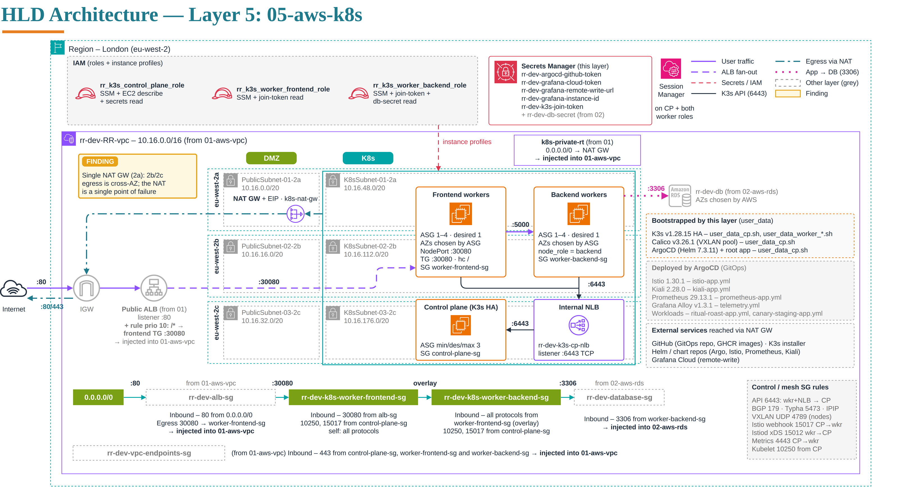

# Layer 5 - K8s on EC2 with GitOps

This Layer is by far the most jampacked Layer in the whole project. With ECS in Layer 4 we took the serverless route with Fargate where we entrusted the responsibility of managing the servers our ECS Task containers were running on to AWS. In this Layer we take back that control building and operating an entire **Kubernetes cluster from scratch**; the control plane, the pod network, the service mesh, and the **Continuous Deployment (CD) pipeline** that keeps it in sync with Git. We do this on plain EC2 instances, with nothing managed by AWS Serveless. We host a live comparison between the original app ("V1") and a rewritten challenger ("V2"), shifting traffic between them using every major progressive-delivery strategy: Canary, blue-green, and shadow deployment.

<a href="documents/hld-architecture/layer5-hld.png">
  
</a>

This illistrates a highly available, self-managed **K3s Kubernetes cluster** integrated with **Istio Service Mesh** and **ArgoCD** to enable GitOps-driven application delivery, progressive canary rollouts, and comprehensive cluster observability.

**Key Highlights** Below are the main highlights based on the HLD above:

1. **High-Availability K3s Architecture** - Runs a dedicated 3-node Controlplane managed behind an Internal Network LoadBalancer (`Internal NLB`), paired with separate AutoScaling Groups for Frontend and Backend worker nodes.

2. **GitOps & Advanced Traffic Management** - Uses ArgoCD for automated, declarative application synchronization, combined with Istio and Kiali to manage traffic routing, canary rollouts, and microservice visualization.

3. **Tiered Security & Network Isolation** - Ingress traffic flows from the Public ALB to Frontend workers on dedicated NodePorts, while database access (`port 3306`) is strictly restricted to Backend worker nodes.

4. **Full-Stack Observability** - Deploys Prometheus for cluster-level metric gathering and Grafana Alloy to stream telemetry data securely to Grafana Cloud.

5. **Centralized Egress Routing** - Manages outbound internet traffic for container image pulls, Helm chart downloads, and external API requests through a central NAT Gateway.

In summary, we're going to accomplish the following:

1. Spin up EC2 instances and prepare them to house Kubernetes controlplane and worker nodes
2. Setup the networking and security to facilitate smooth traffic flow
3. Deploy our application using a light weight production version of Kubernetes, K3S, with GitOPs
4. Test various deployment strategies with Istio
5. Setup observability with Kiali and Grafana Cloud Dashboards

## Costs Summary

Note, this is the most expensive of the Layers in this project. The following are some of the highest contributers to costs:

1. **EC2 Costs** - The choice of **instance type** is **t3.medium** and for control plane we have 3 of those and 2 for worker nodes. It is possible to run this with **t3.small** but the preference was for plenty of room in terms of capacity. Feel free to drop these to `t3.small` but if you get **Out Of Memory KIlls (`OOMKILL`)** then you know why.
2. **Additional credentials in Secrets Manager** - To securely pass the GitHub PAT to Argo CD and the Grafana credentials to Grafana Alloy (or Prometheus), it is safer to store them in AWS Secrets Manager and have the External Secrets Operator (ESO) retrieve them at runtime to synchronize them as Kubernetes Secrets.b and Grafana Cloud.

# Dev environment

We have the usual structure, nothing new that we haven't seen before: We have resources created in one module being consumed in other modules, creating implicit dependencies. We have an explicit dependency, the **compute_k8s** module depends on **network_k8s** module (`depends_on = [ module.network_k8s ]`) meaning the NAT gateway must be created before we launch the control plane and worker nodes EC2 instances.

## Sensitive values

The GitHub PAT and the Grafana credentials are exported into TFVARS via the terminal and directly into variables marked as sensitive. Below are examples of this:

```hcl
variable "github_pat" {
  description = "GitHub Personal Access Token for ArgoCD"
  type        = string
  sensitive   = true
}

variable "grafana_token" {
  description = "Grafana Cloud API token (bearer token)"
  type        = string
  sensitive   = true
  default     = "PENDING_TOKEN"
}
```

Marking them as sensitive means that they will not be printed directly in the terminal, as clear text when included in outputs, but they will show up in the state file as plain text.

# Modules

Lets take a detailed look at the modules that this project is comprise of. Once we have a good grasp of the contents then we'll turn our attention to the **Kubernetes manifest directory `k8s_manifests`** where we'll play with the deployment strategies and more.

## Security Groups (`security_k8s`)

In this architecture, security enforcement is split into two distinct layers:

1. **AWS Security Group (Macro Transport)** - This is the AWS specific security enforcement on AWS resources, it acts as a node-to-node boundary. It ensures that only instances in the Frontend worker group can physically send packets to the Backend worker group, completely blocking the public internet, database, or untrusted VPC resources from reaching Backend instances.
2. **Istio & K8s Network policies (Micro zero trust)** - This is the granular Kubernetes specific security enforcement, where **"HTTP only"** is enforced. Istio inspects the inner Layer 7, application layer, traffic inside the node, authenticates the Frontend's cryptographic key and uses policies to authorize the Frontend to make `GET/POST` HTTP requests to specific backend paths. We'll cover more on Kubernetes and Istio later.

In this section we create the security Groups and push the GitHub PAT and the Grafana credentials to Secrets Manager.
Lets review them one by one.

### [nlb-sg](https://github.com/ManunEbo/Terraform-AWS-Ritual-Roast-Part-2-Containerised/blob/main/infrastructure/05-aws-k8s/modules/security_k8s/nlb-sg.tf)

This security group is for the internal Network Loadbalancer, for **High Availability (HA) controlplane**. Note the NLB itself is created in the **compute_k8s** module along side the controlplane launch template. This loadbalancer exists to facilitate communication between the worker nodes and the controlplane nodes. Worker nodes do not connect directly to a single controlplane instance's IP address. Instead they connect to this internal NLB, which evenly distributes API traffic across all three controlplane instances. Thus this security group ensures that only authorized worker nodes can communicate with the NLB, and that the NLB can only forward that traffic to the controlplane.

```hcl
resource "aws_security_group" "rr_k8s_nlb_sg" {
  name        = "rr-${var.environment}-k8s-nlb-sg"
  description = "Security group for the internal K3s API Network Load Balancer"
  vpc_id      = var.vpc_id

  tags = merge(var.common_tags, {
    Name = "rr-${var.environment}-k8s-nlb-sg"
  })
}
```

Since we've already talked about components of security groups in Layer 4, we'll skip explaining what they do and focus on what makes this interesting: In the file there are three security group rules attached to this security group:

#### Ingress rules

1. `rr_nlb_ingress_from_frontend` - This ingress rule accepts traffic from the Frontend worker security group, `rr_k8s_worker_frontend_sg`, into the NLB on port 6443
2. `rr_nlb_ingress_from_backend` - This ingress rule accepts traffic from the Backend worker security group, `rr_nlb_ingress_from_backend`, into the NLB on port 6443

Worker nodes need to talk to the Kubernetes (k3s) API server continuously to report health, fetch secrets, and receive pod assignments. We're using port 6443 because it is the default/standard secure port for the Kubernetes API Server, **kube-apiserver** i.e. the main entry point to the controlplane serving as the communication hub for the entire cluster.

#### Egress rule

1. `rr_nlb_egress_to_cp` - This egress rule forwards traffic to the controlplane security group, `rr_k8s_control_plane_sg`, from the NLB security group, `rr_k8s_nlb_sg` on port 6443.

### [worker-backend-sg](https://github.com/ManunEbo/Terraform-AWS-Ritual-Roast-Part-2-Containerised/blob/main/infrastructure/05-aws-k8s/modules/security_k8s/worker-backend-sg.tf)

This security group is applied directly to the backend EC2 instances, providing a stateful firewall boundary around nodes hosting backend API workloads, Flask(V1), and Go(V2).

```hcl
resource "aws_security_group" "rr_k8s_worker_backend_sg" {
  name        = "rr-${var.environment}-k8s-worker-backend-sg"
  description = "Security group for k3s backend worker nodes"
  vpc_id      = var.vpc_id

  tags = merge(var.common_tags, {
    Name = "rr-${var.environment}-k8s-worker-backend-sg"
  })
}
```

Lets now turn our attention to the Security Group rules:

#### Ingress rules

1.  `rr_backend_ingress_from_frontend` - Allows Frontend worker nodes to initiate direct network connections to Backend worker nodes across the Calico pod network. Frontend microservices/pods (Next.js/Vite) require this access to forward client API requests to backend pods (Flask/Go).
    **Ports `from_port = 0, to_port = 0`** - Setting both ports to `0` opens all ports **(0-65535)**. Pods inside the Kubernetes overlay network dynamically request arbitrary ports for example; port 5000 for Flask/Go APIs, Istio Envoy proxy telemetry ports, and internal health checks; require unrestricted port access between Frontend and Backend worker nodes.
    **Protocol `-1`** - `-1` means **"ALL protocols"** in AWS Security Groups (TCP,UDP,ICMP,etc). We're using it here because overlay traffic encapsulated by Calico carries diverse internal protocol types between application containers i.e. in using `-1` we leave the Security Group open ended, from the Frontend, so that we don't have to specify a rule for each port that might be required by Kubernetes, Calico, Istio, CoreDNS and telemetry agents such as Grafana.
2.  `rr_backend_ingress_from_cp` - This allows the K3s controlplane to talk to the Kubelet daemon running on Backend worker nodes. This is required for administrative commands like streaming container logs, `kubectl logs`, executing commands inside backend pods, `kubectl exec`, and monitoring pod lifecycle states.
    **Ports `from_port = 10250, to_port = 10250`** - Port 10250 is the standard hard coded HTTPS API port where the Kubernetes `Kubelet` agent listens for commands coming from the API server
    **Protocol `tcp`** - This is used because Kubelet communications relies on stateful, TLS encrypted HTTP/2 streams over TCP to guaramtee data delivery and session security.
3.  `rr_backend_ingress_istio_webhook` - This allows the controlplane API server to communicate with the Istio sidecar injector mutating webhook running on worker nodes. When a new Backend pod deployment is created, the Kubernetes API server calls this webhook to automatically inject the Envoy sidecar container into the pod spec before scheduling.
    **Ports `from_port = 15017`, `to_port = 15017`** - This is the default port used by Istio's `istiod` controlplane for webhook admission reviews.
    **Protocol `tcp`** - `tcp` is required because admission webhooks exchange JSON payloads via TLS-encrypted HTTPS requests, demanding guaranteed packet delivery.
4.  `rr_backend_ingress_calico_bgp_cp` - This allows **Border Gateway Protocol (BGP)** routing traffic between controlplane nodes and Backend worker nodes. Calico uses BGP to broadcast pod IP routing tables across all cluster nodes so every node knows which EC2 instance hosts which pod IP.
    **Ports `from_port = 179`, `to_port = 179`** - This is the standard **IANA-registered** port for BGP communication.
    **Protocol `tcp`** - `tcp` is the underlying transport protocol for BGP, ensuring that routing table updates are delivered reliably and in order across cluster nodes.
5.  `rr_backend_ingress_calico_vxlan_cp` - This allows VXLAN-encapsulated pod traffic to flow between controlplane nodes and Backend worker nodes. It prevents AWS ENI source/destinatin checks from silently dropping cross-node pod traffic.
    **The problem VXLAN solves in Kubernetes on AWS** - In a Kubernetes cluster, every pod receives its own internal IP address e.g. `192.168.x.x`, this IP is not part of the VPC CIDR block. AWS VPC networking only recognizes the primary IP addresses assigned to EC2 ENIs i.e. the VPC CIDR range IPs. If **node 1 `10.0.1.50`** attempts to send a raw packet from a Frontend pod `192.168.1.10` to a Backend pod `192.168.2.20` on **Node 2 `10.0.2.60`**, AWS networking **drops** the packet because AWS does not recognize `192.168.2.20` on that subnetwork interface.
    **How VXLAN encapsulation works step by step**
    - **Inner Packet Creation** - Pod A `192.168.1.10` sends an API request targeted to Pod B `192.168.2.20`.
    - **Encapsulation (Outer envelope)** - Calico's network interface on **Node 1** intercepts the packet and wraps the original payload inside a UDP datagram.
      - **Outer source IP** - Node 1 `10.0.1.50`
      - **Outer destination IP** - Node 2 `10.0.2.60`
      - **Outer destination Port** - UDP 4789
      - **VXLAN Header** - Contains a 24-bit VXLAN network identifier(VNID) to keep isolated virtual networks separate.
    - **VPC transit** - AWS routes the packet across subnets as a standard EC2-to-EC2 UDP packet on port 4789. AWS security groups pass it because it matches authorized host-to-host traffic.
    - **Decapsulation** - Node 2 receives the UDP packet on port 4789. Calico strips off the outer IP, UDP, and VXLAN headers, exposing the original inner packet, and delivers it to pod B.

    **Port `from_port = 4789`, to_port = `4789`** - Port `4789` is the official IANA port allocated for VXLAN (Virtual Extensible Local Area Network) encapsulation.
    **Protocol `udp`** - `udp` is used because VXLAN wraps inner pod IP packets inside lightweight, stateless UDP datagrams to avoid the performance overhead and latency of double-TCP encapsulation.

6.  `rr_backend_ingress_self` - This permits backend worker nodes to communicate freely with other backend worker nodes in the same security group. This is required because backend microservice replicas, distributed datastores, and service mesh sidecars spread across multiple backend instances need inter-node communication.
    **Ports `from_port = 0`, `to_port = 0`** - Setting both ports to `0` opens all ports (0-65535) so Backend nodes can exchange internal overlay data, container traffic, and daemon communication without restriction.
    **Protocol `-1`** - `-1` permits ALL protocols, allowing unrestricted inter-node communication regardless of transport layer type.
7.  `rr_rds_ingress_from_backend` - This modifies the Layer 2 RDS MySQL security group by adding an inbound rule allowing connections from Backend worker nodes. It enables the Flask (v1) and Go (v2) Backend API pods to query and write data to the database.
    **Ports `from_port = 3306`, `to_port = 3306`** - `3306` is the MySQL default port.
    **Protocol `tcp`** - `tcp` is required because relational databases demand stateful, reliable connection sessions to guarantee ACID-compliant query execution and transactions.
8.  `rr_endpoints_ingress_from_wkr_backend` - This injects an ingress rule into the Layer 1 VPC Endpoints security group, allowing backend nodes to access AWS PrivateLink endpoints. It lets Backend pods securely fetch database passwords and tokens from AWS Secrets Manager without leaving the private AWS network backbone.
    **Ports `from_port = 443`, `to_port = 443`** - This is the standard HTTPS interface used by AWS API endpoints.
    **Protocol `tcp`** - This ensures reliable, encrypted TLS connection state when interacting with AWS service APIs.
9.  `rr_backend_ingress_typha_cp` - This allows controlplane nodes to connect to **Calico Typha** instances running on Backend worker nodes. Typha caches and fans out Kubernetes datastore state updates to Calico agents, preventing hundreds of pods from overwhelming the API server with direct watches
    **The problem Typha solves: The "Thundering Herd" Effect**
    In a standard Calico setup without Typha, every single worker node runs a `calico-node` pod. Each `calico-node` pod must constantly watch the Kubernetes API server and underlying `etcd` data store for changes to: **Pod IP assignment**, **Network policies**, **Service endpoints**, **Node status changes**.
    **Whithout Typha (Direct Watches)**
    If we have **50 worker nodes**, we have 50 `calico-node` instances independently opening persistent watch connections to the API server. Every time a single pod is created, deleted, or assigned an IP, `etcd` and the API server must calculate and broadcast that update 50 separate times across 50 TCP streams.
    **With Typha (Fan-Out Cache)**
    Typha acts as an intermediary caching proxy. Typha opens one single watch connection to the K3s API server. When network states change, the API server updates Typha once. Typha then fans out (distributes) those updates to all `calico-node` agents over port 5473. This reduces the load on `etcd` and the API server by up to 95%, drastically cutting down CPU and memory overhead on the controlplane.
    **Ports `from_port = 5473`, `to_port = 5473`** - Port 5473 is the default port assigned to Calico Typha for serving state synchronization clients.
    **Protocol `tcp`** - this is require to maintain persistent, ordered state streams between TYpha servers and Calico node daemons.
10. `rr_backend_ingress_ipip_cp` - This allows **IP-in-IP (IPIP)** encapsulated packets from controlplane nodes to enter Backend worker nodes. This serves as a zero-trust fallback overlay mechanism if Calico transitions or falls back from VXLAN to IPIP encapsulation.
    **The problem IPIP solves**
    In Kubernetes, **every pod in a cluster must be able to communicate with every other pod on any node directly by its IP address, without using Network Address Translation, NAT**. This conflicts with cloud network; with respect to our security groups, pods are on a different CIDR block to our VPC CIDR. As a result the security groups drop pod to pod packets between pods in different nodes.
    **IPIP vs VXLAN**
    IPIP and VXLAN both solve the exact same network routing problem: Tunneling pod packets across physical networks, but they do it at different network layers with different trade-offs:
    a. **Lower Overhead - Higher Performance** - IPIP adds 20 bytes of header overhead to every packet, VXLAN adds 50 bytes. Note, less overhead means more space for actual application payload data per packet.
    b. **CPU Efficiency** - Because IPIP operates directly inside the Linux Kernel at Layer 3, it bypasses the Layer 4 UDP networking stack entirely consuming fewer CPU cycles per packet than VXLAN.
    **Ports `from_port = 0`, `to_port = 0`** - This is set to `0` because **IP-in-IP** operates directly at Layer 3, Network Layer, of the OSI model and does not use Layer 4 transport ports like TCP or UDP.
    **Protocol `4`** - `4` is the official IP protocol number for **IPv4-inIPv4** encapsulation (IPIP). We must specify `4` instead of `tcp` or `udp` because raw IPIP packet headers bypass standard transport protocols.
11. `rr_backend_ingress_metrics_cp` - This allows the controlplane to scrape node and pod resource usage metrics from the **Metrics Server** running on Backend worker nodes. This data powers CPU/Memory metrics shown in `kubectl top` and enables **Horizontal Pod Autoscalers (HPA)** to scale pods.
    **Ports `from_port = 4443`, `to_port = 4443`** - This is the default secure port served by the Kubernete Metrics Server extension API.
    **Protocol `tcp`** - This is used to ensure reliable scraping of HTTPS metrics endpoints by the controlplane.

#### Egress rules

1. `rr_backend_egress_vpc` - This authorizes backend nodes to send outbound network traffic to any target within the VPC CIDR block. This allows backend nodes to reach controlplane instances, internal NLBs, the RDS database, and VPC endpoints
   **Ports `from_port = 0`, `to_port = 0`** - This covers all ports to give worker nodes full internal access across all services inside the VPC boundaries.
   **Protocol `-1`** - This allows ALL protocols to accommodate all internal cluster, overlay, and database traffic patterns.
2. `rr_backend_egress_https` - This allows backend nodes to initiate outbound HTTPS connections to the public internet via the NAT gateway. Backend nodes require this to pull container images from GitHub container registry **ghcr.io** and send telemetry data to Grafana Cloud.
   **Ports `from_port = 443`, `to_port = 443`** - This is the standard HTTPS port
   **Protocol `tcp`** - This provides the necessary connection transport for TLS handshakes and secure data transfers over HTTPS.
3. `rr_backend_egress_http` - This allows backend nodes to initiate outbound unencrypted HTTP web requests to the internet. It is needed during instance bootstrapping to download Linux system packages `dnf update`, pull K3s binaries, and retrieve repository GPG keys.
   **Ports `from_port = 80`, `to_port = 80`** - This is the standard unencrypted HTTP port.
   **Protocol `tcp`** - This provides reliable packet delivery required for downloading installation binaries and Linux OS packages over HTTP.

### [worker-frontend-sg](https://github.com/ManunEbo/Terraform-AWS-Ritual-Roast-Part-2-Containerised/blob/main/infrastructure/05-aws-k8s/modules/security_k8s/worker-frontend-sg.tf)

This security group is applied directly to the Frontend EC2 instances, providing a stateful firewall boundary around nodes hosting Frontend API workloads, Next.js(V1), and Vite(V2).

```hcl
resource "aws_security_group" "rr_k8s_worker_frontend_sg" {
  name        = "rr-${var.environment}-k8s-worker-frontend-sg"
  description = "Security group for k3s frontend worker nodes"
  vpc_id      = var.vpc_id

  tags = merge(var.common_tags, {
    Name = "rr-${var.environment}-k8s-worker-frontend-sg"
  })
}
```

The associated security group rules are identical reverses to the Backend security group rules. So we'll skip a repeat of them and focus on what is different.

1. **Istio HTTP Ingress via NodePort `rr_frontend_ingress_http_alb` & `rr_alb_egress_to_frontend_http`** - This pair of rules permits public web traffic from our AWS ALB into the Frontend EC2 instances. The ALB receives internet traffic and forwards it directly to the Istio ingress gateway pod running on the Frontend worker nodes, allowing Istio to accept and route external HTTP requests into our Kubernetes service mesh.
   **Ports `from_port = 30080`, `to_port = 30080`** - `30080` is the explicitly configured static `NodePort` mapping bound to Istio's HTTP entry point
   **Protocol `tcp`** - TCP is required because HTTP/HTTPS traffic depends on reliable, connection-oriented Layer 4 transport to handle web requests, TLS handshakes, and response streams.
2. **Istio Mutating Webhook `rr_frontend_ingress_istio_webhook`** - This allows the Kubernetes API server, running on the controlplane, to communicate with Istio's sidecar injection webhook on the Frontend nodes. Whenever a new pod is deployed into Istio-enabled namespace, the API server makes an HTTPS call to this webhook so Istio can automatically inject the Envoy proxy sidecar container into the deployment before the pod starts.
   **Ports `from_port = 15017`, `to_port = 15017`** - This is the default/standard target port exposed by `istiod` for admission webhook reviews and sidecar injection logic.
   **Protocol `tcp`** - Kubernetes admission webhooks use strict HTTPS endpoint calls. TCP ensures packet ordering, loss prevention, and TLS encryption during pod admission evaluations.
3. **Backend-to-Frontend Typha Fan-out `rr_frontend_ingress_typha_backend`** - This allows `calico-node` daemons running on Backend worker Nodes to connect to Typha instances hosted on Frontend worker nodes. Because Typha pods are scheduled across the worker node pool, Backend nodes must reach out to Frontend nodes across the network boundary to receive their cached network updates.
   **Ports `from_port = 5473`, `to_port = 5473`** - This is the standard, dedicated Remote Procedure Call, RPC, port used by Calico Typha to serve network state sync data to clients.
   **Protocol `tcp`** - Calico uses a persistent TCP stream to ensure real-time, ordered delivery of network security rules and routing tables without dropping updates.

### [controlplane-sg](https://github.com/ManunEbo/Terraform-AWS-Ritual-Roast-Part-2-Containerised/blob/main/infrastructure/05-aws-k8s/modules/security_k8s/controlplane-sg.tf)

This security group is for the controlplane group of nodes. It provides protection from unwanted access while facilitating required access for Frontend and Backend group of nodes as well as the internal NLB. Once again, since security groups require an egress in one end and an ingress in the other to accept the traffic much of the rules in this section are the counter parties to the rules both the worker security groups. We will skip those rules and focus on what's different. Lets have a look at the rules:

1. **Kubernetes API Server Access `rr_cp_ingress_api_from_frontend`, `rr_cp_ingress_api_from_backend`, `rr_cp_ingress_api_from_nlb`** - These rules allow worker nodes (Kubelet, Kube-Proxy, CNI daemons) and the internal NLB to communicate with the K3s controlplane. The API server is the central orchestration brain of the cluster: worker nodes need to reach it to report health, pull pod specs, and fetch secrets. The NLB uses this to route `kubectl` commands from administrators/CI-CD pipelines and perform controlplane health checks. More on the role of the NLB in the compute section.
   **Ports `from_port = 6443`, `to_port = 6443`** - This is the standard default port reserved by Kubernetes and K3s for secure API server communication.
   **Protocol `tcp`** - TCP is required because all Kubernetes API calls are HTTPS REST requests and persistent gRPC streams that require TLS encryption and stateful packet ordering.
2. **Istiod xDS Discovery Service `rr_cp_ingress_istiod_frontend`, `rr_cp_ingress_istiod_backend`** - This allows envoy sidecar proxies running on Frontend and Backend worker nodes to reach `istiod` on the controlplane. Envoy proxies use this connection to continuously pull dynamic configuration changes such as service discovery maps, mTLS encryption keys, routing rules, and rate limits, without needing a container restart.
   **Ports `from_port = 15012`, `to_port = 15012`** - This port is the dedicated, TLS-encrypted port used by Istio's xDS (eXtensible Discovery Service) protocol to push controlplane configurations to worker proxies.
   **Protocol `tcp`** - The xDS protocol operates over gRPC (on top of HTTP/2 and TCP), requiring long-lived, bidirectional TCP connections to stream live mesh updates.
3. **Calico BGP Routing Ingress `rr_cp_ingress_calico_bgp_frontend`, `rr_cp_ingress_calico_bgp_backend`** - This allows Calico daemons on worker nodes to establish Border Gateway Protocol (BGP) peering connections with the controlplane. While VXLAN handles data packet encapsulation. Calico uses BGP to broadcast and synchronize internal Layer 3, OSI Network Layer, pod IP routing tables across all nodes in the cluster.
   **Ports `from_port = 179`, `to_port = 179`** - This port is the standard IANA-assigned port for BGP networking.
   **Protocol `tcp`** - BGP relies on TCP to ensure reliable neighbor discovery and loss-free routing table syncs between nodes.
4. **Inter-node-connectivity `rr_cp_ingress_self`** - This is a self-referential security group rule. Notice that both `security_group_id` and `source_security_group` point to `aws_security_group.rr_k8s_control_plane_sg.id`. This creates a trusted, private communication zone exclusively between the EC2 instances assigned to the controlplane.
   **Why we need it**
   A High-Availability (HA) Kubernetes controlplane runs multiple nodes that must constantly sync cluster state in real time:
   - **`etcd` Consensus & Leader election** - Embedded `etcd` nodes use the Raft consensus algorithm, ports `2379` and `2380`, to replicate every single cluster change, hold leader elections, and maintain heartbeat signals.

   - **Controlplane Mesh & Health checks** - K3s components; controller-manager, scheduler, API servers; and CNI pods running accross the CP nodes require uninterrupted communication.
     If a single packet or port gets blocked between controlplane nodes during an `etcd` leader election or state sync, `etcd` can lose quorum, putting the entire Kubernetes API into a read-only or frozen state.

   **Ports & Protocol** - Setting both ports to `0` acts as a complete wildcard meaning all ports `0-65535`. Note, in AWS Security Group API, whenever Protocol is set to `-1`, **All Protocols**, AWS strictly requires `from_port` and `to_port` to be set to `0`. This is because non-Layer 4 OSI protocols such as ICMP or raw IP protocol 4, don't have the concept of TCP/UDP port numbers.

   **Why we use `protocol = -1`**
   In AWS security group syntax, `protocol = -1` represents ALL IP Protocol (TCP, UDP, ICMP, IPIP Protocol 4, GRE, etc). Controlplane nodes communicate using multiple different network protocols:
   - **TCP** - For `etcd` peer sync, K3s datastore traffic, and API endpoints

   - **UDP** - For Calico VXLAN overlay tunneling

   - **ICMP** - For diagnostic pings and MTU path discovery between hosts.

   - **Protocol 4** - For Calico IPIP tunneling fallbacks
     Instead of defining 10+ separate granular rules for node-to-node traffic within the same Security Group, we set `protocol = -1` to create this trusted perimeter. Since traffic is strictly bounded by identity, `source_security_group_id`, traffic originating from unmatched instances will be denied access.

### [nlb-sg](https://github.com/ManunEbo/Terraform-AWS-Ritual-Roast-Part-2-Containerised/blob/main/infrastructure/05-aws-k8s/modules/security_k8s/nlb-sg.tf)

This security group controls network traffic for the private AWS Network Loadbalancer (NLB) that sits in front of the K3S controlplane API servers. It establishes an internal, high-availability proxy layer, ensuring only authorized cluster worker nodes can route requests through the NLB to reach the Kubernetes API, `kube-apiserver`. Lets look at the security group rules attached:

1. **Worker Node ingress `rr_nlb_ingress_from_frontend` & `rr_nlb_ingress_from_backend`** - These rules allow the respective worker nodes in both the Frontend and Backend security groups to send inbound traffic to the NLB endpoint. Daemons running on worker nodes such as; `kubelet`, `kube-proxy`, and Calico agents; communicate with the Kubernetes API server via the NLB rather than targeting a single controlplane IP, maintaining uptime if an individual controlplane instance fails.
   **Ports `from_port = 6443`, `to_port = 6443`** - This is the default port reserved for encrypted Kubernetes API server communications.
   **Protocol `tcp`** - Kubernete API calls are standard HTTPS/TLS REST requests and gRPC streams. TCP is required to guarantee packet delivery, ordering, and session persistence across the network.
2. **Controlplane Egress `rr_nlb_egress_to_cp`** - This permits the NLB to forward accepted worker node traffic and send health check probes out to the controlplane EC2 instances. This complements the ingress rule above i.e. it completes the path through the Loadbalancer: traffic enter the NLB via the ingress rules above and exits through this egress rule towards the backend targets.
   **Ports `from_port = 6443`, `to_port = 6443`** - This matches target port `6443` where the K3s API server processes incoming controlplane requests.
   **Protocol `tcp`** - This ensures reliable, end-to-end TCP TLS-encrypted API traffic and health check connections between the Loadbalancer and the controlplane target instances.

That concludes the Security Groups aspect of this module. Lets now turn our attention to other files in this module

### [cluster_join_token_secret](https://github.com/ManunEbo/Terraform-AWS-Ritual-Roast-Part-2-Containerised/blob/main/infrastructure/05-aws-k8s/modules/security_k8s/cluster_join_token_secret.tf)

This group of resources automatically generates a secure, random cluster join token and stores it in AWS Secrets Manager. When new EC2 instances boot up, their startup scripts, userdata, retrieves this token from Secrets Manager. Once retrieved, the token is used to authenticate/join the K3s cluster. This avoids hardcoding secrets in code/userdata or manually copying tokens across nodes.

1. **`random_password.k3s_join_token`** - Thisis a Terraform provider resource that creates a cryptographically strong random string in memory during `terraform apply`. K3S require a shared secret, **`K3S_TOKEN`** for any server or worker node to join an existing cluster. Generating it dynamically guarantees unique, non-predictable credentials across environments
   **`length = 32`** - Generates a 32-character string, providing high cryptographic entropy to prevent brute-force attacks
   **`special = false`** - Excludes special characters e.g.`!@#$%`. This prevents syntax or escape errors when bash scripts inject the token into environment variables or terminal flags on the EC2 instances.
2. **`aws_secretsmanager_secret.rr_k3s_join_token`** - This creates the AWS Secrets Manager container metadata object in our AWS account. It provides an encrypted AWS endpoint where nodes can retrieve the secret dynamically, by assuming their IAM role/IAM instance profile.
   **`recovery_window_in_days = 0`** - This overrides AWS's default 7-to-30 soft delete grace period, forcing the secret to be destroyed immediately after running `terraform destroy`.
3. **`aws_secretsmanager_secret_version.rr_k3s_join_token_val`** - This holds and manages the actual sensitive value, **the join token**, inside the secret's container, `rr_k3s_join_token` i.e. AWS decouples secret metadata management from the secret data payload/value. This resource populates the container created, above, with the string produced by the random generator.
   **`secret_id = aws_secretsmanager_secret.rr_k3s_join_token.id`** - Links this secret versio to the parent Secrets Manager resource created in step 2.
   **`secret_string = random_password.k3s_join_token.result`** - Extracts the generated 32-character string from `random_password` and writes it into the secret body.

### [github_pat_secret](https://github.com/ManunEbo/Terraform-AWS-Ritual-Roast-Part-2-Containerised/blob/main/infrastructure/05-aws-k8s/modules/security_k8s/github_pat_secret.tf)

Here we create an AWS Secrets Manager secret to store the GitHub Personal Access Token (PAT) which was passed dynamically into Terraform via the terminal environment variable, `TF_VAR_github_pat`. This will then be retrieved by Kubernetes via ArgoCD to authenticate against `ghcr.io` to pull private container images and or check for updates. This is necessary to avoid hardcoding raw credentials into source control.

Much of the setup we've already seen previously, so lets skip repetition:

1. **`resource "aws_secretsmanager_secret" "rr_github_pat" {}`** - This resource creates the secret shell in AWS Secrets Manager.
2. **`resource "aws_secretsmanager_secret_version" "rr_github_pat_val" {}`** - This resource injects the actual value into the secret shell above:
   **`secret_string = var.github_pat`** - and this is how the secret is passed in.

### [grafana_token_secret](https://github.com/ManunEbo/Terraform-AWS-Ritual-Roast-Part-2-Containerised/blob/main/infrastructure/05-aws-k8s/modules/security_k8s/grafana_token_secret.tf)

Like the GitHub Pat above, here we take values injected via environment variables for Grafana and provision three distinct secrets in AWS Secrets Manager which will be retrieved for pushing metrics from K3s cluster to Grafana Cloud.

Since we've already seen how to create the secret in Secrets Manager and how to create the secret version to pass the value, we'll skip that and focus on what's different.

1. **Grafana API/Publisher token `rr_grafana_token` & `rr_grafana_token_val`** - These serve as the authentication password/bearer token when making HTTP POST requests to ship metrics to Grafana Cloud.
2. **Grafana Cloud Metrics Ingestion URL `rr_grafana_remote_write_url` & `rr_grafana_remote_write_url_val`** - These define the exact destination URL where in-cluster monitoring agent pushes metrics to Grafana Cloud.
3. **Grafana Instance /User ID `rr_grafana_instance_id` & `rr_grafana_instance_id_val`** - Grafana Cloud uses multi-tenant architecture. The instance ID acts as the HTTP basic authentication i.e. the instance ID acts as the username, and the token acts as the password. Together, they prove the cluster's identity to Grafana Cloud ensuring metrics route into the specific Grafana Cloud organization space.

## IAM (`iam_k8s`)

In this section we review the IAM roles and attached policies that enable our various groups of EC2 instances; Frontend workers, Backend workers, and controlplane; to perform required tasks within our VPC and to communicate with external resources. Since we've covered IAM roles adequately in other modules, we'll skip the technical explaination and focus on what the resources facilitate.

### [worker-frontend](https://github.com/ManunEbo/Terraform-AWS-Ritual-Roast-Part-2-Containerised/blob/main/infrastructure/05-aws-k8s/modules/iam_k8s/worker-frontend.tf)

Here we create the IAM role for the Frontend worker nodes, `rr_k3s_worker_frontend_role`. It defines the AWS identity and baseline permissions for the Frontend K3S worker EC2 instances. It establishes a trusted relationship with the AWS EC2 service, `ec2.amazonaws.com`, allowing instances to acquire short-term AWS credentials dynamically without storing hardcoded access keys on disk.
**Custom policy `rr_worker_frontend_custom_policy`** - This enforces strict least-privilege access for frontend worker nodes. It grants permission to read only the K3s cluster join token secret, `rr-${var.environment}-k3s-join-token-*`, from AWS Secrets Manager. Note that the Frontend workers are explicitly restricted from reading sensitive Backend secrets, such as GitHub Pat, Grafana Cloud telemetry tokens, and RDS database credentials. That's because we're operating a zero trust least privilege security posture and the Frontend has no requirement for more credentials than what it's assigned.
**Policy attachments** - Lets take a look at what the policies we're attaching do:

- `AmazonSSMManagedInstanceCore` - This enables AWS Systems Manager (SSM) agent functionality. It lets administrators securely connect via **SSM Session Manager** for shell access without opening inbound SSH port `22` in security groups, while enabling automated OS patching and inventory tracking.

- `rr_worker_frontend_custom_attach` - This attaches the custom join token policy above to the role, enabling the Frontend nodes startup script, userdata, to fetch the `K3S_TOKEN` required to join the K3s controlplane on boot.

**Instance Profile `rr_k3s_worker_frontend_profile`** - An Instance Profile is a bridge container used by AWS to pass an IAM Role to an EC2 instance. This is because an IAM role cannot be attached directly to an EC2 instance in AWS. Instead an Instance Profile is attached to the virtual machine. The Instance Profile delivers the role's temporary credentials to the instance via the **Instance Metadata Service (IMDS)**, which local processes like the AWS CLI or SSM agents query automatically.

### [worker-backend](https://github.com/ManunEbo/Terraform-AWS-Ritual-Roast-Part-2-Containerised/blob/main/infrastructure/05-aws-k8s/modules/iam_k8s/worker-backend.tf)

Here we create the IAM role for the Backend worker nodes, `rr_k3s_worker_backend_role`. It is practically identical to the Frontend role above with the exception of an extra privilege in the custom policy `rr_worker_backend_custom_policy` to retrieve the database credentials from Secrets Manager,`secret:rr-${var.environment}-db-secret-\*`. This is needed because the Backend group of instances house the Backend containers that need to communicate with the database: sending and retrieving data.

### [controlplane](https://github.com/ManunEbo/Terraform-AWS-Ritual-Roast-Part-2-Containerised/blob/main/infrastructure/05-aws-k8s/modules/iam_k8s/controlplane.tf)

Here we create the IAM role for the controlplane group of nodes, `rr_k3s_control_plane_role`. It enables them to interact with AWS APIs during startup and runtime to discover peer node for High Availability (HA) clustering and to fetch essential system secrets required to bootstrap the cluster and GitOps tooling.

As usual we'll skip what we've already seen and focus on what is different.

#### Custom policy

The custom policy, `rr_cp_custom_policy`, grants two specific permission sets required by the master nodes:

1. **EC2 Peer Discovery `ec2:DescribeInstance`** - This allows startup scripts on controlplane nodes to query the AWS API and discover the IP addresses of sibling controlplane instances. This is necessary for HA leader election and forming the multi-node `etcd` consensus mesh automatically on boot.

2. **Platform Secrets Retrieval `secretsmanager:GetSecretValue` & `DescribeSecret`** - This grants read access to the master set of cluster bootstrapping and management secrets in AWS Secrets Manager:
   - **Cluster Join Token** - To validate and accept joining the cluster. All secondary controlplane nodes must join the cluster using the join token.

   - **GitHub PAT** - To configure ArgoCD with access to private GitHub container registries, `ghcr.io` and repositories within. Without this PAT, ArgoCD cannot authenticate against GitHub.

   - **Grafana Cloud Telemetry Triad** - To pull the Grafana Cloud API token, remote write ingestion URL, and Grafana instance ID for cluster-wide metrics collection i.e to be able to push to Grafana cloud we need these credentials to authenticate and push to the right organisation.

Notice the controlplane doesn't need to access the database thus we have removed the database secrets in the resource section, maintaining our least privileges policy stance.

### [outputs](https://github.com/ManunEbo/Terraform-AWS-Ritual-Roast-Part-2-Containerised/blob/main/infrastructure/05-aws-k8s/modules/iam_k8s/outputs.tf)

This module outputs the three instance profiles making them available to the root module to pass into the **compute_k8s** module.

## LoadBalancers (`load-balancers_k8s`)

In this module we configure the Layer 1 public ALB to forward 100% of the traffic to our Kubernetes cluster in Layer 5.

### [alb-ingress-wiring](https://github.com/ManunEbo/Terraform-AWS-Ritual-Roast-Part-2-Containerised/blob/main/infrastructure/05-aws-k8s/modules/load-balancers_k8s/alb-ingress-wiring.tf)

The resources in this file update the public ALB from Layer 1 to redirect all the traffic to our K3s cluster. The following will be accomplished herein: Create a target group pointing to the frontend worker nodes, **NodePort `30080`**; link the target group to the **frontend ASG**; add a high priority ALB listener rule to ensure 100% of the traffic is routed to Layer 5 K8s instead of Layer 4 ECS.

Lets look at each resource and its components, one by one:

#### Target Group `aws_lb_target_group.rr_k8s_frontend_tg`

This is a logical container that groups together backend destinations such as EC2 instances, IP addresses, containers, or Lambda functions, that receive traffic routed by an ALB. It serves as the bridge between public-facing ALB listener rules and the actual backend workload nodes. It specifies the health checks criteria and the pool of resources that this will be applied to. Note instead of specifying the destination in this resource, we link it to the frontend ASG via `aws_autoscaling_attachment` below.

**Lets look at interesting components**

1. `port = 30080` - This specifies the target port on worker instances where the Istio ingress gateway service is listening via Kubernetes `NodePort`.
2. `protocol = "HTTP"` - Traffic between the ALB and Istio proxy runs over unencrypted HTTP, the ALB handles SSL/TLS termination at the edge.
3. `vpc_id = var.vpc_id` - This links the target group to the cluster's VPC network i.e. it puts the target group in our VPC.
4. `target_type = "instance"` - This registers targets by EC2 instance ID rather than pod IP addresses.
5. `health_check {}` block - The target group continuously executes health probes against registered targets. The ALB routes traffic only to health targets i.e. targets that are currently passing these health checks. Lets examin its components:
   - `enabled = true` - Activates automated health probes from the ALB to the targets.

   - `path = "/"` & `port = "30080"` - This sends HTTP GET requests to `/` on port `30080` to verify Istio's availability.

   - `interval = 15` - This probes target every 15 seconds.

   - `timeout = 5` - Waits 5 seconds for a probe response before marking it failed.

   - `healthy_threshold = 2` - Requires 2 consecutive successful probes to mark a target healthy. Note, this is a preference.

   - `unhealthy_threshold = 3` - Marks a target unhealthy after 3 consecutive failures, removing it from active traffic distribution.

   - `matcher = "200"` - This expects a HTTP status code `200 OK` to pass the health check.

#### ASG attachment `aws_autoscaling_attachment.rr_k8s_frontend_asg_attach`

This binds the Frontend worker ECS ASG directly to the target group above. As worker instances scale out, scale in, or get replaced during maintenance, AWS automatically registers or deregisters their instance IDs from the target group without manual intervention.

**Components**

1. `autoscaling_group_name = var.frontend_worker_asg_name` - This passes the name of the Frontend worker ASG.
2. `lb_target_group_arn = aws_lb_target_group.rr_k8s_frontend_tg.arn` - Identifies which target group the ASG instances should join.

#### Listener Rule `aws_lb_listener_rule.rr_k8s_absolute_cutover`

While the listener process continuesly listens for incoming client connection requests on a specific protocol and port, a **Listener Rule** is a routing statement attached to a listener that inspects incoming requests and determines how to route them i.e. the listener acts as the entry point, **front door**, while the the listener rule serves as the traffic controller, **"traffic cop"**. Thus the rule defines granular criteria to evaluate incoming HTTP/HTTPS request headers and route traffic dynamically.

**Components**

1. `listener_arn = var.gateway_listener_arn` - This references the ARN of the public HTTP/HTTPS ALB listener created in Layer 1 i.e. this rule is to be appended to the specified listener.
2. `priority = 10` - This sets a high evaluation priority, **lower numbers execute first**. This ensures this rule matches incoming traffic before the default or lower-priority catch-all rules.
3. `action {}` block - This specifies what to do with the traffic. Lets look at its components:
   a. `type = "forward"` - This instructs the ALB to redirect/forward the matching HTTP requests.
   b. `target_group_arn = aws_lb_target_group.rr_k8s_frontend_tg.arn` - This specifies the target group ARN as the destination to forward to.
4. `condition {path_pattern { values = ["/*"] }}` - This intercepts all incoming URL paths `/*`, creating a 100% cutover of web traffic straight into the K3s Istio Ingress Gateway.

## Networks (`network_k8s`)

In this Layer our resources reside in private subnets with no internet access. However, our EC2 instances need access to the internet to download updates, to fetch images and code from GitHub, to push metrics to Grafana Cloud. Herein we enable outbound only internet access via the NAT gateway i.e. our instances will be able to reach the internet but nothing in the internet can initiate a connection to our EC2 instances, they remain hidden in private subnets.

Lets take a look at how we achieve this:

### [nat-gateway](https://github.com/ManunEbo/Terraform-AWS-Ritual-Roast-Part-2-Containerised/blob/main/infrastructure/05-aws-k8s/modules/network_k8s/nat-gateway.tf)

This file comprises three resources which combine to provide a secure route out to the public internet while remaining hidden behind private subnets in a private VPC. Lets dive into the resources one by one:

#### Elastic IP `aws_eip.rr_k8s_nat_eip`

AWS Managed NAT gateways require a static public IP address to perform **Network Address Translation** so external services recognize the outbound requests coming from the infrastructure.
This resource requests and allocates a persistent, static public IPv4 address from AWS to our VPC network. This static IP is called an **Elastic IP address (EIP)**. EIPs remain unchanged, attached, until released i.e. if we attach this to a resource the IP address doesn't change no matter what and it remains in our possession until we release it back to AWS.

**Components of interest**

1. `domain = "vpc"` - This instructs AWS to allocate the Elastic IP within the VPC scope. Making it available for us to attach to resources in our VPC, in this case a NAT gateway.

#### NAT gateway `aws_nat_gateway.rr_k8s_nat`

This provisions a managed NAT gateway device in a public subnet that translates private IP traffic from internal nodes into the assigned PUBLIC EIP before sending it to the IGW. This is because private subnets do not have public IP addresses or direct internet routes. The NAT gateway acts as a stateful proxy, allowing internal instances to make outbound HTTP/HTTPS calls while dropping all incoming traffic requests initiated from the outside internet.

**Components of interest**

1. `allocation_id = aws_eip.rr_k8s_nat_eip.id` - This associates the EIP created above to this NAT gateway.
2. `subnet_id = var.public_subnet_id` - This specifies the public subnet that the NAT gateway will be deployed in. Note, this subnet must have a direct route to the IGW.

#### Injected route `aws_route.rr_inject_k8s_internet_access`

Now that we have attached the EIP to the NAT gateway and placed it in a public subnet with access to the internet via IGW, we can create a route to the internet for resources in our private subnets: This resource dynamically appends a default route rule `0.0.0.0/0` to our pre-existing private route table. Note, deploying a NAT gateway does nothing on its own until private subnets know to send their traffic to it. Thus this route tells the OS routing layer on every private instance: **"If you got traffic destined for anywhere outside our local VPC, send it to the NAT gateway."**

**Components of interest**

1. `route_table_id = data.aws_route_table.k8s_rt.id` - This specifies the applicable route table i.e. this is the route table that our k8s subnets use.
2. `destination_cidr_block = "0.0.0.0/0"` - Matches all destination IP addresses outside the local VPC CIDR range i.e. if the IP address is not part of the VPC CIDR range then it is destined for the outside and this is the path to the outside, via the NAT gateway.
3. `nat_gateway_id = aws_nat_gateway.rr_k8s_nat.id` - Specifies the NAT gateway as the target i.e. send any matching traffic to this gateway.

# Compute (`compute_k8s`)

This module provides the final configurations for the three resource groups of compute instances; controlplane, frontend workers and backend workers. The following are the main tasks of this module:

1.  **Automated setup on boot** - Resource group specific startup scripts, **executed via launch templates**, are created that will run on every server in the group, at boot, ensuring the necessary application dependencies are met. This includes setting up Kubernetes i.e. installing k3s, Calico, Helm, ArgoCD; automatically retrieving specified secret keys from AWS without any manual intervention e.g. retrieving the cluster join token or the GitHub PAT.
2.  **Handles auto-scaling** - The launch templates are attached to ASGs to ensure that identical resources are created when initializing, scaling out or replacing unhealthy instances. ASGs are a dynamic cost effective means to ensure fault tolerant resilient highly available deployments.
3.  **Networking and security** - It brings together everything we've built, thus far, in this Layer in preparation for the K8s cluster: It connects these servers directly into the security groups, IAM permissions, network route, and ALB built in earlier Layers.

**What is Kubernetes**

Kubernetes is an open-source platform built by Google for automating the deployment, scaling, and management of containerized applications.
**The core problem it solves**
When running containers, like Docker containers, in production, the following questions emerge:

1.  What happens if a container crashes?
2.  How to distribute containers across multiple machines?
3.  How to roll out updates without downtime?
4.  How do apps find and talk to each other?

Kubernetes resolves all of the above, so you don't have to script it manually.

Lets take a closer look at the constituent files:

### [data](https://github.com/ManunEbo/Terraform-AWS-Ritual-Roast-Part-2-Containerised/blob/main/infrastructure/05-aws-k8s/modules/compute_k8s/data.tf)

data sources are used to retrieve resources created in other Layers, modules or AWS managed resources. In this file we retrieve two resources:

1. **`data "aws_ami" "rr_al2023"`** - This queries the AWS API to dynamically retrieve the ID of the latest official **Amazon Linux 2023 Amazon Machine Image (AMI)** in the current region. This ensures all cluster EC2 instances, controlplane and workers, spin up using an up-to-date base operating system without requiring manual hardcoded AMI update across environments.

   **Components**
   1. `most_recent = true` - This instructs Terraform to sort all matching results by creation date and pick the single newest AMI.
   2. `owners = ["amazon"]` - This limits the query to images officially published by Amazon Web Services, preventing the accidental selection of third-party or malicious community AMIs.

   3. `filter {}` block - This defines the search criteria to narrow down the thousands of available public AMIs:
      - `name = "name"` - This specifies that the filter targets the system name attribute of the AMI.

      - `values = ["al2023-ami-2023.*-x86_64"]` - This uses wildcard matching to select standard 64-bit(x86_64) Amazon Linux 23 base images e.g. `al2023-ami-2023.4.20240429.0-x86_64`

2. `data "aws_secretsmanager_secret" "rr_db_secret"` - This looks at the existing AWS Secrets Manager resource for the database credentials created in earlier layers, `rr-${var.environment}-db-secret`. By fetching this existing secret's metadata, the `compute_k8s` module can retrieve its exact ARN to pass into launch templates or IAM policies without needing to manage the secret's lifecycle or hardcode AWS account IDs. Note this is just a preference i.e. this data source could be used directly where it is needed, in place.

### [user_data_cp](https://github.com/ManunEbo/Terraform-AWS-Ritual-Roast-Part-2-Containerised/blob/main/infrastructure/05-aws-k8s/modules/compute_k8s/user_data_cp.sh)

This script is the automated "ignition sequence" for the Kubernetes controlplane. When an EC2 instance boots up, for controlplane, this script transforms it from a blank Linux server into a fully functioning Kubernetes master node. Collectively, it achieves three fundamental milestones:

1. **High Availability (HA) election** - It ensures the three master nodes coordinate with each other to elect a single "leader" to create the cluster, while the other two gracefully join it.

2. **Core infrastructure setup** - The leader node installs the K3s software, sets up cluster networking, Calico, and configures AWS secrets like database passwords and Grafana tokens directly into Kubernetes.

3. **The GitOps Handoff** - It installs ArgoCD, connects it to the private GitHub repository, and deploys a "Root Application". At this point, the script successfully finishes its job and hands all future cluster management over to GitOps.

The file is broken down into 6 sections. Lets dive into the details of each section:

#### Section 1: System Updates & Prerequisites

Here we update the base Amazon Linux OS, install essential tools and download the Helm package manager.

```bash
#!/bin/bash
set -e

dnf update -y
dnf install -y jq tar openssl

curl https://raw.githubusercontent.com/helm/helm/main/scripts/get-helm-3 | DESIRED_VERSION=v3.14.4 bash

REGION="${aws_region}"
ENVIRONMENT="${environment}"
NLB_DNS="${nlb_dns_name}"
```

**Components**

1. **The Shebang `#!/bin/bash`** - Every bash script starts with this line; it tells the Linux operating system to process the rest of the file using the Bash shell interpreter located at `/bin/bash`.

2. **Safety Exit `set -e`** - By default, if a line in a bash script fails, Linux ignores the error and keeps running the next lines. `set -e` forces the script to abort instantly if any single command returns an error. This prevents a broken installation step from snowballing into a larger failure.

3. **System Update `dnf update -y`** - `dnf` is the package manager for Amazon Linux 2023, **Red Hat Linux (RHEL)**, its like an app store for Linux. This updates all installed system software to the latest security patches. The `-y` flag automatically answers **"Yes"** to confirmation prompts so the server doesn't wait for human input.

4. **Installations `dnf install -y jq tar openssl`** - This installs three foundational command line utilities:
   - `jq` - This is a tool for extracting data from raw JSON strings; it is used to read AWS API responses

   - `tar` - This is an archiving tool used to unpack compressed software files, `.tar.gz` .

   - `openssl` - This is a toolkit for generating and managing encryption keys and certificates.

5. **Helm installation `curl https://raw... | DESIRED_VERSION=v3.14.4 bash`**
   - `curl` - Downloads the official installation script for Helm, the package manager for Kubernetes applications.

   - `|` pipe symbol - this passes the output of the curl command as input to the next command, `bash`, to execute it.

   - `DESIRED_VERSION=v3.14.4` - Sets an environment variable during installation to ensure we lock helm to version `3.14.4` for consistency.

6. Script variables `REGION="${aws_region}" ...` - These three lines set script variables using values injected by Terraform when rendering the template file:
   - `${aws_region}` - Gets replaced with the target AWS region e.g. `us-east-1` .

   - `${environment}` - Gets replaced with our environment name e.g. `dev`, `staging`, and `prod` .

   - `${nlb_dns_name}` - Gets replaced with the NLB domain address created in earlier infrastructure Layers.

#### Section 2: Fetch cluster join token

Here the script uses AWS CLI to securely pull the K3s join token from AWS Secrets Manager and saves it as the `$K3S_TOKEN` variable in memory.

```bash
TOKEN_SECRET_ID="rr-$ENVIRONMENT-k3s-join-token"
K3S_TOKEN=$(aws secretsmanager get-secret-value --region $REGION --secret-id $TOKEN_SECRET_ID --query SecretString --output text)
```

**Components**

1. `TOKEN_SECRET_ID="rr-$ENVIRONMENT-k3s-join-token"` - This constructs the unique identifier string for the secret stored in AWS Secrets Manager.

2. `K3S_TOKEN=$()` - The `$()` syntax executes the command inside the parantheses and saves its text output into the `$K3S_TOKEN` variable:
   - `aws secretsmanager get-secret-value` - This calls the Secrets Manager API to retrieve a stored secret.

   - `--region $REGION` - This specifies the geographical region to send the request to.

   - `--secret-id $TOKEN_SECRET_ID` - Specifies the exact secret name we constructed above.

   - `--query SecretString` - This filters the AWS JSON response to extract only the secret value text.

   - `--output text` - This strips out raw JSON formatting and returns clean plain text.

#### Section 3: High-Availability Leader Election

This is the first major logic block a `while` loop. This pauses the script execution until AWS confirms that exactly 3 controlplane instances are officially in the "running" state. This prevents a fata; "split-brain" scenario. If `Server A` boots faster than `Server B and C`, `Server A` might look look around, see no one, and declare itself the leader. If B and C do the same seconds later, we end up with 3 separate clusters instead of 1 shared cluster. Waiting forces them to acknowledge each other.

```bash
echo "Waiting for all 3 control-plane instances to reach running state..."
while true; do
  CP_COUNT=$(aws ec2 describe-instances \
    --region "$REGION" \
    --filters "Name=tag:Name,Values=rr-$ENVIRONMENT-k3s-control-plane" \
              "Name=instance-state-name,Values=running" \
    --query 'length(Reservations[*].Instances[*])' \
    --output text 2>/dev/null || echo 0)
  [ "$CP_COUNT" -ge 3 ] && break
  echo "  $CP_COUNT/3 running — retrying in 15 s..."
  sleep 15
done
echo "All 3 CP instances running. Proceeding with leader election."
```

**Components**

1. `while true; do ... done` - A continuous loop that repeats the code block inside endlessly until a specific condition forces it to exit, `break` .

2. `CP_COUNT=$(aws ec2 describe-instances` - Asks the AWS API to count how many controlplane EC2 instances are fully booted and active:
   - `--filters "Name=tag:Name,Values=rr-$ENVIRONMENT-k3s-control-plane"` - Filters the search to look only for machines that matches by the `Values` fields

   - `"Name=instance-state-name,Values=running"` - Ignores machines that are still powering on, stopping, or terminated

3. `--query 'length(...)` - Uses JMESPath query syntax to count the total number of matching instances returned.
   - `Reservations[*].Instances[*]` - Flattens the returned nested JSON array by **Reservation & Instances**, collect every matching instance object, `[ {instance1}, {instance2}, {instance3} ]`, and passes it to the length function to count.

   - `2>/dev/null \vert{}\vert{} echo 0`- Suppresses temporary error messages (redirecting errors to`/dev/null`) and defaults the count to `0`if the API call fails during early boot.

   - `[ "$CP_COUNT" -ge 3 ] && break`- Evaluates if`$CP_COUNT`is greater-or-equal,`ge`, to 3. If true, the `break` statement executes immediately, terminating the loop so the script can proceed.

   - `sleep 15` - If fewer than 3 nodes are ready, pauses execution for 15 seconds before looping back to check again.

**Electing the Leader**

Lets look at the next snippet of code:
This performs a deterministic leader election and a self-identity check: It queries AWS to find the private IP addresses of all running controlplane nodes, picks the lowest IP address to serve as the cluster leader, and then asks the local AWS hardware for its own IP address so it can determine if it is the chosen leader.

```bash
EXISTING_CP=$(aws ec2 describe-instances \
  --region $REGION \
  --filters "Name=tag:Name,Values=rr-$ENVIRONMENT-k3s-control-plane" "Name=instance-state-name,Values=running" \
  --query "Reservations[*].Instances[*].PrivateIpAddress" \
  --output text | tr '\t' '\n' | sort | head -n 1)

# Fetch current instance private IP via IMDSv2 token authentication
IMDS_TOKEN=$(curl -sX PUT "http://169.254.169.254/latest/api/token" -H "X-aws-ec2-metadata-token-ttl-seconds: 21600")
MY_IP=$(curl -sH "X-aws-ec2-metadata-token: $IMDS_TOKEN" http://169.254.169.254/latest/meta-data/local-ipv4)
```

**Components**

1. **Query AWS `aws ec2 describe-instances ...`** - Asks the AWS API for running EC2 instances tagged as controlplane nodes.

2. **Filters running instances `--filters ...`** - Filters the running instances with matching names

3. **Extract IPs `--query "Reservations[*].Instances[*].PrivateIpAddress"`** - Extracts only the `PrivateIpAddress` strings.

4. **Format as text `--output text`** - Converts the JSON response into plain text. Because AWS outputs array items as a single line separated by tab space e.g. `10.0.1.45   10.0.1.12   10.0.1.88`, we get one long tabbed string.

5. **Convert tabs to newlines `| tr '\t' '\n'`** - Swaps every tab character `\t` for a new line `\n`, placing each IP address on its own row:

   ```Plaintext
   10.0.1.45
   10.0.1.12
   10.0.1.88
   ```

6. **Sort IPs `| sort`** - Arranges the IP addresses in ascending numerical order:

   ```Plaintext
   10.0.1.12  <-- Lowest IP
   10.0.1.45
   10.0.1.88
   ```

7. **Picks the winner `| head -n 1`** Selects the very first line, the lowest IP address `10.0.1.12` and saves it into `$EXISTING_CP`, where we started the snippet.

   **Why the sorting matters**

   Every controlplane server running this script independently arrive at the exact same IP address `10.0.1.12` as the leader without needing an external consensus manager.

   **Self-discovery via IMDSv2 `MY_IP`**
   1. **Request Session Token `IMDS_TOKEN`** - Sends an HTTP `PUT` reques to **AWS Instance Metadata Service Version 2 `IMDSv2`** at the internal IP `169.254.169.254`. This requests a secure access token valid for 6 hours, `21600` seconds.

   2. **Fetch local IP `MY_IP`** - Passes that security token in an HTTP header to query the virtual hardware for this specific EC2 instance's own private IP address, `local-ipv4`.

   At the end of these lines, the server holds two IP variables in memory:
   1. `$EXISTING_CP` - The IP of the elected leader e.g.`10.0.1.12`

   2. `$MY_IP` - Its own actual IP e.g.`10.0.1.45`

   The script can then run `if [ "$EXISTING_CP" == "$MY_IP" ]` to decide whether it should initialize the cluster root or join an existing leader.

#### Section 4: Cluster Initialization vs. Join Orchestration

Here we hit our main conditional branching logic. It compares the server's own IP `MY_IP` to the universally agreed up on leader IP `EXISTING_IP`. If they match, this server is the leader. If they don't match, this server is a follower.

**Why we need it**
In a High Availability setup, exactly one node must initialize the core database `etcd` and plant the "flag". The other nodes must use the join token to attach to the leader's database.

**Components**

1. `if [ -z "$EXISTING_CP" ] \vert{}\vert{} [ "$EXISTING_CP" == "$MY_IP" ]; then` - Checks if the variable `EXISTING_CP` is empty `-z`, OR `||` if the designated leader IP matches this machine's own IP `MY_IP`. Note, the `-z` means "is **zero-length (empty)**. Thus the whole thing translates as "**If the leader IP is EMPTY, OR if the leader IP is MINE.**". Because it is an `OR` statement, if the first condition is `false`, it must check the second condition. Lets examine how this plays out in reality.
2. **Scenario 1: The leader node**
   - AWS successfully returns an IP e.g. `10.0.1.12`

   - The script checks condition 1: `[ -z "$EXISTING_CP" ]` (Is the IP empty?) Result: **False**

   - Because condition 1 is false, the `OR` forces it to check condition 2: `[ "$EXISTING_CP" == "$MY_IP" ]` (Is the IP my IP?)

   - If yes, it initializes the cluster root. If no, it skips to the `else` block and joins the cluster as a follower

3. **Scenario 2: The AWS API glitches (The Failsafe Path)**
   - Let's say the AWS API times out or returns a blank string. `$EXISTING_CP` is now empty.

   - The script checks condition 1: `[ -z "$EXISTING_CP" ]` (Is the IP empty?) **Result: TRUE**

   - Because condition 1 is true, the `OR` statement is satisfied. The script stops checking and immediately initializes the cluster root.

   **Why**
   Because if no leader can be found at all, someone has to step up and build the database, otherwise the whole cluster fails to boot. This is a defensive programming tactic.

**Bootstrapping the leader node**

1. `curl -sfL [https://get.k3s.io](https://get.k3s.io) | ... sh -s - server` - Downloads and runs the official K3s installation script in `server` controlplane mode.
   - `INSTALL_K3S_VERSION="v1.28.15+k3s1"` - Locks the installation to a stable Kubernetes release.

   - `K3S_TOKEN=$K3S_TOKEN` - Passes the cluster join token fetched from Secrets Manager.

   - `--cluster-init` - Tells K3s to initialize a brand-new embedded `etcd` distributed database cluster.

   - `--disable-network-policy` - Turns off default simple firewall rules so we can use enterprise Calico network policies instead.

   - `--disable traefik` - Disables the lightweight Traefik ingress controller included with K3s because Istio will manage ingress traffic.

   - `--flannel-backend=none` - Disable K3s's built-in Flannel networking overlay so Calico can take complete control of pod networking.

   - `--write-kubeconfig-mode 644` - Sets file permissions on `/etc/rancher/k3s/k3s.yaml` so administrative users can read the Kubernetes configuration file without needing `root` privileges.

   - `--cluster-cidr=192.168.0.0/16` - Allocates the internal IP address space for all Kubernetes pods.

   - `--tls-san="$NLB_DNS"` - Injects the NLB's public domain name into the API server's **Security certificate (Subject alternative name)**. This permits remote tools like `kubectl` to securely talk to the cluster through the NLB without certificate errors.

   - `sleep 20` - Pauses for 20 seconds to allow the K3s system process to start and write out system files.

   - `export KUBECONFIG=/etc/rancher/k3s/k3s.yaml` - Tells `kubectl` where to find the cluster connection credentials file.

   - ` kubectl apply --server-side -f ...` - This safely installs the "**brain**" that will manage the cluster's network, essentially hiring a robot administrator. It downloads a massive configuration file from GitHub and installs the **Tigera Operator**:

     **Why**
     Instead of manually installing the dozens of individual networking components required to make Calico work, we are installing an "**Operator**". In Kubernetes, an operator is essentially a software robot whose only job is to manage other software. Once we install the Tigera Operator, it runs in the background, waiting for us to give it a simple plan so it can build the network for us

     **The hidden trap `--server-side`**
     This is the most critical part of this command. To understand why we need it lets consider how Kubernetes tracks changes:
     - Normally, when we run `kubectl apply`, our local computer (the client) takes the entire YAML file we're applying, squashe it into a text string, and saves it as a sticky note (an annotation) on the object inside the Kubernete database, `etcd`. This is how Kubernete remembers what we applied last time
     - However, kubernetes has strict size limit for these sticky notes: **256 KB**.
     - The Tigera operator YAML file is enormous (~600KB) because it teaches Kubernetes hundreds of new, complex networking rules.
     - If we run this command without `--server-side`, the sticky note is too big. Kubernetes will silently truncate the file or reject it. The operator will appear to install, but its internal rules will be missing, causing it to crash in an endless loop.
     - By using `--server-side`, we tell Kubernetes: _"Don't try to cram this into a client-side sticky note. Send the raw file directly to the central API server and let the server handle the memory tracking natively"_. This bypasses the size limit and ensures the massive file is installed safely

   - `kubectl wait --for=condition=Established ...` - This tells the script to pause, completely, and wait for up to 300 seconds, 5 minutes, until a specific **Custom Resource Definition (crd)** is officially marked as `Established` (ready to use).
     **The race condition: (Why do we need it)**
     When we send a command to Kubernetes, like `kubectl apply`, Kubernetes says _"Got it, I'll start working on that right now!!"_, runs the job on the background and immediately returns control to our bash script so it can run the next line.
     **The problem**
     The problem is that the **Tigera Operator** takes a few seconds to unpack itself and teach Kubernetes a brand new vocabulary word called an **Installation**. Thus if we didn't have this `kubectl wait` command, the bash script would instantly move to the next section (the Heredoc block below) and say: _"Hey Kubernetes, create an `Installation` with these network rules!"_
     Because Kubernetes hasn't finished learning that word yet, it would reply: _"Error: I don't know what an `Installation` is"_ and the entire script would crash, leaving us with a broken cluster. Thus the `wait` command acts as a red traffic light. It asks the Kubernetes database over and over again, _"Do you know what an installation is yet?"_ The exact millisecond Kubernetes says _"Yes, the definition is Established"_ the light turns green, and the bash script continues.

##### Heredoc & Calico network configuration

Althought this is not a Kubernetes centered project, Kubernetes is what this Layer is about, below we'll summarise the YAML file for completeness. Lets start with what a heredoc is:

```bash
cat <<EOF | kubectl apply -f -
...
EOF
```

**Components**

1. `<<EOF` - Starts a **heredoc**: everything upto a line containing exactly `EOF` becomes the standard input of `cat`.

2. `cat` - With no filename argument just echoes its stdin to stdout.

3. `|` - This passes/pipes, the output into `kubectl apply -f -`. The `-f -` tells `kubectl` "Read the manifest from stdin" rather than from a file path.
   The net effect is identical to writing the YAML file e.g. `install.yaml` and running `kubectl apply -f install.yaml`, the heredoc is a useful alternative where we can pass values directly from environment variables which would otherwise require Kubernetes secrets and environment variables, a much lengthier setup.

   In this particular heredoc, we're creating two separate objects/resources. Both are custom resources owned by the **Tigera operator**, `operator.tigera.io/v1`, which is the standard way to install Calico on a cluster as discussed previously: Essentially once Tigera is installed we can pass to it high-level `Installation` and `APIServer` objects such as both the resources in this yaml. The operator watches for these and generates/manage all the underlying Calico components; DaemonSets, ConfigMaps, CRDs, etc.

   Of the two objects in the heredoc, the first is the main configuration object, **Calico network installation** named `default`. Note, the operator will look for a Calico Network installation named `default`. It specifies a number of configuration parameters for Calico pod networking data plane. Lets have a look at the `spec` section:
   1. `calicoNetwork` - the parent object, this configures Calico's pod networking data plane using the configuration below it.
   2. `ipPools` - Defines the IP address space Calico will carve up and hand out to pods
   3. `blockSize: 26` - This sets how large a chunk of IP addresses Calico carves off the available pool for each node to hand out to its own pods. Each node claims one or more of these blocks and assigns pod IPs from it locally, without needing to ask the cluster-wide allocator for an IP for every single pod. Block size of `/26` implies 64 addresses (`$2^{32 - 26} = 2^6 = 64$`), 62 usable, 2 addresses are reserved, the first for network address `.0` and the last for broadcast address `.63`.
   4. `cidr: 192.168.0.0/16` - The overall pool of pod IPs Calico can allocate from, this applies to the whole cluster i.e. this is the pod network, distinct from the node/host network and distinct from Kubernetes Service IPs (A virtual IP assigned to a `Service` object; it doesn't correspond to a real network interface anywhere. `kube-proxy` intercepts traffic to that IP and load-balances it accross the actual pod IPs backing that `Service`).
   5. `encapsulation: VXLAN` - This wraps/envelopes pod-network packets inside **UDP** packets masking the origin and destination IP addresses under hosts IP addresses to get pass security groups which don't recognise pod IP addresses.
   6. `natOutgoing: Enabled` - This rewrites the source IP itself, the original pod IP is replaced by the host IP, for statefull NATing so that return traffic can be returned to the right pod, i.e. this gets a packet leaving the cluster to a destination that doesn't know pod IPs exists and returns the traffic. Thus this only fires when the traffic leaves the pool `192.168.0.0/16` meaning the destination is outside that CIDR entirely e.g. the public internet and or a different network.
   7. `nodeSelector: all()` - This means the above pool applies to every node in the cluster, `all()`, no restriction.

**APIServer**

Lets take a look at the second resource in the heredoc:

```yaml
apiVersion: operator.tigera.io/v1
kind: APIServer
metadata:
  name: default
spec: {}
```

This tells the operator to deploy the Calico API server, a separate, optional component that facilitates the management of Calico specific resources: `NetworkPolicy`, `GlobalNetworkPolicy`, `Tier`, etc through the standard Kubernetes API via `kubectl` e.g. `kubectl get networkpolicies.projectcalico.org`, rather than only through `calicoctl`.

- **`spec: {}`** - This means "use all defaults, no customization, just turn this component on".

- **`sleep 20`** - This acts as a buffer to give the Tigera operator time to start building the network in the background.

#### Section 5: BOOTSTRAP ARGOCD VIA HELM

At this piont in the script, the Kubernetes cluster is running and its network is established: This section installs **ArgoCD (a continuous delivery tool)** and passes it the keys to our GitHub repository, **GitHub PAT**. From this moment on, the bash script stops trying to manage applications, and **ArgoCD** takes over to automatically pull and deploy the app from Git.

**Components**

1. `kubectl create namespace argocd || true` - Creates a dedicated Kubernetes namespace named `argocd`. The `|| true` ensures the script continues even if the namespace already exists. It isolates ArgoCD's controlplane resources into its owm logical boundary, keeping it separated from application workloads.
2. `helm repo add argo https://argoproj.github.io/argo-helm` - Adds the official Argo project Helm repository to Helms's local registry under the alias `argo`. This registers the remote location where the ArgoCD package manifests live so Helm can download them.
3. `helm repo update` - Refreshes the local cache of available Helm charts from all registered repositories. This ensures that Helm installs the exact specified chart version using the latest index metadata.
4. `helm upgrade --install argocd argo/argo-cd -n argocd --version 7.3.11 --set server.service.type=ClusterIP` - Idempotently installs or updates ArgoCD _version 7.3.11_ into the `argocd` namespace, explicitly setting the UI/API service type to `ClusterIP`. This deploys the ArgoCD management engine into the cluster. Restricting the service to `ClusterIP` keeps the administrative server internal and unexposed to the public internet.
5. `GITHUB_SECRET_ID="rr-$ENVIRONMENT-argocd-github-token"` - Constructs a string variable representing the AWS Secrets Manager secret identifier. Dynamically formats the resource name using the current environment variable e.g. `dev` or `prod`.
6. `GITHUB_PAT=$(aws secretsmanager get-secret-value --region $REGION --secret-id $GITHUB_SECRET_ID --query SecretString --output text)` - Calls the AWS API to extract the raw plaintext value of the GitHub PAT from AWS Secrets Manager and assigns it to `GITHUB_PAT`. It securely fetches sensitive authentication credentials at runtime without storing passwords in plain text inside source code or scripts.
7. **Manifest 1: ArgoCD Git Repository Secret YAML** - Creates a Kubernete `Secret` containing Git credentials and attaches a specific ArgoCD label so the ArgoCD controller automatically registers the private GitHub repository as an application source.
   - `labels:`
     `argocd.argoproj.io/secret-type: repository` - In Kubernetes, `labels` are purely organizational key-value pairs attached to objects like Secrets, Pods, or namespaces. They act like metadata tags that allow other internal tools, scripts, or operators to easily search, filter, and group resources across the cluster. In this case we're taking a generic Kubernetes Secret and tagging it with a very specific, proprietary key-value pair: `argocd.argoproj.io/secret-type: repository`. However, ArgoCD's background controller constantly monitors the cluster for configuration changes, but for security and performance reasons, it completely ignores standard kubernetes secrets. This label acts as a beacon. When the ArgoCD controller scans the `argocd` namespace and spots this exact label, it says _"Ah, this secret is meant for me, and it contains Git repository credentials."_ . Without this label, the secret would just sit there silently. ArgoCD would ignore it, fail to authenticate with the private GitHub repository, and never deploy the application. The label is what transforms a generic Secret into a functional ArgoCD configuration object.
   - `type: opaque` - Specifies the default Kubernetes Secret type used for arbitrary user defined key-value data. This tells Kubernetes to store these fields as generic key-value pairs without imposing specialized schema validation.
   - `stringData:` - Accepts plaintext keys and values, automatically encoding them to _Base64_ when writing to `etcd`. Allows variable interpolation `$GITHUB_PAT` directly in the script without requiring a separate Base64 conversion step in bash.
   - `type: git` - Informs ArgoCD that this credential entry targets a Git repository, rather than a Helm or OCI repository. It sets the internal protocol handler ArgoCD uses when connecting to the source.
   - `url: https://github.com/ManunEbo/Terraform-AWS-Ritual-Roast-Part-2-Containerised.git` - Defines the exact HTTPS clone URL for the application repository. It maps these specific authentication credentials directly to requests aimed at this GitHub repository.
   - `password: $GITHUB_PAT` - Injects the retrieved PAT as the authentication password for HTTP basic authentication. It grants ArgoCD permission to clone and read private code and Kubernetes manifests from GitHub.
8. `kubectl create namespace dev || true` - Creates the `dev` namespace where the core application microservices will run. It establishes a clean, isolated environment for application workloads, distinct from system components.
9. `kubectl label namespace dev istio-injection=enabled --overwrite || true` - Applies the label **`istio-injection=enabled`** to the `dev` namespace. Triggers Istio's admission controller to automatically inject an envoy proxy sidecar container into every pod created inside the `dev` namespace, enabling service mesh features like mTLS.
10. `kubectl create secret docker-registry ghcr-login-secret ...` - Creates a Kubernetes image pull secret named `ghcr-login-secret` in the `dev` namespace containing `ghcr.io` credentials. It allows Kubernetes worker nodes to authenticate against `ghcr.io` when pulling application container images.
11. **Manifest 2: Infrastructure handoff ConfigMap** - A `ConfigMap` is a Kubernetes object used to store non-sensitive configuration data such as environment variables, URLs, or configuration files, in key-value pairs. It enables decoupling of environment-specific settings from the application code meaning the same container image can be used in `dev` and `prod` environments simply by swapping out the COnfigMap.
    This YAML creates a Kubernetes `ConfigMap` in the `dev` namespace that stores AWS environment details generated during Terraform provisioning, bridging the gap between infrastructure state and application runtime configuration.
    - `data:` - Defines the map of key-value pairs stored in plaintext inside the ConfigMap. It holds non-sensitive configuration data that can be injected directly into application container environment variables.
    - `SECRET_ARN: "${DB_SECRET_ARN}"` - Injects the full ARN of the database credentials secret created by Terraform. It informs the backend microservice where to look in AWS Secrets Manager to retrieve its database credentials at runtime.
    - `AWS_REGION: "$REGION"` - Stores the active AWS region string e.g. `eu-west-1`. It instructs the AWS SDK inside the backend application which regional endpoints to target when calling AWS services.

#### Section 6: Bootstrap observability credentials

**What is Grafana Alloy**
Lets briefly introduce **Grafana Allow** known simply as Alloy. This is a **lightweight** telemetry collector, a background software agent that acts as a middleman between our Kubernetes cluster and our monitoring tool, Grafana Cloud.

Instead of forcing our applications/microservices to send their monitoring data directly to the cloud themselves, Alloy sits inside our cluster, gathers all that data in one place, cleans it up, and forwards it where it needs to go. This is split into 3 distinct tasks:

1. **Collect (The gatherer)** - Alloy continuously asks the cluster, like Istio envoy proxies application pods, or server nodes, _"What are your current CPU usage, request counts, and error rates?"_
2. **Process & Filter (The bouncer)** - Raw monitoring data is massive and noisy. Alloy formats the data, attaches helpful labels, and throws away irrelevant metrics so we don't pay extra for cloud storage.
3. **Delivery (The shipper)** - Alloy securely packs up the remaining clean data and ships it over the internet to our monitoring dashboard in Grafana Cloud.

Here we bridge AWS secrets management with cluster telemetry by retrieving Grafana Cloud access credentials from AWS Secrets Manager and storing themin a dedicated Kubernetes Secret within an `observability` namespace. This enables in-cluster monitoring agents such as Prometheus, Grafana Alloy, or Vector, to authenticate and stream metrics/logs to Grafana Cloud without hardcoding keys in deployment manifests.

**Components**

1. `GRAFANA_TOKEN=$(aws secretsmanager get-secret-value ...)` - Fetches the API key stored in the secret `rr-$ENVIRONMENT-grafana-cloud-token` for the active `$REGION` and stores it in `$GRAFANA_TOKEN`. The `--query SecretString --output text` flags ensures that the raw plaintext string without JSON formatting quotes is retrieved. Grafana Cloud requires a "Bearer" token or API key to authenticate incoming telemetry data. Fetching this dynamically keeps high-privilege credentials out of the Git repository and cloud-init scripts.
2. `GRAFANA_REMOTE_WRITE_URL=$(aws secretsmanager get-secret-value ...)` - Fetches the HTTP endpoint URL stored in `rr-$ENVIRONMENT-grafana-remote-write-url` and assigns it to `$GRAFANA_REMOTE_WRITE_URL`. In-cluster collectors like Prometheus, Grafana Alloy, or Vector, need to know the exact internet destination address where they must push (remote-write) the cluster's metrics and logs.
3. `GRAFANA_INSTANCE_ID=$(aws secretsmanager get-secret-value ...)` - Fetches the unique Grafana stack identifier from `rr-$ENVIRONMENT-grafana-instance-id` and stores it in `$GRAFANA_INSTANCE_ID`. Grafana Cloud uses this ID as the tenant username/account identifier to route incoming data streams directly to the organization's specific Grafana Cloud dashboard instance.
4. `kubectl create namespace observability || true` - Creates a dedicated Kubernetes namespace named `observability`. The `|| true` fallback prevents the script from failing if the namespace already exists. Establishes an isolated logical boundary for monitoring components;, metrics collectors, log forwarder, agents; separating them from system services; `kube-system`, `argocd`; and business workloads, `dev`.
5. **Secrets injection `kubectl create secret generic grafana-auth ...`** - Creates a generic Kubernetes Secret named `grafana-auth` inside the `observability` namespace using `--from-literal` flags to populate key-value pairs directly from the bash variables. It makes the Grafana Cloud connection details available natively inside Kubernetes. When ArgoCD later deploys the monitoring agent, Grafana Alloy, that agent can mount this `grafana-auth` secret as environment variables or volume mounts to push cluster metrics out to Grafana Cloud securely.

#### Section 7: Ignite GitOPs handover

This section completes the controlplane bootstrap by splitting execution based on node identify: the **Cluster Leader** initializes the GitOps control loop, while **Follower Control Plane nodes** join the existing HA cluster.

**Components**

1. **CRD Stabilization Wait Loop `until kubectl get crd applications.argoproj.io >/dev/null 2>&1; do ...`** - This polls the Kubernetes API server every 5 seconds until the **Custom Resource Definition (CRD)** `applications.argoproj.io` is registered and queryable. All output and errors are silenced (`>/dev/null 2>&1`). This prevents a critical race condition: Section 5 installed ArgoCD via Helm, but the Kubernetes API server registers CRDs asynchronously. If the script immediately attempts to create an `Application` resource before the API server recognizes the CRD type, the command will instantly fail.
2. **Root Application Manifest `root-observability`** - This YAML creates an ArgoCD `Application` custom resource that registers the GitHUb repository's observability directly with ArgoCD, establishing continuous automated deployment for cluster telemetry components.
   - `namespace: argocd` - This ensures that the resource is created in the `argocd` namespace, where it is needed.

   - `spec:` - Defines the operational specification for how ArgoCD tracks and syncs the workload. This is the top level(parent) configuration key required by the ArgoCD Application schema.

   - `project: default` - Assigns the application to ArgoCD's `default` project scope. It applies ArgoCD access controls; allowed source repositories, and destination clusters defined under that project boundary. ArgoCD can be considered a security fence or sandbox. If applications are not assigned to a project, ArgoCD won't know what rules apply to it. By setting `project: default`, the application is placed inside the `default` sandbox.

   **Access controls for the sandbox**
   Without projects, anyone with access to ArgoCD could modify or delete any application. Tying an application to a project, hooks into **ArgoCD's Role-Based Access Control (RBAC)** e.g. We might have a `Frontend` project and a `Backend` project. Assigning the app to the `Frontend` project ensures only the UI developers have the permissions to sync or delete it.

   **Allowed source repositorie**
   This is a major security feature: A project dictates exactly which Git repositories are allowed to be deployed. We want to avoid developers pointing an ArgoCD application to a random, unverified personal GitHub repository. The project boundary ensures this application can only pull Kubernetes manifests from specified trusted/approved Git repositories.

   **Destination clusters**
   JUst like restricting the source, a project restricts the destination, preventing applications from being deployed into the wrong environment e.g. if the application is in development, the project ensures it can only be deployed to the `dev-cluster`. Thus it acts as a guardrail so that no one accidentally syncs a buggy test app straight into the production environment.

   **The open door problem**
   Out of the box, ArgoCD comes with this "default" project pre-installed. By default, it is configured to be completely wide open, it allows any source repository, any destination cluster, and all kinds of Kubernetes resources. Although in this development environment we're using the "default" project, in a production environment we would use custom locked down projects e.g. `project: rr-prod`.
   - `source:` - Groups Git repository location details. It tells ArgoCD where to pull the desired state manifest.

   - `repoURL: ...` - Specifies the target Git repository URL. It directs ArgoCD to the exact codebase holding the application manifests.

   - `targetRevision: main` - Sets the target Git branch, tag, or commit SHA to track, here we're tracking `main`. This ensures that ArgoCD continuously syncs against the primary deployment branch.

   - `path: infrastructure/05-aws-k8s/k8s-manifests/observability` - Points to the precise directory inside the repository containing the Kubernetes YAML manifests for the observability stack. This isolates telemetry manifests from other environment code in the mono-repo.

   - `destination:` - Groups target deployment location details. It instructs ArgoCD where to apply the fetched manifests.

   - `server: 'https://kubernetes.default.svc'` - Specifies the target Kubernetes API server endpoint, `[https://kubernetes.default.svc](https://kubernetes.default.svc)` refers to the local cluster itself i.e. this tells ArgoCD to deploy these resources directly into the cluster it is running on.

   - `namespace: observability` - Defines the default target namespace for all manifests deployed by this application. It ensures observability resources land in the isolated `observability` namespace.

   - `syncPolicy:` - Groups automated reconciliation behaviours. This configures how aggressively ArgoCD forces the cluster state to match Git.

   - `automated:` - Enables automatic synchronization when changes are detected in Git, eliminating manual intervention; pushing code to `main` updates the cluster. Note ArgoCD checks the repo every 3 minutes

   - `prune: true` - Instructs ArgoCD to delete resources from Kubernetes if they are removed from the Git repository. This prevent **"ghost"** or oprhaned resources from lingering in the cluster when manifests are deleted from Git.

   - `selfHeal: true` - Instructs ArgoCD to automatically overwrite manual changes made directly to the cluster e.g. via `kubectl edit` guaranteeing that Git remains the absolute single source of truth and prevents configuration drift.

   - `syncOptions: - CreateNamespace=true` - Passes a directive instructing ArgoCD to automatically create the target namespace if it does not exist prior to deployment. This prevents deployment failures if the `observability` namespace hasn't been created yet.

3. **Follower controlplane join block `curl -sfL https://get.k3s.io | ...`** - This downloads the K3s software and starts it in controlplane mode but instead of creating a brand new cluster, it authenticates with the existing cluster leader, using a secret token, and joins the HA quorum. At the same time it strips out all of K3s's default networking components, `Flannel and Traefik`, so that they don't conflict with the custom networking stack, `Calico/Istio` established earlier, and secures the API server so it can sit behind an AWS NLB.
   - `curl -sfL https://get.k3s.io | ...` - Securely downloads the official K3s installation script; `-s` for silent, `-f` to fail on errors, `-L` to follow redirects; and pipes it directly into the shell, `sh -s -` for immediate execution. Note, this is the standard automated method to pull and run the K3s bootstrap logic without manual file management on the EC2 instance.

   - `INSTALL_K3S_VERSION="v1.28.15+k3s1"` - An environment variable that forces the installer to pull this exact version of K3s, rather than defaulting to the "latest" release. Note, version drift destroys clusters: Every node be it leader, follower or workers, must run the exact same Kubernetes version to ensure API compatibility and stability.

   - `K3S_TOKEN=$K3S_TOKEN` - Passes the shared cluster password, retrieved from AWS Secrets Manager, as an environment variable to the installer. This provides cryptographic proof to the existing cluster leader that this new instance is authorized to join the highly sensitive `etcd` database and controlplane tier.

   - `server` - Instructs the K3s binary to operate as a controlplane node, **running the API server, scheduler, controller manager and database**. Distinguishes this node's role from a standard worker/agent node, ensuring it helps manage the cluster's state.

   - `--server https://$EXISTING_CP:6443` - Provides the IP address and port of the active cluster leader. It is the specific trigger that tells K3s: _"Do not initialize a new cluster. Connect to this address and join its existing cluster instead"_.

   - `--disable-network-policy` - Turns off K3s's lightweight, built-in network policy controller. Since we're using Calico for advanced network security policies, having two different networking controllers fighting to apply rules causes routing failures.

   - `--disable traefik` - Prevents K3s from automatically deploying the Traefik ingress controller upon startup. In this architecture we rely on Istio, envoy sidecars or AWS ALB for traffic routing. Traefik is unnecessary overhead that would consume HTTP/HTTPS ports thus conflicting with the chosen ingress strategy.

   - `--flannel-backend=none` - Completely disables Flannel, which is K3s's default **Container Networking Interface (CNI)** for pod to pod communication. Note, since Tigera operator was installed to manage Calico over VXLAN, if Flannel runs simultaneously, the networking data plane will break.

   - `--write-kubeconfig-mode 644` - Sets the file permissions on the generated `/etc/rancher/k3s/k3s.yaml` admin configuration file to be readable by non-root users, `rw-r--r--`, allowing standard system users like `ubuntu` or `ec2-user` to run kubectl commands directly on the server without having to preface every command with `sudo`.

   - `--cluster-cidr=192.168.0.0/16` - Tells the Kubernetes controller manager the total IP address pool reserved exclusively for Pods across the whole cluster. Note, this must perfectly match the cidr defined in the Calico installation yaml file from `Section 4`. It ensures Kubernetes and Calico agree on what IP addresses are safe to hand out to containers.

   - `--tls-san="$NLB_DNS"` - Adds the NLB DNS name as a Subject Alternative Name (**SAN**) on the Kubernetes API server's TLS certificate. This facilitates the following: When we run `kubectl` from the local computer/laptop, that request hits the AWS NLB, which then forwards the traffic to this node. If the node's TLS certificate doesn't explicitly list the NLB's DNS name as `valid`, the local computer will throw a strict security error and refuse to connect.

### [user_data_worker_frontend](https://github.com/ManunEbo/Terraform-AWS-Ritual-Roast-Part-2-Containerised/blob/main/infrastructure/05-aws-k8s/modules/compute_k8s/user_data_worker_frontend.sh)

This script automates the bootstrapping of a raw AWS EC2 instance into a fully functional Kubernetes worker node dedicated to frontend applications. It installs necessary system packages, waits for the K3s controlplane to finish its own setup by continually checking AWS Secrets Manager for a join token, and then installs the K3s agent. It connects to the cluster via the AWS NLB and tags itself as a "frontend" node.

Worker nodes are the workhorses of a Kubernetes cluster: they provide the actual CPU and memory where the application containers, pods, run. This script is needed for autoscaling groups to spin up new compute capacity automatically without manual human intervention. Giving these specific instances "frontend" labels and taints, strictly segregates network architecture, ensuring internet-facing UI pods never run on the same physical servers as secure backend or database pods.

#### Components

1. `#!/bin/bash & set -e` - Defines the script as a bash script and instructs the shell to exit immediately if any command fails. This failsafes the boot process. If a critical step fails, like a package installation, `set -e` stops the script so we don't end up with a "Zombie" node that is partially configured but broken.

2. `dnf update -y & dnf install -y jq tar` - Updates the Amazon Linux operating system packages and installs the `jq`, JSON parser, and `tar` (archive) utilities. `tar` is strictly required by the K3s installer to unpack the downloaded binaries. `jq` is a standard dependency for parsing JSON responses from the AWS CLI, and running a system update ensures that the node has the latest security patches before joining the cluster.

3. **Terraform variable injection `REGION="${aws_region}", etc`** - Assigns bash variables using Terraform string interpolation. When Terraform provisions the EC2 instance, it replaces `${aws_region}` with the actual value e.g. `eu-west-1` before the script ever runs. This makes the script dynamic and reusable across an AWS region, environment (Dev/Prod), or node tier without having to hardcode values.

4. **The Polling loop `while [ -z "$CLUSTER_TOKEN" ] ...`** - Enters an infinite loop that asks AWS Secrets Manager for the `rr-$ENVIRONMENT-k3s-join-token` every 10 seconds. It suppresses error messages `2>/dev/null` i.e. redirects them to the Linux blackhole until the token is successfully retrieved. This solves a major infrastructure race condition. Worker nodes boot up very fast, but the controlplane node takes minutes to install K3s, configure Calico, deploy ArgoCD, and upload the token. If the worker script doesn't pause and wait for that token , the K3s installation will fail, and the node will never join the cluster.

5. `curl -sfL [https://get.k3s.io](https://get.k3s.io) | ... sh -s - agent` - Downloads and executes the K3s installation script in `agent` mode, which means **"Worker Node"**. This installs the Kubernetes node components; kubelet, container runtime, kube-proxy; required to run application containers.

6. `K3S_URL=https://$NLB_DNS:6443` - Directs the worker node to connect to the Kubernetes API through the AWS NLB rather than a single IP address. It ensures HA i.e. if one controlplane crashes/fails, the NLB seamlessly routes the worker's traffic to a healthy controlplane node.

7. `K3S_TOKEN=$CLUSTER_TOKEN` - Passes the secret password retrieved from AWS Secrets Manager. This cryptographically authenticates this new EC2 instance, proving to the controlplane that it is authorized to join the cluster.

8. `--node-taint dedicated=$NODE_ROLE:NoSchedule` - Applies a Kubernetes **"Taint"** to this node e.g. `dedicated=frontend`. A taint acts like a repellent, no pods can run on this node unless they explicitly have a matching **"Toleration"** in their YAML manifest. This provides/enhances Security and resource isolation. It guarantees that a heavy backend processing pod cannot accidentally be scheduled onto these internet-exposed frontend nodes.

9. `--node-label tier=$NODE_ROLE` - Attaches a key-value tag , `tier=frontend`, to the node object inside Kubernetes. Labels act as magnets: when the frontend web application is deployed `nodeSelector` targeting `tier: frontend` will be used, ensuring Kubernetes schedules those specific pods exactly onto these specific EC2 instances.

### [user_data_worker_backend](https://github.com/ManunEbo/Terraform-AWS-Ritual-Roast-Part-2-Containerised/blob/main/infrastructure/05-aws-k8s/modules/compute_k8s/user_data_worker_backend.sh)

This file is identical to _"user_data_worker_frontend.sh"_ with the exception of the node taints and node label.

1. **Node label `--node-label tier=backend`** - Acts as a magnet: Workloads with a `nodeSelector: { tier: backend }` in their deployment manifest will target these instances exclusively.

2. **Node Taint `--node-taint dedicated=backend:NoSchedule`** - Acts as a repellent: blocks any pod from landing on these nodes unless the pod explicitly defines a matching toleration `dedicated=backend`.

### [controlplane](https://github.com/ManunEbo/Terraform-AWS-Ritual-Roast-Part-2-Containerised/blob/main/infrastructure/05-aws-k8s/modules/compute_k8s/controlplane.tf)

This file consists of two sections: In **Section 1** the HA NLB is provisioned while in **Section 2** the controlplane compute resources are provisioned.

#### Section 1: Network Load Balancer for HA Control Plane

Here the AWS NLB infrastructure is provisioned and configured to listen for incoming connections on **TCP port 6443** and distribute them evenly across target K3s controlplane EC2 instances.

This is the cornerstone of a HA Kubernetes cluster: Without this, the worker nodes and developer using `kubectl` would have to point their configurations to the IP address of a single controlplane node. If that node crashes or undergoes maintenance, the cluster API goes completely offline. The NLB provides a single, highly available, static DNS endpoint that masks the underlying nodes, seamlessly routing around hardware failures.

Lets have a look at the resources:

1. **The Loadbalancer `aws_lb.rr_k3s_cp_nlb`** - Creates the actual NLB inside the AWS account and by specifying subnets the VPC is implied. The NLB acts as the resilient "front door" to the cluster, capable of handling massive amounts of traffic while spanning multiple physical AZs.

   **Components**
   - `internal = true` - Ensures the NLB is only assigned private IP addresses, making it inaccessible from the public internet. This is a security enhancing feature: The Kubernetes API server grants full control over the infrastructure; it should only ever be accessible via a VPN, Bastion host/SSM sessions, or internal worker nodes.
   - `load_balancer_type = "network"` - Selects an OSI Layer 4, network, NLB rather than a Layer 7 ALB. An NLB is used here because Kubernetes uses its own internal TLS certificates, and mutual TLS, for API communication. An ALB tries to intercept and decrypt HTTP/HTTPS traffic. An NLB securely passes the raw, encrypted TCP bytes directly to the nodes, which is strictly required here.
   - `subnets = var.k8s_private_subnets` - Places the NLB interfaces into the specified private subnets. This dictates which AZs the NLB operates in. It must match the subnets where the controlplane EC2 instances live.
   - `security_groups` - Attaches an AWS security group to the NLB. This restricts which IP addresses are allowed to talk to the NLB in the first place, blocking malicious internal lateral movement i.e. if a malicious actor breaches our system and creates an EC2 instance in say the App subnets, they cannot communicate with this NLB and ultimately the cluster nodes: the NLB security group will drop that traffic as it's not allowed.

2. **The target group `aws_lb_target_group.rr_k3s_cp_tg`** - Defines a logical grouping of backend EC2 instances and establishes the rules for determining if those instances are healthy or broken. Note, the NLB is just a traffic cop; it needs to know where the back rooms are and who inside is actually alive to take requests.

   **Components**:
   - `port = 6443` - Defines the port that the traffic will be sent to on the backend EC2 instances. `6443` is the standard, hardcoded port where the Kubernetes API server listens on.
   - `protocol = "TCP"` - Instructs the target group to treat the traffic as raw TCP streams. This helps to prevent AWS from trying to intercept or decrypt the Kubernetes API TLS traffic.
   - `vpc_id = var.vpc_id` - Binds this target group to a specific VPC, this project VPC. This is because AWS requires target groups to be explicitly scoped to a VPC so it knows the network boundaries of the instances it is routing to.
   - `target_type = "instance"` - Tells the target group to identify its targets by their EC2 instance IDs rather than static IP addresses. Because an **ASG** is used here which creates and destroys instance dynamically, AWS can automatically register/deregister instances by their ID. There are a number of advantages to ASG using IDs instead of IPs:
     - **Native, zero-touch registration** - ASGs are hardwired to speak to target groups using instance IDs: When the ASG provisions a new controlplane node, it automatically hands the new instance ID to the loadbalancer. If the target type is set to `ip`, the ASG cannot do this automatically, its a lengthier process.

     - **Ephemeral IPs vs. Immutable identities** - In an AWS VPC, IP addresses are leased via DHCP, they are temporary. **If a node crashes, its IP goes back into the subnet's available pool**. If the target group is tracking IPs, it risks a race condition: the loadbalancer might still think `10.0.1.55` is a valid Kubernetes API server, but that IP was just reassigned to a newly booted instance serving a different purpose. An instance ID, however, e.g. `i-0abcd1234efgh5678`, is a globally unique, immutable fingerprint. It's born with the VM and dies with the VM, eliminating any chance of misrouting traffic to the wrong server.

     - **Graceful termination, connection draining** - When an ASG decides to terminate a node due to scaling down or the node becomes unhealthy, it uses the instance ID to coordinate with the loadbalancer. It tells the NLB: _"I am about to kill `i-0abcd1234...`. Stop sending it new requests, and give it 60 seconds to finish answering its current requests."_ This is called the connection draining. If mapped by IP, this native handshake breaks, leading to abruptly dropped connections for the users or cluster components.

     - **Automatic network interface resolution** - An EC2 instance can have multiple ENIs thus multiple IP addresses attached to it. When registering by `instance`, AWS automatically knows to route the traffic to the primary private IP of the primary network interface. There' no need for manual/programatical figuring out which IP to use.

     Thus using IDs is a superior approach

   - **`health_check { ... }` block** - Configures the NLB to ping the controlplane nodes/servers via TCP on port 6443 every 10 seconds, `interval`. The string `"traffic-port"` is a dynamic placeholder provided by AWS; it tells the loadbalancer to send the health check pings to the exact same port that this target group is configured to use for normal user traffic. If it fails 3 times, `unhealthy_threshold`, it marks the node dead. If it succeeds 3 times, `healthy_threshold`, it marks it alive. Note, this is the heartbeat of HA. If a controlplane node crashes, the health check fails, and the NLB instantly stops sending traffic to that dead node, preventing downtime.

3. **The listener `aws_lb_listener.rr_k3s_cp_listener`** - This essentially opens a specific "door", port, on the NLB and wires it directly to the target group. Without a listener, a loadbalancer drops all incoming traffic. This resource marries the incoming request on the NLB to the controlplane instances in the target group.

   **Components**
   - `load_balancer_arn` - Links this listener to the specific NLB just created because listeners cannot exist in a vacuum; they must be attached to a physical loadbalancer.
   - `port = 6443 & protocol = "TCP"` - Opens port 6443 on the front of the NLB using TCP. This is the kubernetes default port, behind it is the `kube-apiserver`, this is what external resources communicate with to reach Kubernetes.
   - `default_action { type = "forward" ... }` - The routing rule. It tells the listener to unconditionally forward 100% of the traffic hitting this port directly to the target group ARN. Without this, the listener would accept the connection but have no instructions on where to send the traffic hence the traffic would be effectively dropped/dead.

#### Section 2: Control Plane Compute

This section provisions the actual VMs for the Kubernetes controlplane. It creates a standardized template for the servers, establishes an automated fleet manager to ensure exactly three servers are running covering 3 AZs at all times, and seamlessly connects those servers to the NLB. This guarantees a self-healing, HA "brain" for the Kubernetes cluster. If a server physically dies, the architecture automatically detects the loss, provisions a replacement from the exact same template, runs the initialization script, `user_data_cp.sh`, and wires it back into the NLB, all without human intervention.

Lets have a look at the resources:

1. **AWS launch template `aws_launch_template.rr_k3s_cp`** - Creates a reusable configuration template defining exactly how a controlplane server should be built. ASGs require a launch template so they know exactly what to build when a new server is needed. This brings together all the VM settings that we've previously prepared; OS images, CPU size, IAM permissions, Network firewalls, and boot scripts (user_data_cp.sh); to construct this vital resource.

   **Components**
   - `name_prefix = "rr-${var.environment}-k3s-cp-"` - This naming convention is very important so lets look into it with a little more detail: This consists of two actions, one by Terraform and the other by AWS:
     - **Terraform interpolation** - The string evaluates to a base prefix e.g. `rr-dev-k3s-cp-`.

     - **AWS/Terraform suffix generation** - Instead of sending `rr-dev-k3s-cp-` directly as the full resource name, Terraform requests AWS to append **a unique 26 character alphanumeric timestamp/hash suffix** at creation time e.g. `rr-dev-k3s-cp-20260903151800123400000001`.

     **The problem: AWS uniqueness vs. Terraform replacement**

     AWS requires every launch template name to be 100% unique, per AWS account and region. AWS throws an `InvalidLaunchTemplateName.AlreadyExistsException` when an attempt is made to recreate a resource that already exists. This is problematic during infrastructure updates where immutable parameters of resources are modified in Terraform or when a resource lifecycle rule triggers a replacement, Terraform must destroy the old resource and create a new one.

     To prevent service downtime during resource replacements, Terraform often utilizes a **Create-Before-Destroy** lifecycle execution order.
     - Provision the new resource
     - Update downstream dependencies such as ASG to poiint to the new resource.
     - Destroy the old resource.

     **Failure scenario: Using static `name`**
     If the name is hardcoded such as `name = "rr-dev-k3s-cp-template" # AVOID THIS`. Here's what happens during a `tf apply` that forces a resource recreation:
     - Terraform attempts Step 1: Create the new launch template using `name = "rr-dev-k3s-cp-template"`.
     - AWS checks its registry and finds that `rr-dev-k3s-cp-template` already exists, because the old template hasn't been deleted yet.
     - AWS rejects the API request with an `AlreadyExistsException`.
     - The Terraform pipeline crashes, leaving the infrastructure in a partially updated or blocked state.

     **Success scenario: Using `name_prefix`**
     When dynamic prefix is used, `name_prefix = "rr-${var.environment}-k3s-cp-" # BEST PRACTICE`, the resource replacement flow executes cleanly without naming collisions. Here is the new flow:
     - State before change: **Active resource: `rr-dev-k3s-cp-20260101000000000000000001`**
     - Step 1 (Create new): Terraform asks AWS to create a new launch template with the prefix. AWS, in turn, generates a distinct name: **new resource: `rr-dev-k3s-cp-20260903151800123400000001`**
     - Step 2 (Update dependencies): Terraform updates the ASG's `launch_template` parameter to point to the new ID (`rr-dev-k3s-cp-20260903151800123400000001`).
     - Step 3 (Destroy old): Terraform safely deletes `rr-dev-k3s-cp-20260101000000000000000001`.

   - `image_id = data.aws_ami.rr_al2023.id` - Specifies the AMI e.g. Amazon Linux 2023. This determins the base OS and software environment for the node.
   - `instance_type = var.control_plane_type` - Defines the physical compute power e.g. `t3.medium`. This dictates the **CPU & RAM** capacity available to handle Kubernetes API requests and the `etcd` database.
   - `iam_instance_profile { name = var.iam_profile_control_plane }` - Indirectly attaches a specific IAM role to the EC2 instance: Grants the server permission to call AWS APIs securely. This is strictly required so the bash script can fetch the `K3S_TOKEN` and `GRAFANA_TOKEN` from AWS Secrets Manager.
   - `network_interfaces { security_groups = [var.control_plane_sg_id] }` - Attaches the controlplane's firewall rules to the instance's network card. This secures the node by explicitly blocking all traffic except what is required such as TCP 6443 from the NLB and SSH from a Bastion host.
   - `metadata_options { http_tokens = "required" ... }` - Enforces the use of **Instance Metadata Service Version 2 (IMDSv2)**. This is a critical security control: It prevents **Server-Side Request Forgery (SSRF)** attacks from easily stealing the IAM credentials attached to the instance.

     **Components**
     - `http_endpoint = "enabled"` - This is the master on/off switch for the **AWS Instance Metadata Service (IMDS)**. It turns on a hidden, internal web server that lives at a special, non-routablle IP address, `169.254.169.254`. Only the EC2 instance itself can access this address. When the instance visits this address, AWS replies with a massive dictionary of facts about the server e.g. _"You're in the `eu-west-1` region"_, _"Your instance ID is `i-1234"_, _"Here are your IAM credentials"_.
       Without this endpoint enabled, the server is completely blind to its AWS environment. In the architecture, the `user_data_cp.sh` script relies on IAM credentials to securely fetch the `K3S_TOKEN` from AWS Secrets Manager. If the endpoint is disabled, the script cannot retrieve those credentials, and the node will fail to join the cluster
     - `http_tokens = "required"` - This is a strict security enforcer that disables the older, insecure version of the metadata service (IMDSv1) and forces the server to use the modern, highly secure version (IMDSv2). It changes how applications on the server are allowed to ask for information.
       - **Without it (IMDSv1)** - Any software could just shout a simple request at the metadata IP address and immediately get the server's IAM passwords.

       - **With it (IMDSv2)** - Software must perform a complex, two-step cryptographic handshake. First, it must send a specific type of request(`HTTP PUT`) to ask for a temporary, secret password, a _"token"_; then it must include that exact token in all future requests for information.
         This is needed because it stops a very common and devastating hack, SSRF. In an SSRF attack, a hacker finds a vulnerable search box or URL field on our website and types in `[http://169.254.169.254](http://169.254.169.254)`. If we're using V1 our own web server will obediently fetch its AWS IAM credentials and display them to the hacker. Because V2 requires the complex two-step token handshake, a hacker cannot execute this trick through a simple web form. The attacker fails, and our cloud environment stays secure.

     - `http_put_response_hop_limit = 2` - This is a network travel restriction, technically known as **Time-To-Live or TTL**, applied to the secret token we just talked about. It dictates exactly how many network boundaries, "hops", the metadata token is allowed to cross before it self-destructs.
       - **A value of `1`** means the packet can only travel from AWS hardware directly into the host EC2 OS.

       - **A value of `2`** means the packet can take one more step: from the host EC2 operating system into a virtual network running inside the server.

     This is needed for Kubernetes: Kubernetes creates its own internal, virtual network using the Calico CNI layer, where the application containers live. With the AWS default hop limit, `1`, the token would reach the host EC2 server, but when a legitimate Kubernetes pod tried to ask for AWS credentials, the packet would hit the virtual network boundary and die. Setting the limit to `2` ensures the packet survives just long enough to reach the pods running inside Kubernetes while still guaranteeing it cannot be routed entirely off the server to a malicious external network.

   - `user_data = base64encode(templatefile(...))` - Compiles the `user_data_cp.sh` script, injects Terraform variables like `$REGION` and `$NLB_DNS`, encodes it into Base64 and passes it to the instance. This executes the infrastructure automation script exactly once, at boot time, turning a blank Linux server into a functional K3s controlplane node.

2. **AWS ASG `aws_autoscaling_group.rr_k3s_cp_asg`** - Creates an automated fleet manager that spans multiple private subnets and maintains a strict count of running EC2 instances. This provides fault tolerance: by spreading three nodes across different AWS AZs, the controlplane survives even if an entire AWS data center goes offline.
   **Components**
   Lets take a look at the interesting parameters in this resource:
   - `vpc_zone_identifier = var.k8s_private_subnets` - Instructs the ASG to launch instances only within this specific list of private subnets ensuring the nodes are isolated from the public internet and distributed across multiple AZ for HA.
   - `desired_capacity, max_size, and min_size = 3` - Hardcodes the fleet size to exactly three nodes. This is because for HA using the embedded `etcd` database, Kubernetes requires an odd number of nodes for consensus quorum. This is an important concept so lets look into this with a little detail:

   **Quorum**

   Quorum is the minimum number of servers/nodes that must be online and communicating with each other to make a valid decision. It's like a board meeting; if a majority of the board members aren't in the room, no official votes can take place. The rule for quorum is always **"more than half"**, strict majority.
   - If we have 3 nodes, we need at least 2 to agree.

   - If we have 5 nodes, we need at least 3 to agree. If a group of nodes cannot reach that "more than half" number, they automatically lock themselves down and refuse to make any changes.

   **The maths formula**
   The mathematical formula to calculate quorum, **Q** for a cluster size of N is:
   `Q = (N/2) + 1`
   - For a 1-node cluster: `Q = (1/2) + 1 = 1` (Tolerance: 0 failures)

   - For a 3-node cluster: `Q = (3/2) + 1 = 2` (Tolerance: 1 failure)

   - For a 5-node cluster: `Q = (5/2) + 1 = 3` (Tolerance: 2 failures)

   **Why do we need it?**
   This is needed to prevent a disaster called **"split-brain"**. Imagine a 3-node cluster where a network cable is cut, separating Node A from Nodes B & C.
   - Nodes B & C can still talk, they form a quorum, 2 out of 3, and keep working normally.

   - Node A is isolated, because it knows it doesn't have a quorum, 1 out of 3, it stops accepting new data.
     Without quorum, both sides would try to keep working independently. We'd end up with two conflicting versions of the database, permanently ruining the database

   **How does it work: The Raft consensus algorithm**
   Raft is a set of rules, an algorithm, that allows a group of separate servers to work together as if they were a single, highly reliable computer. Raft organises the servers by assigning them roles. At any given time, one server is the **Leader** and the others are **Followers**.
   - The leader is the boss. It handles all incoming traffic and tells the followers what to do.

   - The followers simply listen to the leader and copy its actions.

   - If the leader crashes, the followers realise the boss is gone and immediately hold an election to choose a new leader from among themselves.
     When we have data spread across multiple machines, it is veryeasy for them to get out of sync e.g. one server might think a password was updated, while another server missed the memo. Raft guarantees that every single server in in the cluster records the exact same data in the exact same data in the exact same order, no matter what crashes.

   **Node active voting**
   Active voting is the automated way nodes make decisions together without human intervention. They use voting primarily for one major task: electing a new leader when the old one dies.

   **How it works**
   Every follower node has an internal countdown timer. As long as they keep hearing from the leader, the timer resets. If the leader crashes and goes silent, a follower's timer will eventually run out. When the timer hits zero, that follower raises its hand and says, _"I want to be the new leader! Vote for me!"_ The other active nodes check if this candidate has the most **up-to-date data**. If it does, they cast a **"Yes"** vote. Once the candidate gets a majority, a quorum of "Yes" votes, it becomes the new boss.

   **Why do we need it**
   We need voting so the cluster can fix itself automatically in seconds. If a server dies at 3:00 AM, we don't want to wake up an engineer to manually choose a new leader. Voting ensures a smooth, instant transition of power so the system stays online.

   **Node write operations**
   A "Write operation" is any action that adds, changes, or deletes data in the cluster. Deploying a new application, changing configuration, or save a secret passwords are means of performing write operations.
   **How it works**
   When saving new data, a request is sent to the leader node. The leader doesn't just save it locally and say "Done." instead the following happens:
   - The leader sends a message to the followers: _"Please write this down"_

   - The followers write it down and reply _"Got it!"_.

   - Once the leader receives _"Got it"_ from a quorum, a majority, of the nodes, it permanently saves the data and tells you the operation was successful.
     **Why we need it**
     This process guarantees data safety. If the leader saved the data only to its own hard drive and immediatly caught on fire, the data would be gone forever. By forcing the leader to wait for the followers to copy the data first, ensures the information is safely stored on multiple machines before we consider the job finished.

   Three is the minimum. Pinning all values to 3 prevents the ASG from scaling up or down, prioritizing strict database stability over cost savings. 3. `launch_template { id = ..., version = "$Latest" }` - Links the ASG to the template we created earlier, always pointing to the newest version. This ensures that if the launch template is updated e.g. to use a new AMI, any newly replaced servers will automatically use the updated template.

3. **ASG attachment `aws_autoscaling_attachment.rr_k3s_cp_asg_attach`** - This acts as the glue connecting the ASG to the NLB target group. Without this, the ASG would build perfectly healthy servers, but the NLB would never know they exist. This ensures every newly launched server is instantly registered to receive Kubernetes API traffic.
   **Components**
   - `autoscaling_group_name = aws_autoscaling_group.rr_k3s_cp_asg.id` - References the ASG we just built identifying the source pool of EC2 instances.
   - `lb_target_group_arn = aws_lb_target_group.rr_k3s_cp_tg.arn` - References the target group from the NLB block above. This identifies the destination, completing the circuit: ensuring the ASG automatically hands the NLB the IDs of any new controlplane nodes it creates.

### [worker-frontend](https://github.com/ManunEbo/Terraform-AWS-Ritual-Roast-Part-2-Containerised/blob/main/infrastructure/05-aws-k8s/modules/compute_k8s/worker-frontend.tf)

Much of this file we've covered when looking at the controlplane above. So for brevity, we'll skip explaining what we've already seen and focus on what is different.
This file is responsible for provisioning the elastic compute tier dedicated to frontend workloads within the K3s cluster. By isolating frontend compute, we ensure that internet-facing application such as web UIs and ingress controllers run on distinct infrastructure from sensitive backend services and the controlplane.

It achieves this by declaring two core AWS resources:

1. **Launch template `aws_launch_template.rr_k3s_worker_frontend`** - This acts as the immutable template for all frontend nodes. It defines the base operating system, instance size, network security group rules, and IAM permissions (least privilege). It injects dynamically generated `user_data` script that automatically installs the K3S agent, configures the node with `frontend` Kubernetes taints & labels, then authenticates it with the controlplane NLB.
   **Components of interest**
   - `Userdata` - This is the bridge between Terraform, which povisions the bare metal infrastructure, and the node's operating system. It takes a raw bash script, injects live information from our AWS environment into it, and hands it to the EC2 instance to execute as the `root` user exactly once during its very first boot sequence. Without this Terraform would build an empty Amazone Linux server that does nothing. This block is what magically transforms a blank VM into a fully configured Kubernetes worker node that instantly joins the cluster.
   - `base64encode(templatefile("${path.module}/user_data_worker_frontend.sh"` - This combines two distinct Terraform functions:
     - `templatefile(...)` - This opens the `user_data_worker_frontend.sh` file, looks for variable placeholders, like `${node_role}`, and swaps them out for the real values provided in the block below it. This is necessary because hardcoding URLs and environment names directly into a bash script destroys code reusability. We want Terraform to dynamically calculate things such as the NLB URL and inject them at the exact moment the server is built.

     - `base64encode(...)` - Once the script is fully rendered with the real values, it converts the entire text document into a Base64-encoded string i.e. a single, unbroken line of alpha numeric characters (A-Z,a-z,0-9,+,and /). This is necessary as the AWS API strictly require it: If Terraform sent a raw bash script containing special characters, quotes, and line breaks over the internet, the AWS API request would break. Encoding it into Base64 ensures the script is transmitted safely as a single string of safe characters. AWS then automatically decodes it back into text before running it on the server.

     - `control_plane_endpoint = aws_lb.rr_k3s_cp_nlb.dns_name` - This grabs the exact, dynamically generated DNS address of the controlplane NLB e.g. `rr-dev-k3s-cp-nlb-1234.elb.eu-west-1.amazonaws.com`. This is needed so that the worker nodes know exactly where to send their **"join cluster"** request. If this wasn't retrieved dynamically, we would have to guess the NLB's URL before it was even created, which is impossible.

     - `node_role = "frontend"` - This passes a static string defining the workload tier of the node. This string is injected directly into the final K3s installation command to set the Kubernetes Taint, `dedicated=frontend`, and Labels , `tier=frontend`. It is the singular configuration that tells Kubernetes this node is meant for web traffic, ensuring pods are scheduled correctly.

2. **ASG `aws_autoscaling_group.rr_k3s_worker_frontend_asg`** - This is the automated fleet manager. It makes use of the launch template above to deploy frontend instances across multiple private subnets for HA. Unlike the static controlplane, this ASG is configured for elasticity; scaling between 1 and 4 instances, allowing the infrastruture to automatically expand during traffic spikes and contract during quiet periods to optimize compute costs.

### [worker-backend](https://github.com/ManunEbo/Terraform-AWS-Ritual-Roast-Part-2-Containerised/blob/main/infrastructure/05-aws-k8s/modules/compute_k8s/worker-backend.tf)

This file follows the exact same pattern as the frontend counterpart we looked at previously. There's not much we haven't seen befor with the exeption in the ASG. In the ASG we have the **automated rolling updates** via the `instance_refresh` configuration block:

```hcl
instance_refresh {
   strategy = "Rolling"
   preferences {
   min_healthy_percentage = 50
   }
}
```

Lets breakdown the above to make sense of what's going on:

1. **`instance_refresh` Block & `strategy = "Rolling"`** - This is an AWS auto scaling feature integrated into Terraform that automates the replacement of running EC2 instances whenever a new launch template version is deployed.When launch template parameters are updated in Terraform e.g. changing the base AMI ID, altering the security group, or updating the `user_data` script, AWS does not automatically restart existing EC2 instances by default. With `strategy = "Rolling"`, AWS automatically initiates a controlled deployment pipeline that gracefully terminates old instances and launches new ones using the updated `$Latest` launch template.

With this block, updating Terraform code creates a configuration drift: The launch template in AWS will be updated, but the actual running EC2 instances will continue to run the old code until they crash or are manually terminated by an engineer. `instance_refresh` guarantees that changes in our **Infrastructure-as-Code (IaC)** are immediately and automatically deployed to live infrastructure without manual intervention.

2. `min_healthy_percentage = 50` - This is a safety threshold parameter nested inside the `instance_refresh` block that dictates the minimum compute capacity that must remain operational during a rolling update. It enforces a capacity guardrail during updates. A value of 50 tells the ASG: _"At any given point during this replacement process, at least 50% of the total desired instances must remain active, healthy, and serving traffic"_. Lets look at the process for 2 desired instance:
   - If the ASG has **Desired instances = 2**, it will terminate 1 instance, leaving 50% healthy = 1 instance online.
   - It launches a new instance running the updated launch template.
   - It waits for the new instance to boot and pass all health checks.
   - Only after the new instance is healthy will it terminate the remaining old instance.

As can be seen, this prevents downtime during infrastructure rollouts. If this setting were omitted or set to `0`, the ASG group could terminate all running instances simultaneously to perform the update faster, taking the backend services completely offline. Setting `min_healthy_percentage` ensures zero-downtime rolling updates.

# k8s-manifests

In this section we examine the files that make up the service mesh.

**Istio Mesh**

Istio is an incredibly powerful tool, it represents a paradigm shift in how Kubernetes handles traffic: instead of replacing applications to deploy new code, it deploys multiple versions simultaneously and uses a network proxy, `Istio` to intelligently route traffic between them.

Its an open-source service mesh that manages network communication between microservices running inside a Kubernetes cluster. Acting as an intelligent infrastructure layer that intercepts, controls, and observes all pod-to-pod and external network traffic without requiring code modification. Its an enterprise-grade service mesh that injects high-performance proxy sidecars, **Envoy**, alongside application containers. These proxies handle all networking responsibilities; routing, security, and telemetry; on behalf of the services.

**What it does**

1. **Traffic Management** - Controls how network requests flow between services using dynamic routing rules, loadbalancing, retries, and rate limiting.
2. **Zero-Trust security** - Enforces encrypted mutual TLS (mTLS) authentication and fine-grained authorization policies between microservices.
3. **Observability** - Collects detailed metrics, logs, and distributed traces for every network interaction across the cluster.
4. **Deployment Decoupling** - Separates code deployment, running pods, from code release, routing live traffic to pods.

**What are we using it for**

In this infrastructure, Istio powers our deployment pipeline and cluster visibility. It accomplishes the following:

1. **Canary & Advanced Rollouts** - Dynamically shifts traffic between stable v1 applications, `dev-apps`, and new v2 implementations, `canary-staging`, via `VirtualServices`. Supports weighted Canary shifts, **10% to 100%**, instant **Blue/Green** cutovers, and background **traffic shadowing**.
2. **Ingress routing** - Manages external entry points using an Istio `Gateway`, cleanly separating public-facing traffic rules from underlying cluster services.
3. **Visual Mesh Telemetry** - Emits real-time network telemetry to **Prometheus and Grafana**, while powering **Kiali** for visual service topology mapping and real-time traffic flow verification.

Lets take a look at the directory structure logically.

# 1. [Dev-apps](https://github.com/ManunEbo/Terraform-AWS-Ritual-Roast-Part-2-Containerised/blob/main/infrastructure/05-aws-k8s/k8s-manifests/dev-apps)

This directory holds the stable, baseline version of the application **Version 1**. It consists of three subdirectories:

1. `routing/` - Contains the foundational Istio configurations that allow traffic into the cluster in the first place.
2. `services/` - Defines the standard Kubernetes networking endpoints for these pods.
3. `deployment/` - Spins up the actual compute pods for the V1 Next.js frontend and V1 Flask backend.

In summary, this directory deploys a working Version 1 in preparation for testing it with Version 2: It deploys the default live application giving the users a fully functioning site from day one and provides Istio with a stable baseline to split traffic away from when the canary tests are launched. Without it, there is no active app for users to visit and nothing to compare new code against.

Lets deep dive into these subdirectories and understand what's going on:

### a. [istio-routing](https://github.com/ManunEbo/Terraform-AWS-Ritual-Roast-Part-2-Containerised/blob/main/infrastructure/05-aws-k8s/k8s-manifests/dev-apps/routing/istio-routing.yml)

This file is the "Master traffic controller" for the `dev` environment. It contains a collection of Istio custom resources that dictate exactly network traffic enters the cluster and how it navigates between different versions of the microservices.

It opens a front door for external internet traffic, takes an inventory of all running application pods, grouping them into `v1` and `v2` buckets, and applies a strict, top-down logical rulebook. This rule book decides whether a user request should be sent to the old version of the app, the new version, or the observability dashboard.

Without this file, Kubernetes would just blindly round-robin traffic across every pod it can find. Making safe canary testing impossible. Further more, this file specifically solves the **Sticky session** problem: It ensures that one a user lands on a specific version of the frontend app, like the **v1 Next.js app**, they stay pinned to that version, preventing their browser from breaking by suddenly receiving v2 Vite code mid-session.

Lets look at the resources of this file:

#### 1. Istio Gateway `ritual-roast-gateway`

An Istio gateway is the **"front door guard"** for the cluster. It is a configuration file that programs an edge proxy, an **Envoy proxy** running at the boundary of the cluster, to open network ports and allow outside traffic in. This is needed because Kubernetes pods live on a private internal network that cannot be reached directly from the public internet. The gateway defines the rules for crossing that boundary, specifying which ports e.g. port 80 and protocols e.g. HTTP are exposed to the outside world. Note, unlike a traditional Kubernetes ingresss, an Istio gateway only opens the door; it does not decide which pod gets the traffic. It simply hands the incoming request off to a `VirtualService` to make the actual routing decisions.

**Components**

- `apiVersion: networking.istio.io/v1beta1` & `kind: Gateway` - These specify the Kubernetes resource type definition. They inform Kubernetes that this YAML file represents an Istio Gateway configuration rather than a standard Kubernetes pod, service, or deployment. This is because Kubernetes needs to know which custom resource controller, in this case Istio's controlplane, should read and process this configuration file.
- **metadata - name & namespace: `name: ritual-roast-gateway` & `namespace: dev`** - These represent the resource's unique identity and scope. This names this specific entry point `name: ritual-roast-gateway` and places it inside the `dev` namespace. Other Istio resources, specifically the `VirtualService` must reference this gateway by its exact name `ritual-roast-gateway` to attach their routing rules to it.
- `spec.selector (istio: ingressgateway)` - The `spec` section defines the **desired state** of the resource i.e. what we want Kubernetes to create and maintain. The `selector` is a label matcher. It links this abstract configuration file to the physical software proxy pod running in the cluster that carries the label `istio: ingressgateway`. Once again, a gateway manifest is just a document of rules on paper. The `selector` tells Istio which actual loadbalancer proxy pod running in the cluster must apply these rules to its network interface.
- **`spec.servers`** - This is the list of public-facing listener configurations. It defines the open network channels; ports, protocols, and hostnames; that the proxy is allowed to accept traffic on. By default, Istio blocks all inbound traffic. We must explicitly define a `server` block to instruct the edge proxy which network ports to open to external users.
- **`port (number: 80, name: http, protocol: HTTP)`** - This is the network port listener definition. It opens port 80 on the edge loadbalancer, names the listener `http` and configures the proxy to parse incoming network packets using unencrypted HTTP protocol rules. This is needed as web browsers default to port 80 for standard HTTP traffic. Opening port 80 ensures that standard web requests hitting the ALB can enter the service mesh.
- **`hosts (- "*")`** - This is the domain name matching rule, **Server Name Indication/Host Header filter**. The wildcard `"*"` instructs the gateway to accept traffic regardless of what domain name or IP address the user typed into their browser e.g. `app.com`, `localhost`, or an AWS ELB raw DNS URL. We're using this here because in development we don't have a fixed domain name attached yet, using `"*"` prevents the gateway from dropping requests due to domain mismatch errors.

#### 2. **DestinationRules `frontend-destination-rule` & `backend-destination-rule`**

An Istio `DestinationRule` acts as an inventory manager for the application traffic. While a `VirtualService` decides where to send a user, the `DestinationRule` defines what those destinations actually look like. In these specific files, they act as a categorization tool that slices the server pool into distinct versions. We're using this because by default, standard Kubernetes networking is blind to versions. If we deploy `v1` and `v2` pods at the same time, standard Kubernetes lumps them all into one big bucket and randomly sends traffic to both. We need the `DestinationRule` to cleanly separate that single bucket into two distinct sub-buckets `v1` and `v2`. Without this file, he `VirtualService` would have no way to say **"send 90% of traffic to v2"** because it wouldn't know what `"v2"` actually means.

**Components**

Lets focus on components we haven't seen yet:

- **spec.host `host: rr-frontend-svc`** - This is the target Kubernetes Service. It points to the existing, standard Kubernetes service that normally handles traffic for the application. This is needed for Istio to know which pool of pods it's supposed to divide up. This tells Istio, **"Whenever someone tries to talk to the `rr-frontend-svc` service, step in and apply the rules below"**.
- **`spec.subsets`** - This is the grouping mechanism. It divides the physical pods sitting behind the `host` Service into separate, named categories. This is the core enabler of Canary and Blue/Green deployments. These distinct subsets must be defined so that traffic can be mathematically split between them later.
- **Subsets.name `- name: v1`** - This is the alias or label for the bucket. It assigns a short, human-readable name like `v1` to a specific category of pods. This exact name will be used by the `VirtualService` to direct traffic. It is much easier for a `VirtualService` to say `subset: v1` than to write out complex search queries to find the right pods.
- **subsets.labels (`version: v1`, `version: v2`)** - This is the physical pod filter. It tells Istio exactly how to identify which physical pods belong in this subset by searching for the key-value tags, labels, attached to them. This bridges the gap between the network and the compute resources. When the compute nodes spin up a new pod containing the Next.js code, that pod is tagged with `version: v1`. This label rule ensures Istio automatically detects that pod and puts it in the correct `v1` traffic bucket.

#### 3. **VirtualService `frontend-route` & `backend-route`**

A `VirtualService` is the "traffic cop" or the brain of Istio's routing system. It contains the actual logic and rules that dictate exactly where a network request should go after it enters the cluster or leaves a pod. This is needed beccause standard Kubernetes networking is very basic, it just randomly distributes traffic across all available pods. We need `VirtualServices` to execute intelligent routing. This includes; path based routing, sending `/kiali` to a dashboard; session affinity, reading cookies to keep users on the same app version; and weighted percentage splits, the core mechanism for our canary releases.

**Components**

Note, because both the frontend and backend files use similar components, they are combined below. We'll highlight the differences where applicable. As usual, we'll focus on components that we haven't seen yet.

- `spec.hosts` - This is the target address the client is asking for. It tells Istio when to trigger these rules. For the frontend, `"*"` means **"apply these rules to any external traffic coming from the internet"**. For the backend service we have, `- rituaal-roast-backend` meaning **"apply these rules only when a pod inside the cluster specifically asks for the backend service"**. This is needed because Istio intercepts all traffic in the cluster. It needs to know which specific requests shoud be evaluated against this specific rulebook.
- **`spec.gateway` (frontend only)** - This is the entry point binding. It attaches this specific `VirtualService` to the `ritual-roast-gateway` defined in a previous file. Note, the gateway opens the door to the internet, but it doesn't know where to send people. This line connects the open door, gateway, to the hallway map, `VirtualService`. However, the backend `VirtualService` omits this because it only handles internal pod-to-pod traffic, which never touches the external gateway.
- **Traffic rules `spec.http`** - This is the ordered list of traffic rules. It evaluates incoming HTTP requests from top to bottom. The first rule that matches wins. Once a match is found, Istio stops reading the rest of the list. This allows us to create complex, prioritized logic. For example, we must handle special paths and existing user cookies before we apply our randomized mathematical canary split.
- **Rule 0 `match.uri.prefix: /kiali`** - This is a path-based routing condition. This checks if the URL the user typed ends with `/kiali` e.g. `[www.myapp.com/kiali](https://www.myapp.com/kiali)`. If it does, it routes them to port `20001` on the Kiali observability pod. Note, if this rule wasn't at the very top, **a user with an active app cookie would have their `/kiali` request sent to the frontend Next.js/Vite app instead**, resulting in a 404 Error. Thus, this rule ensures administration tools are accessible regardless of application state.
- **Rules 1 & 2 - Sticky sessions `match.headers.cookie.regex`** - This is a header-based routing condition, **Sticky Sessions**. It inspects the incoming HTTP request for a specific browser cookie; `x-frontend=v1` or `x-frontend=v2`. If found, it routes the user strictly to the corresponding `subset`, `v1` or `v2`. This is needed because **single page applications, like Next.js and Vite will crash if a user's browser requests a JavaScript chunk for version 1, but the server responds with a version 2 file**. These rules guarantee that once a user starts interacting with a specific version, they are locked to that version for their entire session.
- **Default loadbalancing `route.destination.subset` and `weight` Rule 3 & Backend** - This is the default loadbalancing action: If no prior rules match, meaning this is a brand new user without a cookie, or an internal backend request that doesn't use cookies, it splits the traffic based on the assigned weights, **currently 10% to `v1` and 90% to `v2`**. This is the exact mechanism that makes canary deployments possible. It allows us to safely expose new code, `v2` to a small percentage of fresh traffic while keeping the majority of users on the stable code, `v1`, minimizing the impact if the new code contains a bug.

### b. [v1-frontend-nextjs-deployment](https://github.com/ManunEbo/Terraform-AWS-Ritual-Roast-Part-2-Containerised/blob/main/infrastructure/05-aws-k8s/k8s-manifests/dev-apps/deployments/v1-frontend-nextjs-deployment.yml)

In Kubernetes, a **Deployment** is a controller that manages a set of identical pods, ensuring a specified number are running and handling updates to them. **Essentially, this behaves like an AWS ASG but within Kubernetes**. It performs the following key roles:

- **Replica management** - Keeps N pod copies running, self-healing if one dies.
- **Rolling updates** - Replaces old pods with new ones gradually, with no downtime, when we change the pod template e.g. new image version.
- **Rollback** - Revert to a previous version if something breaks.
- **Declarative updates** - We specify the desired state; the deployment controller reconciles to it i.e. provisions the resources.

This file is a Kubernetes `Deployment` manifest that managers the Version 1 Next.js frontend application workload. It maintains two identical pod replicas of the Next.js app in the `dev` namespace, configures their health checks, sets compute resource limits, and explicitly schedules them onto the frontend worker nodes. It provides self-healing lifecycle management for the application compute. Rather than manually managing raw pods, this deployment automatically keeps the frontend running, handles rollouts, and attaches the critical `version: v1` label that Istio ses to group these pods into traffic routing subsets.

**Components**

1.  **Administrative envelope `apiVersion`, `kind`, `metadata`** - This makes up the top level resource metadata. It names the deployment `v1-frontend-nextjs`, assigns it to namespace `dev`, and attache administrative tags, `app: rr-frontend`, `version: v1`. This gives Kubernetes the identity, namespace isolation, and organizational metadata to manage this workload controller.
2.  **Replica & Selector control `spec.replicas`, `spec.selector`** - This is the pod population manager and the match criteria. `replicas: 2` is the specification to run two identical instances. The `matchLabels` block instructs the controller to manage pods tagged with `app: rr-frontend` and `version: v1`. Running 2 replicas provides high availability so traffic continues flowing even if one pod crashes. Note, this is also a development decision i.e. it's not necessary to have higher pod counts. The selector binds this deployment controller to the specific pods created by its template.
3.  **The pod schematics `spec.template`** - Within a deployment's `spec`, `template` defines the schematic for the pods the deployment creates. It's a full pod spec nested inside the deployment spec i.e. it has its own `metadata` + `spec`. The deployment stamps out `replicas` copies of whatever this template describes. Note, `template.metadata.labels` must match `spec.selector.matchLabels`, or the deployment can't find/manage its own pods. Changing the template e.g. new image, triggers a rolling update; a new **ReplicaSet** is created from the updated template and new pods are instantiated while bringing down the old ones.
4.  **Pod template Labels `spec.template.metadata.labels`** - This is the label generator for running pods. It stiches `app: rr-frontend` and `version: v1` directly onto every pod instance spawned by this file. This is the exact link to Istio. The `DestinationRule` we looked at earlier, searches specifically for `version: v1` to route frontend traffic to these pods.
5.  **Istio proxy sidecar tuning `annotations`** - Annotations in Kubernetes are key-value metadata fields attached to objects to pass configuration instructions, operational hints, or state information to external tools, automated controllers, and system components. Unlike labels, which are used by Kubernetes to query, group, and select objects e.g. Istio finding pods with `version: v1`, **annotations are not used to identify or select pods**. Instead, they act as a side-channel message board: They pass metadata to third party controllers and plugins like; Istio, Prometheus, or AWS ingress controllers; that need to customize how they treat an object without altering the core Kubernetes API spec. Because the Istio Envoy proxy container `istio-proxy` is injected into the pod dynamically at runtime, its container definition does not exist directly inside the deployment file. These annotations tell the **Istio Mutating Webhook Injector** how to configure the compute resources for that injected sidecar container:
    - `sidecar.istio.io/procuCPU: "10m"` - Sets the **CPU Request** for the envoy sidecar container to 10 millicores (0.01 CPU core). This is the minimum CPU guaranteed to the proxy.
    - `sidecar.istio.io/proxyMemory: "40Mi"` - Sets the **Memory Request** for the envoy sidecar to 40 Megabytes.
    - `sidecar.istio.io/proxyCPULimit: "200m"` - Sets the **CPU Limit** for the envoy sidecar to 200 millicores (0.2 CPU cores). If the proxy bursts above this, Kubernetes throttles its CPU usage.
    - `sidecar.istio.io/proxyMemoryLimit: "128Mi"` - Sets the **Memory Limit** for the envoy sidecar to 128 Megabytes. If the proxy exceeds **128MI RAM**, Kubernetes terminates it with an **Out-Of-Memory kill (OOMKILL)**, the reported status.

    As to why we're using annotations, we cannot configure `resources.requests` or `resources.limits` for the Istio sidecar under the standard `containers:` block because the sidecar isn't written there. Annotations are the standard mechanism to configure sidecar settings at the individual pod level.
    In using annotations we're also **preventing node over-provisioning**: By default, Istio requests significantly more resources, often `100m CPU` and `128Mi RAM` per sidecar. On a small EC2 instances like the `t3.medium` worker nodes we're using, these defaults consume node capacity rapidly. Overriding request down to `10m` / `40Mi` allows Kubernetes to pack more application pods onto each worker node.
    There is also the **Blast radius control & stability**: If an envoy proxy experiences a memory leak or an unthrottled traffic surge, these limits prevent the proxy from stealing memory and CPU from the primary Next.js application container running inside the same pod.

6.  **Image registry credentials `spec.template.spec.imagePullSecrets`** - This is a private container registry authentication reference. It instructs Kubernetes to use the `ghcr-login-secret` secret to pull images from GitHub Container Registry (GHCR.io). We need this to enable worker nodes to authenticate and pull private application container images securely without embedding credentials in the manifest.
7.  **Node placement controls `tolerations` & `nodeSelector`** - Taints and tolerations form Kubernetes' repulsion mechanism, allowing nodes to reject unwanted workloads. While `nodeSelector` attracts a pod to a node, taints and tolerations ensure that unauthorized pods are kept off that node. Lets summarise what **Taints** and **Tolerations** are:
    - **Taint** - A key-value property set on a **node** with an enforcement effect. It acts like a "keep out" sign or lock on a node.
    - **Toleration** - A matching key-value configuration set on a pod. It acts like a pass or key that permits the pod to ignore the node's taint.

    They grant nodes the authority to choose which pods are allowed to be scheduled on the node. Without taints, the Kubernetes scheduler places pods on any node with available CPU and memory. **Taints allows us to reserve specific compute nodes for specific workloads**, preventing general purpose or untrusted pods from landing on isolated hardware tiers. To achieve true tier isolation, Kubernetes uses a **two-way handshake** combining attraction `nodeSelector` and repulsion `taints` & `tolerations`. Lets take a look at this process:
    - **The repulsion gate `Taints` & `Tolerations`** - On the EC2 worker nodes provisioned via Terraform, the frontend node receives a taint, `dedicated=frontend:NoSchedule`. When the Kubernetes scheduler evaluates where to place a pod, it checks all node taints: - If a node has a taint, the pod must have a matching toleration block. If it lacks a matching toleration, the scheduler ignores that node completely. - `key: "dedicated"` - This is the exact attribute name set on the node's taint. - `operator: "Equal"` - Requires an exact string match for both the `key` and `value`. - `value: "frontend"` - The target value that completes the match. - `effect: "NoSchedule"` - Dictates the enforcement action. If a pod lacks this toleration, the scheduler refuses to place it on the node. Existing running pods remain untouched. Note, other effects include `NoExecute`, which evicts non-tolerating pods immediately, and `PreferNoSchedule`, a soft warning.
    - **The attraction gate `nodeSelector`** - A toleration does not force a pod to go to a tainted node; it merely allows it to go there. Without `nodeSelector`, a frontend pod with a toleration could still land on an untainted backend node. Combining both fields establishes exclusivity: - `nodeSelector` - forces the pod to search only for nodes labeled `tier: frontend`. - `toleration` - unlocks those nodes so the pod can actually be scheduled onto them.

      **Here's why we need `Taints` and `Tolerations`**:
      - **Aligning Kubernetes with the AWS Network Isolation** - In Terraform we built two separate EC2 instance groups with distinct AWS security groups and subnet placements:
        - **worker-frontend** nodes sit in subnets reachable by public loadbalancers
        - **worker-backend** - nodes sit in isolated private subnets.
          However, Kubernetes is completely blind to AWS subnets and security groups. Without taints, Kubernetes would treat all worker nodes as one giant pool and could schedule the Next.js web app onto a backend EC2 instance or the internal/backend Go/Flask API onto a public frontend instance. **Taints enforce the AWS architecture boundaries inside Kubernetes**, guaranteeing that workloads land on the exact EC2 tier designed for them and no where else.

      - **Containing security breaches, Blast-Radius Control** - The `v1-frontend-nextjs` deployment handles raw, untrusted user request coming through the Istio gateway. Public facing web apps face the highest risk of attack e.g. node module vulnerabilities or Remote Code Execution.
        - **With taints** - If an attacker breache the Next.js container, they are trapped on a `worker-frontend` EC2 instance. They cannot read host memory, capture internal API credentials, or pivot directly to the `worker-backend` instances, because the backend pods run on physically separate EC2 hardware.
        - **Without Taints** - The frontend pod could be co-located on the same EC2 node as the backend API. A breach of the web container could compromise the entire physical node and all adjacent backend pods sharing that host's kernel and RAM.

      - **Enforcing AWS Security group boundaries (Network layer)** - AWS security groups attach at the EC2 node's ENI level. As pod traffic egresses the worker node, it is encapsulated with host-level headers that carry the node's security group identity. Without taints, a frontend pod scheduled onto a backend node would inherit that node's security group context, opening unauthorized network paths directly to private databases and AWS Secrets Manager endpoints.

      - **Preserving IAM instance profile scoping (Identity layer)** - Worker nodes assume tier specific IAM roles via EC2 instance profiles, exposed to local containers via **IMDSv2**. Each tier enforces strict least privileges: frontend nodes only retrieve cluster join tokens, backend nodes access db credentials, and controlplane nodes hold GitHub PAT and Grafana credentials. Tains prevent a public-facing frontend pod from landing on a higher-privileged node and harvesting elevated AWS credentials via IMDS.

      - **Protecting user experience on fixed compute `t3.medium` nodes** - We're running `t3.medium` EC2 instances (`2 vCPUs, 4GiB RAM`). Compute resources on these nodes are strictly constrained:
        - **With Taints** - The CPU and RAM on the `worker-frontend` EC2 nodes are reserved exclusively for rendering web pages and serving frontend assets.
        - **Without Taints** - Heavy backend workloads (like data processing or Go API spikes) could bleed onto the frontend nodes, starving Next.js of CPU and causing page loads to freeze for end users. Taints create an operational firewall between the tiers.

8.  **Container definitions & Immutability `containers.image` & `ports`** - This is the exact cryptographic binary path referencing the application image stored in `ghcr.io`: `ghcr.io/manunebo/rr-v1-frontend:46dd0cae58aa503c7ccd4abe03c93820bd4febad` (note, your's will be different, see instructions below on how to retrieve this). Instead of referencing a loose, moving target like `:latest` or `:dev`, this configures Kubernete to pull a container built from a specific, unalterable git commit hash (`46dd0cae...`). Every time a pod starts or reschedules across the EC2 worker nodes, the container runtime uses this exact identifier to locate and pull the image layers. There are a few benefits to this:
    - **Eliminates environment drift & "silent re-pulls"** Standard tags like `:latest` or version numbers like `:v1.0.0` are mutable, they can be overwritten in the container registry at any time. If an EC2 node restarts or scales up, a node with `:latest` might pull a newly overwritten image, while an existing node runs then old image. Pinning the SHA guarantees that all worker nodes in the cluster execute 100% identical code.
    - **Strict GitOps alignment (ArgoCD** - In a GitOps workflow, git is the single source of truth. By writing the git commit SHA directly into the manifest, the deployment history in git maps **1-to-1** with the software running in Kubernetes. We can trace any running container back to the exact line of code that built it.
    - **Instant, reliable rollbacks** - If a deployment introduces a regression, rolling back does not require rebuilding code. Changing the commit SHA back to a previous hash in git causes Kubernetes to execute a deterministic rolling update to the known-good container image instantly.

    **Automated CI and GitOps feedback loop end-to-end**
    The automated CI write-back loop is the critical engine that makes the whole SHA pinning strategy work in practice without manual overhead. Lets look into how this CI and GitOps feedback loop functions end-to-end:
    - **Code push & pipeline trigger** - A developer pushes code to GitHub, generating a unique git commit SHA e.g. `46dd0cae...`.
    - **Image build & tagging** - GitHub Actions builds the container image and pushes it to `ghcr.io`, tagging it directly with that exact git commit HASH.
    - **Automated manifest write-back** - Rather than requiring a human to manually update YAML files, the GitHub Actions workflow edits `v1-frontend-nextjs-deployment.yml`, overwrites the `image:` tag with the new commit SHA, and commits that change back to the repository.
    - **GitOps reconciliation (ArgoCD)** ArgoCD detects the new commit in the Git repository and automatically triggers a rolling update in the K3s cluster, deploying the exact container binary tied to that commit.

    This completes the immutability loop: human developers never touch or copy-paste image tags, eliminating manual errors while ensuring that every single change in git maps 1-to-1 with a specific, immutable container image running in the cluster.

    **Container Port & Network namespace binding `containerPort`**
    This is an explicit declaration stating that the Next.js process running inside the container binds to and listens for inbound TCP connections on port `3000`. It opens port `3000` on the container's internal network interface and exposes this endpoint metadata to the pod's shared network namespace and surrounding Kubernetes controllers. We need it for the following reasons:
    - **Istio envoy proxy loopback interception** - Pods in Kubernetes share a single Linux network namespace (all containers in a pod share the same IP address and `localhost`). When Istio injects the envoy sidecar container into the Next.js pod, envoy uses `iptables` rules to intercept all incoming network traffic. Once envoy validates mTLS and processes virtualService rules, it needs to pass the request locally to Next.js . Declaring `containerPort: 3000` tells the service mesh exactly which loopback port (`127.0.0.1:3000) is accepting traffic inside the pod.
    - **Service-to-Pod port mapping: Kubernetes** - `services` use target port matching to route traffic from cluster-level virtual IPs down to individual pod instances. This port declaration ensures the `Service` selector maps incoming HTTP traffic directly to the Next.js process without misrouting requests to an unopened port.
    - **Tooling & Health probe contracts** - Monitoring tools, Prometheus scrapers and K8s readiness/liveness probes rely on `containerPort` metadata to discover active endpoints and perform automated health checks against the container.

9.  **Health probes `readinessProbe` & `livenessProbe`** - These are automated application health monitors. Lets take a closer look:
    - **The traffic controller `readinessProbe`** - This is a network-aware diagnostic check executed continuously by the Kubernete worker node's kubelet. It determines whether a pod is eligible to receive external user traffic from the Kubernetes service and Istio service mesh. It pings the `/api/health` endpoint on port `3000`. If the probe fails, Kubernetes forcefully removes this pod's IP address from the pool of the `rr-frontend-svc` service. The Istio envoy sidecars are immediately updated to stop routing user request to this specific pod. Crucially, **the pod is not killed or restarted**; it is simply taken out of the load-balancer rotation until the probe succeeds again. We need this for the following reasons:
      - **Zero-Downtime rollouts** - When ArgoCD deploys a new Next.js pod, the container starts, but the Node.js server takes several seconds to boot and parse JavaScript chunks. Without a readiness probe, Kubernetes would instantly send user traffic to the pod the millisecond the container process starts, resulting in `502 Bad Gateway` errors for early users.
      - **Graceful Degradation** - If the pod experiences a temporary CPU spike and cannot serve requests quickly enough, it will fail readiness. Istio will route traffic to the other replica while this pod recovers, preventing a localized slowdown from affecting users.
    - **The Process Executioner `livenessProbe`** - This is a dreastic, fail-safe diagnostic check also executed by the Kubelet, designed to detect irrecoverable application deadlocks. It also pings `/api/health` but its reaction to failure is entirely different. If the liveness probe fails consecutively, the Kubelet assumes the application is irreparably frozen. It issues a `SIGTERM`, and eventually a `SIGKILL` to terminate the container, completely destroying it and spinning up a fresh instance in its place. We need this for **Catching zombie processes**: Container runtimes, like **containerd** or **Docker**, only know if the main PID (Linux process ID 1) is running. If the Next.js application suffers a thread-pool exhaustion, an infinite loop, or a memory leak that freezes the web server, the process itself hasn't crashed, so the container runtime thinks it is healthy. The liveness probe detects this "zombie" state and forces a hard reset to restore functionality without requiring a human on-call engineer to SSH into the node..
    - **Components** - Both probes use the same mechanism but are tuned with different timing parameters to serve their distinct purposes.
      - `httpGet (path: /api/health, port: 3000)` - This is the protocol and destination of the check. It instructs the Kubelet to send an unencrypted HTTP GET request to `127.0.0.1:3000/api/health`. It considers the probe successful only if the application returns an HTTP status code between `200` and `399`. This is a **"shallow"** probe: thus it doesn't query a database. That's the best practice for a frontend: If the backend DB goes down, we don't want Kubernetes to aggressively terminate all the frontend pods in response. All we want to know is that the Next.js server itself can return a `200 OK`.
      - **`initialDelaySeconds` (5s for Readiness, 15s for Liveness)** - This is the startup grace period. It tells the Kubelet how long to wait after the container starts before sending the very first health check. This is because the Next.js framework requires a few seconds to initialize:
        a. We set Readiness to 5s so the pod can quickly join the traffic pool as soon as it boots.
        b. We set liveness to 15s to give the app plenty of time to start. If liveness was too short, the Kubelet might kill the pod while it's still booting, trapping it in an infinite `CrashLoopBackOff` cycle.
      - **`timeoutSeconds: 2`** - This is the maximum acceptable latency. If the Next.js app takes longer than 2 seconds to respond with `200 Ok`, the Kubelet marks that specific check as a failure. A server that takes 5 seconds to respond to a simple `/health` ping is severely degraded. This strict timeout ensures that slow pods are quickly detected and rotated out of the traffic pool before user requests start timing out.
      - **`failureThreshold: 3`** - This is the consecutive failure limit. It requires the probe to fail 3 times in a row before Kubernetes takes action, removing it from routing or restarting the pod. This prevents "flappy" behaviour. A microsecond network blip or a momentary garbage-collection pause in Node.js might cause a single timeout. Requiring 3 consecutive failures ensures Kubernetes only takes drastic action when the pod is genuinely broken, not just momentarily hiccuping.
10. **Service interconnect environment variable `containers.env`** - This environment variable passes runtime configuration into the application code without hardcoding values inside the container image i.e. setting `BACKEND_URL = "http://ritual-roast-backend:5000"` injects a dynamic configuration setting directly into the Next.js container when it boots up. When the Next.js server fetches data for a user, it reads this variable to know where to send its backend API requests inside the cluster `http://ritual-roast-backend:5000`. This is useful for a number of reasons:
    - **Change settings without rebuilding code** - We can point the frontend to different backend URLs across environments (`dev`, `staging`, `prod`) by modifying a single line in YAML. We never have to recompile the Next.js application or rebuild the container image.
    - **Unlocks canary deployments** - The frontend doesn't need to know whether the backend is running Flask (`v1`) or Go (`v2`). It sends every request to the neutral address `ritual-roast-back`, allowing Istio to step in and handle the percentage-based traffic split behind the scenes.
    - **Keeps sever calls internal and fast** - Server-to-server requests stay safely inside the private Kubernetes network, avoiding slow and insecure round-trips over the public internet.

11. **Container compute boundaries `containers.resources`** - This is a resource contract for the Next.js container. It defines two distinct operational boundaries for CPU and Memory: **the guaranteed floor `Requests`** and **the maximum ceiling `Limits`**:
    - **Requests `cpu: 100m`, `memory: 256Mi`** - Reserves a guaranteed minimum of **0.1 CPU core (100 millicores) and 256 Megabytes if RAM**. Kubernetes uses this baseline figure when deciding which worker node has enough capacity to accept the pod.
    - **Limits `cpu: 300m`, `memory: 512Mi`** - Sets an absolute maximum ceiling. During sudden traffic spikes, the container can temporarily burst up to **0.3 CPU cores and 512 Megabytes of RAM**, but it cannot exceed these bounds.

This configuration is needed for a number of reasons:

- **Blast radius containment (Noisy neighbors)** - If a bug or memory leak causes the Next.js process to runaway, the memory limit prevents it from consuming all available RAM on the underlying EC2 instance. Kubernetes isolates the failure by terminating only the runaway container `OOMKilled` while keeping neighboring pods on the host node running safely.
- **Intelligent pod placement** - Kubernetes schedules pods based on **Requests**, not **Limits**. Explicit requests prevent the scheduler from cramming too many pods onto a single `t3.medium` worker node, avoiding host-level resource starvation.
- **Resource-specific safety enforcement**
  - **CPU overconsumption** - If the app exceeds 300m CPU, the OS throttles, slows down, execution without crashing the app
  - **Memory overconsumption** - If the app exceeds **512Mi RAM**, the OS terminates the container instantly to protect host kernel stability.

### c. [v1-backend-flask-deployment](https://github.com/ManunEbo/Terraform-AWS-Ritual-Roast-Part-2-Containerised/blob/main/infrastructure/05-aws-k8s/k8s-manifests/dev-apps/deployments/v1-backend-flask-deployment.yml)

This is the manifest file for the `v1` Flask backend API. It creates two pods in the `dev` namespace, placing them on private EC2 worker nodes. It injects backend configuration settings, and manages the pod boot-up and runtime health. In the process it provides self-healing, scalable compute for the core internal API services while ensuring strict physical isolation from public internet traffic and preventing boot-time crash loops during database initialization. Since structurally this file is the same as the frontend file previously reviewed, we'll focus on what's different.

1. **Cold-Start guard `startupProbe`** - This serves as a temporary boot shield, granting slow-starting applications a dedicated grace window to complete heavy initialization tasks before standard health checks take over. Its a specialized Kubernetes probe designed exclusively for application boot-up. Unlike `livenessProbe` or `readinessProbe` which run continuously for the entire life of the container, the `startupProbe` executes only during initial container startup and disables itself permanently once the container successfully passes it. It continuously sends **HTTP GET** requests to `http://127.0.0.1:5000/health](http://127.0.0.1:5000/health` using a high tolerance polling schedule:
   - `initialDelaySeconds: 5` - Waits 5 seconds after the container process starts before sending the first probe
   - `periodSeconds: 5` - Fires a probe every 5 seconds.
   - `failureThreshold: 30` - Allows the application to fail this probe up to 30 times in a row before giving up.
   - `timeoutSeconds: 2` - Gives the app up to 2 seconds to respond to each ping.

   By allowing 30 failures spcaed 5 seconds apart **(30 x 5 seconds)**, we create a maximum **150-seconds (2.5 minutes) boot window**. The container is considered successfully started the very first time it returns a `200 Ok` response. We are using this as a shield mechanism: a physical gatekeeper that **disables both `livenessProbe` and `readinessProbe`** until the application finishes booting. Lets step through the process phases:
   - **Phase 1 (Booting)** - The container turns on. The `startupProbe` begins polling. As long as `startupProbe` is running, Kubernetes ignores `livenessProbe` and `readinessProbe` completely.
   - **Phase 2 (Success)** - The Flask app finishes booting and returns its first `200 Ok` on `/health`.
   - **Phase 3 (Handoff)** - The `startupProbe` turns off forever. Kubernetes immediately hands control over to `readinessProbe` to start routing user traffic, and `livenessProbe` to monitor long term runtime crashes.

   We need this to avoid the boot **"death spiral"**: During a cold start, the Python Flask backend must complete several time-consuming network calls before its web server can respond to requests:
   - Connect to AWS secrets manager via network API calls to fetch database credentials.
   - Parse application code and initialize connection pools to the remote MySQL database.

   **Without `startupProbe` (The `CrashLoopBackOff` problem)**
   Relying solely on a tight `livenessProbe` e.g. checking every "20" seconds with a failure threshold of 3, the `livenessProbe` would start checking the app while it is still waiting on AWS secrets manager. After 60 seconds of initial boot delay, `livenessProbe` fails 3 times, concludes the Python process is frozen, and **kills the container**. The pod restarts, tries to boot again, gets killed again at second 60, and traps the app in an infinite restart loop, `CrashLoopBackOff`.

   **With `startupProbe` (The solution)**
   The `startupProbe` hangs a **"Do Not Disturb"** sign on the container for up to 150 seconds. It gives Python all the time it needs to perform cold-start network tasks safely, without risking premature termination by the liveness executioner.

2. **Bulk environment injection (`envFrom: configMapRef`)** - This is an automatic bulk importer that loads an entire group of configuration settings into the container all at once i.e. this is a Kubernetes environment injection bock, `envFrom`, that targets an external ConfigMap named `backend-config`. Instead of manually defining variables line-by-line using individual `env` blocks, `envFrom` reads a central configuration dictionary and imports every key-value pair inside it automatically.

   When Kubernetes creates the container, it opens the `backend-config` ConfigMap stored in the cluster, reads every key-value pair and sets them as environment variables inside the container's OS. When the application boots up, its code can access these values instantly as if they were typed directly into the container. **Note** this specific configMap we saw in `user_data_cp.sh`, I've included it below for clarity:

   ```yaml
   cat <<EOF | kubectl apply -f -
   apiVersion: v1
   kind: ConfigMap
   metadata:
   name: backend-config
   namespace: dev
   data:
   SECRET_ARN: "${DB_SECRET_ARN}"
   AWS_REGION: "$REGION"
   EOF
   ```

   As can be seen, there are two values stored: `AWS_REGION` for region and `SECRET_ARN` the non-sensitive locator variable which is passed into the user_data in `controlplane.tf` (line 75) as `DB_SECRET_ARN = data.aws_secretsmanager_secret.rr_db_secret.arn`. Thus this is a reference to the secret's container i.e. where the secret can be found. This is a cleaner, clutter free, way of passing environment variables to a deployment manifest i.e. instead of passing lots of individual environment variables, we pass a consolidated configMap.

   In general, passing the `configMap` through the `envFrom` offers the following flexibilities:
   - **Centralized configuration management** - If the database endpoint changes, we update the `backend-config` ConfigMap once. Both `v1-backend-flask` and `v2-backend-go` pick up the update automatically without needing us to edit individual deployment files.
   - **Eliminates YAML boilerplate** - It keeps deployment manifests concise, readable, and focused on compute/lifecycle specifications rather than long lists of settings.
   - **Enforces clean architecture (12-Factor App)** - Decouples application configuration from container deployment definitions, ensuring environment parameters are managed as independent, versioned cluster objects.

3. **Reduced compute footprint** - The `resources` block establishes a precise compute budget for the Flask backend container, defining both the guaranteed minimum resources required to run and the absolute maximum ceilings allowed. As usual the resource allocation contract consists of two layers:
   - **Requests (`cpu: 100m`, `memory: 128Mi RAM`)** - The guaranteed resource floor that Kubernetes reserves on the worker node.
   - **Limits (`cpu: 250m`, `memory: 256Mi RAM`)** - The absolute consumption ceiling that the container cannot cross.

   Thus when the backend pod is deployed, Kubernetes evaluates the worker nodes and places it only on a node that has at least 100 millicores of free CPU and 128 Megabytes of free RAM available. If the Python application experiences a burst of heavy traffic, the Linux kernel allows it to temporarily consume up to a quarter of a CPU core. If it tries to use more, the OS throttles the process. Likewise, if the Python process consumes more than 256 Megabytes of RAM, the operating system instantly triggers an OOM kill on the container.

   Compared to the Next.js frontend, which requires a larger 256Mi request and 512 Mi limit because of the Node.js V8 runtime, the Flask backend is configured with a significantly smaller footprint:
   - **Lower memory baseline** - Python WSGI web apps start with a much smaller memory footprint than Node.js servers.
   - **Proportional scaling** - Sizing the container to 128Mi/256Mi matches the actual resource profile of a lightweight API microservice.

   This is useful for a number of reasons:
   - **Maximizing `t3.medium` node density** - the worker node is running on `t3.medium` EC2 instances, which have strict physical memory limits. By cutting resource requests in half compared to the frontend, Kubernete can pack twice as many backend replicas onto a single node without wasting infrastructure capacity.
   - **Blast radius protection** - If a bug in a database query or a memory leak causes the Python process to balloon in size, the 256Mi memory limit ensures it gets terminated locally (`OOMKilled`) rather than consuming all the RAM on the underlying EC2 instance and crashing neighboring pods.

### d. [frontend-service](https://github.com/ManunEbo/Terraform-AWS-Ritual-Roast-Part-2-Containerised/blob/main/infrastructure/05-aws-k8s/k8s-manifests/dev-apps/services/frontend-service.yml)

Both the frontend and backend service manifest files implement Istio's **Single-Service Canary Pattern**. Instead of creating separate Kubernetes services for v1 and v2, a single service sits in front of all pods in a given tier. Thus Kubernetes registers all pods under one pool, while Istio handles fine-grained traffic splitting between versions behind the scenes.

This file houses the frontend service manifest, `rr-frontend-svc`. The service acts as the single, stable networking anchor for the frontend applications. In Kubernetes, individual application pods are constantly destroyed and recreated, changing their IP addresses every time. This service provides a permanent, unchanging internal "phone number" that other parts of the cluster can always call to reach a frontend pod.

**Components**

1. **Unified target selector `app: rr-frontend`** - The "Umbrella" approach: Kubernetes services use label selectors to decide which pods belong to them. If a pod has the labels the service is looking for, the service sends traffic to it. By intentionally defining only `app: rr-frontend` and omitting the `version` label, this service acts as a giant umbrella. It scoops up both the older Next.js pods `version: v1` and the new Vite pods `version: v2` into a single pool. To the rest of the cluster, there is no "v1" or "v2", there's just one unified "frontend" destination. This forces Istio to step in and manage the actual percentage split between the two versions behind the scenes.

2. **Port normalization `port: 80` -> `targetPort: 3000`** - The "universal adapter". This rule acts as a translation layer between the outside network and the inside of the container.
   - `port: 80` - The service opens standard web port **80** to the rest of the cluster. Other services just send standard web traffic here.
   - `targetPort: 3000` - The service instantly forwards that traffic to port **3000** on whichever pod it selects.
   - **The strategy (Port alignment)** - By default, Next.js listens on port **3000**, but Vite usually defaults to **5173**. If they listened on different ports, a single service couldn't cleanly route traffic to both. Thus the Vite app was rebuilt to listen on **3000** ensuring structural uniformity. The service can blindly forward traffic to port **3000**, completely unaware of whether a Next.js or a Vite app is receiving it.

3. **Named protocol port `name: http`** - The "Traffic X-Ray". In standard Kubernetes, a service just shuffles raw bytes from _point A_ to _point B_ without looking at them, **Layer 4 networking**. Istio, however, is a smart traffic manager that needs to look inside the traffic, **Layer 7 networking** to read HTTP headers, cookies, and URIs. This is how Istio knows to route 90% of traffic to v1 and 10% to v2. Istio requires a strict naming convention to turn on this "X-Ray vision": By simply naming the port `http`, Istio envoy sidecars is explicitly told **"This is web traffic, parse the headers and apply the canary routing rules"**. Had we named this port `web` or `frontend` instead of `http`, Istio would treat it as blind TCP traffic, and the percentage based canary splits would fail to execute.

### e. [backend-service](https://github.com/ManunEbo/Terraform-AWS-Ritual-Roast-Part-2-Containerised/blob/main/infrastructure/05-aws-k8s/k8s-manifests/dev-apps/services/backend-service.yml)

Structurally, the backend service manifest is identical to the frontend service manifest reviewed above. A minor functional distinction worth noting regarding how they handle network traffic.

1.  **Frontend performs port translation** - It receives traffic on standard web port `80` and translates/forwards it to container port `3000`.
2.  **Backend performs pass-through** - it receives traffic on port `5000` and forwards it directly to container port `5000` without translation.

Both manifests exists purely to establish an internal virtual IP (**ClusterIP**) and group pods under a shared `app` label, deliberately leaving all intelligent routing, percentage splits, and subset filtering to Istio's `VirtualService` and `DestinationRule` resource.

The backend service essentially provides a fixed address `ritual-roast-backend` that the frontend can route requests to i.e. Kubernetes will assign a **Fully Qualified Domain Name (FQDN)** for each service, in this case `ritual-roast-backend.dev.svc.cluster.local`. Note, `ritual-roast-backend` is the short name, it only works within the same namespace, `dev` in this case because Linux appends the postfix from `/etc/resolv.conf` which is like a table of known network addresses.

# 2. [canary-staging](https://github.com/ManunEbo/Terraform-AWS-Ritual-Roast-Part-2-Containerised/blob/main/infrastructure/05-aws-k8s/k8s-manifests/canary-staging)

This directory contains the deployment manifests for **Version 2** of the application, the Vite frontend and the Go backend. Note, this only contains deployments, not services or routing. It will plug into the v1 service and routing. To perform a seamless transition using Istio, both v1 and v2 must run inside the cluster at the exact same time. This directory simply turns on the v2 compute resources so they are alive and ready in the background. Note, because there's no routing configured here, these v2 pods sit safely in isolation, receiving zero live user traffic until Istio is told otherwise.

### a. [v2-frontend-vite-deployment](https://github.com/ManunEbo/Terraform-AWS-Ritual-Roast-Part-2-Containerised/blob/main/infrastructure/05-aws-k8s/k8s-manifests/canary-staging/v2-frontend-vite-deployment.yml)

Structurally, this v2 manifest file is 90% identical to the v1 Next.js frontend manifest but lets focus on what's different.

1.  **Canary subset label `version: v2`** - Changing the version label value from `v1` to `v2` while keeping `app: rr-frontend` pairs this deployment with the unified **`rr-frontend-svc`** loadbalancer while creating a distinct group of pods that Istio can target independently. Istio's `DestinationRule` looks for `version: v2` to register these pods as the `v2` subset. This allows us to run Next.js and Vite simultaneously under the same Kubernetes service, enabling Istio to control the exact percentage of user traffic sent to Vite e.g. a 10% canary split.
2.  **Omission of the Runtime `env` block** - To understand this shift, we need to look at where the code is actually running and how the internal network is structured. Below is the detailed breakdown of how Nginx replaces the `BACKEND_URL` environment variable.

    **The problem: The browser cannont see Kubernetes**
    In the Next.js architecture, the application runs on a Node.js server inside the Kubernetes cluster. Because it lives inside the cluster, it can read the `BACKEND_URL` environment variable and directly talk to `http://ritual-roast-backend:5000`.

    In the Vite architecture, the application is a **Single Page Application (SPA)**. Once Nginx sends the HTML and JavaScript to the user, the application is now running entirely on the **user's laptop or phone browser**. If the JavaScript in the browser tries to send an API request directly to `http://ritual-roast-backend:5000`, it will fail. The user's laptop has no idea what that internal Kubernetes address is.

    **The solution: Nginx as a "Reverse proxy"**
    Instead of the browser trying to talk to the backend directly, the browser sends all API requests back to Nginx e.g `[https://your-website.com/api/data](https://your-website.com/api/data)`. When Nginx receives a request, it uses a baked-in configuration file, [nginx.conf](https://github.com/ManunEbo/Terraform-AWS-Ritual-Roast-Part-2-Containerised/blob/main/apps/v2-frontend-vite/nginx.conf), to decide what to do with it. We configured nginx to act as a traffic cop using the `proxy_pass` directive. Inside the nginx.conf file this `proxy_pass http://ritual-roast-backend:5000/api/;` is the magic line (26) that makes all the difference.

    **The step by step flow at runtime**
    Because this rule is hardcoded into the Nginx configuration file during the Docker image build process, Kubernetes doesn't need to inject any environment variables at runtime. Below is the request flow process:
    - **The user action** - A user clicks "Load data" in their browser
    - **The browser request** - The Vite JavaScript sends an HTTP request to `[https://your-website.com/api/data](https://your-website.com/api/data)`
    - **Nginx intercepts** - The request hits the Nginx container on port 3000. Nginx sees that the URL path starts with `/api/`.
    - **The handoff `proxy_pass`** - Instead of looking for a static file, Nginx obeys the `proxy_pass` rule. It secretly opens a new connection to `http://ritual-roast-backend:5000/data` inside the cluster, grabs the response, and hands it back to the user's browser.

    By hardcoding the internal K8S address directly intoo the `nginx.conf` file routing rules, Nginx handles the communication automatically. The container doesn't need K8s to pass a `BACKEND_URL` variable at boot because Nginx already knows exactly where to send API traffic.

3.  **Halved compute footprint `resources`** - This reduces resource allocation from `request: 256Mi, limit: 512Mi` for Next.js down to `request: 128Mi, limit: 256Mi` for Vite/Nginx. Essentially freeing half the memory reservation, per container, on the Kubernetes worker node. Thus Nginx is significantly lighter than the Node.js V8 runtime. Lowering these limits prevents wasting RAM on our `t3.medium` EC2 instances and lets us pack more pods onto each worker node.

### b. [v2-backend-go-deployment](https://github.com/ManunEbo/Terraform-AWS-Ritual-Roast-Part-2-Containerised/blob/main/infrastructure/05-aws-k8s/k8s-manifests/canary-staging/v2-backend-go-deployment.yml)

While this manifest is largely identical to the `v1-backend-flask` deployment in its infrastructure footprint: they share the `app: rr-backend` label, port 5000, `envFrom` config map, and exactly the same CPU/Memory resources. However, it's not structurally identical.

The v2 Go backend introduces a massive architectural shift in how Kubernetes monitors the health of the application. Below are the three specific components that are different compared to the v1 Flask backend:

1. **Canary subset label `version: v2`** - We've seen this with the frontend where we changed the version label from `v1` to `v2`. Here it tags these pods as the new Go iteration of the application, while keeping them grouped under the shared `app: rr-backend` umbrella alongside the Python Flask pods. Istio in turn uses this exact label to differentiate the Go pods from the Flask pods behind the scenes, allowing it to mathematically split traffic e.g. send 10% of traffic to the `v2` label. Without this version distinction, Istio wouldn't be able to tell the Python and Go containers apart, and the controlled canary rollout wouldn't work.

2. **Omission of the `startupProbe`** - To truly understand why the `startupProbe` was removed for the Go backend, we have to look at how Kubernete decides if an application is "alive", and how fundamentally different Python and Go are under the hood. Lets take a deep dive into why this component was dropped and how it changes the deployment's behaviour.

   **The Kubernetes "Impatient Manager" problem**
   Kubernetes is notoriously impatient. When it starts a container, it immediately wants to know if the application is ready to receive web traffic. It does this by pinging the `livenessProbe` and `readinessProbe` URLs. If an application takes too long to boot up, Kubernetes will ping the health URL, get no answer, assume the application is broken, and mercilessly kill the container to try again, creating a vicious cycle of **CrashLoopBackOff**.

   **The heavy engine: v1 Python scenario**
   Python is an interpreted language. When the v1 Flask container starts, alot of heavy lifting happens sequentially before it can answer a web request:
   - The operating system loads the Python interpreter
   - Python reads and compiles the application code into memory.
   - The WSGI web server, like Gunicorn, spins up its worker processes.
   - The application halts to make a network request to AWS Secrets Manager.
   - The application halts again to establish a connection pool with the database.

   This process can take 10 to 30 seconds. To protect the Python application from Kubernetes' impatience, we used a `startupProbe` to shield this process. It essentially tells Kubernetes: _"Do not run the liveness or readiness checks yet. Give this container up to 150 seconds to figure itself out"_.

   **The electric motor: v2 Go scenario**
   Go is a compiled language. Before the Docker image is even built, the Go code is compiled down into raw, optimized machine code. When the v2 Go container starts, there is no interpreter to load and no heavy web framework to initialize. The OS simply executes a raw binary file.
   - The application runs, fetches the AWS secret, connects to the database, and binds to port 5000 in a fraction of a second.
   - Because the boot time is nearly instantaneous, the application is ready to answer health checks almost the exact millisecond Kubernetes starts asking.

   **The result of the omission**
   By removing the `startupProbe` in v2, we are removing the unnecessary "shield". Instead, we rely entirely on a small `initialDelaySeconds` built into the standard probes:
   - `readinessProbe.initialDelaySeconds: 5`
   - `livenessProbe.initialDelaySeconds: 15`

   **The real-world benefit**
   When the traffic spikes and Kubernetes needs to auto-scale by adding more backend pods, speed is critical. A Python pod might take 20 seconds to become useful. Because we removed the startup probe delay and utilized Go's native speed, a new v2 pod can be scheduled, booted, pass its health checks, and begin serving live user traffic in under 6 seconds.

3. **The split-endpoint probe contract `livez` VS `/health`**
   To understand these concepts well, we must first understand the fundamental difference between how Kubernetes treats a **Liveness Probe** versus a **Readiness Probe**. They ask two very different questions, and Kubernetes reacts to the answers in completely different ways.
   - **Liveness Probe asks** - _"Do you have a pulse?"_
     **if it failes** Kubernetes assumes the application has crashed or frozen. Its only response is to forcefully terminate the container and start a new one.
   - **Readiness Probe asks** - _"Are you ready to do work right now?"_
     **If it fails** Kubernetes assumes the application is busy loading or temporarily disconnected. It does not kill the container. It simply stops sending user traffic to it until the probe passes again.

   **The flaw in v1: "Container assassination"**
   Here's exactly how mixing these up caused a major flaw in v1, and how the split-endpoints fix it in v2. In the v1 Flask deployment, both the Liveness and Readiness probes pointed to the exact same url: `/health`. This URL ran a script that checked if the database was reachable.

   **The scenario**
   AWS RDS occassionally performs routine maintenance or a failover. When this happens, the database drops all connections and goes completely offline for about 30 seconds.

   **What happens in v1**
   - The database goes offline for 30 seconds
   - The Readiness probe hits `/health`, fails to reach the database, and tells Kubernetes: _"`/` can't work right now"_. Kubernetes stops sending it user traffic. This is the correct behaviour.
   - But simultaneously, the Liveness probe hits `/health`, fails to reach the database, and tels Kubernete: _"I failed my check"_
   - Kubernetes interprets this as _"I do not have a pulse"_
   - **The disaster** - Kubernetes mercilessly executes the container. Because every backend pod lost database access at the exact same time, Kubernetes assassinates our entire backend fleet simultaneously.
   - When the pods restart, they have to go through their long 150 seconds boot sequence, causing a massive, multi-minute outage for our users over a simple 30 second database blip.

   **The fix in v2: The split endpoint contract**
   In the v2 Go deployment, here, we separate the two questions into two different URLs so Kubernetes gets the right context.

   **The shallow check: `/livez` (Liveness)**
   When Kubernetes hits this URL, the Go web server immediately replies with `200 Ok`. It does not check the database. It does not check external APIs. It only proves that the Go binary is running and listening on port 5000. Essentially, it tells Kubernetes _"My core engine is running. Please do not Kill me"_

   **The deep check: `/health` (Readiness)**
   When Kubernetes hits this URL, the Go application actively runs a `db.Ping()` command against the AWS RDS database. If the database responds, it returns `200 Ok`. It tells Kubernetes, _"I have everything I need to successfully process a user's web request right now"_. If the database is offline, it returns `503 Service Unavailable`.

   **The v2 scenario: Surviving the database blip**
   Now lets look at what happens when AWS RDS goes offline for 30 seconds with the v2 architecture:
   - The database goes offline.
   - Readiness `/health` fails. The probe sees the database is down. Kubernetes temporarily removes the pod from the active loadbalancer. User traffic is paused.
   - Liveness `/livez` succeeds: The probe sees the Go web server is still running perfectly fine. Kubernetes leaves the container alive and alone.
   - The pod patiently sits there, completely healthy, just waiting.
   - 30 seconds later, the database comes back online.
   - The Readiness probe `/health` automatically passes again. Kubernetes instantly starts sending user traffic back to the pod.

   The result: Zero containers were killed. Zero CPU was wasted restarting applications. The system gracefully paused for 30 seconds and resumed flawlessly the millisecond the database returned.

# 3. [canary-variants](https://github.com/ManunEbo/Terraform-AWS-Ritual-Roast-Part-2-Containerised/blob/main/infrastructure/05-aws-k8s/k8s-manifests/canary-variants)

This is a library of Istio `VirtualService` configurations, indicated by the `vs-` prefix. It contains pre-written rules that dictate exactly how much traffic should be sent to the stable `dev-apps` (v1) versus the new `canary-staging` (v2). It covers multiple release strategies:

1.  **Canary** - Slowly bleeding/transferring traffic over in steps: 10% then 30%, upto 100%
2.  **Blue/Green** - A hard toggle switching 100% of traffic from v1 instantly to v2.
3.  **Shadow** Mirroring live user traffic to v2 invisibly in the background to test performance without the users knowing.

This is the core value of Istio. In standard Kubernetes, a deployment replaces old pods with new pods. If the new code crashes, the user sees an error. Istio separates deployment from release. This directory is used to safely and dynamically control the flow of network traffic, allowing us to test v2 on a tiny subset of real users e.g. 10% and instantly roll it back by switching files if something breaks.

## Canary deployments

A canary deployment is a strategy where a new version of an application `v2` is released to a very small, controlled percentage of live users, **the "canary in the coal mine"**. If the new version crashes or throws errors, only a tiny fraction of users notice, while the rest remain safely on the stable version `v1`. If `v2` id healthy, we gradually increase the percentage until it reaches 100%. This is an useful, essential, deployment technique because migrating an entire tech stack from Python/Next.js to Go/Vite introduces massive operational risk. A canary deployment mitigates this big-bang risk. It allows us to prove that the new Go binary and Vite static files work flawlessly under real-world load before committing all users to the new architecture.

**The YAML files `vs-frontend-canary-10.yml` & `vs-backend-canary-10.yml`**
We will look at these two files but the remaining files are variations of the above. In fact these files are patches to the baseline [istio-routing](https://github.com/ManunEbo/Terraform-AWS-Ritual-Roast-Part-2-Containerised/blob/main/infrastructure/05-aws-k8s/k8s-manifests/dev-apps/routing/istio-routing.yml) file that we reviewed earlier. That file routes 100% of traffic to `v1`. These files are designed to overwrite those baseline rules temporarily. Thus the files are Istio `VirtualService` resources. They act as intelligent **Layer 7 of the OSI model (Application layer)** traffic cops. Instead of blindly distributing network packets, they intercept HTTP web traffic, look at the URLs, headers and cookies, and using a mathematical algorithm routes the requests to either `v1` or `v2` pods based on the rules defined herein. This is needed because standard Kubernetes Services only provide basic **"Round-robin"** loadbalancing; they cannot do percentage-based splits like (90/10) or inspect HTTP cookies. Istio `VirtualServices` provides the surgical precision required to control exactly who sees what version of the app.

## a. [vs-frontend-canary-10.yml](https://github.com/ManunEbo/Terraform-AWS-Ritual-Roast-Part-2-Containerised/blob/main/infrastructure/05-aws-k8s/k8s-manifests/canary-variants/vs-frontend-canary-10.yml)

Istio evaluates rules from top to bottom. The first rule that matches a user's request wins, and the rest are ignored. Lets look at the components, one by one.

1. **`spec:` block** - This is the specification block. It defines the desired state and the actual routing logic for this `VirtualService`. In Kubernetes, the `metadata` just gives the resource name. The `spec` is where the actual engineering happens.
2. **The domain matcher `hosts: - "*"`** - This is the host/domain interceptor. It tells Istio which web addresses this rule applies to. The `"*"` is a wildcard meaning **"any domain name or IP address"**. This is needed because we want to catch absolutely all traffic heading into the frontend, regardless of whether the user typed `[www.ritual-roast.com](https://www.ritual-roast.com)`, an internal cluster address, or a raw IP address into their browser.
3. **The entry point `gateways: - ritual-roast-gateway`** - This is the gateway binder. It attaches these specific routing rules to the cluster's front door, the Istio Ingress gateway. This is needed for intercepting and evaluating the user's traffic at the very edge of the cluster, before it even reaches the internal frontend services.
4. **The protocol declaration `http:`** - This is the protocol block. It declares that all the rules following it are specifically for HTTP/HTTPS web traffic. Istio can route many types of traffic; TCP, gRPC, etc; By specifying HTTP, we tell Istio to look deep inside the web packets so it can read URLs, headers, and cookies.
5. **Rule number 1: The v1 "Sticky" session** - This is the condition checker and router for existing stable users. It looks at the incoming we request. If the user's browser contains a cooking with `x-frontend=v1`, it immediately stops evaluating rules and forwards the traffic directly to the `v1` Next.js subset of the frontend service. This is needed to prevent browser crashes. If a user is currently clicking around the Next.js site, we must keep them on the Next.js site. Lets have a look at what the rule is comprised of:
   - **The conditional trigger `- match`** - This is the "if" statement of the rule. It tells Istio's proxy to pause and inspect the incoming web request before deciding where to send it. It acts as a a gatekeeper, intercepting specific users rather than blindly treating all traffic exactly the same.
   - **The cookie inspector `- headers: { cookie: { regex: ".*x-frontend=v1.*" }}`** - This is the specific criteria the gatekeeper is looking for. It digs into the hidden data, HTTP headers, sent by the user's web browser and looks at their `cookie`. The `regex: ".*x-frontend=v1.*"` is a search pattern. It scans the entire cookie string to see if the exact phrase `x-frontend=v1` exists anywhere inside it. This is how we identify the users. If a browser has this cookie, it proves the user is currently navigating the old Next.js version of the website. We need this exact string to identify them so we don't disrupt their session.
   - **The action command `route:`** - This is the **"then"** statement of the rule. It tells Istio that if the `match` condition above is successfully met, it must execute the routing instructions that immediately follow. It bridges the logic. It separates the **"how to find the user"** part from the **"where to send the user"** part.
   - **The target destination `- destination: { host: rr-frontend-svc, subset: v1, port: { number: 80 } }`** - This is the final delivery address. It gives Istio the exact coordinates of where to send this user's web request: 1. `host: rr-frontend-svc`, Go to the main frontend service; 2. `subset: v1` - Crucially, bypass the generic pool and specifically target the pods labeled as `v1` (the Next.js pods); 3. `port: {number: 80}`, enter through port 80.
     Without this, Istio wouldn't know what to do with the matched user: Specifying the `v1` subset ensures that a user who started their journey on the `v1` website stays securely locked into the `v1` website for a seamless experience.
6. **Rule number 2 `- match: - headers: { cookie: { regex: ".*x-frontend=v2.*" } } route - destination: { host: rr-frontend-svc, subset: v2, port: { number: 80 } }`** - This is the condition checker and router for the existing canary users. It scans the request for the `x-frontend=v2` cookie. If found, it routes the traffic directly to the `v2` (Vite) subset. This is needed because if a user was randomly selected to test the new Vite frontend 5 minutes ago, we must keep them pinned to Vite. If we didn't have this rule, they might click a link and accidentally be routed back to the old Next.js site, causing a jarring user experience.
7. **Rule 3: The default fallback (The canary split) `- route: - destination: {...} weight: 90 ...`** - This is the catch-all canary distributor. Notice there is no `match:` block here. If a user reaches this far down the list, they do not have a `v1` cookie nor a `v2` cookie. They are a brand new visitor. Istio acts like a loaded roulette wheel: it sends **90%** of these new visitors to Next.js(`v1`) and **10%** of them to Vite (`v2`). This is the actual engine of the progressive rollout. It safely introduces a small **fraction, 10%** of new traffic to the new architecture. Once that **10%** lands on the Vite `v2` pods, the Nginx server running inside those pods will automatically inject the `x-frontenv2` cookie into the user's browser. On their very next click, they will hit **Rule 2** and remain safely locked into the `v2` experience.

**The remaining `vs-frontend-canary-X.yml` variants**
The remaining frontend variant files differ only by their respective weights. Thus the same logic applies to them as above. There's no need to cover them in any detail.

## b. [vs-backend-canary-10.yml](https://github.com/ManunEbo/Terraform-AWS-Ritual-Roast-Part-2-Containerised/blob/main/infrastructure/05-aws-k8s/k8s-manifests/canary-variants/vs-backend-canary-10.yml)

This file is significantly simpler than the frontend version because the backend API is **"stateless"**, it just receives data, processes it, and forgets about it. It doesn't need to track user browser sessions with cookies. Because neither the Flask nor the Go backend keeps local session memory, **Request #1** from a user can hit a Python Flask pod, and **Request #2** half a second later can hit a Go pod. Both pods simply query the shared RDS database and return the exact same response. The user's application never breaks, even if their requests flip back and forth between different backend versions. Thus both the `v1` Flask backend and the `v2` Go backend strictly adhere to the **exact same API contract/format** meaning every endpoint path, request payload, JSON response scheme, and HTTP status code is identical across both implementation. This is what facilitates the flexibility of any frontend communicating with any backend version seamlessly.

**By contrast** as we've seen before, **the frontend is stateful in the browser**: if a user loads the Javascript app bundle for Next.js `v1`, and their next page click randomly loads a HTML/JS fragment from Vite `v2`, the running browser application will crash because the two frontends execute completely different codebases.

Like the above frontend manifest we looked at previously, this is an Istio **VirtualService** specifically configured for internal backend traffic. It acts as an invisible traffic cop sitting directly in front of the database API. It intercepts any request inside the cluster that is trying to talk to the `ritual-roast-backend` address. Notice that there is no `match:` block and no cookie checking here. Instead, it immediately applies a pure mathematical split to every single request that arrives:

1.  `weight: 90` - 90% of all API calls are sent to the `v1` subset, the stable Python/Flask pods.
2.  `weight: 10` - 10% of all API calls are sent to the `v2` subset, the new Go pods.

It does this randomly, on a per-request basis. If a frontend pod sends 10 requests to the backend, roughly 9 will go to Python and 1 will go to Go. This is the safest way to test the brand new Go backend under real-world conditions: By routing just 10% of the live API traffic to the Go pods, the engineering team can monitor the logs, check for database errors, and verify that the Go code is responding correctly. If the Go pods crash or fail, only 10% of the background API requests fail, minimizing the blast radius. If everything looks healthy and fast, we can confidently apply the next file in the library (like `vs-backend-canary-30.yml`) to increase the traffic to `v2` up to 30%.

**The remaining `vs-backend-canary-X.yml` variants**
Like the frontend, the remaining backend variant files differ only by their respective weights. Thus the same logic applies to them as above. There's no need to cover them in any detail.

## Blue-Green deployments

A **Blue-Green deployment strategy** is a zero-downtime application release model that uses two identical production environments named **Blue** and **Green**, to safely roll out updates.

Lets have a look at how it works:

1. **Blue environment (Live production environment)** - This runs the current, stable version of the application and processes 100% of live user traffic through a gateway or loadbalancer such as Istio, AWS ALB, or Nginx.
2. **Green environment (The standby production environment)** - Long before code ever reaches this stage, automated CI/CD workflows run pre-deployment checks such as: unit tests, static code analysis, and container security scans to catch bugs early in the pipeline. Once those checks pass, the new build is deployed to Green, an exact replica of the production environment i.e. running in paralell to the live environment. While Green initially receives 0% of live customer traffic, teams safely warm up database connection pools, pre-populate caches, and perform final smoke tests with zero risk to real users. Once Green is confirmed fully ready, the loadbalancer instantly flips 100% of live traffic from Blue to Green in a single atomic switch.

**Key advantages**

- **Zero downtime** - Users experience no service interuption because the update happens by updating a proxy routing pointer rather than restarting containers under live load.
- **Near instant rollback** - If Green fails post cut-over, flipping the loadbalancer pointer back to Blue restores stable operations in milliseconds.
- **Risk isolation** - Live users never see incomplete builds or transient startup errors while new code initializes.

**Key challenges**

- **Infrastructure footprint** - Running two concurrent production environments doubles resource usage during the deployment window.
- **Shared database schema** - Because both environments usually talk to the same backend database, backward compatibility must be ensured with both versions during the cutover window.

The manifest files below implement an instant Blue-Green deployment strategy by serving as an "atomic light switch", instantly redirecting 100% of user traffic between `v1` (Next.js) and `v2` Vite, without any incremental percentage splits.

## a. [vs-frontend-bluegreen-v1.yml](https://github.com/ManunEbo/Terraform-AWS-Ritual-Roast-Part-2-Containerised/blob/main/infrastructure/05-aws-k8s/k8s-manifests/canary-variants/vs-frontend-bluegreen-v1.yml)

As we've seen before, this is an Istio `VirtualService` configuration file that acts as an "atomic traffic switch". Specifically, this file represents the **Blue** state, the stable legacy baseline environment running the `v1` Next.js application. It acts as a master override, grabbing all incoming web traffic at the edge of the cluster and forcing 100% of it directly to the `v1` pods. It completely ignores any `v2` pods that might be running in the background.
This file serves two critical purpose:

- **The baseline** - It establishes the starting point before any migration begins.
- **The panic button (Instant rollback)** - If we flip the switch to `v2` **Green** and the new Vite frontend immediately crashes under live load, we don't have time to debug. Applying this `v1` file instantly rescues the users, re-routing 100% of traffic back to the stable Next.js application in milliseconds.

**Omission of `match` and `sticky session`**
Canary deployments need `match` rules and cookies to carefully separate users into two different buckets (`v1` vs. `v2`) at the same time. Blue-Green deployments don't have buckets, they have a single, global light switch. Because 100% of users are going to the exact same version, there is no need to inspect cookies or track user sessions. It is an all-or-nothing approach.

**Components**

Lets have a look at the components:

1. **The domain interceptor `hosts: - "*"`** - We've seen this before, it's the domain/URL matcher. It makes use of the wildcard `"*"` to catch any web address, hostname, or IP address the user typed into their browser to reach the cluster. This is needed to guarantee that this routing rule applies to all incoming frontend traffic, regardless of how the user navigated to the site.
2. **The edge binder `gateways: - ritual-roast-gateway`** - This is the entry-point connection. It attaches this specific routing rule to the main Istio ingress gateway, the public front door of the Kubernetes cluster. This is needed to control and direct the user traffic at the very edge of the network, long before the traffic actually enters the internal application network.
3. **The protocol block `http:`** - The traffic type declaration. It tells Istio that the rules following it apply specifically to HTTP/HTTPS web traffic. It allows Istio to properly process the incoming network packets as web requests, ensuring they are formatted correctly before sending them to the web servers.
4. **The action and target `- route: - destination: { host: rr-frontend-svc, subset: v1, port: { number: 80 } }`** - The routing command and final address. It instructs Istio to forward the traffic to the `rr-frontend-svc` service, but bypass the general pool and specifically hunt down pods labeled as `v1`. It sends the traffic into those pods on port `80`. This provides the exact internal coordinates of the stable Next.js containers so Istio knows exactly where the data needs to go.
5. **The absolute switch `weight: 100`** - This is the traffic distributor, it forces 100% of the traffic matched by this rule to go to the `v1` destination defined above it. By definition, this means 0% of traffic goes anywhere else. This single line is the core mechanism of the Blue-Green strategy. Changing this number to 0 and another subset to 100 is how we instantly flip the traffic switch between environments.

## b. [vs-frontend-bluegreen-v2.yml](https://github.com/ManunEbo/Terraform-AWS-Ritual-Roast-Part-2-Containerised/blob/main/infrastructure/05-aws-k8s/k8s-manifests/canary-variants/vs-frontend-bluegreen-v2.yml)

This manifest is structurally identical to `vs-frontend-bluegreen-v1.yml` except for a single property change in the destination spec.

```yaml
- destination: { host: rr-frontend-svc, subset: v2, port: { number: 80 } }
```

This achieves the following:

- **Target pod redirect** - It changes the Istio subset pointer from `v1` (Next.js) to `v2` (Vite).
- **Operational cutover** - Applying this file executes the **Green switch**. It instantly shifts 100% of live user traffic to the Vite frontend across the entire cluster without restarting any containers or dropping active connections.

## c. [vs-backend-blue-green-v2.yml.yml](https://github.com/ManunEbo/Terraform-AWS-Ritual-Roast-Part-2-Containerised/blob/main/infrastructure/05-aws-k8s/k8s-manifests/canary-variants/vs-backend-blue-green-v2.yml)

Like the other files previously reviewed, this is yet another variation of the `VirtualService` which updates the base file to route traffic to an alternative destination. There's nothing we haven't seen yet here but lets have a look at the **routing** section:

1. The `-route` is the execution command under `http`. It tells Istio to evaluate the destination list immediately beneath it to decide where to deliver the HTTP request. It bridges the incoming connection to the explicit target destinations.
2. **The legacy endpoint `- destination: { host: ritual-roast-backend, subset: v1, port: { number: 5000 } } weight: 0`** - The target definition for the legacy Python/Flask backend. It targets port `5000` on the `v1` pods and assigns it a `weight: 0`. This completely cuts off all live traffic to the old backend. Keeping `v1` explicitly listed with `0` weight preserves the manifest structure. If `v2` experiences an issue after cutover, an engineer or automated script can perform an immediate rollback by simply flipping this `0` back to `100` and the `v2` weight to `0`.
3. **The target endpoint `- destination: { host: ritual-roast-backend, subset: v2, port: { number: 5000 } } weight: 100`** - This is the target definition for the `v2`. It assigns `weight: 100` to port 5000 on the `v2` pods, directing 100% of internal backend traffic exclusively to the Go service. This executes the atomic Blue-Green cutover for the backend API. Every internal microservice or frontend pod calling `ritual-roast-backend` now communicates solely with `v2`.

**Why is there no `vs-backend-blue-green-v1.yml`**

The `vs-backend-bluegreen-v1.yml` is missing because the `canary-variants/` directory contains files used strictly for **moving forwards to `v2`**, where as `v1` is managed as the core cluster baseline. Here are points to clarify this:

1. **`v1` is the starting origin, not a deployment target** - We only put a file in `canary-variants/` if we want to shift traffic away from our default baseline toward `v2`. `v1` is already the default state running in our core cluster setup (`dev-apps/`). We don't need a variant file to deploy `v1` because `v1` is where we start.
2. **Automation scripts only look for `v2` deployment targets** - When a CI/CD pipeline runs a release, it needs a file in `canary-variants/` that explicitly tells Istio to send traffic to the new code (`v2`):
   - **Blue-Green script** looks for `vs-backend-bluegreen-v2.yml` to flip 100% of traffic to `v2`.
   - **A canary script** steps through `vs-backend-canary-10.yml` ... up to `vs-backend-canary-100.yml` to finish shifting traffic to `v2`.
3. **How rollbacks to `v1` actually happen** - If either script fails and needs to revert back to `v1`, it does not apply a new `v1` variant file. Instead, the pipeline simply deletes the `VirtualService` override or re-applies the base `dev-apps` manifest, which instantly resets the backend back to its default `v1` state.

Because `canary-variants/` is purely a library of `v2` **forward-transition targets**, creating a `vs-backend-bluegreen-v1.yml` file would be redundant.

## Shadow(mirroring) deployment

**Shadow deployment (also called traffic mirroring)** is a testing strategy where Istio duplicates live production traffic and sends a shadow copy to a new version (`v2`) asynchronously, while the primary version (`v1`) continues to serve real users. Istio silently **discards all HTTP responses** generated by the shadowed `v2` service. The real user never sees `v2`'s response, and any error or crash on `v2` has zero impact on live traffic.

**Redundancy of frontend shadowing**

Frontend shadowing is completely redundant and practically useless: A frontend web application (Next.js or Vite) exists to serve HTML, CSS, JavaScript, and static assets directly to a user's web browser so the browser can render a user interface. Because **Istio discards 100% of the mirrored HTTP responses** from `subset: v2`, the browser never receives `v2`'s HTML or JavaScript bundle. Thus the browser only ever renders `v1`. We cannot **"shadow test"** a visual user interface or client-side application because the client never receives the payload to display it.

**Deep dive explaination**
Frontend traffic shadowing fails because a web browser must receive code to execute and render a page, but Istio intentionally throws away the mirrored response before it ever reaches the user. To understand why this makes frontend shadowing completely pointless, it helps to look at how a browser actually loads a modern website versus how Istio handles mirrored traffic.

1. **The "incinerator" analogy** - Imagine ordering a shirt online:
   - **The request** - You order a shirt from a store
   - **Store A (`v1`)** - Ships a blue shirt directly to your house. You wear it.
   - **Store B (`v2-Shadow`)** - Ships a green shirt, but the delivery driver throws it straight into an incinerator before you ever see it.

Did you test if the green shirt fits, looks good, or has torn seams? **No**. You never even saw it. That's exactly what happens when you mirror frontend traffic.

2. **Step-by-Step traffic flow** - When a user opens the frontend app in their browser, here's what Istio does with `vs-frontend-shadow.yaml`. **User's browser (Requests page)**:
   - **The browser requests files** - The user's browser asks the server: _"Give me the HTML and JavaScript files so I can display the webpage"_.
   - **Istio duplicates the request** - Istio sends the request to both `v1 (Next.js)` and `v2 (Vite)` simultaneously.
   - **`v1` responds** - Next.js sends its HTML and JavaScript back. Istio forwards this to the browser. The browser runs the code, draws the UI, and the user sees the `v1` website.
   - **`v2` responds** - Vite sends its new `v2` HTML and JavaScript back. **Istio immediately drops this response in the trash**.

3. **Why this makes frontend shadowing useless**
   - **Zero pixels are rendered** - Because the browser never receives `v2`'s HTML or CSS, no user or browser ever draws a single element of the `v2` interface. You cannot visually inspect or test the new UI.
   - **No client-side code runs** - Modern frontend frameworks (React, Vite, Next.js) do almost all their heavy lifting inside the user's browser. Because the browser never receives `v2`'s JavaScript bundle, none of the new React components, state logic, or event listeners ever execute.
   - **We only test "File delivery"** - The only thing `v2` does in a shadow setup is read a static `.html` or `.js` file off its disk and hand it to Istio. Proving that a web server can read a static file takes almost zero resources and tells us nothing about whether our frontend app actually works.

**The bottom line** - Shadowing is meant for backend **APIs** where we want to test server-side database queries, CPU load, and data processing on real payloads without sending responses back to the user. For a **frontend**, if the user's browser doesn't get the code, no actual test has occured.

## a. [vs-backend-shadow.yml](https://github.com/ManunEbo/Terraform-AWS-Ritual-Roast-Part-2-Containerised/blob/main/infrastructure/05-aws-k8s/k8s-manifests/canary-variants/vs-backend-shadow.yml)

Much of this file we've already seen several times so we'll skip explaining this and focus on the components we haven't come across thus far.

**Components**

1. **`- method: exact: GET`** - This acts as a strict request filter that inspects the HTTP verb of every incoming request and only applies the rule if it finds a strict match. **Lets look at how it works**:
   - **`method`** - Instructs the Istio sidecar proxy to check the standard HTTP method header of the incoming request e.g. `GET`, `POST`, `PUT`, `DELETE`, `PATCH`.
   - **`exact:`** - Demands a 1:1 case-sensitive string match. `exact: GET` will trigger solely for `GET` requests. It ignores every other method type.

   **The safe principle: Safe vs. Mutating request**
   HTTP verbs fall into two distinct operational categories:
   - **Safe/Read-Only (`GET`)** - Used strictly to retrieve data e.g. fetching a product list or loading a user profile. `GET` requests do not modify database, alter application states, or execute transactions.
   - **Mutating/State-Changing (`POST`, `PUT`, `DELETE`, `PATCH`)** - Used to create, update, or remove data e.g. charging a credit card, updating a password, or deleting a record.

   **Why this is essential for Shadow deployments**

   During traffic shadowing, Istio creates an asynchronous duplicate copy of incoming live requests and fires them at the new `v2` service. If we mirror mutating requests without this filter, both `v1` and `v2` will attempt to execute the underlying write action simultaneously. This leads to severe data corruption, such as **processing duplicate financial transactions, creating duplicate user accounts, or overwriting database records**.
   By locking the mirror rule to `exact: GET`:
   - **Live `GET` requests** are safely duplicated to `v2` to stress-test CPU load, memory usage, and query performance against real production payloads.
   - **Live `POST / PUT / DELETE`** fall through to the default route below, executing once and only once on the stable `v1` backend.

2. **`mirror:` block** - This is the traffic shadowing configuration. It acts like a two-way mirror. It takes a blind copy of the incoming `Get` request and fires it at the new, experimental version of the backend (`subset: v2`). This allows us to test how `v2` handles real-world production traffic, data, and load without risking the user experience. The user never knows `v2` exists, and Istio completely ignores any errors or slow responses that `v2` might generate.
3. **The `mirrorPercentage` parameter (`value: 100.0`)** - This is the volume dial for the shadow traffic. It tells Istio to copy exactly 100% of the matched `GET` requests over to the `v2` mirror. If our `v2` environment is small or we just want to do a light smoke test, then we could set this to a lower value such as `10%`. Here we've set this to `100%` because we want to subject the `v2` to the exact same full-scale stress and volume that `v1` is currently handling.
4. **The second `route` block (The fallback)** - This is a catch-all safety net at the bottom of the file. It routes any traffic that failed the first match, meaning any request that is NOT a `GET` request such as: `POST`, `PUT`, or `DELETE`, directly to `v1`. This fallback is needed becaue our first rule is explicitly locked to `GET` requests. Without this second block, if a user tried to log in or update their profile, Istio wouldn't know what to do with the request and would drop it, breaking the application. This ensures all non-read traffic is handled normally by the stable `v1` app and is completely excluded from the mirroring process.

# 4. [observability](https://github.com/ManunEbo/Terraform-AWS-Ritual-Roast-Part-2-Containerised/blob/main/infrastructure/05-aws-k8s/k8s-manifests/observability)

This directory contains the **Observability & Monitoring stack** for the Istio service mesh, managed primarily via GitOps (ArgoCD).
It equips the cluster with real-time traffic visualization, metrics collection, telemetry logging, and pre-configured Grafana dashboards.

**Core operational components**
It consists of the following core operational components:

1. **Infrastructure & App wrappers (`*-app.yml`)** - These files are GitOps `application` manifests that automate the deployment and monitoring of cluster tools:
   - **`prometheus-app.yml`** - Deploys Prometheus to collect, store, and query time-series performance metrics (request counts, latency, memory/CPU usage) from the pods and proxies.
   - **`istio-app.yml` / `ritual-roast-app.yml` / `canary-staging-app.yml`** - These are GitOps definitions that tell ArgoCD how to deploy and sync the core mesh components, the production application, and canary/staging environments alongside their monitoring hooks.

2. **Mesh telemetry engine `telemetry.yml`** - This is an Istio custom resource that acts as the **"Logging & Metrics valve"**. It configures envoy sidecar proxies to emit acces logs, trace requests, and export standardized metrics directly to Prometheus for all traffic flowing through the `dev` namespace.

3. **Visual Dashboards & Automation (`dashboards/`)**
   - **`ritual-roast-mesh-dashboard.json`** - This is a pre-configured Grafana dashboard template designed to monitor the Ritual Roast app (tracking traffic weights, error rates, response times, and canary/blue-green split performance).
   - **`push-to-grafana.sh`** - This is a helper script that uses the Grafana API to automatically upload and update `ritual-roast-mesh-dashboard.json` into the live Grafana instance without requiring manual UI configuration.

Lets take a look at each file one by one.

## a. [telemetry.yml](https://github.com/ManunEbo/Terraform-AWS-Ritual-Roast-Part-2-Containerised/blob/main/infrastructure/05-aws-k8s/k8s-manifests/observability/telemetry.yml)

This file houses the manifest for several resources. Below we deep dive into each resource:

1. **ConfigMap (`alloy-config`)** - This is a Kubernetes object used to store non-sensitive configuration data in key-value pairs. Here it is used to store the complete `config.alloy` pipeline script that configures the telemetry agent: We store the rules that tell Grafana Alloy how to discover Istio proxies, scrape metrics every 30 seconds, filter out unwanted data, and push the remaining data to Grafana Cloud. Note, this separates the metric scraping configuration from the collector software itself allowing us to update scraping rules without rebuilding container images.

   **Components**

- **The destination: sending data off cluster `prometheus.remote_write "grafana_cloud"`** - This defines the exit door for all collected metrics. To ship metrics to Grafana cloud so we can view dashboards without storing heavy historical data inside the cluster. It uses `env(...)` to read secrets (`GRAFANA_CLOUD_TOKEN`, etc.) safely injected into the pod environment. It uses `external_labels` to attach `cluster = "ritual-roast-dev` and `env = "dev"` onto every single metric that passes through. That way if we connect 10 clusters to Grafana cloud later, we can instantly filter metrics by environment.

- **The bouncer: cutting out the noise `prometheus.relabel "istio_only"`** - This acts as a quality filter before metrics leave the cluster. Envoy proxies generate thousands of internal metrics per container (memory stats, detailed connection pools, internal buffers). Pushing all of that will blow past Grafana Cloud's free `1,500` samples/second tier. This concists of the following component rules:
  - `forward_to = [prometheus.remote_write.grafana_cloud.receiver]` - This is the `grafana_cloud` remote write component i.e. what we're sending to provided the conditions in the regular expression are met.
  - `source_labels = ["__name__"]` - This looks at the internal name of every metric incoming.
  - `regex = "istio_.*|up" & action = "keep"` - Drops everything except metrics starting with `istio_` (like request counts and latency) or named `up` (to tell if a container is alive).

- **Pipeline 1: Application sidecar proxies (The `dev` namespace**
  This pipeline works in three coordinated stages to collect telemetry from the microservices:
  - **Stage A: Discovery (`discovery.kubernetes "sidecar_pods"`)** - This asks the Kubernetes API: _"Give me a list of all active pods in the `dev` namespace"_. Pods in Kubernetes die, scale, and move around frequently. Dynamic discovery ensures Alloy never relies on hardcoded IP addresses.
  - **Stage B: Cleanup & Prep (`discovery.relabel "sidecar_pods")** - Cleans up the raw list of pods provided by Stage A. It has the following component rules:
    - `source_labels = ["__meta_kubernetes_pod_annotation_sidecar_istio_io_status"]` - This filters non-mesh pods i.e. if a pod doesn't have an Istio sidecar running, it gets dropped. But if it does then keep (`action = "keep"`).

    - **Fix the port** - By default Kubernetes discovery points to application ports e.g. port 8080. Istio proxy metrics are served on port `15020`. The regex rule rewrite the address to `IP:15020`.

    - **Attach metadata labels** - Internal Kubernetes attributes like `__meta_kubernetes_pod_name` are hidden system labels. This stage extracts them into clean standard labels (`namespace`, `pod`, `app`, `version`) so we can filter dashboards by app or version.

  - **Stage C: Scraping (`prometheus.scrape "sidecar_pods"`)** - Every 30 seconds, Alloy reaches out over the network to `http://<POD_IP>:15020/stats/prometheus` to fetch raw text metrics. It sends this to `forward_to = [prometheus.relabel.istio_only.receiver]` i.e. it sends the raw metrics straight into the `istio_only` metric filter we built earlier.

- **Pipeline 2: Ingress gateway (The cluster edge)**
  The ingress gateway pod lives in the `istio-ingress` namespace and handles incoming external traffic. Even though it is an envoy proxy, it does not have a sidecar annotation because it is a standalone gateway rather than an app sidecar. To collect metrics from it, we use a dedicated 3-step pipeline:
  - **Discovery (`discovery.kubernetes "gateway_pods"`)** - Finds all pods inside the `istio-ingress` namespace.
  - **Relabeling (`discovery.relabel "gateway_pods")** - This does the following: Drops everything that isn't explicitly labeled `istio=ingressgateway; rewrites the port to `15020`, where envoy metrics live; attaches standard `namespace`and`pod` labels.
  - **Scraping `prometheus.scrape "gateway_pods"`** - Polls `/stats/prometheus` on port **15020** every 30 seconds and passes the metrics to the `istio_only` filter.

  **Summary of component chains**

  Think of this configuration as two parallel conveyor belts inside a processing factory. They pick up raw data from different parts of the cluster, refine it, merge at a central quality filter and ship the final product out.

  **The parallel conveyor belts**
  - **App belt (`dev` namespace)** - Find pods ➔ Fix port & add labels ➔ Fetch data ➔ Filter noise ➔ Ship to cloud
  - **Gateway belt (`istio-ingress` namespace)** - Find gateway ➔ Fix port & add labels ➔ Fetch data ➔ Filter noise ➔ Ship to cloud

  **What each stage does**
  - **Find (Kubernetes discovery)** - Alloy asks the Kubernetes API for a live list of active container IP addresses so it knows where to look.
  - **Clean & prep (Target relabeling)** - Alloy ignores non-mesh containers, changes the destination port to Istio's metric port (`15020`), and attaches tags like `app` and `version`.
  - **Fetch (Scraping)** - Alloy connects to port `15020` every 30 seconds to download the latest raw performance numbers.
  - **Filter (Central convergence)** - Both conveyor belts merge here. Alloy acts as a bouncer, throwing away 90% of internal proxy noise and keeping only metrics starting with `istio_*` to prevent high cloud bill costs.
  - **Ship (Remote write)** - The remaining clean, lightweight metrics are packed up and sent over the internet to Grafana Cloud.

2.  **ServiceAccount (`alloy`)** - This is a Kubernetes user identity created specifically for applications running inside pods. It provides a digital identity card that pods use to authenticate against the Kubernetes API server. It is attached to the Grafana Alloy pods running in the `observability` namespace. Kubernetes restricts API access by default. Thus the Grafana Alloy needs an identity so Kubernetes knows who is requesting permission to inspect cluster pods and nodes.
3.  **ClusterRole (`Alloy`)** - This is a cluster wide set of permission rules inside Kubernetes **Role-Based Access Control (RBAC)**. It specifies exactly what actions such as: `get`, `list`, `watch` can be performed on cluster resources across all namespaces. It grant read-only permission to inspect nodes, services, endpoints, and pods across the entire cluster. This is needed for scraping metrics dynamically: Grafana Alloy must be allowed to read pod metadata and IP addresses directly from the Kubernetes API.
4.  **ClusterRoleBinding (`alloy`)** - This is an RBAC bridge object that connects a `clusterRole` to a `ServiceAccount`. It binds the permissions defined in the `alloy` ClusterRole directly to the `alloy` ServiceAccount identity. It links our pod identity in the `observability` namespace to the cluster-wide read permissions. Since the permissions (`ClusterRole`), and identities, (`ServiceAccount`) exist separately, this binding activates those permissions for the Alloy agent.
5.  **DaemonSet(`grafana-alloy-agent`)** - A DaemonSet is a specific type of Kubernetes manager (or "workload") designed to run a background service across an entire infrastructure. It guarantees that exactly **one copy** of a specific pod/container is running on **every single node** in the cluster. If we add a brand new server to our cluster to handle more traffic, the DaemonSet instantly notices and automatically places a copy of the DaemonSet pod on that new server. It is the perfect tool for infrastructure tasks like monitoring, logging, or networking. Because Grafana Alloy's job is to collect data from the servers and applications, we absolutely must have an Alloy agent running on every single server. If a server didn't have an Alloy pod, it would be a blind spot in our monitoring.

    **Components**

- **Annotations: ArgoCD Sync wave (`argocd.argoproj.io/sync-wave: "4"`)** - This is a deployment instruction for ArgoCD (The tool managing our cluster's deployments). It tells ArgoCD to wait until "Wave 4" (Step 4 in the deployment) before trying to create this DaemonSet. Kubernetes deployments often have dependencies. Alloy cannot start until its passwords (Secrets) and configuration files (ConfigMaps) exist. Putting Allow in Wave 4 ensures that Waves 1,2, and 3 have already built the foundation it needs to run successfully i.e. guarantees that the `observability` namespace exists, the `grafana-auth` secret containing our API token is loaded, the `alloy-config` file is mounted and ready. Only then does Alloy spin up, launching smoothly on the first try without crashing or looping on missing dependency errors.
- **Tolerations (`operator: "Exist"`)** - This is a VIP pass that bypasses node restrictions. Since in Kubernetes, administrators often place "taints" on nodes (as we have) to restrict pod placement. This toleration tells Kubernetes, _"I tolerate all taints, put me on this node anyway"_. This is needed as the resource at hand is a DaemonSet meant for cluster-wide monitoring: It needs to monitor everything. Without this rule, the restricted nodes would reject the Alloy pod, leaving those critical servers completely unmonitored.
- **The container image (`image: grafana/alloy:v1.3.1`)** - This is the actual software being downloaded and run. It pulls version 1.3.1 of Grafana Alloy from the internet. We're using a specific pinned version (`v1.3.1`) rather than just asking for `:latest`. If it were set to `:latest`, a new update from Grafana could automatically download, chage how the software works and break our monitoring pipeline without warning. Pinned versions guarantee stability.
- **Environment variables `valueFrom: secretKeyRef`** This is a secure method for handing passwords to a container. Instead of typing the Grafana Cloud password directly into this file, it reaches out to a locked Kubernets _"Secret"_ named `grafana-auth`, extracts the `bearer-token` and `instance-id`, and hands them to Alloy in memory as environment variables. This is a security measure: If we typed passwords directly into this YAML file, anyone who can read our code repository could steal our cloud credentials. Referencing a Secret keeps the passwords hidden and safe.
- **Volume and mounts (`volumeMounts & volumes`)** - Thisis the mechanism for giving the container files it needs to read. It takes the `alloy-config` ConfigMap, the pipeline configuration we looked at earlier, and injects it directly into the Alloy container's file system at `/etc/alloy`. The Alloy software is just an empty engine; it doesn't know what to do until we give it instructions. This mount connects the engine to the template so it knows how to route our data. Making it `readOnly: true` ensures the container can't accidentally delete or overwrite its own instructions.
- **Resources (`requests` and `limits`)** - These are the hardware guardrails for CPU (processing power) and Memory (RAM).
- **`requests`** - guarantees the pods get at least `100m` of CPU and `128Mi` of Memory to function.
- **`limits`** - Puts a hard ceiling at 200m CPU and 256Mi memory. If the pod tries to use more, Kubernetes will restrict or restart it.
  This is needed to protect the rest of the server. If Alloy encounters a bug and tries to consume **100%** of the server's memory, it would crash our actual business applications running on that same server. Limits ensure the monitoring tool never takes down the applications it is supposed to be monitoring.

## b. [prometheus-app.yml](https://github.com/ManunEbo/Terraform-AWS-Ritual-Roast-Part-2-Containerised/blob/main/infrastructure/05-aws-k8s/k8s-manifests/observability/prometheus-app.yml)

This manifest tells ArgoCD to install a **lightweight Prometheus server** into our cluster using Helm.

**Prometheus** is an open-source systems monitoring and alerting toolkit. At its core, it is a highly specialized time-series database designed to collect and store metric data like CPU utilization, Memory consumption, request latency, and error rates over time. Instead of waiting for applications to send data to it, Prometheus actively "pulls" (scrapes) metrics over HTTP from endpoints exposed by our applications, infrastructure, and services at regular intervals. It stores this data securely and uses a powerful query language called PromQL to let us analyze performance, build dashboards with Grafana, and trigger alerts when things break.

**Since Grafana Alloy is already shipping our metrics to Grafana Cloud, why do we need a local Prometheus?**

- **Alloy's job** - is to collect long-term metrics and ship them out to the cloud.
- **This Prometheus's job** - is to keep a super-fast, temporary **2 hour buffer** of local Istio metrics inside the cluster. Tools like **Kiali (Istio's service mesh topology visualizer)** query this local Prometheus to draw real-time traffic maps and service dependency graphs.

The rest of this file review is broken into sections, We'll review them cronologically.

1. **Metadata & Sync Wave** - This opening section declares the resources as an ArgoCD `Application` named `prometheus` inside the `argocd` namespace. By assigning it `argocd.argoproj.io/sync-wave: "1"`, ArgoCD knows to deploy Prometheus early in the cluster rollout. Spinning up the monitoring backend in Wave 1 ensures it is active and ready to collect metrics before application services start up in later waves.
2. **Helm chart source & version locking** - Here, ArgoCD is directed to pull the official Prometheus Helm chart directly from the community repository. The deployment is explicitly locked to `targetRevision: '29.13.1'`. Pinning the exact chart version ensures that upstream changes won't automatically modify or break our monitoring setup during routine deployments.
3. **Stripping down unneeded services** - Default Prometheus deployments come bundled with extra sub-tools like alert managers, node exporters, and metrics push gateways. Because Grafana Alloy and Grafana Cloud already handle cluster-wide node monitoring and alerting, all four of these auxiliary services are set to `enabled: false`. This removes unnecessary background containers and keeps the footprint lean.
4. **Memory-Only server sizing & retention** - The core Prometheus server is customized to act as an ultra-lightweight, short term buffer. Setting `retention: "2h"` and disabling persistent disk storage (`persistentVolume.enabled: false`) forces Prometheus to hold metrics purely in RAM and discard anything older than two hours. Tight resource boundaries (`100-200m CPU` and `256-512Mi RAM`) ensure it provides real-time data to Kiali without inflating cluster storage costs.
5. **Controlplane node placement** - Using `tolerations` and `nodeAffinity`, Kubernetes is instructed to preferentially schedule this Prometheus pod onto a `control-plane` node, using worker nodes only as a backup. Controlplane nodes typically have spare CPU and memory headroom. Placing Prometheus here offloads monitoring overhead from worker nodes, preserving their resources for actual application traffic.
6. **Custom Istio scrape pipelines** - Under `extraScrapeConfigs`, three distinct scrape jobs define how Prometheus gathers metrics across the mesh:
   - **`istio-mesh`** - Discovers application pods in the `dev` namespace containing Istio sidecars. It rewrites target endpoints to Istio's telemetry port (`15020`), attaches identity tags like `app` and `version`, and filters specifically for `istio_*` and `pilot_*` metrics.
   - **istio-ingress-gateway** - Targets the edge gateway in the `istio-ingress` namespace on port `15020` so we can observe external traffic entering the cluster.
   - **`istiod`** - Connects to the mesh controlplane in `istio-system` on port `15014` to gather controlplane health and performance metrics.
7. **Cluster permissions & access** - Setting `rbac.create: true` tells Helm to automatically generate the required ServiceAcounts, ClusterRoles, and RoleBindings. This gives Prometheus the read-only security permissions needed to discover pods and inspect metadata across every namespace in the cluster.
8. **Target destination & self-healing sync** - The final lines instruct ArgoCD to deploy Prometheus into the `observability` namespace, creating the namespace automatically if it doesn't exist (`createNamespace=true`). Enabling `prune` removes cluster resources if they are deleted from Git, while `selfHeal` automatically reverts any manual cluster tweaks back to match to match Git ground truth.

## c. [kiali-app.yml](https://github.com/ManunEbo/Terraform-AWS-Ritual-Roast-Part-2-Containerised/blob/main/infrastructure/05-aws-k8s/k8s-manifests/observability/kiali-app.yml)

Kiali is an open-source observability console and management dashboard built specifically for the Istio service mesh. Kiali automatically discovers the microservices running in a Kubernetes cluster and draws real-time visual diagrams of how they communicate. It maps traffic flows, monitors network health (like HTTP error rates and latency), validates Istio configurations, and allows us to view or edit mesh routing rules directly from its web interface. Here, we're using Kiali strictly as a live, visual topology map for our Istio traffic. By wiring Kiali to the lightweight, 2-hour-retention Prometheus instance we reviewed above, Kiali has exactly the real-time data it needs to draw accurate service dependency graphs and canary traffic splits. We also enable a specific feature flag (`istio_injection_action: true`) that lets us quickly toggle Istio sidecar injection on or off for different namespaces directly from the Kiali UI.

**Components**

1. **ArgoCD metadata & Deployment sequencing** - The manifest defines an ArgoCD `Application` named `kiali`. Noticeably, it is assigned `sync-wave: "2"`. By placing Kiali in Wave 2, ArgoCD waits for Prometheus (deployed in Wave 1) to be fully up and running first. This ensures Kiali doesn't crash on initial startup while trying to reach a monitoring backend that doesn't exist yet.
2. **Helm source & the operator pattern** - This section pulls the official Kiali Helm chart and locks it to version `2.28.0`. Interestingly, this chart doesn't install the Kiali web UI directly; it installs the **Kiali Operator**. The operator is a background controller that watches for a specific configuration file (**a Custom Resource**) and then builds the Kiali server based on those instructions.
3. **Operator pod node placement** - Just like we did with Prometheus, `tolerations` and `nodeAffinity` are used to push the Kiali operator pod onto the cluster's `control-plane` nodes. Since the operator just sits in the background watching for config changes, placing it on the controlplane frees up valuable worker node resources for our apps.
4. **The Kiali CR & Prometheus linking** - This block (`cr.create: true`) provides the instructions that the Kiali operator reads to actually deploy the Kiali server. It bypasses internal login screens (`auth.strategy: "anonymous"`) and explicitly wires Kiali to the local Prometheus instance using internal Kubernetes DNS (`[http://prometheus-server.observability](http://prometheus-server.observability)...`). Links to external Grafana and tracing services are disabled here to keep the setup focused purely on Istio topology.
5. **Server Web Config & the admission quirk** - The configuration sets the web root to `/kiali` and the port to `20001`. A vital detail here is that the port is wrapped in quotes (`"20001"`). Kiali's custom resource schema strictly requires a string for this field. If provided as an integer, the Kubernetes API would reject the file with an admission error, and the Kiali server would never deploy.
6. **Server sizing & feature flags** - This section defines the footprint of the actual Kiali web server pod. It is given a lightweight profile (`100-200m CPU` and `128-256Mi RAM`) and is also instructed to prefer `control-plane` nodes. It disables a dedicated ingress, expecting us to route to it via a gateway, and turns on `istio_injection_action: true`, which allows us to toggle Istio sidecars for our namespaces directly from the Kiali UI.
7. **Target destination & self-healing sync** - This is standard ArgoCD housekeeping: deploy everything into the `observability` namespace, creating it if it's missing. Automated pruning and self-healing enforce that Git remains the strict source of truth for the Operator deployment.
8. **Advanced drift management** - This final block prevents a common GitOps headache. When the Kiali operator deploys the Kiali server, it automatically fills in missing `.spec` fields with default values. ArgoCD sees these new fields, realizes they aren't in Git, and flags the app as **"Out of Sync"**. By using `ignoreDifferences` and `jqPathExpressions`, ArgoCD is told to ignore modifications the operator makes. Using `jq` specifically is a clever workaround for Kiali's loose schema, avoiding errors that stricter synchronization methods would trigger.

## d. [dashboards](https://github.com/ManunEbo/Terraform-AWS-Ritual-Roast-Part-2-Containerised/blob/main/infrastructure/05-aws-k8s/k8s-manifests/observability/dashboards/)

**`dashboards/`** provides a complete, automated workflow for provisioning Istio service mesh observability in Grafana. It concists of two complementary components:

1. **The Dashboard definition (`ritual-roast-mesh-dashboard.json`)** - A pre-configured, production-ready Grafana dashboard template designed specifically for microservices running in the Istio mesh. It visualizes:
   - **Traffic split** - Real world traffic distribution across `v1` and `v2` deployments for canary ramps, blue-green cutovers, or shadow traffic.
   - **Service reliability** - HTTP 5xx error percentages per version alongside color-coded status cards
   - **Latency** - 95th-percentile response times calculated directly from Istio histogram buckets.
   - **Mesh & Egress health** - Live scrape target statuses and TCP egress throughput leaving the backend for external MySQL/RDS database

2. **The deployment script (`push-to-grafana.sh`)** - A bash script that automates publishing the dashboard into a target Grafana instance using Grafana's HTTP REST API(`/api/dashboards/import`). It handles:
   - **Environment validation** - Verifies required tools (`curl`, `jq`) and authorization tokens (`GRAFANA_API_TOKEN`, `GRAFANA_URL`).
   - **Datasource auto-discovery** - Automatically queries Grafana's API to locate an available Prometheus datasource if one isn't explicitly named.
   - **Dynamic binding & Import** - Bundles the JSON template, binds the discovered Prometheus datasource to the dashboard's `${DS_PROMETHEUS}` variable, and pushes the payload to Grafana with overwrite enabled.

Together, this directory allows us to manage dashboard definitions as code in Git and continuously push updates to our Grafana environment without manual imports.

**HTTP 5xx errors**
Lets briefly look at this very important status codes that we might get.

An HTTP 5xx error is a category of HTTP status codes indicating that the server failed to fulfill a valid request. When a user's browser, mobile app, or another microservice sends a request and receives a response in the **`500`** range, the server is essentially saying _"I received your request, but something broke on my side while I was processing it."_

Lets quickly distinguish between error types:

- **Client side fault (`4xx Errors`)** - This happens if the client sent a bad request e.g. `404 Not Found`, if we typed an invalid URL; `401 Unauthorized`, we forgot our password.
- **Server-side fault (`5xx Errors`)** - The request was valid, but the server broke e.g. The backend application code crashed, a database query timed out, or a container ran out of memory.

In microservice architectures and automated deployments, **`5xx`** error rates are the primary signal for service health:

- **Canary safety nets** - When rolling out version `v2` alongside `v1`, if the dashboard shows `v1` at 0% errors while `v2` jumps to 3% `500 Internal Server Error`, automated deployment pipelines instantly halt the rollout and revert 100% of traffic back to `v1`.
- **Circuit Breaking** - Istio envoy proxies monitor`533` or `502` errors returned by individual pods. If a specific pod starts throwing `5xx` errors, Istio automatically removes that pod from the loadbalancing pool until it recovers.

## d.1 [dashboards/ritual-roast-mesh-dashboard.json](https://github.com/ManunEbo/Terraform-AWS-Ritual-Roast-Part-2-Containerised/blob/main/infrastructure/05-aws-k8s/k8s-manifests/observability/dashboards/ritual-roast-mesh-dashboard.json)

Lets jump straight into components

**Components**

1. **Dashboard metadata & inputs** - The top of the JSON manifest declares the prerequisite dependencies and global metadata for the Grafana dashboard:
   - **Inputs & Datasource binds** (`__inputs / __requires`): Declares a required parameter (`DS_PROMETHEUS`) that dynamically attaches the dashboard to a Prometheus datasource in Grafana Cloud. This datasource receives the `istio_*` metric series remote-written by Grafana Alloy. It requires Grafana `9.0.0` or higher.
   - **Global metadata** - Sets the dashboard title to _`"Ritual Roast — v1/v2 Mesh Traffic (Istio)"`_ with the unique identifier `rr-mesh-traffic`. It configures auto-refreshing every 30 seconds, sets a default time window of the last 6 hours (`now-6h` to `now`), and tags the dashboard for easy filtering (`canary`, `blue-green`, `shadow`, `istio`).
2. **Traffic split section** - This section begins with a row header titled **`"Traffic split (canary / blue-green / shadow)"`** and contains four timeseries panels to track traffic distribution across microservice versions:
   - **Panel 1 (`Frontend request rate by version`)** - Uses PromQL to measure raw request throughput (`reqps`) landing on `rr-frontend-svc`, separated by `destination_version`. It explicitly uses `reporter="destination"` to count requests at the receiving sidecar, avoiding double-counting. Version `v1` is styled in green and `v2` in red.
   - **Panel 2 (`Backend request rate by version`)** - Performs the exact same throughput rate calculation for the `ritual-roast-backend` service.
   - **Panel 3 (`Frontend traffic share % (observed weight)`)** - Calculate the relative percentage split (0-100%) of frontend traffic across versions. By dividing version-specific traffic by total service traffic, it verifies real-world behaviour against the weights configured in Istio VirtualServices. It seamlessly visualizes moving canary ramps, binary **0/100** blue-green flips, or mirrored/shadow traffic (where `v2` receives requests even with an official weight of `0`).
   - **Panel 4 (`Backend traffic share % (observed weight)`)** - Calculates and displays the corresponding percentage traffic split for backend versions.
3. **Reliability section** - Marked by the **"Reliability"** row header, this section focuses on HTTP 5xx error tracking across both services:
   - **Panel 5 `Frontend error rate % by version (5xx)`** - Plots a timeseries line graph showing the percentage of requests returning 5xx status codes for `rr-frontend-svc` per version.
   - **Panel 6 `Backend error rate % by version (5xx)`** - Plots the equivalent 5xx error percentage time series for `ritual-roast-backend`.
   - **Panels 7 & 8 `Frontend v1 / v2 error rate`** - Single-stat callout cards giving an immediate at a glance health check for frontend versions. Color thresholds dynamically shift from **green (<1%) errors** to **yellow (1-5%)** to **red (>5%)**
   - **Panel 9 & 10 `Backend v1 / v2 error rate`** - Matching single stat callout cards enforcing the same 1% and 5% alert thresholds for backend `v1` and `v2`.
4. **Latency section** - Introduced by the **"Latency (p95)"**, the 95th percentile, row header, this section isolates response time performance:
   - **Panel 11 `Frontend p95 latency by version`** - Uses `histogram_quantile(0.95, ...)` against the `istio_request_duration_milliseconds_bucket` metric to graph 95th-percentile latency in milliseconds for `rr-frontend-svc`, broken down by version (`v1` vs `v2`).
   - **Panel 12 `Backend p95 latency by version`** - Runs the same p95 histogram quantile calculation for `ritual-roast-backend` to ensure backend database queries or internal logic changes in `v2` do not introduce performance regressions.
5. **Mesh & Infra health section** - The final section under **"Mesh & infra health"** provides visibility into underlying telemetry scraping and external egress network traffic:
   - **Panel 13 `Scrape target health (up)`** - Renders a real time status table querying `up{namespace=~"dev|istio-ingress"}`. It displays a green "1" or red "0" background to confirm whether Grafana Alloy is actively scraping `/stats/prometheus` telemetry from application sidecars and gateway pods.
   - **Panel 14 `Backend → RDS TCP bytes (PassthroughCluster)`** - Tracks envoy TCP throughput (bytes sent/received per second) leaving `rr-backend` pods toward external services (like MySQL/RDS) via Istio's `PassthroughCluster`. This confirms healthy database network activity and mirrors the egress lines visualized in Kiali.

## d.2 [dashboards/push-to-grafana.sh](https://github.com/ManunEbo/Terraform-AWS-Ritual-Roast-Part-2-Containerised/blob/main/infrastructure/05-aws-k8s/k8s-manifests/observability/dashboards/push-to-grafana.sh)

This is an automation script that deploys the `ritual-roast-mesh-dashboard.json` file directly into a target Grafana instance using the Grafana REST API. It handles the end-to-end import process by performing the following core tasks:

1.  **Environment Validation** - Verifies that required authentication credentials (`GRAFANA_URL`, `GRAFANA_API_TOKEN`) and system dependencies (`curl`, `jq`) are present before attempting network calls.
2.  **Datasource Auto-Discovery** - Automatically queries the Grafana API to locate an active Prometheus datasource to bind to the dashboard if one is not explicitly provided.
3.  **Dynamic Payload Assenbly** - Uses `jq` to safely bundle the raw JSON dashboard with the required important parameters, including the bound datasource and an instructions to overwrite existing versions.
4.  **Direct impooit** - Pushes the constructed payload to Grafana's `/api/dashboards/import` endpoint and outputs a clickable URL to the newly provisioned dashboard.

By eliminating manual UI uploads, this script allows the dashboard to be managed as code and seamlessly integrated into CI/CD Pipelines

**Components**

1. **Strict shell execution option `set -euo pipefail`** - This is a standard bash safety directive. The options mean:
   - `-e` - Immediately exits the script if any command fails.
   - `-u` - Treats uninitialized variables as errors and exits.
   - `-o pipefail` - Ensures that a pipeline e.g. `command1 | command2` fails if any command in the chain fails, not just the last one.
     This prevents dangerous silent failures, ensuring the script halts immediately if a network call fails or a variable is missing rather than attempting broken operations.
2. **Dynamic script path resolution `SCRIPT_DIR="$(cd "$(dirname "${BASH_SOURCE[0]}")" && pwd)"` `DASHBOARD_JSON="${SCRIPT_DIR}/ritual-roast-mesh-dashboard.json"`** - This is the absolute file path lookup logic. It resolves the exact filesystem directory where `push-to-grafana.sh` resides and constructs the absolute path to `ritual-roast-mesh-dashboard.json`. It allows us to execute the script safely from any directory in our terminal without breaking relative file paths. **Note, this runs locally NOT on Kubernetes nodes.**
3. **Environment variable validation `${GRAFANA_URL:?Set GRAFANA_URL ...` & `GRAFANA_API_TOKEN ....`** - This uses bash parameter expansion (`: "${VAR:?error}"`) to verify that the required Grafana URL and API token are set in the environment. If either is missing, it instantly halts execution and prints the error message. It then strips any trailing slash (`/`) from the `GRAFANA_URL`. This offers protection against malformed API calls such as `[https://example.com//api/](https://example.com//api/)` and ensures that we are authenticated before attempting network requests.

4. **Prerequisites check**

   ```bash
   for bin in curl jq; do
   command -v "$bin" >/dev/null || { echo "Missing required tool: $bin" >&2; exit 1; }
   done
   [[ -f "$DASHBOARD_JSON" ]] || { echo "Dashboard file not found: $DASHBOARD_JSON" >&2; exit 1; }
   ```

   This checks the system's `$PATH` to verify that `curl` (for making HTTP API requests) and `jq` (for parsing and building JSON) are installed. It also double-checks that the dashboard JSON file exists. This fails fast with clear, human readable errors if basic dependencies are missing, rather than throwing cryptic binary-not-found errors mid-execution

5. **HTTP Headers array `auth=(-H "Authorization: Bearer ${GRAFANA_API_TOKEN}" -H "Content-Type: application/json")`** - This defines a reusable bash array containing standard HTTP headers for Grafana's API. It keeps the code **DRY (Do not Repeat Yourself)** by allowing subsequent `curl` commands to simply reference `"${auth[@]}"` instead of re-typing the authorization tokens and content types.

6. **Prometheus datasource Auto-Discovery**

   ```bash
   if [[ -z "${GRAFANA_DATASOURCE_NAME:-}" ]]; then
   ...
   ds_json=$(curl -fsS "${auth[@]}" "${GRAFANA_URL}/api/datasources")
   GRAFANA_DATASOURCE_NAME=$(echo "$ds_json" | jq -r '[.[] | select(.type=="prometheus")][0].name // empty')
   ...
   fi
   ```

   If a target datasource name isn't provided via the `GRAFANA_DATASOURCE_NAME` variable, the script proactively queries Grafana's `/api/datasources` endpoint. It uses `jq` to parse the response and automatically extracts the name of the first available Prometheus datasource. This provides a seamless out-of-the-box experience, eliminating the need for developers to manually hunt down exact datasource names in the Grafana UI before deploying the dashboard.

7. **API payload construction**

   ```bash
   payload=$(jq -n \
   --slurpfile dashboard "$DASHBOARD_JSON" \
   --arg ds "$GRAFANA_DATASOURCE_NAME" \
   ...
   '{
      dashboard: $dashboard[0],
      overwrite: true,
      inputs: [
         { name: "DS_PROMETHEUS", type: "datasource", pluginId: "prometheus", value: $ds }
      ]
   } ...')

   ```

   This uses `jq` to safely construct the JSON payload expected by Grafana's `/api/dashboards/import` endpoint. It embeds the raw dashboard file, sets `overwrite: true`, dynamically binds the discovered Prometheus datasource to the dashboard's internal `${DS_PROMETHEUS}` variable, and optionally assigns a Grafana folder UID if one was provided. By using `jq` to build the payload rather than string concatenation, it guarantees valid, properly escaped JSON output and prevents shell syntax injection errors.

8. **Dashboard deployment `resp=$(curl -fsS -X POST "${auth[@]}" "${GRAFANA_URL}/api/dashboards/import" -d "$payload")`** - This is the execution step that actually provisions or updates the dashboard inside our Grafana our Grafana instance. It executes a **HTTP POST** request to push the freshly constructed JSON payload into Grafana via the Dashboard Import API.

9. **Response parsing & output**

   ```bash
   url_path=$(echo "$resp" | jq -r '.importedUrl // .imported.url // empty')
   if [[ -n "$url_path" ]]; then
   echo "Done. Dashboard URL: ${GRAFANA_URL}${url_path}"
   else
   ...
   ```

   This inspects the API response JSON for the `.importedUrl` path. If successful, it prints a complete, clickable URL to view the newly imported dashboard. If it fails, it dumps the raw API response for debugging. It provides immediate, actionable visual confirmation of success so we don't have to navigate through the Grafana UI to find the dashboard.

## d.3 [istio-app.yml](https://github.com/ManunEbo/Terraform-AWS-Ritual-Roast-Part-2-Containerised/blob/main/infrastructure/05-aws-k8s/k8s-manifests/observability/istio-app.yml)

Think of a Service mesh as a city's traffic management system. The applications are the buildings, the network is the roads, and Istio is the system that controls the traffic lights, road signs, and security checkpoints.

This file is an ArgoCD GitOps manifest that orchestrates the multi-stage deployment of the Istio service mesh. It defines three distinct ArgoCD `Application` resources that pull Helm charts directly from Istio's repository (pinned to version 1.30.1). The file relies heavily on **ArgoCD sync waves** to enforce a strict dependency hierarchy: creating the foundational custom resource definition (CRDs), first, followed by the controlplane, and finally the ingress gateway.

Lets review each resource:

1. **Istio Base `istio-base`** - Kubernetes natively understands basic concepts like **"Pods" and "Services (internal networking)**. However, it does not natively understand complex traffic rules, like **"send 10% of traffic to the new version of this app"** or **"reject traffic without a specific security token"**. The `istio-base` application installs **Custom Resource Definitions (CRDs)**. CRDs acts like a dictionary expansion pack for Kubernetes. They teach the Kubernetes API brand new, Istio specific words like `VirtualService`, traffic routing rules, or `Gateway`, entry points. This matters because without this base vocabulary installed first, if we try to give Kubernetes an Istio routing rule, Kubernetes will throw an error because it literally does not recognize the commands we're using. Thus this application establishes the foundation of the service mesh by installing Istio's Custom resource definitions (CRDs) and cluster roles. It consists of:
   - **Deployment ordering** - It uses `sync-wave: "-1"`, guaranteeing it is the very first component deployed. ArgoCD will wait for these CRDs to be fully healthy before proceeding to the next wave.
   - **Namespace automation** - The `CreateNamespace=true` flag ensures the `istio-system` namespace is built dynamically if it does not already exist.
   - **State management (Drift ignore)** - It includes an `ignoreDifferences` block for the `ValidatingWebhookConfiguration`. Because Istio's internal controller (`pilot-discovery`) injects CA bundles into this webhook at runtime, ArgoCD would normally interpret this as configuration drift and flag the app as `OutOfSync`. This block tells ArgoCD to ignore runtime mutations by that specific field manager, keeping the GitOps state clean and green.

2. **Istio Controlplane `istiod`** - This application deploys the core Istio daemon, which acts as the brain of the mesh, managing service discovery, configuration translation for envoy proxies, and certificate issuance. In older versions of Istio, the **"brain"** was split into multiple different pieces. Today, it is consolidated into a single application called **istiod**, the "d" stands for daemon. This is the air traffic controller of the mesh. It takes the human readable rules we write, using the vocabulary from the Base layer, and translates them into machine code. It does **not** touch our web traffic directly. Instead, it beams these translated rules down to the thousands of tiny "Envoy proxies" (_traffic cops_) running alongside our actual applications. It also acts as an **internal Certificate Authority (CA)**. It constantly generates and rotates cryptographic certificates for our apps so they can communicate with each other securely (a concept called mTLS), without us having to write security code. It consists of:
   - **Deployment ordering** - It uses `sync-wave: "1"`, executing only after the foundational CRDs from the base app are established.
   - **Resource isolation (Node pinning)** - The configuration actively prevents `istiod` from running on the Kubernetes controlplane node. By injecting Helm values for `nodeSelector` and `tolerations` (targeting `tier: frontend` and `dedicated: frontend`), it forces the daemon onto frontend worker nodes. The comments note this to prevents `Istiod` from starving critical infrastructure like `etcd` and ArgoCD on a smaller controlplane instance.
   - **Resource fencing** - It enforces explicit CPU and memory requests (`100m/128Mi`) and limits (`500m/512Mi) to ensure predictable scaling behaviour.
3. **Istio Ingress gateway `istio-ingressgateway`** - Our internal applications are hidden away inside the cluster where the outside world cannot reach them. We need a safe, highly controlled entry point. The ingress gateway is a massive, high-performance envoy proxy that sits at the very edge of the cluster. It acts as the receptionist or bouncer. When a user from the internet tries to access our application, their request hits the gateway first. The gateway checks the rules given to it by the brain, `istiod`. It handles the heavy lifting of decrypting HTTPS Web traffic (SSL termination), ensures the request is valid, and then routes that external traffic to the correct internal, hidden application. Thus this application deploys the **"front door"** of the mesh, a standalone envoy proxy that intercepts, inspects, and routes external traffic into the cluster.
   - **Deployment ordering** It uses `sync-wave: "2"`, meaning it provisions only after the `istiod`controlplane is fully operational and ready to configure it.
   - **Node pinning** - Like the controlplane, the gateway is anchored explicitly to the DMZ/frontend worker nodes via`tolerations`and`nodeSelector`values.
   - **Network exposure** - Instead of requesting a cloud native loadbalancer, which provisions external cloud infrastructure, the service is configured as a`NodePort`. It explicitly maps internal HTTP traffic to `nodePort: 30080`on the worker nodes, creating a deterministic bridge for external traffic.
   - **Health checks** - It explicitly exposes port`15021`, which is required for Istio's internal proxy health and readiness probes.

**Summary of the flow:**

1.  **Base** gives us the language to write rules.
2.  **Istiod** reads those rules and acts as the brain.
3.  **Ingress gateway** - is the muscle at the edge that takes orders from the brain and actually routes the outside traffic.

## d.4 [ritual-roast-app.yml](https://github.com/ManunEbo/Terraform-AWS-Ritual-Roast-Part-2-Containerised/blob/main/infrastructure/05-aws-k8s/k8s-manifests/observability/ritual-roast-app.yml)

This file is an ArgoCD application manifest that bridges the gap between infrastructure and the actual product. While the previous files built the traffic management system (Istio) and monitoring tools, this file is responsible for deploying the actual "Ritual Roast" application workloads into the cluster. Instead of deploying a single Helm chart like the Istio files, this manifest acts as a dynamic folder scanner. It tells ArgoCD to watch a specific directory in a GitHub repository and automatically apply every Kubernetes configuration it finds inside that folder to the cluster. It consists of:
**ArgoCD Application `ritual-roast-workloads`** - This resource operates as an automated deployment agent for the core application. Think of it as a supervisor that constantly watches our application's template folder and ensures the real-world cluster always matches those templates.

1.  **Deployment ordering - `sync-wave: "3"`** - This is the most critical piece of metadata. By setting the wave to 3, it guarantees that the Ritual Roast application will not attempt to deploy until the Istio base (-1), Istiod (1), and Istio ingress gateway (2) are fully online and healthy. It prevents the application from starting before its network and security foundations exist.
2.  **Source location & Recursion** - The `source` block points directly to the `main` branch of a GitHub repository, specifically targeting the `infrastructure/05-aws-k8s/k8s-manifests/dev-apps` directory. The `recurse: true` flag is highly powerful here, it tells ArgoCD to drill down into any subfolders within `dev-apps` and deploy every YAML file it finds. This allows developers to organize their app manifests (depployments, services, configmaps) logically into subfolders without having to update this ArgoCD file.
3.  **Target environment `namespace: dev`** - It directs all the discovered workloads into a dedicated `dev` namespace, keeping the application securely isolated from system components like `istio-system` or `argocd`. The `CreateNamspace=true` flag ensures this `dev` environment is automatically built if it doesn't already exist.
4.  **Strct state enforcement `syncPolicy`**
    - `prune: true` - means if a developer deletes a YAML file from the GitHub repository, ArgoCD will automatically delete the corresponding resource running in the Kubernetes cluster.
    - `selfHeal: true` - prevents "configuration drift". If an engineer manually alters a running pod or service directly in the cluster via the command line, ArgoCD will instantly overwrite their changes and revert the system back to exactly what is written in GitHub

## d.5 [canary-staging-app.yml](https://github.com/ManunEbo/Terraform-AWS-Ritual-Roast-Part-2-Containerised/blob/main/infrastructure/05-aws-k8s/k8s-manifests/observability/canary-staging-app.yml)

This is another ArgoCD application manifest. It serves a specialized purpose: deploying the `v2` Ritual Roast application alongside the `v1` for safe testing. This file acts as the automated deployment agent specifically for the `v2`, experimental version. By deploying this alongside the main application, `v1`, we set the stage for Istio to route a small percentage of live traffic to the `v2` to test its performance.
**ArgoCD application `ritual-roast-canary`** - This resource functions almost identically to the main workload application from our previous file, but it acts as a separate supervisor watching a different set of templates. Lets take a closer look:

1.  **Deployment ordering `sync-wave: "3"`** It deploys at the exact same time as the main `ritual-roast-workloads` application. Because it is on wave 3, it safely waits for all the Istio network and security components to be fully built before trying to launch.
2.  **Source location (the experimental folder)** - Instead of pointing to the main `dev-apps` folder, this application is hardcoded to watch the `infrastructure/05-aws-k8s/k8s-manifests/canary-staging` directory. The `recurse: true` flag ensures ArgoCD digs through any subfolders to deploy every manifest it finds. These manifests will contain the newer versions of our application code.
3.  **Shared target environment `namespace: dev`** - This is the most critical detail in the file. It deploys the canary components into the exact same `dev` namespace as the main application. They share the same environment. This shared living space is what allows Istio to seamlessly intercept incoming web traffic and safely split it between the stable version and the new canary version.
4.  **Strict state enforcement `syncPolicy`** - It uses the same strict GitOps rules `prune: true` and `selfHeal: true`. This is especially useful for canary testing: if the canary version fails its tests, we can simply delete the respective canary file from GitHub. ArgoCD's prune feature will instantly see the files are gone and automatically delete the failing canary pods from the live cluster, instantly stopping the test.

# Instructions

0. The whole project should have already been pushed to GitHub by now, in your own new repo. Thus unless [.github/workflows/deploy-ghcr-k8s.yml](https://github.com/ManunEbo/Terraform-AWS-Ritual-Roast-Part-2-Containerised/blob/main/.github/workflows/deploy-ghcr-k8s.yml) was disabled, it would have executed and pushed 4 images up to `ghcr.io`. If not, then please enable it by removing the postfix `.disabled` and pushing to GitHub.
1. Copy the name of the S3 bucket used in Layer 1
2. Open `05-aws-k8s/environments/dev/providers.tf` and replace the bucket name from `"rr-capstone-5b160b287a99a6d9"` with the value.
3. If you're using a different region, change the provider region from `"eu-west-2"` to your desired region. Then, open the following files and update `default = "eu-west-2"` under `variable "aws_region" {}` to your desired region:
   - `05-aws-k8s/environments/dev/variables.tf`
   - `05-aws-k8s/modules/compute_k8s/variables.tf`
4. Open `05-aws-k8s/environments/dev/shared_locals.tf` and update `Project_owner`, `s3_bucket` and any other values you want to add or remove.
5. Open the following files and update the URL to your GitHub repo:
   - `05-aws-k8s/modules/compute_k8s/user_data_cp.sh` update **Lines: `145` & `206`**
   - `05-aws-k8s/k8s-manifests/observability/canary-staging-app.yml` update **Line: `11`**
   - `05-aws-k8s/k8s-manifests/observability/ritual-roast-app.yml` update **Line: `11`**
6. **Find the ghcr.io images:** Update the following with your GitHub account name **`https://github.com/manunebo?tab=packages`** i.e. replace `manunebo` with your account name. Then paste that on your browser to retrieve a list of images in **ghcr.io**. If this is the only project you have, you should have 4 packages. Clicking on the package title e.g `rr-v1-frontend` will open **the image tag history** with the latest at the top. Copy the **current full image reference** e.g. `ghcr.io/manunebo/rr-v1-frontend:46dd0cae58aa503c7ccd4abe03c93820bd4febad` i.e. the one with the docker pull prefix.
7. Change the ghcr.io image URLs in the following files with their corresponding **current full image reference**:
   - `05-aws-k8s/k8s-manifests/dev-apps/deployments/v1-frontend-nextjs-deployment.yml` update **Line: `40`**
   - `05-aws-k8s/k8s-manifests/dev-apps/deployments/v1-backend-flask-deployment.yml` update **Line: `37`**
   - `05-aws-k8s/k8s-manifests/canary-staging/v2-frontend-vite-deployment.yml` update **Line: `40`**
   - `05-aws-k8s/k8s-manifests/canary-staging/v2-backend-go-deployment.yml` update **Line: `37`**
8. **Grafana setup:** To setup Grafana follow the instructions on `05-aws-k8s/documents/Creating_a_Grafana_account_and_credentials`
9. If on Linux change directory to the Layer 5 dev directory `cd infrastructure/05-aws-k8s/environments/dev/` and Export the GitHub PAT and Grafana credentials:

   ```bash
   export TF_VAR_github_pat="ghp..."
   export TF_VAR_grafana_token="glc_..."
   export TF_VAR_grafana_remote_write_url="https://prometheus-..."
   export TF_VAR_grafana_instance_id="123..."
   ```

10. Create an alias for terraform `alias tf=terraform`, this is easier than writing out the long word
11. Initialize terraform: `tf init` and run terraform plan: `tf plan` review the outputs and if you're happy run `tf apply`, or if you trusted the plan `tf apply -auto-approve`
12. Retrieve the Loadbalancer DNS:

```BASH
aws elbv2 describe-load-balancers \
--query "LoadBalancers[?contains(LoadBalancerName, 'public-alb')].DNSName" \
--output text
```

Copy and paste this on your browser to view the webpage. **Congratulations you've deployed your website with K8S**

13. Retrieve the controlplane instance id for session manager: Run the following command in a new shell window.

```bash
aws ec2 describe-instances \
--filters "Name=tag:Name,Values=rr-dev-k3s-control-plane" "Name=instance-state-name,Values=running" \
--query "Reservations[0].Instances[0].InstanceId" \
--output text
```

This will retrieve the instance ID which can then be used to open a session into the instance with session manager. The output of this should be a single value such as `i-0d82acd5aa8f15404`. Copy this.

14. Open a session into the instance with sessionManager using:

```bash
aws ssm start-session --target instance-id
```

Example including instance ID:

```bash
aws ssm start-session --target i-0d82acd5aa8f15404
```

This will give us a terminal into the instance just like an SSH session would.

15. Once in the session, export/Initiate kubeconfig this loads the user configuration

```bash
sudo su
export KUBECONFIG=/etc/rancher/k3s/k3s.yaml
```

16. The cluster will take a while to come up, 5 to 13 minutes. Open `05-aws-k8s/documents/Steps_to_verify_the_cluster_status.txt` and following the instructions to verify various cluster resource status.
17. To deploy canary, open `05-aws-k8s/documents/Step by step Canary deployment.txt` and follow the instructions.
18. View observability with Kiali: Take the loadbalancer DNS from `12.` above and add `/kiali` to the end, Open a new tab on the browser and paste it and press enter (See the images in `05-aws-k8s/documents/kiali-canary-images` for what you should expect.). Do the following in kiali:

- Under Namespace select `dev`
- Under Display play with the selection to see which draws out desireable characteristics. I recommend `traffic animation`.

19. View Observability with Grafana: Open `05-aws-k8s/documents/Creating_a_Grafana_account_and_credentials` and follow the instructions under `Phase 5: Viewing observability with Grafana`

20. When you're done, destroy the Layers in reverse order:

- Layer 5 `tf destroy --auto-approve`, this will take a few minutes, wait until it's done then move to the next.
- Layer 2, go to the Layer 2 terminal and execute `tf destroy --auto-approve`. This will take the longest, wait for it to finish.
- Layer 1, go to the Layer 1 terminal and execute `tf destroy --auto-approve`. This won't take too long, wait for it to finish.
- List the contents of your project s3 bucket with: `aws s3 ls rr-capstone-5b160b287a99a6d9 --recursive`
- Delete all the contents of this s3 bucket in one go with: `aws s3api delete-objects --bucket rr-capstone-5b160b287a99a6d9 --delete "$(aws s3api list-object-versions --bucket rr-capstone-5b160b287a99a6d9 | jq '.Versions + .DeleteMarkers | {Objects: map({Key, VersionId}), Quiet: false}')"`
  Now the project s3 bucket is cleansed.

# Next Step: Fix Frontend Version 2 Internal Routing

## The Problem

Our application works normally for end users—pages load, forms submit, and data is saved to the database. However, behind the scenes, internal traffic is not following our canary rules such as 90/10: Instead of sending 10% of backend requests to Version 2, traffic is splitting evenly at 50/50.

## Why It Is Happening (The Mailroom Analogy)

Think of our smart traffic manager (Istio) as an **internal mailroom clerk**.

- The clerk has a rulebook: _"When a message is addressed to **Backend Service**, send 90% to Version 1 and 10% to Version 2."_
- When **Frontend Version 2** sends a request to the backend, it accidentally puts the **public website address** on the envelope instead of writing "Backend Service.", this was a mistake that was overlooked in development.
- The mailroom clerk looks at the public address, checks its rulebook, and finds no rule for that name.
- Rather than dropping the letter, the clerk falls back to basic delivery and splits the mail evenly across all available backend workers (50/50).

Because both backend versions write to the same database, our web app continues to work perfectly. The issue is purely about **which version handles the traffic**, not whether the request succeeds.

In Kiali this shows up as either traffic split or dead end traffic i.e. you'll see traffic going into `v2` and nothing forwarded from `v2` to the `ritual-roast-backend` service or you'll see `v2` traffic split three ways: one headed for `ritual-roast-backend`, another headed for backend `v1` and finally to backend `v2`. **This unexpected behaviour is what uncovered the error to be fixed**.

## Action Item & Next Steps

We need to update Frontend Version 2 so it labels internal envelopes with the correct internal address.

1. **Update Configuration File:**
   In the Frontend Version 2 web configuration (`default.conf`), update the API proxy rule so it explicitly sets the host name:

```nginx
# Change from: proxy_set_header Host $host;
# Change to:   proxy_set_header Host ritual-roast-backend;

```

2. **Rebuild & Redeploy:**
   Because this configuration file is baked into the application container, rebuild the Frontend `v2` image through the automated pipeline (CI/CD) and deploy the updated image.
3. **Re-Verify in Kiali:**
   After deploying the update, observe the Kiali visual map. Traffic moving from Frontend `v2` to the Backend will pass through the service manager node and achieve the target **90% / 10%** split.
